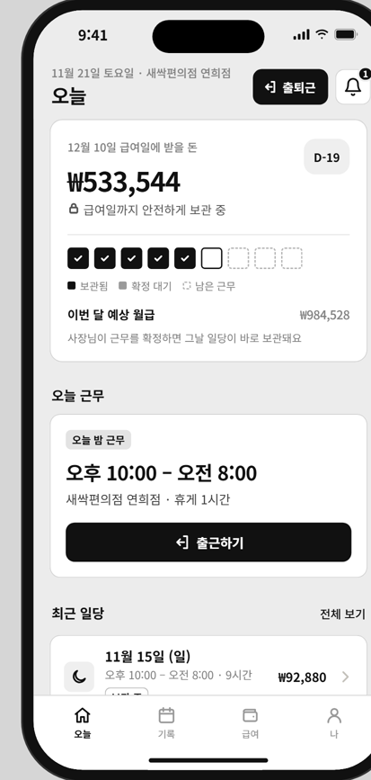
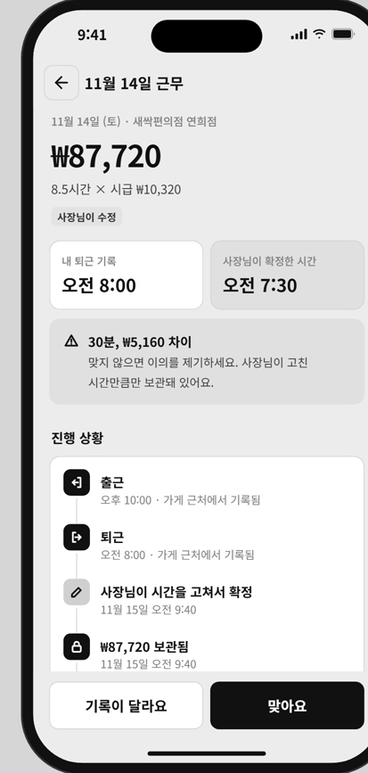
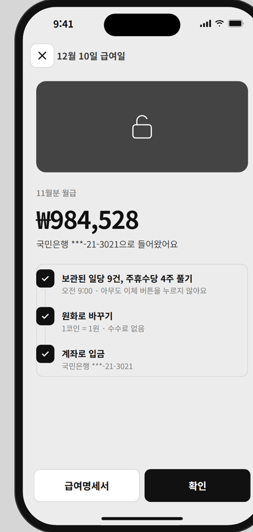
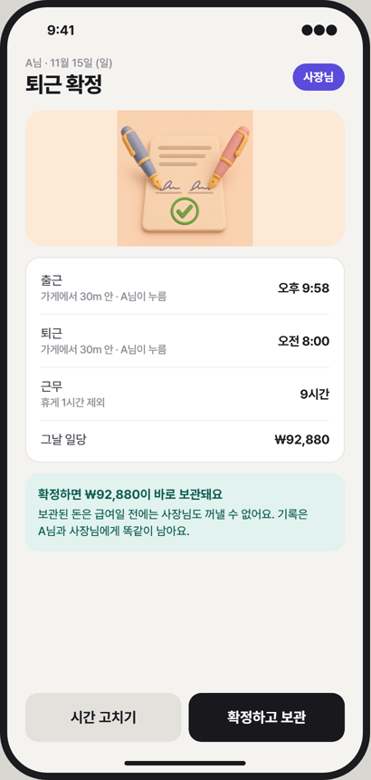
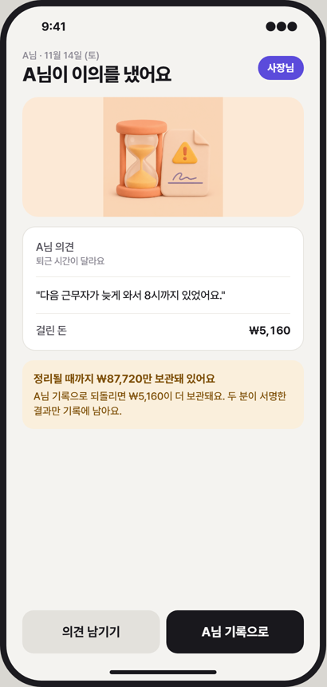

<p align="center"></p>

# 체무 · chemu-wage-escrow

**일한 날마다 그날 일당이 먼저 보관되고, 급여일에는 아무도 이체하지 않아도 알바생 계좌로 자동으로 들어옵니다.**

원화 스테이블코인으로 일당을 날마다 보관하고 급여일에 자동으로 풀어 주는 아르바이트 임금 체불 방지 서비스입니다. BAY 18기 자율주제 2조 체무팀 프로젝트이고, 테스트넷의 모의 원화 토큰(KRWt)으로 시연합니다.

## 왜 만드나

- **체불은 역대 최대이고 작은 가게에 몰려 있습니다.** 2025년 임금체불액은 2조 679억 원, 피해 근로자는 26만 2,304명이었습니다(경향신문, 2026.2.20). 2026년 1분기 체불액 4,764억 원 가운데 72.3%가 30인 미만 사업장에서 나왔습니다(뉴시스, 2026.5.7).
- **겪어도 대응하지 못합니다.** 아르바이트 경험자 2,457명 가운데 48.0%가 임금 문제를 겪었고, 대응한 사람은 51.2%였습니다. 포기한 이유 1위는 "대응해도 받지 못할 것 같아서"(41.8%)였습니다(알바천국 조사, 한경 잡앤조이 2025.1.21).
- **증명할 기록은 사장 손에 있습니다.** 근무표는 사장님 휴대폰에만 있고, 알바생이 가진 건 통장에 찍힌 숫자뿐입니다. 주휴수당처럼 "원래 없다"는 말에 넘어가기 쉬운 돈도 있습니다.
- **급여일의 목돈은 사장에게도 부담입니다.** 한 달치 인건비를 하루에 마련하는 대신, 근무를 확정한 날마다 그날 몫을 보관하면 체불도 급여일의 잔고 부족도 줄어듭니다.

## 어떻게 작동하나

| 단계 | 누가 | 무엇이 남나 |
|---|---|---|
| 1. 계약 | 사장님이 올리고 알바생이 동의 | 시급, 근무 시간, 주휴수당, 급여일이 담긴 계약. 주휴수당이 빠지면 알바생 화면에 바로 표시 |
| 2. 출퇴근 | 알바생이 가게 30m 안에서 누름 | 출근, 퇴근 기록. 사장님과 알바생에게 똑같이 남음 |
| 3. 확정과 보관 | 사장님이 확정 | 확정하는 순간 그날 일당이 보관함으로. 보관된 돈은 급여일 전에는 사장님도 꺼낼 수 없음 |
| 4. 고친 기록 | 사장님이 고치면 알바생에게 바로 알림 | 원래 기록은 지우지 않고 고친 기록과 이유를 덧붙임. 알바생은 이의를 낼 수 있음 |
| 5. 급여일 자동 입금 | 컨트랙트 | 보관된 일당과 주휴수당이 알바생이 고른 곳으로 자동 입금, 급여명세서와 장부 생성 |
| 6. 체불 위험 알림 | 서비스 | 일당이 보관되지 않으면 사장님께 먼저, 사흘째에는 알바생에게도 알림 |
| 7. 기록 대조 | 누구나 | 로그인 없이 원문과 해시, 서명, 고친 기록을 대조 |

작동 흐름과 화면 전체: [FigJam 보드](https://www.figma.com/board/LXlHx5ZjoJLioX72lDwHhV)

## 화면

알바생 앱은 근로자 파트 이성재 님의 와이어프레임 v3(23화면)이 기준이고, 사장님 앱 8화면은 같은 페르소나와 숫자, 같은 디자인 토큰으로 맞췄습니다. 화면별 질문과 시연 순서는 [화면기획서](docs/화면기획서.md)에 있습니다.

<p align="center">





</p>

시연 페르소나 A님은 주말 편의점 야간 알바입니다. 토, 일 오후 10시부터 오전 8시까지 휴게 1시간을 빼고 9시간, 시급 10,320원으로 일당 92,880원, 주휴수당 주 37,152원, 11월 예상 월급 984,528원입니다. 인물과 가게는 가상입니다.

## 예외 처리 (설계안)

| 상황 | 처리 |
|---|---|
| 주휴수당이 빠진 계약 | 알바생 계약 확인 화면에 빠진 항목과 금액을 표시, 동의 전에 수정 요청 |
| 사장님이 시간을 고침 | 고친 기록과 이유가 덧붙고 알바생에게 바로 알림. 이의가 있으면 다툼 금액만 따로 남기고 나머지는 보관 |
| 일당이 보관되지 않음 | 하루 지나면 사장님께, 사흘째에는 알바생에게도 알림. 알바생은 기록을 내보내 노동청 진정에 쓸 수 있음 |
| 중도 퇴사 | 보관된 돈은 다음 날 정산해 지급, 보관되지 않은 돈은 기록으로 남김 |
| 근무시간 부풀리기 | 가게 30m 안에서만 출퇴근, 사장님이 확정해야 보관 |
| 결근 | 그날 일당은 보관하지 않음 |

세부 규칙은 정규 세션에서 확정합니다.

## 기술 구성 (계획)

| 부분 | 쓸 것 | 참고 |
|---|---|---|
| 일당 보관과 급여일 자동 입금 | Solidity, OpenZeppelin `VestingWallet` 구조 | 시작일을 급여일, 기간을 0으로 두면 급여일에 한꺼번에 풀림 |
| 조건부 지급과 환불 | OpenZeppelin v4.9 `ConditionalEscrow`, `RefundEscrow` | v5에서 빠져 release-v4.9 브랜치에서 참고 |
| 확정 서명 | EIP-712 타입 서명, `SignatureChecker` | 알바생과 사장님이 같은 기록에 각자 서명 |
| 하루 기록 고정 | 하루치 기록의 해시, 필요하면 `MerkleProof` | 위치와 시각 원문은 체인에 올리지 않음 |
| 시연 앱 | scaffold-eth-2 (Next.js, Hardhat, wagmi, viem, RainbowKit) | 테스트넷 배포와 지갑 연결이 이미 묶여 있음 |
| 결제 토큰 | 모의 원화 토큰 KRWt (ERC-20) | 실제 원화 스테이블코인은 국내 제도화 전 |

저장소별 라이선스와 세부는 [오픈소스 참고](docs/오픈소스_참고.md)에 있습니다. Sablier(BUSL-1.1)처럼 코드를 옮길 수 없는 저장소는 설계 참고로만 씁니다.

## 폴더 구조

```
contracts/   보관, 자동 입금, 서명 검증 컨트랙트
backend/     출퇴근, 확정, 고친 기록, 명세서 API
frontend/    알바생 앱, 사장님 앱, 기록 대조 페이지
docs/        화면기획서, 오픈소스 참고, 3D 에셋, 화면 이미지
scripts/     배포와 정산 검증 스크립트
```

## 팀

| 파트 | 담당 영역 |
|---|---|
| PM · 고용주 기획 | 일정, 사장님 앱, 장부 연동 유인, 부풀리기 방지 |
| 근로자 기획 · 시연 | 알바생 앱(와이어프레임 v3), 체불 시나리오, 시연 플로우 |
| 코어 개발 | 프론트엔드, 백엔드, 아키텍처 |
| 스마트 컨트랙트 | 일당 보관, 자동 입금 로직 |
| 정산 · 장부 설계 | 근로계약 조건, 장부 데이터, 예외 정산 |
| 리서치 · QA · 발표 | 사례와 규제 조사, 테스트, 피칭 덱 |

## 함께 작업하는 규칙

1. 이슈를 먼저 만들고 브랜치를 따서 작업합니다.
2. 커밋 메시지는 `feat`, `fix`, `docs`, `test` 중 하나로 시작합니다.
3. 컨트랙트를 바꾸면 테스트를 함께 올립니다.
4. 병합 전에 다른 파트 한 명 이상의 리뷰를 받습니다.
5. `main`에 직접 푸시하지 않습니다.

## 아직 정하지 않은 것

- 이 기록이 노동청이나 법원에서 어느 정도의 증거로 인정되는지는 확인하지 못했습니다. 노무사 의견을 받아 덧붙입니다.
- 사용자의 근로시간 기록·관리 의무화는 2026년 2월 법안으로 발의됐고 아직 통과되지 않았습니다(한국경제, 2026.6.17).
- 세금과 4대보험 공제는 시연에서 다루지 않습니다.

## 출처

- [경향신문, 2025년 임금체불액 역대 최대(2026.2.20)](https://www.khan.co.kr/article/202602200600041)
- [뉴시스, 2026년 1분기 임금체불(2026.5.7)](https://mobile.newsis.com/view/NISX20260506_0003619129)
- [한경 잡앤조이, 알바천국 임금 문제 조사(2025.1.21)](https://magazine.hankyung.com/job-joy/article/202501210145d)
- [한국경제, 근로시간 기록 의무 법안 현황(2026.6.17)](https://www.hankyung.com/article/202606172507i)

3D 에셋은 팀이 생성한 클레이 이미지와 [3dicons](https://github.com/realvjy/3dicons)(CC0)를 씁니다.
