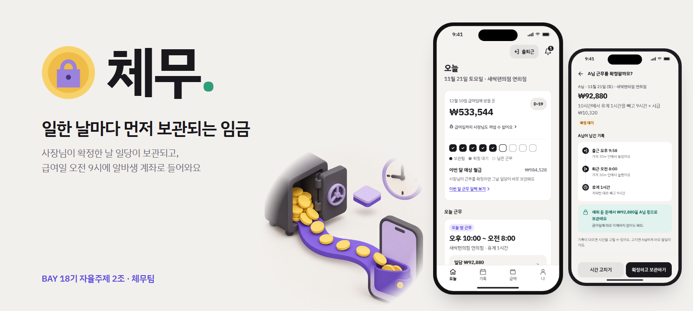
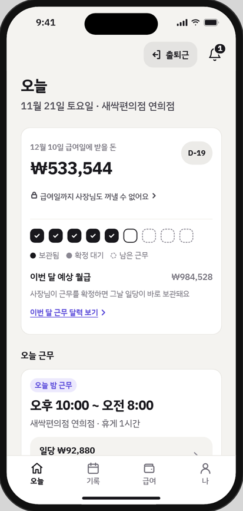
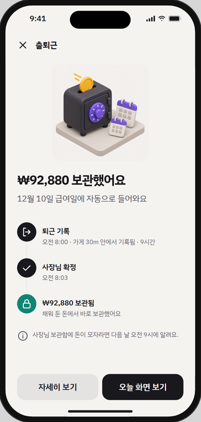
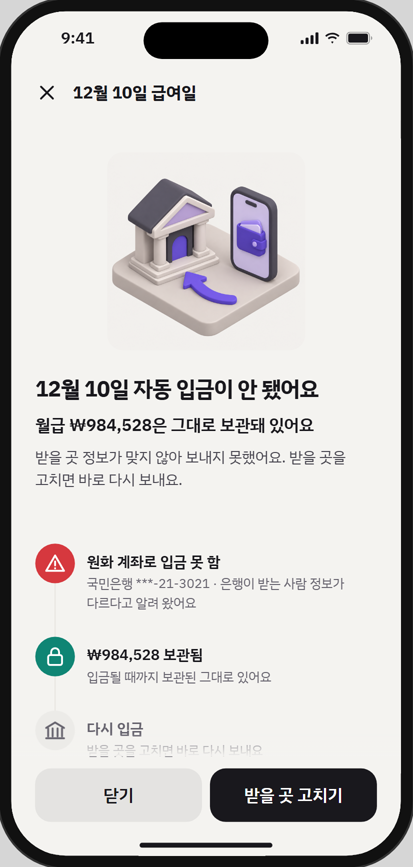
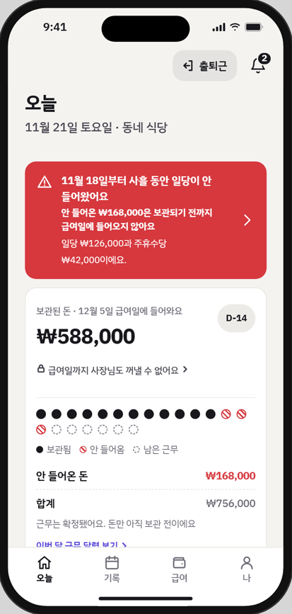
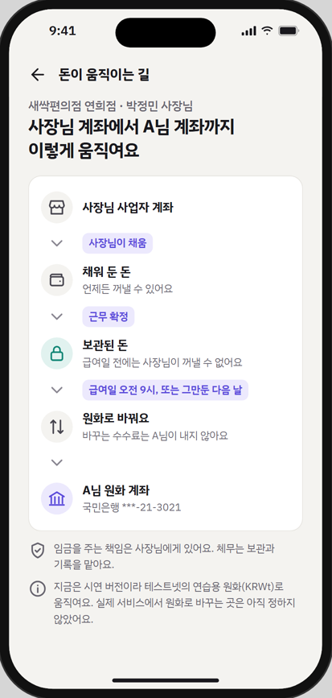
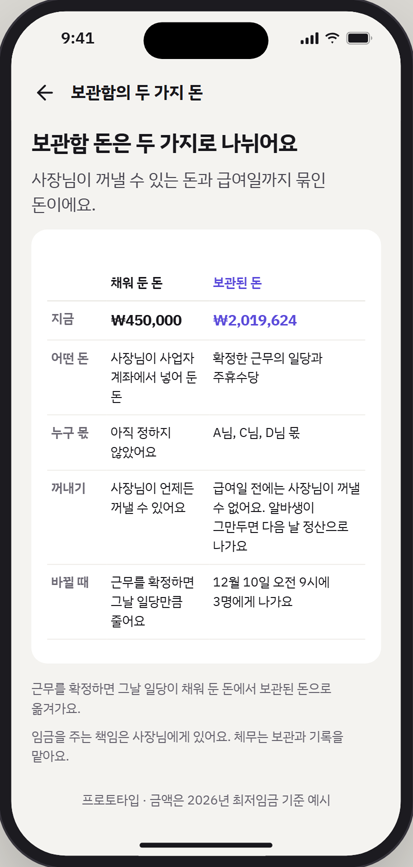
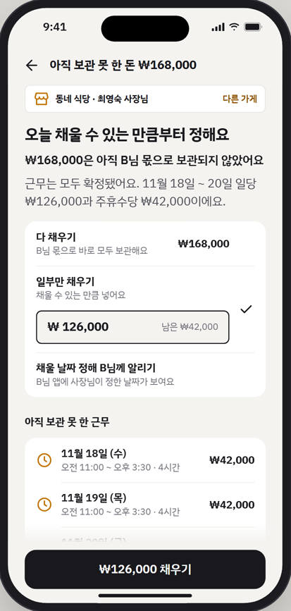
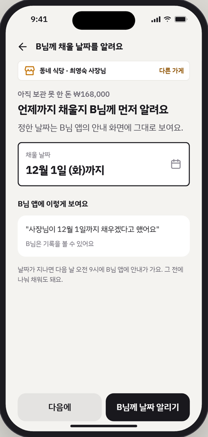
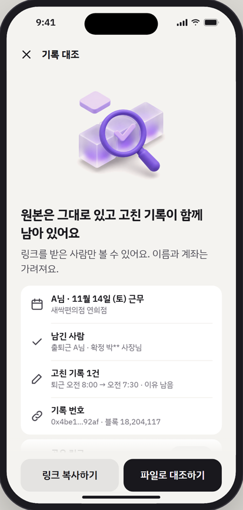

<p align="center"></p>

# 체무 · chemu-wage-escrow

**일한 날마다 그날 일당이 먼저 보관되고, 급여일에는 아무도 이체하지 않아도 알바생 계좌로 들어옵니다.**

아르바이트 임금 체불을 막는 서비스입니다. 사장님이 근무를 확정하면 그날 일당이 원화 스테이블코인으로 보관되고, 급여일 오전 9시에 원화로 바뀌어 알바생 계좌로 들어갑니다. 원화 스테이블코인 그대로 받는 길은 법이 정비되면 열고, 지금은 시연에서만 보여 줍니다. BAY 18기 자율주제 2조 체무팀 프로젝트이고, 테스트넷의 모의 원화 토큰(KRWt)으로 시연합니다.

| 지금 | 체무에서는 |
|---|---|
| 이번 달 얼마가 들어와야 맞는지 사장님께 물어봐야 압니다 | 오늘까지 보관된 돈과 급여일에 받을 돈이 홈 첫 줄에 있습니다 |
| 근무표는 사장님 휴대폰에만 있습니다 | 출퇴근 기록이 두 사람에게 똑같이 남고, 누가 고치면 상대에게 바로 알림이 갑니다 |
| 체불은 한 달 뒤 월급날에 압니다 | 일당이 보관되지 않으면 다음 날 아침에 압니다 |
| 급여일에 사장님이 이체해야 돈이 들어옵니다 | 보관된 돈이 급여일 오전 9시에 자동으로 들어옵니다 |

## 왜 만드나

- **체불은 역대 최대이고 작은 가게에 몰려 있습니다.** 2025년 임금체불액은 2조 679억 원, 피해 근로자는 26만 2,304명이었습니다(경향신문, 2026.2.20). 2026년 1분기 체불액 4,764억 원 가운데 72.3%가 30인 미만 사업장에서 나왔습니다(뉴시스, 2026.5.7).
- **겪어도 대응하지 못합니다.** 아르바이트 경험자 2,457명 가운데 48.0%가 임금 문제를 겪었고, 가장 많은 피해는 주휴수당 미지급(37.3%)이었습니다. 대응한 사람은 51.2%였고, 포기한 이유 1위는 "대응해도 받지 못할 것 같아서"(41.8%)였습니다(알바천국 조사, 한경 잡앤조이 2025.1.21).
- **증명할 기록은 사장님 손에 있습니다.** 근무표는 사장님 휴대폰에, 출퇴근 기록은 가게 포스기에 있습니다. 알바생이 가진 건 통장에 찍힌 숫자뿐입니다.
- **급여일의 목돈은 사장님에게도 부담입니다.** 한 달치 인건비를 하루에 마련하는 대신 근무를 확정한 날마다 그날 몫을 보관하면, 체불도 급여일의 잔고 부족도 줄어듭니다.

## 누구의 문제인가

근로자 파트 이성재 님이 세운 두 페르소나입니다. 인물과 가게는 가상입니다.

**A님, 주말 편의점 야간 알바.** 21세 대학생입니다. 토, 일 밤 10시부터 아침 8시까지 일하고 시급은 10,320원입니다. 근로계약서는 "나중에 쓰자"는 말만 들었고, 사장님은 편의점은 원래 주휴수당이 없다고 했습니다. 월급은 10일이 아니라 13일이나 15일쯤 들어옵니다. 석 달 뒤에야 받지 못한 주휴수당이 45만 원 가까이 된다는 걸 알았습니다.

**B님, 평일 점심 식당 알바.** 25세, 공무원 시험을 준비합니다. 평일 오전 11시부터 오후 3시 30분까지 일하고 시급은 10,500원입니다. 계약서는 썼지만 사본은 받지 못했습니다. 10월 5일에 9월분 월급의 절반만 들어왔고, 11월 5일에는 10월분이 아예 들어오지 않았습니다. 일주일 뒤 가게가 문을 닫았고 밀린 돈은 160만 원이 넘습니다.

| | 체무로 바뀌는 것 |
|---|---|
| A님 | 사장님께 묻지 않아도 이번 달 받을 돈과 오늘까지 보관된 돈을 앱에서 봅니다. 주휴수당이 빠진 계약은 동의하기 전에 걸러집니다 |
| B님 | 체불을 한 달 뒤가 아니라 하루 뒤에 압니다. 떼일 수 있는 돈도 그만큼 작아집니다 |

## 알바생 여정

| 단계 | 속마음 | 지금 막히는 점 | 체무 화면 |
|---|---|---|---|
| 계약 확인 | 주휴수당은 원래 없는 건가? | 계약서를 안 쓰거나 사본이 없다 | 계약 확인. 최저임금과 주휴수당을 앱이 점검하고 수정을 요청 |
| 출근 | 시간이 제대로 찍혔나? | 기록이 사장님 포스기에만 남는다 | 출퇴근 버튼. 가게 30m 안에서만 눌림 |
| 퇴근과 확정 | 사장님이 시간을 고치진 않을까? | 고쳐도 알 길이 없다 | 확정 알림, 내 기록과 사장님 기록 비교, 이의 제기 |
| 일당 보관 | 이번 달 얼마 받지? | 급여일까지 아무것도 안 보인다 | 보관된 돈과 근무 칸, 빠진 날은 다음 날 아침 알림 |
| 급여일 | 오늘 진짜 들어오나? | 늦게 들어와도 묻기 민망하다 | 급여일 자동 입금, 받을 곳 고르기, 급여명세서 |
| 그만둘 때 | 마지막 월급 받을 수 있을까? | 그만두면 연락이 끊긴다 | 중도 정산, 안 들어온 돈 기록 내보내기 |

체무가 알바생에게 주는 가장 큰 가치는 급여일 자동 입금보다 그 전에 있습니다. 내 돈이 지금 어디에 얼마나 보관돼 있는지 날마다 볼 수 있다는 점입니다.

## 어떻게 작동하나

| 단계 | 누가 | 무엇이 남나 |
|---|---|---|
| 1. 계약 | 사장님이 올리고 알바생이 동의 | 시급, 근무 시간, 주휴수당, 급여일이 담긴 계약. 최저임금보다 낮거나 주휴수당이 빠지면 알바생 화면에 바로 표시 |
| 2. 출퇴근 | 알바생이 가게 30m 안에서 누름 | 출근, 퇴근 기록. 사장님과 알바생에게 똑같이 남음 |
| 3. 확정과 보관 | 사장님이 확정 | 확정하는 순간 그날 일당이 보관함으로. 보관된 돈은 급여일 전에는 사장님도 꺼낼 수 없음 |
| 4. 고친 기록 | 사장님이 고치면 알바생에게 바로 알림 | 원래 기록은 지우지 않고 고친 기록과 이유를 덧붙임. 알바생은 이의를 낼 수 있음 |
| 5. 급여일 자동 입금 | 컨트랙트 | 보관된 일당과 주휴수당이 알바생이 고른 곳으로 들어감. 급여명세서와 장부 생성 |
| 6. 안 들어온 날 알림 | 서비스 | 확정한 날의 일당이 보관되지 않으면 사장님께 바로, 알바생에게는 다음 날 오전 9시에 알림. 알바생 쪽 알림은 끌 수 없음 |
| 7. 기록 대조 | 누구나 | 로그인 없이 원문과 해시, 서명, 고친 기록을 대조 |

작동 흐름도: [FigJam 보드](https://www.figma.com/board/LXlHx5ZjoJLioX72lDwHhV)

## 화면

알바생 앱 83화면, 사장님 앱 54화면, 링크로 여는 기록 대조 웹, 두 앱을 나란히 보여 주는 1분 시연 모드입니다(v15). 근로자 파트 이성재 님의 와이어프레임 v3를 뼈대로 삼고, 실제로 쓰다 막히는 상태(가게 30m 밖, 확정 지연, 입금 실패, 돈이 모자란 가게)와 3D 아이소메트릭 그림 16장, 토스 라이팅 원칙에 맞춘 문구를 더했습니다. 화면마다 "이 화면이 답하는 질문, 들어오고 나가는 길, 이어지는 상대 앱 화면"을 기획 주석으로 달았습니다.

<p align="center">





</p>
<p align="center">





</p>

| 보고 싶은 것 | 위치 |
|---|---|
| 직접 눌러 보는 와이어프레임 | [알바생 앱](docs/wireframe/worker.html), [사장님 앱](docs/wireframe/owner.html). 저장소를 내려받아 브라우저로 열면 오른쪽 화면 목록에서 모든 화면과 상태로 가고, 주석의 링크로 상대 앱 화면이 열립니다. 패널에서 글자 크기 100%, 130%, 200%를 바꿀 수 있습니다 |
| 기록 대조 웹 | [verify.html](docs/wireframe/verify.html). 브라우저에서 기록의 SHA-256을 직접 계산해 남겨 둔 지문과 대조합니다. 파일로 대조하기도 됩니다 |
| 1분 시연 모드 | [demo.html](docs/wireframe/demo.html). 두 앱을 나란히 두고 시연 12단계를 5초씩 자동으로 넘깁니다 |
| 화면 이미지 전체 | [알바생](docs/screens/worker), [사장님](docs/screens/owner), [기록 대조](docs/screens/verify), [시연](docs/screens/demo) |
| 화면별 질문과 경로, 시연 순서, 심사 질문 | [화면기획서](docs/화면기획서.md) |
| 문구와 3D 그림 원칙 | [문구와 그림 원칙](docs/문구와_그림_원칙.md) |
| 디자인 근거, 토큰, 접근성, 에러 체계, 컴포넌트 | [디자인 근거와 점검](docs/design/README.md) |
| 버전마다 바뀐 것 | [버전 기록](docs/버전기록.md) |
| 12월 1일 발표까지 개발 일정 | [개발 타임라인](docs/개발_타임라인.md) |

### 화면 점검 결과 (v15)

토스 TDS Mobile 공개 문서, 당근 SEED Design, WCAG 2.2를 기준으로 [점검 도구](scripts/design-audit)가 모든 화면을 재서 나온 숫자입니다.

| 항목 | v7 알바생 | v15 알바생 (83화면) | v15 사장님 (54화면) |
|---|---|---|---|
| 13px 미만 글자 | 996 | 0 | 0 |
| 명암비 미달 (본문 4.5:1, 큰 글자와 UI 3:1) | 981 | 0 | 0 |
| 44px 미만 터치 대상 | 406 | 0 | 0 |
| 채운 주 버튼이 둘 이상인 화면 | 10 | 0 | 0 |
| 모서리 값 종류 | 12 | 4 (8, 16, 24, 9999px) | 4 |
| 아이소메트릭 그림 규칙 위반 | | 0 (같은 화면의 상태 변형 제외) | 0 |

v7 숫자는 휴대폰을 약 0.89배로 줄인 창(440x900)에서 잰 값이라 터치 대상 수가 실제보다 많게 나옵니다. v10부터는 1:1 창(480x1200)에서 쟀습니다.

시연 페르소나 A님은 주말 편의점 야간 알바입니다. 토, 일 오후 10시부터 오전 8시까지 휴게 1시간을 빼고 9시간, 시급 10,320원으로 일당 92,880원, 주휴수당 주 37,152원, 11월 예상 월급 984,528원입니다. 새싹편의점은 사장님과 알바 3명, 5인 미만 가게라 야간 가산수당 대상이 아닙니다.

## 체무가 막지 못하는 것

| 상황 | 체무가 하는 일 |
|---|---|
| 사장님이 보관을 하지 않음 | 보관된 돈만 지킬 수 있습니다. 빠진 날은 바로 알리고, 노동청 진정에 낼 수 있는 기록으로 꺼내 줍니다 |
| 계약 조건이 처음부터 틀림 | 보관과 입금은 계약대로만 움직입니다. 그래서 계약 확인 단계에서 최저임금과 주휴수당을 점검하고, 알바생이 동의해야 계약이 확정됩니다 |
| 사장님이 확정을 미루거나 근무를 인정하지 않음 | 그날 일당은 보관되지 않습니다. 출퇴근 기록과 확정 대기 상태는 그대로 남고, 알바생은 이의를 낼 수 있습니다. 확정 기한은 정규 세션에서 정합니다 |

## 원화 스테이블코인으로 줄 때 짚을 점

- **통화 지급 원칙.** 근로기준법 제43조는 임금을 통화로 직접, 전액 주도록 정합니다. 가상자산으로 임금을 주면 이 원칙에 어긋난다는 해석이 있고(주간경향), 이 문제를 직접 다룬 판례는 아직 찾기 어렵습니다(한국경제).
- **발행 근거.** 원화 스테이블코인을 발행하고 쓸 법적 근거는 아직 없습니다. 디지털자산기본법은 2025년 6월 발의돼 국회 정무위원회에서 심사 중입니다(토큰포스트). 2026년 11월 기준 여당은 2027년 1월 안 통과를, 야당은 규제 완화를 먼저 내세웁니다(블록미디어).
- **알바생이 떠안는 위험.** 복구 문구를 잃어버리면 월급은 어떻게 되는지, 원화로 바꿀 때 수수료는 누가 내는지, 발행사에 문제가 생겨 1코인이 1원이 아니게 되면 손해는 누가 지는지 답해야 합니다. 1원이라도 빠지면 전액 지급 원칙과도 부딪칩니다.

그래서 체무는 돈을 보관하고 기록을 남기는 데 집중합니다. 급여일 입금은 원화 계좌가 기본입니다. 바꾸는 수수료는 알바생이 내지 않고, 원화 스테이블코인 그대로 받는 길은 법이 정비될 때까지 시연용으로만 둡니다.

## 예외 처리 (설계안)

| 상황 | 처리 |
|---|---|
| 주휴수당이 빠진 계약 | 알바생 계약 확인 화면에 빠진 항목과 금액을 표시하고, 동의 전에 수정을 요청 |
| 가게 30m 밖에서 출근 | 출근 버튼을 누르기 전부터 거리를 보여 주고, 가까이 오면 버튼이 켜짐 |
| 사장님이 아직 확정하지 않은 퇴근 | 확정 대기로 표시. 보관은 확정 뒤에 시작 |
| 사장님이 시간을 고침 | 고친 기록과 이유가 덧붙고 알바생에게 바로 알림. 이의가 있으면 다툼 금액만 따로 남기고 나머지는 보관 |
| 보관함 잔액이 모자람 | 사장님께 바로 알리고 채우기를 안내. 알바생에게는 다음 날 오전 9시에 알림 |
| 급여일 자동 입금 실패 | 실패 이유와 다시 입금 요청 버튼을 보여 줌. 보관된 돈은 그대로 남음 |
| 중도 퇴사, 폐업 | 보관된 돈은 다음 날 오전 9시에 정산해 입금. 보관되지 않은 돈은 기록으로 남김 |
| 결근 | 그날 일당은 보관하지 않음 |

세부 규칙은 정규 세션에서 확정합니다.

## 기술 구성 (계획)

| 부분 | 쓸 것 | 참고 |
|---|---|---|
| 일당 보관과 급여일 자동 입금 | Solidity, OpenZeppelin `VestingWallet` 구조 | 시작일을 급여일, 기간을 0으로 두면 급여일에 한꺼번에 풀림 |
| 조건부 지급과 환불 | OpenZeppelin v4.9 `ConditionalEscrow`, `RefundEscrow` | v5에서 빠져 release-v4.9 브랜치에서 참고 |
| 확정 서명 | EIP-712 타입 서명, `SignatureChecker` | 알바생과 사장님이 같은 기록에 각자 서명 |
| 하루 기록 고정 | 하루치 기록의 해시, 필요하면 `MerkleProof` | 위치와 시각 원문은 체인에 올리지 않음 |
| 시연 앱 | scaffold-eth-2 (Next.js, Hardhat, wagmi, viem, RainbowKit) | 테스트넷 배포와 지갑 연결이 이미 묶여 있음 |
| 결제 토큰 | 모의 원화 토큰 KRWt (ERC-20) | 실제 원화 스테이블코인은 국내 제도화 전 |

저장소별 라이선스와 세부는 [오픈소스 참고](docs/오픈소스_참고.md)에 있습니다. Sablier(BUSL-1.1)처럼 코드를 옮길 수 없는 저장소는 설계 참고로만 씁니다.

## 폴더 구조

```
contracts/   보관, 자동 입금, 서명 검증 컨트랙트
backend/     출퇴근, 확정, 고친 기록, 명세서 API
frontend/    알바생 앱, 사장님 앱, 기록 대조 페이지
docs/        화면기획서, 문구와 그림 원칙, 오픈소스 참고, 3D 에셋, 화면 이미지
scripts/     배포와 정산 검증 스크립트
```

## 팀

| 파트 | 담당 영역 |
|---|---|
| PM · 고용주 기획 | 일정, 사장님 앱, 장부 연동 유인, 부풀리기 방지 |
| 근로자 기획 · 시연 | 알바생 앱(와이어프레임), 페르소나와 체불 시나리오, 시연 플로우 |
| 코어 개발 | 프론트엔드, 백엔드, 아키텍처 |
| 스마트 컨트랙트 | 일당 보관, 자동 입금 로직 |
| 정산 · 장부 설계 | 근로계약 조건, 장부 데이터, 예외 정산 |
| 리서치 · QA · 발표 | 사례와 규제 조사, 테스트, 피칭 덱 |

## 함께 작업하는 규칙

1. 이슈를 먼저 만들고 브랜치를 따서 작업합니다.
2. 커밋 메시지는 `feat`, `fix`, `docs`, `test` 중 하나로 시작합니다.
3. 컨트랙트를 바꾸면 테스트를 함께 올립니다.
4. 병합 전에 다른 파트 한 명 이상의 리뷰를 받습니다.
5. `main`에 직접 푸시하지 않습니다.

## 아직 정하지 않은 것

- 이 기록이 노동청이나 법원에서 어느 정도의 증거로 인정되는지는 확인하지 못했습니다. 노무사 의견을 받아 덧붙입니다.
- 사용자의 근로시간 기록·관리 의무화는 2026년 2월 법안으로 발의됐고 아직 통과되지 않았습니다(한국경제, 2026.6.17).
- 사장님이 확정을 미룰 때 언제까지 기다리고 그 뒤에 어떻게 처리할지.
- 실제 서비스에서 원화 스테이블코인을 원화로 바꿔 계좌에 넣는 일을 누가 어떤 인가로 맡을지. 시연은 모의 전환입니다.
- 세금과 4대보험 공제는 시연에서 다루지 않습니다.

## 출처

- [경향신문, 2025년 임금체불액 역대 최대(2026.2.20)](https://www.khan.co.kr/article/202602200600041)
- [뉴시스, 2026년 1분기 임금체불(2026.5.7)](https://mobile.newsis.com/view/NISX20260506_0003619129)
- [한경 잡앤조이, 알바천국 임금 문제 조사(2025.1.21)](https://magazine.hankyung.com/job-joy/article/202501210145d)
- [한국경제, 근로시간 기록 의무 법안 현황(2026.6.17)](https://www.hankyung.com/article/202606172507i)
- [주간경향, 가상자산 임금과 통화 지급 원칙](https://weekly.khan.co.kr/article/202510241507011)
- [토큰포스트, 디지털자산기본법 심사 현황](https://www.tokenpost.kr/news/cryptocurrency/394948)
- [블록미디어, 디지털자산기본법 통과 시점](https://www.blockmedia.co.kr/archives/1163808)
- [파이낸셜뉴스, 임금체불 근절 대책](https://www.fnnews.com/news/202509021548593493)

페르소나, 사용자 여정, 원화 스테이블코인 쟁점은 이성재 님의 「페르소나와 시나리오」, 「리서치: 알바생 입장」을 정리했습니다. 3D 에셋은 팀이 생성한 이미지와 [3dicons](https://github.com/realvjy/3dicons)(CC0)를 씁니다.
