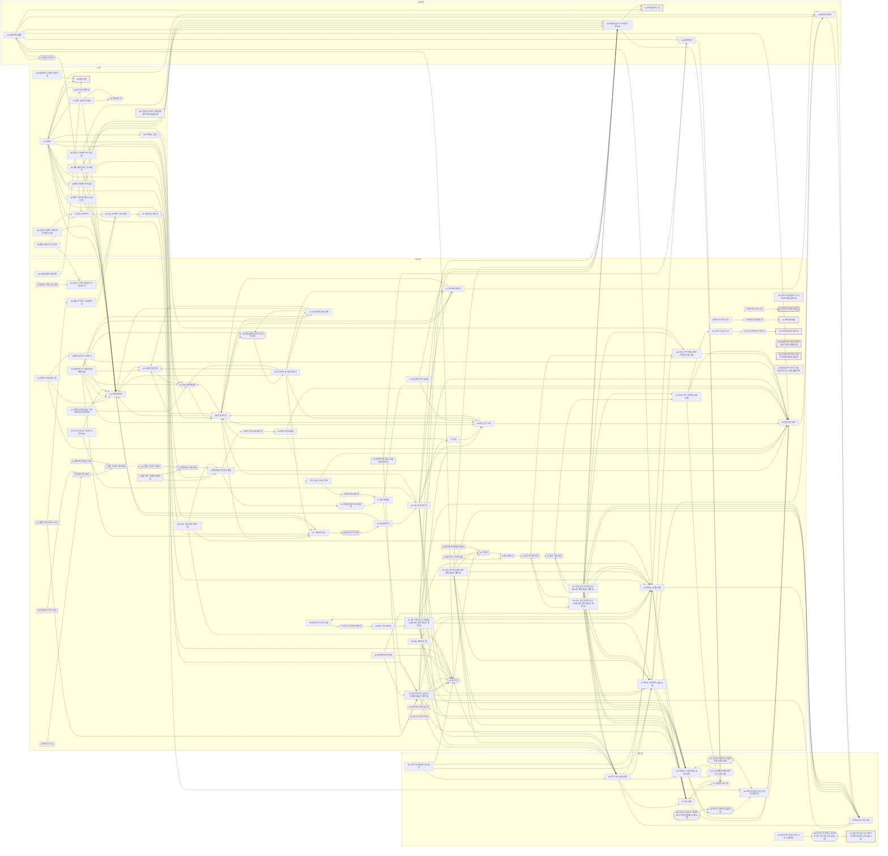
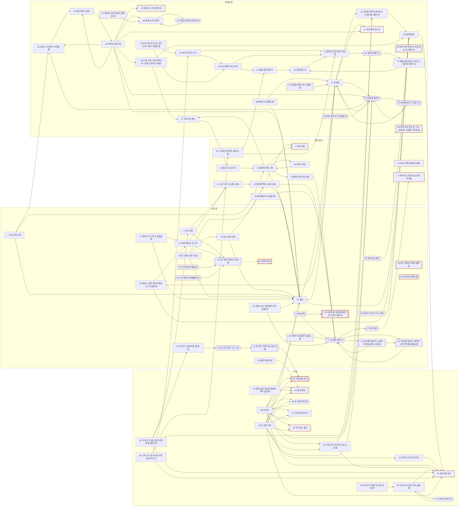

# 체무 화면 흐름도

쓴 앱 파일: 알바생 `worker_v75.html` (v75, 화면 115개, 파일 시각 2026-11-28 14:59, 내용 해시 70a1546d), 사장님 `owner_v75.html` (v75, 화면 83개, 파일 시각 2026-11-28 14:56, 내용 해시 3cea6934)  
시연 단계: `v75/demo_v75.html`  
만든 때: 2026-11-28 15:29, 만든 도구: `v44/_gen/flow.mjs`

- 버전 확인: 알바생 앱은 v77이 더 최근입니다. 이 흐름도는 위 파일 기준입니다.
- 버전 확인: 사장님 앱은 v76이 더 최근입니다. 이 흐름도는 위 파일 기준입니다.

## 읽는 법

- 화면 번호는 PANEL 번호(`?i=N`)입니다. 화면마다 그 화면을 열고 누를 수 있는 것을 하나씩 눌러, 누른 뒤 도착한 상태의 `currentKey()`를 PANEL 키에 맞췄습니다. 누를 때마다 새로 열어서 앞에서 누른 결과가 섞이지 않습니다.
- 종류: 버튼, 행(목록 줄과 누르는 카드), 탭(아래 탭 막대), 푸시(사장님 앱 위쪽 알림), 자동(누른 뒤 기다리면 바뀜), 뒤로·닫기.
- 도착한 상태가 PANEL 키와 꼭 같지 않을 때는 이렇게 맞췄습니다: 다른 탭에서 연 같은 화면(키의 탭 마디만 다름), 다른 사람의 같은 화면(사람 마디도 다름), 다른 항목(키 끝의 기록 번호만 다름), 같은 꼴(화면 이름과 제목 틀이 같은 PANEL 화면이 하나뿐). 비고 칸에 적었습니다. 어디에도 맞지 않으면 "PANEL에 없는 상태로 가는 이동"에 따로 둡니다.
- 들어오는 길과 나가는 길은 뒤로·닫기를 뺀 이동으로 셉니다. 탭 막대 이동과 자동은 셉니다.
- 두 앱 연결은 기획 주석의 상대 앱 줄(알바생 앱의 "사장님 앱:", 사장님 앱의 "알바생 앱:")을 `v16/_tools/xlink.mjs`와 같은 방식으로 상대 앱 화면 이름에 맞춘 것입니다.
- 그림: `흐름도_알바생.svg`, `흐름도_사장님.svg`는 탭 묶음마다 칸을 나누고, 칸 안에서는 탭 첫 화면에서 몇 번 눌러 오는지로 세로줄을 둡니다. `흐름도_두앱.svg`는 두 앱 연결만 그립니다.

## 수

| | 알바생 앱 | 사장님 앱 |
|---|---|---|
| 화면 | 115 | 83 |
| 흐름 간선(뒤로·닫기 뺌) | 290 | 174 |
| 그 가운데 탭 막대 | 39 | 40 |
| 그 가운데 자동 | 3 | 1 |
| 뒤로·닫기 간선 | 100 | 65 |
| 들어오는 길이 없는 화면 | 38 | 24 |
| 나가는 길이 없는 화면 | 11 | 15 |
| PANEL에 없는 상태로 가는 이동 | 12 | 5 |
| 누르면 그 화면 그대로(토스트, 고르기 같은 것) | 64 | 62 |

두 앱 연결 201개(두 주석이 서로 가리킴 29개). 알바생 화면 106개가 사장님 앱을, 사장님 화면 69개가 알바생 앱을 가리킵니다.

## 시연 12단계 경로

단계마다 앞에 선 앱의 화면이 바로 앞 단계 화면에서 눌러 갈 수 있는지 봅니다. 오는 길은 흐름 그래프에서 가장 짧은 누르는 길이고, 뒤로·닫기와 다른 사람의 화면으로 넘어가는 이동은 쓰지 않습니다. 길이 없으면 시연 모드는 화면 목록 번호로 바로 넘어갑니다.

| 단계 | 앞에 선 앱 | 알바생 화면 | 사장님 화면 | 자막 | 앞 단계에서 오는 길(앞에 선 앱) |
|---|---|---|---|---|---|
| 1 | 사장님 | 6 계약 확인: 주휴수당 빠짐 | 1 근로계약 올리기 | 사장님이 근로계약서를 등록해요 주휴수당은 체무가 법에 따라 계산해요 | 첫 화면 |
| 2 | 알바생 | 6 계약 확인: 주휴수당 빠짐 | 1 근로계약 올리기 | 주휴수당 한 주 37,152원이 빠지면 확정하기 전에 바로 보여요 | 첫 화면 |
| 3 | 알바생 | 11 출근하기 | 1 근로계약 올리기 | 가게 30m 안에서 출근하면 기록이 A님과 사장님에게 똑같이 남아요 | 6 [주휴수당 없이 확정하기] 74, 74 [주휴수당 없이 확정하기] 57, 57 [오늘 화면 보기] 8, 8 [출퇴근] 11 |
| 4 | 사장님 | 15 퇴근, 일당 보관 | 9 근무 확정 | 사장님이 확정해 두 사람 서명이 모이면 체무가 일당 92,880원을 보관해요 | 누르는 길 없음(1번에서 화면 목록으로 넘어감) |
| 5 | 알바생 | 15 퇴근, 일당 보관 | 9 근무 확정 | 보관된 92,880원은 급여일 전에 아무도 꺼낼 수 없어요 | 11 [출근하기] 14, 14 [퇴근하기] 70, 70 [퇴근하기] 21, 21 [기다리면] 15 |
| 6 | 사장님 | 18 사장님이 시간을 고침 (11월 21일) | 13 시간 고치기 (11월 15일) | 퇴근을 오전 7:30으로 고치면 A님 앱에 고친 이유까지 바로 보여요 | 9 [시간 고치기] 13 |
| 7 | 알바생 | 18 사장님이 시간을 고침 (11월 21일) | 13 시간 고치기 (11월 15일) | A님이 다르다고 알리면 차이 나는 5,160원은 따로 남겨 둬요 | 15 [오늘 화면 보기] 60, 60 [11월 14일 토요일] 18 |
| 8 | 알바생 | 33 급여일 자동 입금 (12월 10일, 결정 뒤) | 28 자동 입금 완료 | 급여일 오전 9:00에 누르지 않아도 월급 984,528원이 들어와요 | 누르는 길 없음(18번에서 화면 목록으로 넘어감) |
| 9 | 알바생 | 36 오늘: 안 들어온 돈 | 40 아직 보관 못 한 돈 | 일당이 안 들어오면 다음 날 오전 9:00에 알려 드려요 | 누르는 길 없음(33번과 사람이 다른 화면이라 화면 목록으로 넘어감) |
| 10 | 사장님 | 36 오늘: 안 들어온 돈 | 40 아직 보관 못 한 돈 | 채울 돈이 모자라면 일부만 채우거나 채울 날짜를 B님에게 알려요 | 누르는 길 없음(13번과 사람이 다른 화면이라 화면 목록으로 넘어감) |
| 11 | 알바생 | 52 돈이 움직이는 길 | 40 아직 보관 못 한 돈 | 월급을 주는 사람은 사장님이에요 체무는 돈을 보관하고 기록을 남겨요 | 누르는 길 없음(36번과 사람이 다른 화면이라 화면 목록으로 넘어감) |
| 12 | 사장님 | 52 돈이 움직이는 길 | 39 기록 맞춰 보기 | 링크를 받은 사람은 원래 기록과 고친 기록을 맞춰 봐요 | 누르는 길 없음(40번과 사람이 다른 화면이라 화면 목록으로 넘어감) |

## 알바생 앱 흐름 그래프

탭 막대 이동과 뒤로, 닫기는 그리지 않았습니다. 점선 테두리는 들어오는 길이 없는 화면, 붉은 테두리는 나가는 길이 없는 화면입니다.

## 사장님 앱 흐름 그래프

탭 막대 이동과 뒤로, 닫기는 그리지 않았습니다. 점선 테두리는 들어오는 길이 없는 화면, 붉은 테두리는 나가는 길이 없는 화면입니다.

## 두 앱이 이어지는 곳

| 알바생 앱 화면 | 사장님 앱 화면 | 근거 | 앱 화면 목록 링크 |
|---|---|---|---|
| 0 초대받고 가입 | 1 근로계약 올리기 | 알바생 주석 | 알바생 앱 |
| 0 초대받고 가입 | 2 초대 보냄 | 사장님 주석 | 사장님 앱 |
| 0 초대받고 가입 | 5 알바생 3명 초대 상태 | 알바생 주석 | 알바생 앱 |
| 0 초대받고 가입 | 52 알바생이 아직 없을 때 | 사장님 주석 | 사장님 앱 |
| 0 초대받고 가입 | 63 처음 연 날: 알바생이 아직 없을 때 | 사장님 주석 | 사장님 앱 |
| 1 초대 링크 기간 지남 | 5 알바생 3명 초대 상태 | 알바생 주석, 사장님 주석 | 알바생 앱, 사장님 앱 |
| 2 휴대폰 본인 확인 | 5 알바생 3명 초대 상태 | 알바생 주석, 사장님 주석 | 알바생 앱, 사장님 앱 |
| 3 받을 곳 등록: 계좌 확인 | 5 알바생 3명 초대 상태 | 알바생 주석 | 알바생 앱 |
| 3 받을 곳 등록: 계좌 확인 | 25 급여일 하루 전 미리보기 (12월 9일, 결정 뒤) | 알바생 주석 | 알바생 앱 |
| 4 알림 허용: 휴대폰 알림 꺼짐 | 37 알림 | 알바생 주석 | 알바생 앱 |
| 4 알림 허용: 휴대폰 알림 꺼짐 | 55 알림 설정: 휴대폰 알림이 꺼져 있을 때 | 사장님 주석 | 사장님 앱 |
| 5 계약서가 아직 안 옴 | 1 근로계약 올리기 | 알바생 주석 | 알바생 앱 |
| 5 계약서가 아직 안 옴 | 5 알바생 3명 초대 상태 | 알바생 주석 | 알바생 앱 |
| 6 계약 확인: 주휴수당 빠짐 | 1 근로계약 올리기 | 알바생 주석, 사장님 주석 | 알바생 앱, 사장님 앱 |
| 6 계약 확인: 주휴수당 빠짐 | 3 A님이 계약 수정을 요청함 | 사장님 주석 | 사장님 앱 |
| 6 계약 확인: 주휴수당 빠짐 | 74 근로계약 올리기: 시급이 최저임금보다 낮을 때 | 사장님 주석 | 없음 |
| 7 계약 확인: 고쳐진 계약 | 1 근로계약 올리기 | 알바생 주석 | 알바생 앱 |
| 7 계약 확인: 고쳐진 계약 | 4 계약 확정 | 사장님 주석 | 사장님 앱 |
| 7 계약 확인: 고쳐진 계약 | 5 알바생 3명 초대 상태 | 사장님 주석 | 사장님 앱 |
| 7 계약 확인: 고쳐진 계약 | 77 계약 다시 보냄 (A님 동의 기다림) | 사장님 주석 | 사장님 앱 |
| 8 오늘: 보관된 돈 (11월 21일, 예상 월급은 결정 뒤) | 6 오늘 (11월 21일) | 알바생 주석, 사장님 주석 | 알바생 앱, 사장님 앱 |
| 8 오늘: 보관된 돈 (11월 21일, 예상 월급은 결정 뒤) | 7 오늘: 알바 3명 | 사장님 주석 | 사장님 앱 |
| 8 오늘: 보관된 돈 (11월 21일, 예상 월급은 결정 뒤) | 9 근무 확정 | 사장님 주석 | 없음 |
| 8 오늘: 보관된 돈 (11월 21일, 예상 월급은 결정 뒤) | 10 확정 완료 | 사장님 주석 | 없음 |
| 8 오늘: 보관된 돈 (11월 21일, 예상 월급은 결정 뒤) | 17 보관함 | 알바생 주석 | 알바생 앱 |
| 8 오늘: 보관된 돈 (11월 21일, 예상 월급은 결정 뒤) | 28 자동 입금 완료 | 사장님 주석 | 없음 |
| 9 이번 달 근무 달력 (11월 21일) | 6 오늘 (11월 21일) | 알바생 주석 | 알바생 앱 |
| 9 이번 달 근무 달력 (11월 21일) | 35 반복 근무표 | 알바생 주석, 사장님 주석 | 알바생 앱, 사장님 앱 |
| 9 이번 달 근무 달력 (11월 21일) | 36 결근으로 남기기 | 사장님 주석 | 사장님 앱 |
| 9 이번 달 근무 달력 (11월 21일) | 37 알림 | 사장님 주석 | 없음 |
| 10 일당 계산 풀이 | 27 주휴수당 계산 | 알바생 주석 | 알바생 앱 |
| 10 일당 계산 풀이 | 31 이번 달 인건비 리포트 | 알바생 주석 | 알바생 앱 |
| 11 출근하기 | 6 오늘 (11월 21일) | 알바생 주석 | 알바생 앱 |
| 11 출근하기 | 8 출근 알림 (11월 21일) | 사장님 주석 | 사장님 앱 |
| 12 출근하기: 위치 꺼짐 | 6 오늘 (11월 21일) | 알바생 주석 | 알바생 앱 |
| 13 출근하기: 인터넷 끊김 | 6 오늘 (11월 21일) | 알바생 주석 | 알바생 앱 |
| 14 근무 중 | 6 오늘 (11월 21일) | 알바생 주석 | 알바생 앱 |
| 15 퇴근, 일당 보관 | 9 근무 확정 | 알바생 주석 | 알바생 앱 |
| 15 퇴근, 일당 보관 | 10 확정 완료 | 사장님 주석 | 사장님 앱 |
| 15 퇴근, 일당 보관 | 17 보관함 | 알바생 주석 | 알바생 앱 |
| 16 근무 기록 (11월 21일) | 6 오늘 (11월 21일) | 알바생 주석 | 알바생 앱 |
| 16 근무 기록 (11월 21일) | 9 근무 확정 | 알바생 주석 | 알바생 앱 |
| 16 근무 기록 (11월 21일) | 11 확정 안 한 근무가 쌓였을 때 | 사장님 주석 | 사장님 앱 |
| 16 근무 기록 (11월 21일) | 31 이번 달 인건비 리포트 | 사장님 주석 | 사장님 앱 |
| 16 근무 기록 (11월 21일) | 33 알바생 목록 (11월 21일) | 사장님 주석 | 사장님 앱 |
| 16 근무 기록 (11월 21일) | 34 알바생 목록: 3명 | 사장님 주석 | 사장님 앱 |
| 17 하루 상세 | 9 근무 확정 | 알바생 주석 | 알바생 앱 |
| 17 하루 상세 | 15 A님 기록으로 바꿈 (결정 뒤) | 사장님 주석 | 사장님 앱 |
| 17 하루 상세 | 17 보관함 | 알바생 주석 | 알바생 앱 |
| 17 하루 상세 | 39 기록 맞춰 보기 | 사장님 주석 | 사장님 앱 |
| 18 사장님이 시간을 고침 (11월 21일) | 13 시간 고치기 (11월 15일) | 알바생 주석, 사장님 주석 | 알바생 앱, 사장님 앱 |
| 19 다르다고 알리기 (11월 21일) | 14 다르다고 알림 받음 (결정 전) | 알바생 주석, 사장님 주석 | 알바생 앱, 사장님 앱 |
| 20 출근하기: 가게 30m 밖 | 6 오늘 (11월 21일) | 알바생 주석 | 알바생 앱 |
| 21 퇴근 뒤 확정 대기 | 9 근무 확정 | 알바생 주석, 사장님 주석 | 알바생 앱, 사장님 앱 |
| 21 퇴근 뒤 확정 대기 | 47 인터넷이 끊겼을 때 | 사장님 주석 | 사장님 앱 |
| 21 퇴근 뒤 확정 대기 | 49 근무 확정이 실패했을 때 | 사장님 주석 | 사장님 앱 |
| 22 확정이 하루 넘게 늦음 | 12 어제 확정 안 한 근무 | 알바생 주석, 사장님 주석 | 알바생 앱, 사장님 앱 |
| 23 퇴근을 못 누르고 나옴 | 12 어제 확정 안 한 근무 | 알바생 주석 | 알바생 앱 |
| 23 퇴근을 못 누르고 나옴 | 13 시간 고치기 (11월 15일) | 알바생 주석 | 알바생 앱 |
| 24 휴게 1시간을 못 쉼 | 9 근무 확정 | 알바생 주석 | 알바생 앱 |
| 24 휴게 1시간을 못 쉼 | 13 시간 고치기 (11월 15일) | 알바생 주석 | 알바생 앱 |
| 25 근무 기록: 확인할 근무 없음 | 9 근무 확정 | 알바생 주석 | 알바생 앱 |
| 26 다르다고 알린 결과: 내 기록으로 바뀜 (결정 뒤) | 14 다르다고 알림 받음 (결정 전) | 알바생 주석 | 알바생 앱 |
| 26 다르다고 알린 결과: 내 기록으로 바뀜 (결정 뒤) | 15 A님 기록으로 바꿈 (결정 뒤) | 사장님 주석 | 사장님 앱 |
| 27 다르다고 알린 결과: 기록 그대로 둠 (다른 갈래) | 14 다르다고 알림 받음 (결정 전) | 알바생 주석 | 알바생 앱 |
| 27 다르다고 알린 결과: 기록 그대로 둠 (다른 갈래) | 16 내 기록 그대로 둠 (다른 갈래) | 사장님 주석 | 사장님 앱 |
| 27 다르다고 알린 결과: 기록 그대로 둠 (다른 갈래) | 32 장부 내보내기 | 알바생 주석 | 알바생 앱 |
| 27 다르다고 알린 결과: 기록 그대로 둠 (다른 갈래) | 71 내 기록 그대로 두기 시트 | 사장님 주석 | 없음 |
| 28 급여: 보관 현황 | 17 보관함 | 알바생 주석, 사장님 주석 | 알바생 앱, 사장님 앱 |
| 28 급여: 보관 현황 | 18 보관함: 알바 3명 | 사장님 주석 | 사장님 앱 |
| 28 급여: 보관 현황 | 25 급여일 하루 전 미리보기 (12월 9일, 결정 뒤) | 알바생 주석, 사장님 주석 | 알바생 앱, 사장님 앱 |
| 28 급여: 보관 현황 | 26 12월 10일 가게 전체 급여 (11월 21일에 본 예상) | 사장님 주석 | 사장님 앱 |
| 29 주휴수당 풀이 | 27 주휴수당 계산 | 알바생 주석, 사장님 주석 | 알바생 앱, 사장님 앱 |
| 29 주휴수당 풀이 | 36 결근으로 남기기 | 사장님 주석 | 사장님 앱 |
| 30 보관된 돈은 누가 꺼낼 수 있나요 | 20 채워 둔 돈과 보관된 돈 | 알바생 주석, 사장님 주석 | 알바생 앱, 사장님 앱 |
| 30 보관된 돈은 누가 꺼낼 수 있나요 | 21 돈이 움직이는 길 | 사장님 주석 | 사장님 앱 |
| 30 보관된 돈은 누가 꺼낼 수 있나요 | 24 보관된 돈을 꺼내려 할 때 | 알바생 주석, 사장님 주석 | 알바생 앱, 사장님 앱 |
| 31 받을 곳 고르기 | 25 급여일 하루 전 미리보기 (12월 9일, 결정 뒤) | 알바생 주석 | 알바생 앱 |
| 32 급여일 아침 (오전 9시 전) | 26 12월 10일 가게 전체 급여 (11월 21일에 본 예상) | 알바생 주석, 사장님 주석 | 알바생 앱, 사장님 앱 |
| 33 급여일 자동 입금 (12월 10일, 결정 뒤) | 25 급여일 하루 전 미리보기 (12월 9일, 결정 뒤) | 알바생 주석 | 알바생 앱 |
| 33 급여일 자동 입금 (12월 10일, 결정 뒤) | 28 자동 입금 완료 | 사장님 주석 | 사장님 앱 |
| 33 급여일 자동 입금 (12월 10일, 결정 뒤) | 54 알림 설정 | 사장님 주석 | 없음 |
| 34 급여명세서 | 30 급여명세서 | 알바생 주석, 사장님 주석 | 알바생 앱, 사장님 앱 |
| 35 급여일: 자동 입금 실패 | 25 급여일 하루 전 미리보기 (12월 9일, 결정 뒤) | 알바생 주석 | 알바생 앱 |
| 35 급여일: 자동 입금 실패 | 29 입금이 안 됐을 때 | 사장님 주석 | 알바생 앱, 사장님 앱 |
| 35 급여일: 자동 입금 실패 | 66 입금이 안 된 뒤 다시 보냄 | 알바생 주석 | 알바생 앱 |
| 36 오늘: 안 들어온 돈 | 40 아직 보관 못 한 돈 | 알바생 주석, 사장님 주석 | 알바생 앱, 사장님 앱 |
| 37 알림 | 37 알림 | 사장님 주석 | 없음 |
| 37 알림 | 40 아직 보관 못 한 돈 | 알바생 주석 | 알바생 앱 |
| 37 알림 | 45 아직 보관 못 한 돈 보관 완료 (다 채운 뒤) | 사장님 주석 | 사장님 앱 |
| 37 알림 | 54 알림 설정 | 사장님 주석 | 없음 |
| 37 알림 | 82 알림: A님이 확정 요청을 다시 보냈을 때 | 사장님 주석 | 없음 |
| 38 안 들어온 돈 | 40 아직 보관 못 한 돈 | 알바생 주석, 사장님 주석 | 알바생 앱, 사장님 앱 |
| 38 안 들어온 돈 | 41 B님 앱에 보이는 안내 | 사장님 주석 | 사장님 앱 |
| 38 안 들어온 돈 | 44 일부만 채운 뒤 | 사장님 주석 | 사장님 앱 |
| 38 안 들어온 돈 | 54 알림 설정 | 사장님 주석 | 없음 |
| 38 안 들어온 돈 | 70 일부만 먼저 채우기 확인 창 | 사장님 주석 | 없음 |
| 38 안 들어온 돈 | 75 아직 보관 못 한 돈: 남은 돈보다 많이 넣었을 때 | 사장님 주석 | 사장님 앱 |
| 38 안 들어온 돈 | 80 아직 보관 못 한 돈: 다시 보관하는 거래를 기다릴 때 | 사장님 주석 | 없음 |
| 39 안 들어온 돈: 사장님이 날짜를 알림 | 40 아직 보관 못 한 돈 | 알바생 주석 | 알바생 앱 |
| 39 안 들어온 돈: 사장님이 날짜를 알림 | 42 채울 날짜 알리기 | 알바생 주석, 사장님 주석 | 알바생 앱, 사장님 앱 |
| 39 안 들어온 돈: 사장님이 날짜를 알림 | 43 날짜 알린 뒤 | 사장님 주석 | 사장님 앱 |
| 39 안 들어온 돈: 사장님이 날짜를 알림 | 72 채울 날짜 알리기: 남은 돈 (일부만 채운 뒤) | 사장님 주석 | 사장님 앱 |
| 40 사장님에게 알리기 전 문자 보기 | 37 알림 | 알바생 주석 | 알바생 앱 |
| 40 사장님에게 알리기 전 문자 보기 | 40 아직 보관 못 한 돈 | 알바생 주석 | 알바생 앱 |
| 41 안 들어온 돈 알림 단계 | 37 알림 | 알바생 주석 | 알바생 앱 |
| 41 안 들어온 돈 알림 단계 | 40 아직 보관 못 한 돈 | 알바생 주석 | 알바생 앱 |
| 41 안 들어온 돈 알림 단계 | 41 B님 앱에 보이는 안내 | 사장님 주석 | 사장님 앱 |
| 42 보관 안 된 하루 | 40 아직 보관 못 한 돈 | 알바생 주석 | 알바생 앱 |
| 43 기록 내보내기 | 31 이번 달 인건비 리포트 | 사장님 주석 | 사장님 앱 |
| 43 기록 내보내기 | 32 장부 내보내기 | 알바생 주석, 사장님 주석 | 알바생 앱, 사장님 앱 |
| 44 노동청 진정 안내 | 32 장부 내보내기 | 알바생 주석 | 알바생 앱 |
| 44 노동청 진정 안내 | 37 알림 | 알바생 주석 | 알바생 앱 |
| 45 그만두고 정산 | 46 그만둔 알바 정산 (채우기 전) | 알바생 주석, 사장님 주석 | 알바생 앱, 사장님 앱 |
| 46 정산 받기 전 확인 | 46 그만둔 알바 정산 (채우기 전) | 알바생 주석 | 알바생 앱 |
| 47 안 들어온 돈이 보관됨 | 17 보관함 | 알바생 주석 | 알바생 앱 |
| 47 안 들어온 돈이 보관됨 | 40 아직 보관 못 한 돈 | 알바생 주석 | 알바생 앱 |
| 47 안 들어온 돈이 보관됨 | 45 아직 보관 못 한 돈 보관 완료 (다 채운 뒤) | 사장님 주석 | 사장님 앱 |
| 48 오늘: 불러오는 중 | 6 오늘 (11월 21일) | 알바생 주석 | 알바생 앱 |
| 49 오늘: 불러오지 못함 | 6 오늘 (11월 21일) | 알바생 주석 | 알바생 앱 |
| 49 오늘: 불러오지 못함 | 48 불러오지 못했을 때 | 사장님 주석 | 사장님 앱 |
| 50 알림 (A, 11월 21일) | 9 근무 확정 | 알바생 주석 | 알바생 앱 |
| 50 알림 (A, 11월 21일) | 13 시간 고치기 (11월 15일) | 알바생 주석 | 알바생 앱 |
| 50 알림 (A, 11월 21일) | 25 급여일 하루 전 미리보기 (12월 9일, 결정 뒤) | 알바생 주석 | 알바생 앱 |
| 51 내 정보 | 1 근로계약 올리기 | 알바생 주석 | 알바생 앱 |
| 51 내 정보 | 33 알바생 목록 (11월 21일) | 사장님 주석 | 사장님 앱 |
| 51 내 정보 | 34 알바생 목록: 3명 | 사장님 주석 | 사장님 앱 |
| 51 내 정보 | 38 내 정보 | 사장님 주석 | 사장님 앱 |
| 51 내 정보 | 78 나: 알바 3명 | 사장님 주석 | 사장님 앱 |
| 52 돈이 움직이는 길 | 17 보관함 | 알바생 주석 | 알바생 앱 |
| 52 돈이 움직이는 길 | 21 돈이 움직이는 길 | 알바생 주석, 사장님 주석 | 알바생 앱, 사장님 앱 |
| 53 초대: 새 초대 요청함 | 5 알바생 3명 초대 상태 | 알바생 주석 | 알바생 앱 |
| 54 알림 허용: 알림 켜짐 | 37 알림 | 알바생 주석 | 알바생 앱 |
| 55 계약서 요청함 | 1 근로계약 올리기 | 알바생 주석 | 알바생 앱 |
| 56 계약: 수정 요청함 | 1 근로계약 올리기 | 알바생 주석 | 알바생 앱 |
| 57 계약: 확정됨 | 4 계약 확정 | 사장님 주석 | 사장님 앱 |
| 57 계약: 확정됨 | 5 알바생 3명 초대 상태 | 알바생 주석 | 알바생 앱 |
| 58 오늘: 근무 중 (11월 21일, 예상 월급은 결정 뒤) | 6 오늘 (11월 21일) | 알바생 주석 | 알바생 앱 |
| 59 오늘: 퇴근 뒤 확정 대기 (11월 21일, 예상 월급은 결정 뒤) | 9 근무 확정 | 알바생 주석, 사장님 주석 | 알바생 앱, 사장님 앱 |
| 60 오늘: 퇴근 뒤 보관됨 (11월 21일, 예상 월급은 결정 뒤) | 9 근무 확정 | 알바생 주석 | 알바생 앱 |
| 60 오늘: 퇴근 뒤 보관됨 (11월 21일, 예상 월급은 결정 뒤) | 10 확정 완료 | 사장님 주석 | 사장님 앱 |
| 60 오늘: 퇴근 뒤 보관됨 (11월 21일, 예상 월급은 결정 뒤) | 17 보관함 | 알바생 주석 | 알바생 앱 |
| 61 오늘: 어제 퇴근 기록 없음 (11월 22일, 예상 월급은 결정 뒤) | 12 어제 확정 안 한 근무 | 알바생 주석 | 알바생 앱 |
| 62 다르다고 알린 뒤 답 기다림 (결정 전) | 14 다르다고 알림 받음 (결정 전) | 알바생 주석, 사장님 주석 | 알바생 앱, 사장님 앱 |
| 63 주휴수당 하루 상세 | 27 주휴수당 계산 | 알바생 주석 | 알바생 앱 |
| 64 확정 요청 다시 보낸 뒤 | 12 어제 확정 안 한 근무 | 알바생 주석 | 알바생 앱 |
| 65 퇴근 기록 보낸 뒤 | 12 어제 확정 안 한 근무 | 알바생 주석 | 알바생 앱 |
| 65 퇴근 기록 보낸 뒤 | 13 시간 고치기 (11월 15일) | 알바생 주석 | 알바생 앱 |
| 66 휴게 확인 요청 보낸 뒤 | 13 시간 고치기 (11월 15일) | 알바생 주석 | 알바생 앱 |
| 67 주휴수당 보관 전 | 40 아직 보관 못 한 돈 | 알바생 주석 | 알바생 앱 |
| 68 안 들어온 돈: 알림 보낸 뒤 | 37 알림 | 알바생 주석 | 알바생 앱 |
| 68 안 들어온 돈: 알림 보낸 뒤 | 40 아직 보관 못 한 돈 | 알바생 주석 | 알바생 앱 |
| 69 정산 요청 뒤 | 46 그만둔 알바 정산 (채우기 전) | 알바생 주석 | 알바생 앱 |
| 70 퇴근 확인 창 | 9 근무 확정 | 알바생 주석 | 알바생 앱 |
| 71 87,720원으로 확정 확인 창 (11월 21일) | 13 시간 고치기 (11월 15일) | 알바생 주석 | 알바생 앱 |
| 72 기록 원본 보기 창 | 39 기록 맞춰 보기 | 알바생 주석, 사장님 주석 | 알바생 앱, 사장님 앱 |
| 73 계약 수정 요청 확인 창 | 1 근로계약 올리기 | 알바생 주석 | 알바생 앱 |
| 74 주휴수당 없이 동의 확인 창 | 1 근로계약 올리기 | 알바생 주석 | 알바생 앱 |
| 75 계약 동의 확인 창 | 5 알바생 3명 초대 상태 | 알바생 주석 | 알바생 앱 |
| 76 계약서 요청 확인 창 | 1 근로계약 올리기 | 알바생 주석 | 알바생 앱 |
| 77 퇴근 시간 보내기 확인 창 | 12 어제 확정 안 한 근무 | 알바생 주석 | 알바생 앱 |
| 78 못 쉰 휴게 보내기 확인 창 | 13 시간 고치기 (11월 15일) | 알바생 주석 | 알바생 앱 |
| 80 인증번호가 맞지 않음 | 5 알바생 3명 초대 상태 | 알바생 주석 | 알바생 앱 |
| 81 계좌 주인 이름이 다름 | 5 알바생 3명 초대 상태 | 알바생 주석 | 알바생 앱 |
| 82 퇴근할 때 위치를 못 찾음 | 9 근무 확정 | 알바생 주석 | 알바생 앱 |
| 83 받을 곳 바꾸기 | 37 알림 | 알바생 주석 | 알바생 앱 |
| 85 받을 곳을 바꾼 뒤 | 37 알림 | 알바생 주석 | 알바생 앱 |
| 86 받을 곳 바꾸기: 급여일 아침 | 25 급여일 하루 전 미리보기 (12월 9일, 결정 뒤) | 알바생 주석 | 알바생 앱 |
| 87 받을 곳 고치기: 월급이 안 들어온 뒤 | 29 입금이 안 됐을 때 | 알바생 주석 | 알바생 앱 |
| 87 받을 곳 고치기: 월급이 안 들어온 뒤 | 66 입금이 안 된 뒤 다시 보냄 | 알바생 주석, 사장님 주석 | 알바생 앱, 사장님 앱 |
| 88 알림 설정 | 54 알림 설정 | 알바생 주석 | 알바생 앱, 사장님 앱 |
| 89 알림 설정: 휴대폰 알림 꺼짐 | 54 알림 설정 | 알바생 주석 | 알바생 앱 |
| 89 알림 설정: 휴대폰 알림 꺼짐 | 55 알림 설정: 휴대폰 알림이 꺼져 있을 때 | 사장님 주석 | 사장님 앱 |
| 90 결근으로 남은 날 (가상: A의 11월 1일) | 36 결근으로 남기기 | 알바생 주석, 사장님 주석 | 알바생 앱, 사장님 앱 |
| 91 로그아웃 확인 창 | 56 로그아웃 확인 창 | 사장님 주석 | 사장님 앱 |
| 92 탈퇴: 보관된 돈이 있음 | 58 가게 닫기: 보관된 돈이 있을 때 | 사장님 주석 | 사장님 앱 |
| 92 탈퇴: 보관된 돈이 있음 | 64 가게 닫기: 끝낼 일이 여럿일 때 (결정 전) | 사장님 주석 | 사장님 앱 |
| 93 탈퇴: 확정 대기 근무가 있음 | 9 근무 확정 | 알바생 주석 | 알바생 앱 |
| 93 탈퇴: 확정 대기 근무가 있음 | 64 가게 닫기: 끝낼 일이 여럿일 때 (결정 전) | 사장님 주석 | 사장님 앱 |
| 94 탈퇴: 다르다고 알린 뒤 (결정 전) | 14 다르다고 알림 받음 (결정 전) | 알바생 주석 | 알바생 앱 |
| 94 탈퇴: 다르다고 알린 뒤 (결정 전) | 64 가게 닫기: 끝낼 일이 여럿일 때 (결정 전) | 사장님 주석 | 사장님 앱 |
| 95 탈퇴: 안 들어온 돈이 있음 (B) | 40 아직 보관 못 한 돈 | 알바생 주석 | 알바생 앱 |
| 95 탈퇴: 안 들어온 돈이 있음 (B) | 65 가게 닫기: 동네 식당 아직 보관 못 한 돈 | 사장님 주석 | 사장님 앱 |
| 96 탈퇴: 월급이 안 들어옴 | 29 입금이 안 됐을 때 | 알바생 주석 | 알바생 앱 |
| 97 탈퇴: 남은 돈이 없음 | 60 가게 닫기: 남은 돈이 없을 때 | 사장님 주석 | 사장님 앱 |
| 98 탈퇴 확인 창 | 61 가게 닫기 확인 창 | 사장님 주석 | 사장님 앱 |
| 99 자주 묻는 질문 | 62 자주 묻는 질문 | 알바생 주석, 사장님 주석 | 알바생 앱, 사장님 앱 |
| 100 오늘: 처음 연 날 (계약 전) | 1 근로계약 올리기 | 알바생 주석 | 알바생 앱 |
| 100 오늘: 처음 연 날 (계약 전) | 63 처음 연 날: 알바생이 아직 없을 때 | 사장님 주석 | 사장님 앱 |
| 101 알림: 알림이 없을 때 | 53 알림이 없을 때 | 알바생 주석, 사장님 주석 | 알바생 앱, 사장님 앱 |
| 104 다르다고 알리기: 결근으로 남은 날 (가상: A의 11월 1일) | 14 다르다고 알림 받음 (결정 전) | 알바생 주석 | 없음 |
| 105 휴대폰 본인 확인: 인증번호를 다 넣지 않았을 때 | 5 알바생 3명 초대 상태 | 알바생 주석 | 없음 |
| 106 휴대폰 본인 확인: 번호가 초대한 번호와 다를 때 | 5 알바생 3명 초대 상태 | 알바생 주석 | 없음 |
| 108 퇴근을 못 누르고 나옴: 출근보다 앞 시간을 골랐을 때 | 12 어제 확정 안 한 근무 | 알바생 주석 | 없음 |
| 109 다르다고 알리기: 기타를 고르고 비워 뒀을 때 (11월 21일) | 14 다르다고 알림 받음 (결정 전) | 알바생 주석 | 없음 |
| 110 오늘 근무: 사장님 확정 기다림 (11월 21일) | 9 근무 확정 | 알바생 주석 | 없음 |
| 110 오늘 근무: 사장님 확정 기다림 (11월 21일) | 79 근무 확정 거래를 기다릴 때 | 사장님 주석 | 없음 |
| 111 오늘 근무: 보관됨 (11월 21일) | 9 근무 확정 | 알바생 주석 | 없음 |
| 112 결근으로 남은 날: 다르다고 알린 뒤 (가상: A의 11월 1일) | 14 다르다고 알림 받음 (결정 전) | 알바생 주석 | 없음 |
| 113 받을 곳 등록: 등록함 | 37 알림 | 알바생 주석 | 없음 |
| 114 정산 받음 (B, 다음 날 오전 9:00) | 46 그만둔 알바 정산 (채우기 전) | 알바생 주석 | 없음 |

앱 html에 들어 있는 xlink 표(화면 목록 "상대 앱에서 이어지는 화면"): 알바생 96개 화면, 사장님 63개 화면. 위 연결 가운데 앱 화면 목록 링크가 없는 것 24개, 앱 링크에만 있는 것 2개.

상대 앱 이름에 맞추지 못한 주석:

- 사장님 44 일부만 채운 뒤: "주휴수당만 남음)"
- 사장님 54 알림 설정: "입금 안 됨"
- 사장님 54 알림 설정: "정산)"
- 사장님 57 가게 정보 바꾸기: "알바생 앱 가게 이름"
- 사장님 57 가게 정보 바꾸기: "출근할 수 있는 거리가 같이 바뀜"
- 사장님 59 가게 닫기: 채워 둔 돈만 있을 때: "알바생 앱"
- 사장님 59 가게 닫기: 채워 둔 돈만 있을 때: "관계없음"
- 사장님 64 가게 닫기: 끝낼 일이 여럿일 때 (결정 전): "짝"
- 사장님 65 가게 닫기: 동네 식당 아직 보관 못 한 돈: "알바생 탈퇴를 막는 조건"
- 사장님 65 가게 닫기: 동네 식당 아직 보관 못 한 돈: "짝)"
- 사장님 70 일부만 먼저 채우기 확인 창: "주휴수당만 남음)"
- 사장님 74 근로계약 올리기: 시급이 최저임금보다 낮을 때: "같은 기준)"
- 사장님 82 알림: A님이 확정 요청을 다시 보냈을 때: ")"

## 알바생 앱: 들어오는 길이 없는 화면

| 화면 | PANEL 키 | 묶음 | 기획 주석의 들어옴 |
|---|---|---|---|
| 0 초대받고 가입 | `m:onboarding` | 시작하기 (A) | 사장님이 보낸 초대 문자 링크 |
| 1 초대 링크 기간 지남 | `m:onboarding:expired` | 시작하기 (A) | 기간이 지난 초대 문자 링크 |
| 4 알림 허용: 휴대폰 알림 꺼짐 | `m:onboarding:notioff` | 시작하기 (A) | 받을 곳 등록 다음 단계(휴대폰 알림 권한이 꺼져 있을 때) |
| 5 계약서가 아직 안 옴 | `haneul/home/contract/none` | 시작하기 (A) | 가입 마지막 단계, 나 탭 근로계약서 |
| 12 출근하기: 위치 꺼짐 | `m:clock:locoff` | A의 근무하는 날 | 출근하기 화면(휴대폰 위치가 꺼져 있을 때) |
| 13 출근하기: 인터넷 끊김 | `m:clock:offline` | A의 근무하는 날 | 출근하기를 누른 순간 연결이 없을 때 |
| 20 출근하기: 가게 30m 밖 | `m:clock:far` | A의 근무하는 날 | 출근하기 화면에서 위치가 30m 밖일 때 |
| 22 확정이 하루 넘게 늦음 | `haneul/home/day/today/late` | A의 근무하는 날 | 확정 지연 알림, 기록의 확정 대기 줄 |
| 25 근무 기록: 확인할 근무 없음 | `haneul/work/work/empty` | A의 근무하는 날 | 기록 탭 확인 필요 칩(시간 고침을 확정한 뒤) |
| 26 다르다고 알린 결과: 내 기록으로 바뀜 (결정 뒤) | `haneul/home/dres/ok` | A의 근무하는 날 | 다르다고 알린 결과 알림 |
| 27 다르다고 알린 결과: 기록 그대로 둠 (다른 갈래) | `haneul/home/dres/no` | A의 근무하는 날 | 다르다고 알린 결과 알림 |
| 32 급여일 아침 (오전 9시 전) | `m:paymorning` | A의 급여일 | 급여일 아침 알림, 급여일에 앱 열기 |
| 33 급여일 자동 입금 (12월 10일, 결정 뒤) | `m:payday` | A의 급여일 | 급여일 오전 9시 알림 |
| 35 급여일: 자동 입금 실패 | `m:payday:fail` | A의 급여일 | 입금 실패 알림 |
| 39 안 들어온 돈: 사장님이 날짜를 알림 | `junho/home/missing/promised` | B의 안 들어온 돈 | "사장님이 12월 1일까지 채우겠다고 했어요" 알림, 오늘의 빨간 안내 |
| 47 안 들어온 돈이 보관됨 | `junho/home/missing/resolved` | B의 안 들어온 돈 | 보관 알림, 오늘 |
| 48 오늘: 불러오는 중 | `haneul/home/home/loading` | 공통 | 앱 열기, 느린 연결 |
| 49 오늘: 불러오지 못함 | `haneul/home/home/loadfail` | 공통 | 불러오는 중에 연결이 끊겼을 때 |
| 58 오늘: 근무 중 (11월 21일, 예상 월급은 결정 뒤) | `haneul/home/home/working` | 누른 뒤 상태 (A) | 출근하기 |
| 80 인증번호가 맞지 않음 | `m:onboarding:verify:fail` | 에러와 빈 상태 | 휴대폰 본인 확인의 본인 확인하기 |
| 81 계좌 주인 이름이 다름 | `m:onboarding:receive:mismatch` | 에러와 빈 상태 | 받을 곳 등록의 계좌 확인 |
| 82 퇴근할 때 위치를 못 찾음 | `m:clock:outnoloc` | 에러와 빈 상태 | 근무 중의 퇴근하기 |
| 89 알림 설정: 휴대폰 알림 꺼짐 | `haneul/me/notiset/off` | v31 받을 곳, 알림 설정, 결근 (A) | 나 탭 알림 설정(휴대폰 알림 권한이 꺼져 있을 때) |
| 90 결근으로 남은 날 (가상: A의 11월 1일) | `haneul/work/day/h1101/absent` | v31 받을 곳, 알림 설정, 결근 (A) | 알림(사장님이 11월 1일 근무를 결근으로 남겼어요), 근무 기록 |
| 93 탈퇴: 확정 대기 근무가 있음 | `haneul/me/leave/pending` | v32 로그아웃과 탈퇴 | 나 탭 계정의 체무 탈퇴(퇴근 뒤 확정 대기) |
| 94 탈퇴: 다르다고 알린 뒤 (결정 전) | `haneul/me/leave/disputed` | v32 로그아웃과 탈퇴 | 나 탭 계정의 체무 탈퇴(다르다고 알린 뒤 답 기다림) |
| 95 탈퇴: 안 들어온 돈이 있음 (B) | `junho/me/leave/missing` | v32 로그아웃과 탈퇴 | 나 탭 계정의 체무 탈퇴(B) |
| 96 탈퇴: 월급이 안 들어옴 | `haneul/me/leave/payfail` | v32 로그아웃과 탈퇴 | 나 탭 계정의 체무 탈퇴(급여일 입금 실패) |
| 100 오늘: 처음 연 날 (계약 전) | `haneul/home/home/first` | v34 처음 연 날 | 가입 마지막 단계(계약 확인하러 가기, 다음에) 뒤 오늘 탭 |
| 101 알림: 알림이 없을 때 | `haneul/home/notices/empty` | v37 빠진 실패와 빈 상태 | 오늘 탭 종 |
| 102 받을 곳 바꾸기: 계좌 주인 이름이 다름 | `haneul/me/recv/normal/mismatch` | v37 빠진 실패와 빈 상태 | 받을 곳 바꾸기에서 계좌를 적은 뒤 |
| 103 다르다고 알리기: 보내지 못함 (11월 21일) | `sheet:disputeFail` | v37 빠진 실패와 빈 상태 | 다르다고 알리기 시트의 보내기(인터넷 끊김) |
| 105 휴대폰 본인 확인: 인증번호를 다 넣지 않았을 때 | `m:onboarding:verify/otp` | v66 입력 화면 | 휴대폰 본인 확인(02)에서 인증번호를 넷만 넣고 칸을 떠남 |
| 106 휴대폰 본인 확인: 번호가 초대한 번호와 다를 때 | `m:onboarding:verify/phone` | v66 입력 화면 | 휴대폰 본인 확인(02)의 번호 고치기 또는 휴대폰 번호 칸 |
| 107 받을 곳 바꾸기: 계좌번호를 다 넣지 않았을 때 | `haneul/me/recv/normal/form/short` | v66 입력 화면 | 받을 곳 바꾸기(83)의 계좌번호 칸에서 자리를 덜 넣고 칸을 떠남 |
| 108 퇴근을 못 누르고 나옴: 출근보다 앞 시간을 골랐을 때 | `haneul/home/noout/early` | v66 입력 화면 | 퇴근을 못 누르고 나옴(23)의 퇴근 행에서 오후 8:00을 고름(오전과 오후를 바꿔 고름) |
| 109 다르다고 알리기: 기타를 고르고 비워 뒀을 때 (11월 21일) | `sheet:dispute/empty` | v66 입력 화면 | 다르다고 알리기(19)에서 기타를 고르면 적는 칸으로 포커스, 비운 채 칸을 떠남 |
| 114 정산 받음 (B, 다음 날 오전 9:00) | `junho/home/settle/settled/paid` | v74 결정안 사건 틀 | 정산 요청 뒤(69) 다음 날 오전 9:00 정산 알림(E12) |

## 알바생 앱: 나가는 길이 없는 화면

| 화면 | PANEL 키 | 뒤로·닫기만 있음 | 누르면 그대로 | PANEL 밖으로 | 기획 주석의 나감 |
|---|---|---|---|---|---|
| 26 다르다고 알린 결과: 내 기록으로 바뀜 (결정 뒤) | `haneul/home/dres/ok` | 예 |  |  | 확인 뒤 알림, 하루 상세 |
| 52 돈이 움직이는 길 | `haneul/pay/flow` | 예 |  |  | 뒤로(보관된 돈 설명, 급여) |
| 53 초대: 새 초대 요청함 | `m:onboarding:expired:asked` |  |  |  | 새 초대 문자 링크 |
| 55 계약서 요청함 | `haneul/home/contract/none/asked` | 예 |  |  | 계약서가 오면 계약 확인 |
| 66 휴게 확인 요청 보낸 뒤 | `haneul/home/norest/sent` | 예 |  |  | 확인 뒤 하루 상세 |
| 88 알림 설정 | `haneul/me/notiset` | 예 | 3 |  | 스위치로 근무 전날 알림, 계약 소식, 소식과 안내 켜고 끄기 |
| 105 휴대폰 본인 확인: 인증번호를 다 넣지 않았을 때 | `m:onboarding:verify/otp` | 예 | 2 |  | 여섯 자리를 다 넣으면 본인 확인하기 뒤 받을 곳 등록, 인증번호 다시 받기 |
| 106 휴대폰 본인 확인: 번호가 초대한 번호와 다를 때 | `m:onboarding:verify/phone` | 예 | 2 |  | 초대한 번호(끝자리 5678)로 고치면 초대한 번호와 같아요 배지가 다시 보이고 본인 확인하기 |
| 107 받을 곳 바꾸기: 계좌번호를 다 넣지 않았을 때 | `haneul/me/recv/normal/form/short` | 예 |  |  | 번호를 다 넣고 칸을 떠나면 은행에서 계좌 주인 이름을 확인(1.6초) 뒤 이름 같음과 본인 확인하기, 이름이 다르면 102 |
| 108 퇴근을 못 누르고 나옴: 출근보다 앞 시간을 골랐을 때 | `haneul/home/noout/early` | 예 |  |  | 오후 9:58 뒤 시간을 고르면 그 시간으로 사장님에게 확정 요청하기 뒤 퇴근 시간 보내기 확인 창(77) |
| 112 결근으로 남은 날: 다르다고 알린 뒤 (가상: A의 11월 1일) | `haneul/work/day/h1101/disputed/absent` | 예 |  |  | 사장님이 답하면 알림, 기록 내보내기 |

## 사장님 앱: 들어오는 길이 없는 화면

| 화면 | PANEL 키 | 묶음 | 기획 주석의 들어옴 |
|---|---|---|---|
| 0 가게 등록 | `m:ob:0` | 시작하기 | 앱 첫 실행 |
| 3 A님이 계약 수정을 요청함 | `haneul/staff/contract/requested` | 시작하기 | 알림, 알바생 목록 |
| 8 출근 알림 (11월 21일) | `haneul/home/home/push` | 오늘 | 휴대폰 알림 (A님이 가게 30m 안에서 출근) |
| 11 확정 안 한 근무가 쌓였을 때 | `haneul/home/home/backlog` | 오늘 | 오늘 (월요일 아침) |
| 15 A님 기록으로 바꿈 (결정 뒤) | `m:resolved:worker` | 기록 다루기 | 다르다고 알림 받음 |
| 28 자동 입금 완료 | `m:payday` | 급여일 | 알림 (12월 10일 오전 9:00) |
| 29 입금이 안 됐을 때 | `m:payfail` | 급여일 | 알림 (오전 9:00 입금 실패) |
| 45 아직 보관 못 한 돈 보관 완료 (다 채운 뒤) | `m:shortDone` | 다른 가게: 동네 식당 | 아직 보관 못 한 돈의 다 채우기 |
| 47 인터넷이 끊겼을 때 | `m:offline` | 에러와 빈 상태 | 근무 확정의 확정하고 보관하기 (연결 없음) |
| 48 불러오지 못했을 때 | `haneul/vault/vault/loadfail` | 에러와 빈 상태 | 보관함 탭을 열었는데 응답이 없을 때 |
| 49 근무 확정이 실패했을 때 | `m:confirmFail` | 에러와 빈 상태 | 근무 확정의 확정하고 보관하기 |
| 50 보관함 채우기가 안 됐을 때 | `m:fillFail` | 에러와 빈 상태 | 보관함 채우기 시트의 채우기 |
| 51 계약서 사진을 못 읽었을 때 | `m:ob:1/photofail` | 에러와 빈 상태 | 근로계약 올리기의 계약서 사진 올리기 |
| 53 알림이 없을 때 | `haneul/home/notices/empty` | 에러와 빈 상태 | 오른쪽 위 종 |
| 55 알림 설정: 휴대폰 알림이 꺼져 있을 때 | `haneul/me/notif/phoneoff` | 설정과 도움 | 나 → 알림 설정 |
| 59 가게 닫기: 채워 둔 돈만 있을 때 | `haneul/me/close/fill` | 설정과 도움 | 나 → 계정 → 가게 닫기 |
| 64 가게 닫기: 끝낼 일이 여럿일 때 (결정 전) | `haneul/me/close/kept/many` | 새로 더한 화면 | 나 → 계정 → 가게 닫기 |
| 65 가게 닫기: 동네 식당 아직 보관 못 한 돈 | `junho/me/close/kept/many` | 새로 더한 화면 | 나 → 계정 → 가게 닫기 |
| 66 입금이 안 된 뒤 다시 보냄 | `m:payfail:fixed` | 새로 더한 화면 | 알림 (A님 월급이 나갔어요) |
| 67 채워 둔 돈을 꺼내지 못했을 때 | `m:withdrawFail` | 새로 더한 화면 | 보관된 돈을 꺼내려 할 때 → 채워 둔 돈 꺼내기, 가게 닫기: 채워 둔 돈만 있을 때 |
| 68 자동 채우기가 안 됐을 때 | `m:autoFail` | 새로 더한 화면 | 알림 (월요일 오전 자동 채우기) |
| 75 아직 보관 못 한 돈: 남은 돈보다 많이 넣었을 때 | `junho/vault/short/over` | 입력 화면 (v66) | 아직 보관 못 한 돈의 일부만 채우기 칸 |
| 80 아직 보관 못 한 돈: 다시 보관하는 거래를 기다릴 때 | `m:shortWait` | 결정안과 맞춘 상태 (v74) | 아직 보관 못 한 돈의 168,000원 채우기 확인 창 |
| 82 알림: A님이 확정 요청을 다시 보냈을 때 | `haneul/home/notices/reask` | 결정안과 맞춘 상태 (v74) | A님이 확정 요청을 다시 보냄(알바생 앱), 오늘 탭의 알림 종 |

## 사장님 앱: 나가는 길이 없는 화면

| 화면 | PANEL 키 | 뒤로·닫기만 있음 | 누르면 그대로 | PANEL 밖으로 | 기획 주석의 나감 |
|---|---|---|---|---|---|
| 3 A님이 계약 수정을 요청함 | `haneul/staff/contract/requested` | 예 | 1 |  | 주휴수당 넣고 다시 보내기 → 계약 확정 |
| 4 계약 확정 | `haneul/staff/contract/agreed` | 예 |  |  | 오늘 |
| 10 확정 완료 | `m:kept` | 예 |  |  | 오늘 |
| 15 A님 기록으로 바꿈 (결정 뒤) | `m:resolved:worker` | 예 |  |  | 오늘 |
| 20 채워 둔 돈과 보관된 돈 | `team/vault/explain` | 예 |  |  | 보관함 |
| 21 돈이 움직이는 길 | `team/vault/moneyflow` | 예 |  |  | 보관함 |
| 29 입금이 안 됐을 때 | `m:payfail` | 예 |  |  | 다시 보내기 → 자동 입금 완료 |
| 32 장부 내보내기 | `haneul/me/ledger` | 예 | 10 |  | PDF, 엑셀 저장 |
| 39 기록 맞춰 보기 | `m:verify` | 예 | 3 |  | 받는 사람 화면 보기(같은 폴더의 기록 맞춰 보기 웹), 링크 복사하기, 링크 끄기 |
| 45 아직 보관 못 한 돈 보관 완료 (다 채운 뒤) | `m:shortDone` |  |  | 2 | 보관함 |
| 54 알림 설정 | `haneul/me/notif` | 예 | 4 |  | 행을 눌러 켜고 끄기(토스트 한 줄) |
| 62 자주 묻는 질문 | `haneul/me/faq` | 예 | 1 |  | 고용노동부 상담 1350 → 전화 확인 창 |
| 73 가게 등록: 사업자등록번호가 맞지 않을 때 | `m:ob:0/biz` |  |  |  | 10자리를 넣으면 가게 등록하기 → 근로계약 올리기 |
| 77 계약 다시 보냄 (A님 동의 기다림) | `haneul/staff/contract/fixed` | 예 |  |  | A님이 동의하면 계약 확정(04, 알림), 알바생 목록으로 돌아가기 |
| 80 아직 보관 못 한 돈: 다시 보관하는 거래를 기다릴 때 | `m:shortWait` | 예 |  |  | 끝나면 보관 완료(45), 보관함으로 돌아가기 |

## 알바생 앱: PANEL에 없는 상태로 가는 이동

| 출발 | 누른 것 | 도착 상태 키 | 도착 제목 |
|---|---|---|---|
| 8 오늘: 보관된 돈 (11월 21일, 예상 월급은 결정 뒤) | 11월 8일 일요일 | `haneul/home/day/h1108` | 사장님이 11월 8일 일당 92,880원을 보관했어요 |
| 9 이번 달 근무 달력 (11월 21일) | 11월 1일 | `haneul/home/day/h1101` | 사장님이 11월 1일 일당 92,880원을 보관했어요 |
| 9 이번 달 근무 달력 (11월 21일) | 11월 7일 | `haneul/home/day/h1107` | 사장님이 11월 7일 일당 92,880원을 보관했어요 |
| 9 이번 달 근무 달력 (11월 21일) | 11월 8일 | `haneul/home/day/h1108` | 사장님이 11월 8일 일당 92,880원을 보관했어요 |
| 16 근무 기록 (11월 21일) | 11월 8일 일요일 | `haneul/work/day/h1108` | 사장님이 11월 8일 일당 92,880원을 보관했어요 |
| 16 근무 기록 (11월 21일) | 11월 7일 토요일 | `haneul/work/day/h1107` | 사장님이 11월 7일 일당 92,880원을 보관했어요 |
| 16 근무 기록 (11월 21일) | 11월 1일 일요일 | `haneul/work/day/h1101` | 사장님이 11월 1일 일당 92,880원을 보관했어요 |
| 37 알림 | 사장님이 11월 17일 근무를 확정했어요 | `junho/home/day/j17` | 사장님이 11월 17일 일당 42,000원을 보관했어요 |
| 47 안 들어온 돈이 보관됨 | 11월 20일 금요일 | `junho/home/day/j20` | 사장님이 11월 20일 일당 42,000원을 보관했어요 |
| 47 안 들어온 돈이 보관됨 | 11월 19일 목요일 | `junho/home/day/j19` | 사장님이 11월 19일 일당 42,000원을 보관했어요 |
| 58 오늘: 근무 중 (11월 21일, 예상 월급은 결정 뒤) | 11월 8일 일요일 | `haneul/home/day/h1108` | 사장님이 11월 8일 일당 92,880원을 보관했어요 |
| 61 오늘: 어제 퇴근 기록 없음 (11월 22일, 예상 월급은 결정 뒤) | 11월 8일 일요일 | `haneul/home/day/h1108` | 사장님이 11월 8일 일당 92,880원을 보관했어요 |

앱 밖으로 여는 링크:

- 18 사장님이 시간을 고침 (11월 21일) [기록 원본 보기] `verify_v75.html`
- 62 다르다고 알린 뒤 답 기다림 (결정 전) [기록 원본 보기] `verify_v75.html`

## 사장님 앱: PANEL에 없는 상태로 가는 이동

| 출발 | 누른 것 | 도착 상태 키 | 도착 제목 |
|---|---|---|---|
| 45 아직 보관 못 한 돈 보관 완료 (다 채운 뒤) | 닫기 | `junho/vault/vault` | B님 몫을 모두 보관했어요 |
| 45 아직 보관 못 한 돈 보관 완료 (다 채운 뒤) | 보관함으로 돌아가기 | `junho/vault/vault` | B님 몫을 모두 보관했어요 |
| 46 그만둔 알바 정산 (채우기 전) | 뒤로 가기 | `junho/staff/staff` | 알바생 1명이 일하고 있어요 |
| 46 그만둔 알바 정산 (채우기 전) | 알바생 목록으로 돌아가기 | `junho/staff/staff` | 알바생 1명이 일하고 있어요 |
| 65 가게 닫기: 동네 식당 아직 보관 못 한 돈 | 뒤로 가기 | `junho/me/me` | 알바생 1명과 일하고 있어요 |

앱 밖으로 여는 링크:

- 39 기록 맞춰 보기 [받는 사람 화면 보기] `verify_v75.html`

## 알바생 앱 흐름 표

| 출발 | 누른 것 | 종류 | 도착 | 비고 |
|---|---|---|---|---|
| 0 초대받고 가입 | 초대 수락하기 | 버튼 | 2 휴대폰 본인 확인 |  |
| 1 초대 링크 기간 지남 | 새 초대 요청하기 | 버튼 | 53 초대: 새 초대 요청함 | 토스트: 사장님에게 새 초대를 요청했어요 |
| 2 휴대폰 본인 확인 | 뒤로 가기 | 뒤로·닫기 | 0 초대받고 가입 |  |
| 2 휴대폰 본인 확인 | 본인 확인하기 | 버튼 | 3 받을 곳 등록: 계좌 확인 | 토스트: 본인 확인을 마쳤어요 |
| 3 받을 곳 등록: 계좌 확인 | 뒤로 가기 | 뒤로·닫기 | 2 휴대폰 본인 확인 |  |
| 3 받을 곳 등록: 계좌 확인 | 기다리면, 은행 계좌로 받기 급여일에 바로 들어와요 뒤 기다림 | 자동 | 113 받을 곳 등록: 등록함 | 2번에서 누른 뒤 |
| 4 알림 허용: 휴대폰 알림 꺼짐 | 뒤로 가기 | 뒤로·닫기 | 3 받을 곳 등록: 계좌 확인 |  |
| 4 알림 허용: 휴대폰 알림 꺼짐 | 다음에 | 버튼 | 6 계약 확인: 주휴수당 빠짐 |  |
| 4 알림 허용: 휴대폰 알림 꺼짐 | 알림 켜기 | 버튼 | 54 알림 허용: 알림 켜짐 | 토스트: 알림을 켰어요 |
| 5 계약서가 아직 안 옴 | 뒤로 가기 | 뒤로·닫기 | 8 오늘: 보관된 돈 (11월 21일, 예상 월급은 결정 뒤) |  |
| 5 계약서가 아직 안 옴 | 사장님에게 계약서 요청하기 | 버튼 | 76 계약서 요청 확인 창 |  |
| 6 계약 확인: 주휴수당 빠짐 | 뒤로 가기 | 뒤로·닫기 | 8 오늘: 보관된 돈 (11월 21일, 예상 월급은 결정 뒤) |  |
| 6 계약 확인: 주휴수당 빠짐 | 일당 | 행 | 10 일당 계산 풀이 |  |
| 6 계약 확인: 주휴수당 빠짐 | 고쳐 달라고 요청하기 | 버튼 | 73 계약 수정 요청 확인 창 |  |
| 6 계약 확인: 주휴수당 빠짐 | 주휴수당 없이 확정하기 | 버튼 | 74 주휴수당 없이 동의 확인 창 |  |
| 7 계약 확인: 고쳐진 계약 | 뒤로 가기 | 뒤로·닫기 | 8 오늘: 보관된 돈 (11월 21일, 예상 월급은 결정 뒤) |  |
| 7 계약 확인: 고쳐진 계약 | 일당 | 행 | 10 일당 계산 풀이 |  |
| 7 계약 확인: 고쳐진 계약 | 계약 확정하기 | 버튼 | 75 계약 동의 확인 창 |  |
| 8 오늘: 보관된 돈 (11월 21일, 예상 월급은 결정 뒤) | 이번 달 근무 달력 보기 | 버튼 | 9 이번 달 근무 달력 (11월 21일) |  |
| 8 오늘: 보관된 돈 (11월 21일, 예상 월급은 결정 뒤) | 일당 92,880원 10시간 − 쉬는 시간… | 행 | 10 일당 계산 풀이 |  |
| 8 오늘: 보관된 돈 (11월 21일, 예상 월급은 결정 뒤) | 출퇴근, 출근하기 | 버튼 | 11 출근하기 |  |
| 8 오늘: 보관된 돈 (11월 21일, 예상 월급은 결정 뒤) | 전체 보기 | 버튼 | 16 근무 기록 (11월 21일) |  |
| 8 오늘: 보관된 돈 (11월 21일, 예상 월급은 결정 뒤) | 기록 | 탭 | 16 근무 기록 (11월 21일) |  |
| 8 오늘: 보관된 돈 (11월 21일, 예상 월급은 결정 뒤) | 11월 15일 일요일 | 행 | 17 하루 상세 | PANEL의 다른 탭 화면으로 맞춤 |
| 8 오늘: 보관된 돈 (11월 21일, 예상 월급은 결정 뒤) | 11월 14일 토요일 | 행 | 18 사장님이 시간을 고침 (11월 21일) | PANEL의 다른 탭 화면으로 맞춤 |
| 8 오늘: 보관된 돈 (11월 21일, 예상 월급은 결정 뒤) | 급여 | 탭 | 28 급여: 보관 현황 |  |
| 8 오늘: 보관된 돈 (11월 21일, 예상 월급은 결정 뒤) | 급여일까지 사장님도 꺼낼 수 없어요 급여일… | 행 | 30 보관된 돈은 누가 꺼낼 수 있나요 | PANEL의 다른 탭 화면으로 맞춤 |
| 8 오늘: 보관된 돈 (11월 21일, 예상 월급은 결정 뒤) | 알림 | 버튼 | 50 알림 (A, 11월 21일) |  |
| 8 오늘: 보관된 돈 (11월 21일, 예상 월급은 결정 뒤) | 나 | 탭 | 51 내 정보 |  |
| 8 오늘: 보관된 돈 (11월 21일, 예상 월급은 결정 뒤) | 주휴수당 | 행 | 63 주휴수당 하루 상세 | PANEL의 다른 탭 화면으로 맞춤 |
| 9 이번 달 근무 달력 (11월 21일) | 11월 15일 | 행 | 17 하루 상세 | PANEL의 다른 탭 화면으로 맞춤 |
| 9 이번 달 근무 달력 (11월 21일) | 11월 14일, 고친 기록 1일 | 행 | 18 사장님이 시간을 고침 (11월 21일) | PANEL의 다른 탭 화면으로 맞춤 |
| 9 이번 달 근무 달력 (11월 21일) | 주휴수당 2주 | 행 | 29 주휴수당 풀이 | PANEL의 다른 탭 화면으로 맞춤 |
| 9 이번 달 근무 달력 (11월 21일) | 뒤로 가기 | 뒤로·닫기 | 59 오늘: 퇴근 뒤 확정 대기 (11월 21일, 예상 월급은 결정 뒤) |  |
| 9 이번 달 근무 달력 (11월 21일) | 11월 21일, 확정 대기 1일 | 행 | 110 오늘 근무: 사장님 확정 기다림 (11월 21일) |  |
| 10 일당 계산 풀이 | 뒤로 가기 | 뒤로·닫기 | 8 오늘: 보관된 돈 (11월 21일, 예상 월급은 결정 뒤) |  |
| 10 일당 계산 풀이 | 체무가 주휴수당을 따로 보관해요 | 행 | 29 주휴수당 풀이 | PANEL의 다른 탭 화면으로 맞춤 |
| 11 출근하기 | 닫기 | 뒤로·닫기 | 8 오늘: 보관된 돈 (11월 21일, 예상 월급은 결정 뒤) |  |
| 11 출근하기 | 출근하기 | 버튼 | 14 근무 중 | 토스트: 오후 9:58 출근을 기록했어요 |
| 12 출근하기: 위치 꺼짐 | 닫기 | 뒤로·닫기 | 8 오늘: 보관된 돈 (11월 21일, 예상 월급은 결정 뒤) |  |
| 12 출근하기: 위치 꺼짐 | 위치 켜기 | 버튼 | 11 출근하기 | 토스트: 위치를 켰어요. 출근할 수 있어요 |
| 13 출근하기: 인터넷 끊김 | 다시 연결하기 | 버튼 | 14 근무 중 | 토스트: 다시 연결했어요. 체무가 출근 기록을 보냈어요 |
| 13 출근하기: 인터넷 끊김 | 닫기 | 뒤로·닫기 | 58 오늘: 근무 중 (11월 21일, 예상 월급은 결정 뒤) |  |
| 13 출근하기: 인터넷 끊김 | 퇴근하기 | 버튼 | 70 퇴근 확인 창 |  |
| 14 근무 중 | 닫기 | 뒤로·닫기 | 58 오늘: 근무 중 (11월 21일, 예상 월급은 결정 뒤) |  |
| 14 근무 중 | 퇴근하기 | 버튼 | 70 퇴근 확인 창 |  |
| 15 퇴근, 일당 보관 | 닫기 | 뒤로·닫기 | 60 오늘: 퇴근 뒤 보관됨 (11월 21일, 예상 월급은 결정 뒤) |  |
| 15 퇴근, 일당 보관 | 오늘 화면 보기 | 버튼 | 60 오늘: 퇴근 뒤 보관됨 (11월 21일, 예상 월급은 결정 뒤) |  |
| 15 퇴근, 일당 보관 | 오늘 근무 보기 | 버튼 | 111 오늘 근무: 보관됨 (11월 21일) |  |
| 16 근무 기록 (11월 21일) | 오늘 | 탭 | 8 오늘: 보관된 돈 (11월 21일, 예상 월급은 결정 뒤) |  |
| 16 근무 기록 (11월 21일) | 달력 보기 달력 보기 | 버튼 | 9 이번 달 근무 달력 (11월 21일) | PANEL의 다른 탭 화면으로 맞춤 |
| 16 근무 기록 (11월 21일) | 출퇴근 | 버튼 | 11 출근하기 |  |
| 16 근무 기록 (11월 21일) | 11월 15일 일요일 | 행 | 17 하루 상세 |  |
| 16 근무 기록 (11월 21일) | 11월 14일 토요일 | 행 | 18 사장님이 시간을 고침 (11월 21일) |  |
| 16 근무 기록 (11월 21일) | 급여 | 탭 | 28 급여: 보관 현황 |  |
| 16 근무 기록 (11월 21일) | 알림 | 버튼 | 50 알림 (A, 11월 21일) | PANEL의 다른 탭 화면으로 맞춤 |
| 16 근무 기록 (11월 21일) | 나 | 탭 | 51 내 정보 |  |
| 16 근무 기록 (11월 21일) | 주휴수당 | 행 | 63 주휴수당 하루 상세 | PANEL의 같은 꼴 화면으로 맞춤 |
| 17 하루 상세 | 일당 계산 풀이 보기 | 버튼 | 10 일당 계산 풀이 | PANEL의 다른 탭 화면으로 맞춤 |
| 17 하루 상세 | 뒤로 가기 | 뒤로·닫기 | 16 근무 기록 (11월 21일) |  |
| 17 하루 상세 | 기록 원본 보기 | 버튼 | 72 기록 원본 보기 창 |  |
| 18 사장님이 시간을 고침 (11월 21일) | 일당 계산 풀이 보기 | 버튼 | 10 일당 계산 풀이 | PANEL의 다른 탭 화면으로 맞춤 |
| 18 사장님이 시간을 고침 (11월 21일) | 뒤로 가기 | 뒤로·닫기 | 16 근무 기록 (11월 21일) |  |
| 18 사장님이 시간을 고침 (11월 21일) | 다르다고 알리기 | 버튼 | 19 다르다고 알리기 (11월 21일) |  |
| 18 사장님이 시간을 고침 (11월 21일) | 87,720원으로 확정하기 | 버튼 | 71 87,720원으로 확정 확인 창 (11월 21일) |  |
| 19 다르다고 알리기 (11월 21일) | 닫기 | 뒤로·닫기 | 18 사장님이 시간을 고침 (11월 21일) |  |
| 19 다르다고 알리기 (11월 21일) | 다르다고 알리기 | 버튼 | 62 다르다고 알린 뒤 답 기다림 (결정 전) | 토스트: 사장님에게 퇴근 시간이 다르다고 알렸어요 |
| 20 출근하기: 가게 30m 밖 | 닫기 | 뒤로·닫기 | 8 오늘: 보관된 돈 (11월 21일, 예상 월급은 결정 뒤) |  |
| 20 출근하기: 가게 30m 밖 | 위치 다시 찾기 | 버튼 | 11 출근하기 | 토스트: 가게에서 30m 안이라 출근할 수 있어요 |
| 21 퇴근 뒤 확정 대기 | 기다리면 | 자동 | 15 퇴근, 일당 보관 | 토스트: 사장님이 11월 21일 근무를 확정했어요. 92,880원을 보관했어요 / 70번에서 누른 뒤 |
| 21 퇴근 뒤 확정 대기 | 닫기 | 뒤로·닫기 | 59 오늘: 퇴근 뒤 확정 대기 (11월 21일, 예상 월급은 결정 뒤) |  |
| 21 퇴근 뒤 확정 대기 | 오늘 화면 보기 | 버튼 | 59 오늘: 퇴근 뒤 확정 대기 (11월 21일, 예상 월급은 결정 뒤) |  |
| 21 퇴근 뒤 확정 대기 | 오늘 근무 보기 | 버튼 | 110 오늘 근무: 사장님 확정 기다림 (11월 21일) |  |
| 22 확정이 하루 넘게 늦음 | 일당 계산 풀이 보기 | 버튼 | 10 일당 계산 풀이 |  |
| 22 확정이 하루 넘게 늦음 | 기록 내보내기 | 버튼 | 43 기록 내보내기 | PANEL의 다른 사람 화면으로 맞춤 |
| 22 확정이 하루 넘게 늦음 | 뒤로 가기 | 뒤로·닫기 | 59 오늘: 퇴근 뒤 확정 대기 (11월 21일, 예상 월급은 결정 뒤) |  |
| 22 확정이 하루 넘게 늦음 | 확정 요청 다시 보내기 | 버튼 | 64 확정 요청 다시 보낸 뒤 | 토스트: 사장님에게 확정 요청을 다시 보냈어요 |
| 23 퇴근을 못 누르고 나옴 | 뒤로 가기, 다음에 | 뒤로·닫기 | 61 오늘: 어제 퇴근 기록 없음 (11월 22일, 예상 월급은 결정 뒤) |  |
| 23 퇴근을 못 누르고 나옴 | 퇴근 시간 보내기 | 버튼 | 77 퇴근 시간 보내기 확인 창 |  |
| 24 휴게 1시간을 못 쉼 | 사장님에게 알리기 | 버튼 | 78 못 쉰 휴게 보내기 확인 창 |  |
| 24 휴게 1시간을 못 쉼 | 뒤로 가기, 다음에 | 뒤로·닫기 | 111 오늘 근무: 보관됨 (11월 21일) |  |
| 25 근무 기록: 확인할 근무 없음 | 오늘 | 탭 | 8 오늘: 보관된 돈 (11월 21일, 예상 월급은 결정 뒤) |  |
| 25 근무 기록: 확인할 근무 없음 | 달력 보기 달력 보기 | 버튼 | 9 이번 달 근무 달력 (11월 21일) | PANEL의 다른 탭 화면으로 맞춤 |
| 25 근무 기록: 확인할 근무 없음 | 출퇴근 | 버튼 | 11 출근하기 |  |
| 25 근무 기록: 확인할 근무 없음 | 전체 기록 보기, 전체, 보관됨 | 버튼 | 16 근무 기록 (11월 21일) |  |
| 25 근무 기록: 확인할 근무 없음 | 급여 | 탭 | 28 급여: 보관 현황 |  |
| 25 근무 기록: 확인할 근무 없음 | 알림 | 버튼 | 50 알림 (A, 11월 21일) | PANEL의 다른 탭 화면으로 맞춤 |
| 25 근무 기록: 확인할 근무 없음 | 나 | 탭 | 51 내 정보 |  |
| 26 다르다고 알린 결과: 내 기록으로 바뀜 (결정 뒤) | 뒤로 가기, 알림 목록 보기 | 뒤로·닫기 | 50 알림 (A, 11월 21일) |  |
| 27 다르다고 알린 결과: 기록 그대로 둠 (다른 갈래) | 기록 내보내기 | 버튼 | 43 기록 내보내기 | PANEL의 다른 사람 화면으로 맞춤 |
| 27 다르다고 알린 결과: 기록 그대로 둠 (다른 갈래) | 뒤로 가기, 닫기 | 뒤로·닫기 | 50 알림 (A, 11월 21일) |  |
| 27 다르다고 알린 결과: 기록 그대로 둠 (다른 갈래) | 고용노동부 상담 1 3 5 0 | 행 | 79 1350 전화 확인 창 |  |
| 28 급여: 보관 현황 | 오늘 | 탭 | 8 오늘: 보관된 돈 (11월 21일, 예상 월급은 결정 뒤) |  |
| 28 급여: 보관 현황 | 근무 5일 | 행 | 10 일당 계산 풀이 | PANEL의 다른 탭 화면으로 맞춤 |
| 28 급여: 보관 현황 | 출퇴근 | 버튼 | 11 출근하기 |  |
| 28 급여: 보관 현황 | 기록 | 탭 | 16 근무 기록 (11월 21일) |  |
| 28 급여: 보관 현황 | 주휴수당 2주, 주휴수당은 어떻게 계산하나요? | 행 | 29 주휴수당 풀이 |  |
| 28 급여: 보관 현황 | 보관된 돈은 누가 꺼낼 수 있나요? | 행 | 30 보관된 돈은 누가 꺼낼 수 있나요 |  |
| 28 급여: 보관 현황 | 은행 계좌로 받기 | 행 | 31 받을 곳 고르기 |  |
| 28 급여: 보관 현황 | 10월분 월급, 9월분 월급 | 행 | 34 급여명세서 |  |
| 28 급여: 보관 현황 | 알림 | 버튼 | 50 알림 (A, 11월 21일) | PANEL의 다른 탭 화면으로 맞춤 |
| 28 급여: 보관 현황 | 나 | 탭 | 51 내 정보 |  |
| 28 급여: 보관 현황 | 돈은 어디서 어디로 움직이나요? | 행 | 52 돈이 움직이는 길 |  |
| 29 주휴수당 풀이 | 뒤로 가기 | 뒤로·닫기 | 28 급여: 보관 현황 |  |
| 29 주휴수당 풀이 | 주휴수당 | 행 | 63 주휴수당 하루 상세 | PANEL의 같은 꼴, 다른 탭 화면으로 맞춤 |
| 30 보관된 돈은 누가 꺼낼 수 있나요 | 뒤로 가기 | 뒤로·닫기 | 28 급여: 보관 현황 |  |
| 30 보관된 돈은 누가 꺼낼 수 있나요 | 돈이 움직이는 길 | 행 | 52 돈이 움직이는 길 |  |
| 30 보관된 돈은 누가 꺼낼 수 있나요 | 기록 원본 보기 | 버튼 | 72 기록 원본 보기 창 |  |
| 31 받을 곳 고르기 | 닫기 | 뒤로·닫기 | 28 급여: 보관 현황 |  |
| 31 받을 곳 고르기 | 이 계좌로 받기 | 버튼 | 28 급여: 보관 현황 |  |
| 31 받을 곳 고르기 | 다른 계좌로 바꾸기 | 버튼 | 83 받을 곳 바꾸기 | PANEL의 다른 탭 화면으로 맞춤 |
| 32 급여일 아침 (오전 9시 전) | 닫기 | 뒤로·닫기 | 8 오늘: 보관된 돈 (11월 21일, 예상 월급은 결정 뒤) |  |
| 32 급여일 아침 (오전 9시 전) | 오늘 화면 보기 | 버튼 | 8 오늘: 보관된 돈 (11월 21일, 예상 월급은 결정 뒤) |  |
| 32 급여일 아침 (오전 9시 전) | 받을 곳 바꾸기 | 버튼 | 86 받을 곳 바꾸기: 급여일 아침 |  |
| 33 급여일 자동 입금 (12월 10일, 결정 뒤) | 닫기 | 뒤로·닫기 | 8 오늘: 보관된 돈 (11월 21일, 예상 월급은 결정 뒤) |  |
| 33 급여일 자동 입금 (12월 10일, 결정 뒤) | 오늘 화면 보기 | 버튼 | 8 오늘: 보관된 돈 (11월 21일, 예상 월급은 결정 뒤) |  |
| 33 급여일 자동 입금 (12월 10일, 결정 뒤) | 급여명세서 보기 | 버튼 | 34 급여명세서 |  |
| 34 급여명세서 | 뒤로 가기 | 뒤로·닫기 | 28 급여: 보관 현황 |  |
| 34 급여명세서 | 기록 원본 보기 | 버튼 | 72 기록 원본 보기 창 |  |
| 35 급여일: 자동 입금 실패 | 닫기 | 뒤로·닫기 | 8 오늘: 보관된 돈 (11월 21일, 예상 월급은 결정 뒤) |  |
| 35 급여일: 자동 입금 실패 | 받을 곳 고치기 | 버튼 | 87 받을 곳 고치기: 월급이 안 들어온 뒤 |  |
| 36 오늘: 안 들어온 돈 | 이번 달 근무 달력 보기 | 버튼 | 9 이번 달 근무 달력 (11월 21일) | PANEL의 다른 사람 화면으로 맞춤 |
| 36 오늘: 안 들어온 돈 | 출퇴근 | 버튼 | 11 출근하기 |  |
| 36 오늘: 안 들어온 돈 | 전체 보기 | 버튼 | 16 근무 기록 (11월 21일) | PANEL의 다른 사람 화면으로 맞춤 |
| 36 오늘: 안 들어온 돈 | 기록 | 탭 | 16 근무 기록 (11월 21일) | PANEL의 다른 사람 화면으로 맞춤 |
| 36 오늘: 안 들어온 돈 | 급여 | 탭 | 28 급여: 보관 현황 | PANEL의 다른 사람 화면으로 맞춤 |
| 36 오늘: 안 들어온 돈 | 급여일까지 사장님도 꺼낼 수 없어요 급여일… | 행 | 30 보관된 돈은 누가 꺼낼 수 있나요 | PANEL의 다른 사람 화면으로 맞춤 |
| 36 오늘: 안 들어온 돈 | 알림 | 버튼 | 37 알림 |  |
| 36 오늘: 안 들어온 돈 | 11월 18일부터 사흘 일당 126,000… | 행 | 38 안 들어온 돈 |  |
| 36 오늘: 안 들어온 돈 | 11월 20일 금요일, 11월 19일 목요일, 11월 18일 수요일 | 행 | 42 보관 안 된 하루 | PANEL의 같은 꼴 화면으로 맞춤 |
| 36 오늘: 안 들어온 돈 | 나 | 탭 | 51 내 정보 | PANEL의 다른 사람 화면으로 맞춤 |
| 36 오늘: 안 들어온 돈 | 주휴수당 | 행 | 67 주휴수당 보관 전 |  |
| 37 알림 | 뒤로 가기 | 뒤로·닫기 | 36 오늘: 안 들어온 돈 |  |
| 37 알림 | 11월 18일부터 3일 동안 일당이 안 들…, 이번 주 주휴수당 42,000원이 아직 안… | 행 | 38 안 들어온 돈 |  |
| 37 알림 | 11월 18일 일당 42,000원이 아직 … | 행 | 42 보관 안 된 하루 |  |
| 38 안 들어온 돈 | 뒤로 가기 | 뒤로·닫기 | 36 오늘: 안 들어온 돈 |  |
| 38 안 들어온 돈 | 사장님에게 알림 보내기 | 행 | 40 사장님에게 알리기 전 문자 보기 |  |
| 38 안 들어온 돈 | 사장님에게 다시 알릴 수 있어요 | 행 | 41 안 들어온 돈 알림 단계 |  |
| 38 안 들어온 돈 | 11월 20일 금요일, 11월 19일 목요일, 11월 18일 수요일 | 행 | 42 보관 안 된 하루 | PANEL의 같은 꼴 화면으로 맞춤 |
| 38 안 들어온 돈 | 기록 내보내기 | 행 | 43 기록 내보내기 |  |
| 38 안 들어온 돈 | 노동청 진정 안내 | 행 | 44 노동청 진정 안내 |  |
| 38 안 들어온 돈 | 그만두고 정산 받기 | 행 | 45 그만두고 정산 |  |
| 38 안 들어온 돈 | 주휴수당 | 행 | 67 주휴수당 보관 전 |  |
| 38 안 들어온 돈 | 고용노동부 상담 1 3 5 0 | 행 | 79 1350 전화 확인 창 |  |
| 39 안 들어온 돈: 사장님이 날짜를 알림 | 뒤로 가기 | 뒤로·닫기 | 36 오늘: 안 들어온 돈 |  |
| 39 안 들어온 돈: 사장님이 날짜를 알림 | 사장님에게 알림 보내기 | 행 | 40 사장님에게 알리기 전 문자 보기 |  |
| 39 안 들어온 돈: 사장님이 날짜를 알림 | 사장님에게 다시 알릴 수 있어요 | 행 | 41 안 들어온 돈 알림 단계 |  |
| 39 안 들어온 돈: 사장님이 날짜를 알림 | 11월 20일 금요일, 11월 19일 목요일, 11월 18일 수요일 | 행 | 42 보관 안 된 하루 | PANEL의 같은 꼴 화면으로 맞춤 |
| 39 안 들어온 돈: 사장님이 날짜를 알림 | 기록 내보내기 | 행 | 43 기록 내보내기 |  |
| 39 안 들어온 돈: 사장님이 날짜를 알림 | 노동청 진정 안내 | 행 | 44 노동청 진정 안내 |  |
| 39 안 들어온 돈: 사장님이 날짜를 알림 | 그만두고 정산 받기 | 행 | 45 그만두고 정산 |  |
| 39 안 들어온 돈: 사장님이 날짜를 알림 | 주휴수당 | 행 | 67 주휴수당 보관 전 |  |
| 39 안 들어온 돈: 사장님이 날짜를 알림 | 고용노동부 상담 1 3 5 0 | 행 | 79 1350 전화 확인 창 |  |
| 40 사장님에게 알리기 전 문자 보기 | 닫기 | 뒤로·닫기 | 38 안 들어온 돈 |  |
| 40 사장님에게 알리기 전 문자 보기 | 문자 보내기 | 버튼 | 68 안 들어온 돈: 알림 보낸 뒤 | 토스트: 사장님에게 알림을 보냈어요 |
| 41 안 들어온 돈 알림 단계 | 뒤로 가기 | 뒤로·닫기 | 38 안 들어온 돈 |  |
| 41 안 들어온 돈 알림 단계 | 사장님에게 다시 알리기 | 버튼 | 40 사장님에게 알리기 전 문자 보기 |  |
| 41 안 들어온 돈 알림 단계 | 기록 내보내기 | 버튼 | 43 기록 내보내기 |  |
| 41 안 들어온 돈 알림 단계 | 진정 안내 보기 | 버튼 | 44 노동청 진정 안내 |  |
| 42 보관 안 된 하루 | 일당 계산 풀이 보기 | 버튼 | 10 일당 계산 풀이 | PANEL의 다른 사람 화면으로 맞춤 |
| 42 보관 안 된 하루 | 뒤로 가기 | 뒤로·닫기 | 38 안 들어온 돈 |  |
| 42 보관 안 된 하루 | 안 들어온 돈 보기 | 버튼 | 38 안 들어온 돈 |  |
| 43 기록 내보내기 | 뒤로 가기 | 뒤로·닫기 | 38 안 들어온 돈 |  |
| 43 기록 내보내기 | 이 PDF로 노동청에 진정하기 | 행 | 44 노동청 진정 안내 |  |
| 44 노동청 진정 안내 | 뒤로 가기 | 뒤로·닫기 | 43 기록 내보내기 |  |
| 44 노동청 진정 안내 | 1350 상담하기 1 3 5 0 상담하기 | 버튼 | 79 1350 전화 확인 창 |  |
| 45 그만두고 정산 | 뒤로 가기 | 뒤로·닫기 | 38 안 들어온 돈 |  |
| 45 그만두고 정산 | 기록 내보내기 | 버튼 | 43 기록 내보내기 |  |
| 45 그만두고 정산 | 정산 받기 | 버튼 | 46 정산 받기 전 확인 |  |
| 46 정산 받기 전 확인 | 닫기 | 뒤로·닫기 | 45 그만두고 정산 |  |
| 46 정산 받기 전 확인 | 정산 받기 | 버튼 | 69 정산 요청 뒤 | 토스트: 사장님에게 그만둔다고 알렸어요 |
| 47 안 들어온 돈이 보관됨 | 뒤로 가기 | 뒤로·닫기 | 36 오늘: 안 들어온 돈 |  |
| 47 안 들어온 돈이 보관됨 | 11월 18일 수요일 | 행 | 42 보관 안 된 하루 |  |
| 47 안 들어온 돈이 보관됨 | 주휴수당 | 행 | 67 주휴수당 보관 전 |  |
| 48 오늘: 불러오는 중 | 출퇴근 | 버튼 | 11 출근하기 |  |
| 48 오늘: 불러오는 중 | 기록 | 탭 | 16 근무 기록 (11월 21일) |  |
| 48 오늘: 불러오는 중 | 급여 | 탭 | 28 급여: 보관 현황 |  |
| 48 오늘: 불러오는 중 | 알림 | 버튼 | 50 알림 (A, 11월 21일) |  |
| 48 오늘: 불러오는 중 | 나 | 탭 | 51 내 정보 |  |
| 49 오늘: 불러오지 못함 | 다시 불러오기 | 버튼 | 8 오늘: 보관된 돈 (11월 21일, 예상 월급은 결정 뒤) | 토스트: 근무 기록을 불러왔어요 |
| 49 오늘: 불러오지 못함 | 출퇴근 | 버튼 | 11 출근하기 |  |
| 49 오늘: 불러오지 못함 | 기록 | 탭 | 16 근무 기록 (11월 21일) |  |
| 49 오늘: 불러오지 못함 | 급여 | 탭 | 28 급여: 보관 현황 |  |
| 49 오늘: 불러오지 못함 | 알림 | 버튼 | 50 알림 (A, 11월 21일) |  |
| 49 오늘: 불러오지 못함 | 나 | 탭 | 51 내 정보 |  |
| 50 알림 (A, 11월 21일) | 뒤로 가기 | 뒤로·닫기 | 8 오늘: 보관된 돈 (11월 21일, 예상 월급은 결정 뒤) |  |
| 50 알림 (A, 11월 21일) | 사장님이 11월 15일 근무를 확정했어요 | 행 | 17 하루 상세 | PANEL의 다른 탭 화면으로 맞춤 |
| 50 알림 (A, 11월 21일) | 사장님이 11월 14일 퇴근 시간을 고쳤어요 | 행 | 18 사장님이 시간을 고침 (11월 21일) | PANEL의 다른 탭 화면으로 맞춤 |
| 50 알림 (A, 11월 21일) | 월급 984,528원이 들어왔어요 | 행 | 34 급여명세서 | PANEL의 다른 탭 화면으로 맞춤 |
| 50 알림 (A, 11월 21일) | 체무가 주휴수당 37,152원을 보관했어요 | 행 | 63 주휴수당 하루 상세 | PANEL의 다른 탭 화면으로 맞춤 |
| 51 내 정보 | 근로계약서 | 행 | 6 계약 확인: 주휴수당 빠짐 | PANEL의 다른 탭 화면으로 맞춤 |
| 51 내 정보 | 오늘 | 탭 | 8 오늘: 보관된 돈 (11월 21일, 예상 월급은 결정 뒤) |  |
| 51 내 정보 | 출퇴근 | 버튼 | 11 출근하기 |  |
| 51 내 정보 | 기록 | 탭 | 16 근무 기록 (11월 21일) |  |
| 51 내 정보 | 급여 | 탭 | 28 급여: 보관 현황 |  |
| 51 내 정보 | 주휴수당 | 행 | 29 주휴수당 풀이 | PANEL의 다른 탭 화면으로 맞춤 |
| 51 내 정보 | 기록 내보내기 | 행 | 43 기록 내보내기 | PANEL의 다른 사람 화면으로 맞춤 |
| 51 내 정보 | 그만두고 정산 받기 | 행 | 45 그만두고 정산 | PANEL의 다른 사람 화면으로 맞춤 |
| 51 내 정보 | 알림 | 버튼 | 50 알림 (A, 11월 21일) | PANEL의 다른 탭 화면으로 맞춤 |
| 51 내 정보 | 고용노동부 상담 1 3 5 0 | 행 | 79 1350 전화 확인 창 |  |
| 51 내 정보 | 받을 곳 | 행 | 83 받을 곳 바꾸기 |  |
| 51 내 정보 | 알림 설정 | 행 | 88 알림 설정 |  |
| 51 내 정보 | 로그아웃하기 | 행 | 91 로그아웃 확인 창 |  |
| 51 내 정보 | 체무 탈퇴 | 행 | 92 탈퇴: 보관된 돈이 있음 |  |
| 51 내 정보 | 자주 묻는 질문 | 행 | 99 자주 묻는 질문 |  |
| 52 돈이 움직이는 길 | 뒤로 가기 | 뒤로·닫기 | 30 보관된 돈은 누가 꺼낼 수 있나요 |  |
| 54 알림 허용: 알림 켜짐 | 뒤로 가기 | 뒤로·닫기 | 3 받을 곳 등록: 계좌 확인 |  |
| 54 알림 허용: 알림 켜짐 | 계약 확인하러 가기 | 버튼 | 6 계약 확인: 주휴수당 빠짐 |  |
| 55 계약서 요청함 | 뒤로 가기 | 뒤로·닫기 | 8 오늘: 보관된 돈 (11월 21일, 예상 월급은 결정 뒤) |  |
| 56 계약: 수정 요청함 | 기다리면 | 자동 | 7 계약 확인: 고쳐진 계약 | 토스트: 사장님이 계약서에 주휴수당을 넣었어요 / 73번에서 누른 뒤 |
| 56 계약: 수정 요청함 | 뒤로 가기 | 뒤로·닫기 | 8 오늘: 보관된 돈 (11월 21일, 예상 월급은 결정 뒤) |  |
| 56 계약: 수정 요청함 | 일당 | 행 | 10 일당 계산 풀이 |  |
| 57 계약: 확정됨 | 뒤로 가기 | 뒤로·닫기 | 8 오늘: 보관된 돈 (11월 21일, 예상 월급은 결정 뒤) |  |
| 57 계약: 확정됨 | 오늘 화면 보기 | 버튼 | 8 오늘: 보관된 돈 (11월 21일, 예상 월급은 결정 뒤) |  |
| 57 계약: 확정됨 | 일당 | 행 | 10 일당 계산 풀이 |  |
| 58 오늘: 근무 중 (11월 21일, 예상 월급은 결정 뒤) | 이번 달 근무 달력 보기 | 버튼 | 9 이번 달 근무 달력 (11월 21일) |  |
| 58 오늘: 근무 중 (11월 21일, 예상 월급은 결정 뒤) | 출퇴근, 퇴근하기 | 버튼 | 14 근무 중 |  |
| 58 오늘: 근무 중 (11월 21일, 예상 월급은 결정 뒤) | 전체 보기 | 버튼 | 16 근무 기록 (11월 21일) |  |
| 58 오늘: 근무 중 (11월 21일, 예상 월급은 결정 뒤) | 기록 | 탭 | 16 근무 기록 (11월 21일) |  |
| 58 오늘: 근무 중 (11월 21일, 예상 월급은 결정 뒤) | 11월 15일 일요일 | 행 | 17 하루 상세 | PANEL의 다른 탭 화면으로 맞춤 |
| 58 오늘: 근무 중 (11월 21일, 예상 월급은 결정 뒤) | 11월 14일 토요일 | 행 | 18 사장님이 시간을 고침 (11월 21일) | PANEL의 다른 탭 화면으로 맞춤 |
| 58 오늘: 근무 중 (11월 21일, 예상 월급은 결정 뒤) | 급여 | 탭 | 28 급여: 보관 현황 |  |
| 58 오늘: 근무 중 (11월 21일, 예상 월급은 결정 뒤) | 급여일까지 사장님도 꺼낼 수 없어요 급여일… | 행 | 30 보관된 돈은 누가 꺼낼 수 있나요 | PANEL의 다른 탭 화면으로 맞춤 |
| 58 오늘: 근무 중 (11월 21일, 예상 월급은 결정 뒤) | 알림 | 버튼 | 50 알림 (A, 11월 21일) |  |
| 58 오늘: 근무 중 (11월 21일, 예상 월급은 결정 뒤) | 나 | 탭 | 51 내 정보 |  |
| 58 오늘: 근무 중 (11월 21일, 예상 월급은 결정 뒤) | 주휴수당 | 행 | 63 주휴수당 하루 상세 | PANEL의 다른 탭 화면으로 맞춤 |
| 59 오늘: 퇴근 뒤 확정 대기 (11월 21일, 예상 월급은 결정 뒤) | 이번 달 근무 달력 보기 | 버튼 | 9 이번 달 근무 달력 (11월 21일) |  |
| 59 오늘: 퇴근 뒤 확정 대기 (11월 21일, 예상 월급은 결정 뒤) | 전체 보기 | 버튼 | 16 근무 기록 (11월 21일) |  |
| 59 오늘: 퇴근 뒤 확정 대기 (11월 21일, 예상 월급은 결정 뒤) | 기록 | 탭 | 16 근무 기록 (11월 21일) |  |
| 59 오늘: 퇴근 뒤 확정 대기 (11월 21일, 예상 월급은 결정 뒤) | 11월 15일 일요일 | 행 | 17 하루 상세 | PANEL의 다른 탭 화면으로 맞춤 |
| 59 오늘: 퇴근 뒤 확정 대기 (11월 21일, 예상 월급은 결정 뒤) | 11월 14일 토요일 | 행 | 18 사장님이 시간을 고침 (11월 21일) | PANEL의 다른 탭 화면으로 맞춤 |
| 59 오늘: 퇴근 뒤 확정 대기 (11월 21일, 예상 월급은 결정 뒤) | 출퇴근 | 버튼 | 21 퇴근 뒤 확정 대기 |  |
| 59 오늘: 퇴근 뒤 확정 대기 (11월 21일, 예상 월급은 결정 뒤) | 급여 | 탭 | 28 급여: 보관 현황 |  |
| 59 오늘: 퇴근 뒤 확정 대기 (11월 21일, 예상 월급은 결정 뒤) | 급여일까지 사장님도 꺼낼 수 없어요 급여일… | 행 | 30 보관된 돈은 누가 꺼낼 수 있나요 | PANEL의 다른 탭 화면으로 맞춤 |
| 59 오늘: 퇴근 뒤 확정 대기 (11월 21일, 예상 월급은 결정 뒤) | 알림 | 버튼 | 50 알림 (A, 11월 21일) |  |
| 59 오늘: 퇴근 뒤 확정 대기 (11월 21일, 예상 월급은 결정 뒤) | 나 | 탭 | 51 내 정보 |  |
| 59 오늘: 퇴근 뒤 확정 대기 (11월 21일, 예상 월급은 결정 뒤) | 주휴수당 | 행 | 63 주휴수당 하루 상세 | PANEL의 다른 탭 화면으로 맞춤 |
| 59 오늘: 퇴근 뒤 확정 대기 (11월 21일, 예상 월급은 결정 뒤) | 확정 대기 9시간 일했어요 92,880원 …, 11월 21일 토요일 오늘 | 행 | 110 오늘 근무: 사장님 확정 기다림 (11월 21일) |  |
| 60 오늘: 퇴근 뒤 보관됨 (11월 21일, 예상 월급은 결정 뒤) | 이번 달 근무 달력 보기 | 버튼 | 9 이번 달 근무 달력 (11월 21일) |  |
| 60 오늘: 퇴근 뒤 보관됨 (11월 21일, 예상 월급은 결정 뒤) | 출퇴근 | 버튼 | 15 퇴근, 일당 보관 |  |
| 60 오늘: 퇴근 뒤 보관됨 (11월 21일, 예상 월급은 결정 뒤) | 전체 보기 | 버튼 | 16 근무 기록 (11월 21일) |  |
| 60 오늘: 퇴근 뒤 보관됨 (11월 21일, 예상 월급은 결정 뒤) | 기록 | 탭 | 16 근무 기록 (11월 21일) |  |
| 60 오늘: 퇴근 뒤 보관됨 (11월 21일, 예상 월급은 결정 뒤) | 11월 15일 일요일 | 행 | 17 하루 상세 | PANEL의 다른 탭 화면으로 맞춤 |
| 60 오늘: 퇴근 뒤 보관됨 (11월 21일, 예상 월급은 결정 뒤) | 11월 14일 토요일 | 행 | 18 사장님이 시간을 고침 (11월 21일) | PANEL의 다른 탭 화면으로 맞춤 |
| 60 오늘: 퇴근 뒤 보관됨 (11월 21일, 예상 월급은 결정 뒤) | 급여 | 탭 | 28 급여: 보관 현황 |  |
| 60 오늘: 퇴근 뒤 보관됨 (11월 21일, 예상 월급은 결정 뒤) | 급여일까지 사장님도 꺼낼 수 없어요 급여일… | 행 | 30 보관된 돈은 누가 꺼낼 수 있나요 | PANEL의 다른 탭 화면으로 맞춤 |
| 60 오늘: 퇴근 뒤 보관됨 (11월 21일, 예상 월급은 결정 뒤) | 알림 | 버튼 | 50 알림 (A, 11월 21일) |  |
| 60 오늘: 퇴근 뒤 보관됨 (11월 21일, 예상 월급은 결정 뒤) | 나 | 탭 | 51 내 정보 |  |
| 60 오늘: 퇴근 뒤 보관됨 (11월 21일, 예상 월급은 결정 뒤) | 주휴수당 | 행 | 63 주휴수당 하루 상세 | PANEL의 다른 탭 화면으로 맞춤 |
| 60 오늘: 퇴근 뒤 보관됨 (11월 21일, 예상 월급은 결정 뒤) | 보관됨 9시간 일했어요 92,880원 사장…, 11월 21일 토요일 오늘 | 행 | 111 오늘 근무: 보관됨 (11월 21일) |  |
| 61 오늘: 어제 퇴근 기록 없음 (11월 22일, 예상 월급은 결정 뒤) | 이번 달 근무 달력 보기 | 버튼 | 9 이번 달 근무 달력 (11월 21일) |  |
| 61 오늘: 어제 퇴근 기록 없음 (11월 22일, 예상 월급은 결정 뒤) | 일당 92,880원 10시간 − 쉬는 시간… | 행 | 10 일당 계산 풀이 |  |
| 61 오늘: 어제 퇴근 기록 없음 (11월 22일, 예상 월급은 결정 뒤) | 출퇴근, 출근하기 | 버튼 | 11 출근하기 |  |
| 61 오늘: 어제 퇴근 기록 없음 (11월 22일, 예상 월급은 결정 뒤) | 전체 보기 | 버튼 | 16 근무 기록 (11월 21일) |  |
| 61 오늘: 어제 퇴근 기록 없음 (11월 22일, 예상 월급은 결정 뒤) | 기록 | 탭 | 16 근무 기록 (11월 21일) |  |
| 61 오늘: 어제 퇴근 기록 없음 (11월 22일, 예상 월급은 결정 뒤) | 11월 15일 일요일 | 행 | 17 하루 상세 | PANEL의 다른 탭 화면으로 맞춤 |
| 61 오늘: 어제 퇴근 기록 없음 (11월 22일, 예상 월급은 결정 뒤) | 11월 14일 토요일 | 행 | 18 사장님이 시간을 고침 (11월 21일) | PANEL의 다른 탭 화면으로 맞춤 |
| 61 오늘: 어제 퇴근 기록 없음 (11월 22일, 예상 월급은 결정 뒤) | 퇴근 시간 적기 | 버튼 | 23 퇴근을 못 누르고 나옴 |  |
| 61 오늘: 어제 퇴근 기록 없음 (11월 22일, 예상 월급은 결정 뒤) | 급여 | 탭 | 28 급여: 보관 현황 |  |
| 61 오늘: 어제 퇴근 기록 없음 (11월 22일, 예상 월급은 결정 뒤) | 급여일까지 사장님도 꺼낼 수 없어요 급여일… | 행 | 30 보관된 돈은 누가 꺼낼 수 있나요 | PANEL의 다른 탭 화면으로 맞춤 |
| 61 오늘: 어제 퇴근 기록 없음 (11월 22일, 예상 월급은 결정 뒤) | 알림 | 버튼 | 50 알림 (A, 11월 21일) |  |
| 61 오늘: 어제 퇴근 기록 없음 (11월 22일, 예상 월급은 결정 뒤) | 나 | 탭 | 51 내 정보 |  |
| 61 오늘: 어제 퇴근 기록 없음 (11월 22일, 예상 월급은 결정 뒤) | 주휴수당 | 행 | 63 주휴수당 하루 상세 | PANEL의 다른 탭 화면으로 맞춤 |
| 62 다르다고 알린 뒤 답 기다림 (결정 전) | 일당 계산 풀이 보기 | 버튼 | 10 일당 계산 풀이 | PANEL의 다른 탭 화면으로 맞춤 |
| 62 다르다고 알린 뒤 답 기다림 (결정 전) | 뒤로 가기 | 뒤로·닫기 | 16 근무 기록 (11월 21일) |  |
| 63 주휴수당 하루 상세 | 뒤로 가기 | 뒤로·닫기 | 16 근무 기록 (11월 21일) |  |
| 63 주휴수당 하루 상세 | 주휴수당이란? 한 주 15시간 이상 일하고… | 행 | 29 주휴수당 풀이 | PANEL의 다른 탭 화면으로 맞춤 |
| 64 확정 요청 다시 보낸 뒤 | 일당 계산 풀이 보기 | 버튼 | 10 일당 계산 풀이 |  |
| 64 확정 요청 다시 보낸 뒤 | 기록 내보내기 | 버튼 | 43 기록 내보내기 | PANEL의 다른 사람 화면으로 맞춤 |
| 64 확정 요청 다시 보낸 뒤 | 뒤로 가기 | 뒤로·닫기 | 59 오늘: 퇴근 뒤 확정 대기 (11월 21일, 예상 월급은 결정 뒤) |  |
| 65 퇴근 기록 보낸 뒤 | 뒤로 가기 | 뒤로·닫기 | 61 오늘: 어제 퇴근 기록 없음 (11월 22일, 예상 월급은 결정 뒤) |  |
| 65 퇴근 기록 보낸 뒤 | 오늘 화면 보기 | 버튼 | 61 오늘: 어제 퇴근 기록 없음 (11월 22일, 예상 월급은 결정 뒤) |  |
| 66 휴게 확인 요청 보낸 뒤 | 뒤로 가기, 오늘 근무 보기 | 뒤로·닫기 | 111 오늘 근무: 보관됨 (11월 21일) |  |
| 67 주휴수당 보관 전 | 주휴수당이란? 한 주 15시간 이상 일하고… | 행 | 29 주휴수당 풀이 | PANEL의 다른 사람 화면으로 맞춤 |
| 67 주휴수당 보관 전 | 뒤로 가기 | 뒤로·닫기 | 38 안 들어온 돈 |  |
| 67 주휴수당 보관 전 | 안 들어온 돈 보기 | 버튼 | 38 안 들어온 돈 |  |
| 68 안 들어온 돈: 알림 보낸 뒤 | 뒤로 가기 | 뒤로·닫기 | 36 오늘: 안 들어온 돈 |  |
| 68 안 들어온 돈: 알림 보낸 뒤 | 기록을 내보낼 수 있어요 | 행 | 41 안 들어온 돈 알림 단계 |  |
| 68 안 들어온 돈: 알림 보낸 뒤 | 11월 20일 금요일, 11월 19일 목요일, 11월 18일 수요일 | 행 | 42 보관 안 된 하루 | PANEL의 같은 꼴 화면으로 맞춤 |
| 68 안 들어온 돈: 알림 보낸 뒤 | 기록 내보내기 | 행 | 43 기록 내보내기 |  |
| 68 안 들어온 돈: 알림 보낸 뒤 | 노동청 진정 안내 | 행 | 44 노동청 진정 안내 |  |
| 68 안 들어온 돈: 알림 보낸 뒤 | 그만두고 정산 받기 | 행 | 45 그만두고 정산 |  |
| 68 안 들어온 돈: 알림 보낸 뒤 | 주휴수당 | 행 | 67 주휴수당 보관 전 |  |
| 68 안 들어온 돈: 알림 보낸 뒤 | 고용노동부 상담 1 3 5 0 | 행 | 79 1350 전화 확인 창 |  |
| 69 정산 요청 뒤 | 오늘 화면 보기 | 버튼 | 36 오늘: 안 들어온 돈 |  |
| 69 정산 요청 뒤 | 뒤로 가기 | 뒤로·닫기 | 38 안 들어온 돈 |  |
| 69 정산 요청 뒤 | 기록 내보내기 | 버튼 | 43 기록 내보내기 |  |
| 70 퇴근 확인 창 | 닫기 | 뒤로·닫기 | 14 근무 중 |  |
| 70 퇴근 확인 창 | 퇴근하기 | 버튼 | 21 퇴근 뒤 확정 대기 |  |
| 71 87,720원으로 확정 확인 창 (11월 21일) | 닫기 | 뒤로·닫기 | 18 사장님이 시간을 고침 (11월 21일) |  |
| 71 87,720원으로 확정 확인 창 (11월 21일) | 확정하기 | 버튼 | 18 사장님이 시간을 고침 (11월 21일) | 토스트: 87,720원으로 확정했어요 |
| 72 기록 원본 보기 창 | 기록 원본 열기 | 버튼 | 17 하루 상세 | 토스트: 기록을 열고 있어요 (시연 버전) |
| 72 기록 원본 보기 창 | 닫기 | 뒤로·닫기 | 17 하루 상세 |  |
| 73 계약 수정 요청 확인 창 | 닫기 | 뒤로·닫기 | 6 계약 확인: 주휴수당 빠짐 |  |
| 73 계약 수정 요청 확인 창 | 고쳐 달라고 요청하기 | 버튼 | 56 계약: 수정 요청함 | 토스트: 사장님에게 고쳐 달라고 요청했어요 |
| 74 주휴수당 없이 동의 확인 창 | 닫기 | 뒤로·닫기 | 6 계약 확인: 주휴수당 빠짐 |  |
| 74 주휴수당 없이 동의 확인 창 | 주휴수당 없이 확정하기 | 버튼 | 57 계약: 확정됨 | 토스트: 계약이 확정됐어요 |
| 75 계약 동의 확인 창 | 닫기 | 뒤로·닫기 | 7 계약 확인: 고쳐진 계약 |  |
| 75 계약 동의 확인 창 | 계약 확정하기 | 버튼 | 57 계약: 확정됨 | 토스트: 계약이 확정됐어요 |
| 76 계약서 요청 확인 창 | 닫기 | 뒤로·닫기 | 5 계약서가 아직 안 옴 |  |
| 76 계약서 요청 확인 창 | 계약서 요청하기 | 버튼 | 55 계약서 요청함 | 토스트: 사장님에게 계약서를 요청했어요 |
| 77 퇴근 시간 보내기 확인 창 | 닫기 | 뒤로·닫기 | 23 퇴근을 못 누르고 나옴 |  |
| 77 퇴근 시간 보내기 확인 창 | 퇴근 시간 보내기 | 버튼 | 65 퇴근 기록 보낸 뒤 | 토스트: 퇴근 시간을 사장님에게 보냈어요 |
| 78 못 쉰 휴게 보내기 확인 창 | 닫기 | 뒤로·닫기 | 24 휴게 1시간을 못 쉼 |  |
| 78 못 쉰 휴게 보내기 확인 창 | 못 쉰 시간 알리기 | 버튼 | 66 휴게 확인 요청 보낸 뒤 | 토스트: 못 쉰 1시간을 사장님에게 알렸어요 |
| 79 1350 전화 확인 창 | 1350에 전화하기 1 3 5 0에 전화하기 | 버튼 | 38 안 들어온 돈 | 토스트: 1350에 전화를 걸고 있어요 (시연 버전) |
| 79 1350 전화 확인 창 | 닫기 | 뒤로·닫기 | 38 안 들어온 돈 |  |
| 80 인증번호가 맞지 않음 | 뒤로 가기 | 뒤로·닫기 | 0 초대받고 가입 |  |
| 80 인증번호가 맞지 않음 | 닫기 | 뒤로·닫기 | 2 휴대폰 본인 확인 |  |
| 80 인증번호가 맞지 않음 | 인증번호 다시 받기 | 버튼 | 2 휴대폰 본인 확인 | 토스트: 인증번호를 다시 보냈어요 |
| 81 계좌 주인 이름이 다름 | 뒤로 가기 | 뒤로·닫기 | 2 휴대폰 본인 확인 |  |
| 81 계좌 주인 이름이 다름 | 받을 곳 다시 등록하기 | 버튼 | 3 받을 곳 등록: 계좌 확인 | 토스트: 은행에서 새 계좌 주인 이름을 확인하고 있어요 |
| 82 퇴근할 때 위치를 못 찾음 | 위치 다시 찾기 | 버튼 | 14 근무 중 | 토스트: 가게에서 30m 안이라 퇴근할 수 있어요 |
| 82 퇴근할 때 위치를 못 찾음 | 닫기 | 뒤로·닫기 | 58 오늘: 근무 중 (11월 21일, 예상 월급은 결정 뒤) |  |
| 83 받을 곳 바꾸기 | 뒤로 가기 | 뒤로·닫기 | 51 내 정보 |  |
| 83 받을 곳 바꾸기 | 본인 확인하기 | 버튼 | 84 받을 곳 바꾸기: 본인 확인 |  |
| 84 받을 곳 바꾸기: 본인 확인 | 뒤로 가기 | 뒤로·닫기 | 51 내 정보 |  |
| 84 받을 곳 바꾸기: 본인 확인 | 받을 곳 바꾸기 | 버튼 | 85 받을 곳을 바꾼 뒤 |  |
| 85 받을 곳을 바꾼 뒤 | 오늘 화면 보기 | 버튼 | 8 오늘: 보관된 돈 (11월 21일, 예상 월급은 결정 뒤) |  |
| 85 받을 곳을 바꾼 뒤 | 뒤로 가기 | 뒤로·닫기 | 51 내 정보 |  |
| 86 받을 곳 바꾸기: 급여일 아침 | 뒤로 가기 | 뒤로·닫기 | 8 오늘: 보관된 돈 (11월 21일, 예상 월급은 결정 뒤) |  |
| 86 받을 곳 바꾸기: 급여일 아침 | 본인 확인하기 | 버튼 | 84 받을 곳 바꾸기: 본인 확인 | PANEL의 같은 꼴 화면으로 맞춤 |
| 87 받을 곳 고치기: 월급이 안 들어온 뒤 | 뒤로 가기 | 뒤로·닫기 | 8 오늘: 보관된 돈 (11월 21일, 예상 월급은 결정 뒤) |  |
| 87 받을 곳 고치기: 월급이 안 들어온 뒤 | 본인 확인하기 | 버튼 | 84 받을 곳 바꾸기: 본인 확인 | PANEL의 같은 꼴 화면으로 맞춤 |
| 88 알림 설정 | 뒤로 가기 | 뒤로·닫기 | 51 내 정보 |  |
| 89 알림 설정: 휴대폰 알림 꺼짐 | 뒤로 가기 | 뒤로·닫기 | 51 내 정보 |  |
| 89 알림 설정: 휴대폰 알림 꺼짐 | 알림 켜기 | 버튼 | 88 알림 설정 | 토스트: 알림을 켰어요 |
| 90 결근으로 남은 날 (가상: A의 11월 1일) | 뒤로 가기 | 뒤로·닫기 | 16 근무 기록 (11월 21일) |  |
| 90 결근으로 남은 날 (가상: A의 11월 1일) | 다르다고 알리기 | 버튼 | 104 다르다고 알리기: 결근으로 남은 날 (가상: A의 11월 1일) |  |
| 91 로그아웃 확인 창 | 닫기 | 뒤로·닫기 | 51 내 정보 |  |
| 91 로그아웃 확인 창 | 로그아웃하기 | 버튼 | 51 내 정보 | 토스트: 로그아웃했어요 (시연 버전) |
| 92 탈퇴: 보관된 돈이 있음 | 보관된 돈 | 행 | 30 보관된 돈은 누가 꺼낼 수 있나요 | PANEL의 다른 탭 화면으로 맞춤 |
| 92 탈퇴: 보관된 돈이 있음 | 기록 내보내기 | 버튼 | 43 기록 내보내기 | PANEL의 다른 사람 화면으로 맞춤 |
| 92 탈퇴: 보관된 돈이 있음 | 그만두고 정산 받기 | 행 | 45 그만두고 정산 | PANEL의 다른 사람 화면으로 맞춤 |
| 92 탈퇴: 보관된 돈이 있음 | 뒤로 가기 | 뒤로·닫기 | 51 내 정보 |  |
| 93 탈퇴: 확정 대기 근무가 있음 | 보관된 돈 | 행 | 30 보관된 돈은 누가 꺼낼 수 있나요 | PANEL의 다른 탭 화면으로 맞춤 |
| 93 탈퇴: 확정 대기 근무가 있음 | 기록 내보내기 | 버튼 | 43 기록 내보내기 | PANEL의 다른 사람 화면으로 맞춤 |
| 93 탈퇴: 확정 대기 근무가 있음 | 뒤로 가기 | 뒤로·닫기 | 51 내 정보 |  |
| 93 탈퇴: 확정 대기 근무가 있음 | 확정 대기 | 행 | 110 오늘 근무: 사장님 확정 기다림 (11월 21일) | PANEL의 다른 탭 화면으로 맞춤 |
| 94 탈퇴: 다르다고 알린 뒤 (결정 전) | 보관된 돈 | 행 | 30 보관된 돈은 누가 꺼낼 수 있나요 | PANEL의 다른 탭 화면으로 맞춤 |
| 94 탈퇴: 다르다고 알린 뒤 (결정 전) | 기록 내보내기 | 버튼 | 43 기록 내보내기 | PANEL의 다른 사람 화면으로 맞춤 |
| 94 탈퇴: 다르다고 알린 뒤 (결정 전) | 뒤로 가기 | 뒤로·닫기 | 51 내 정보 |  |
| 94 탈퇴: 다르다고 알린 뒤 (결정 전) | 다르다고 알린 기록 | 행 | 62 다르다고 알린 뒤 답 기다림 (결정 전) | PANEL의 다른 탭 화면으로 맞춤 |
| 95 탈퇴: 안 들어온 돈이 있음 (B) | 보관된 돈 | 행 | 30 보관된 돈은 누가 꺼낼 수 있나요 | PANEL의 다른 사람 화면으로 맞춤 |
| 95 탈퇴: 안 들어온 돈이 있음 (B) | 안 들어온 돈 | 행 | 38 안 들어온 돈 | PANEL의 다른 탭 화면으로 맞춤 |
| 95 탈퇴: 안 들어온 돈이 있음 (B) | 기록 내보내기 | 버튼 | 43 기록 내보내기 | PANEL의 다른 탭 화면으로 맞춤 |
| 95 탈퇴: 안 들어온 돈이 있음 (B) | 뒤로 가기 | 뒤로·닫기 | 51 내 정보 | PANEL의 다른 사람 화면으로 맞춤 |
| 96 탈퇴: 월급이 안 들어옴 | 기록 내보내기 | 버튼 | 43 기록 내보내기 | PANEL의 다른 사람 화면으로 맞춤 |
| 96 탈퇴: 월급이 안 들어옴 | 뒤로 가기 | 뒤로·닫기 | 51 내 정보 |  |
| 96 탈퇴: 월급이 안 들어옴 | 급여일 입금 | 행 | 87 받을 곳 고치기: 월급이 안 들어온 뒤 | PANEL의 다른 탭 화면으로 맞춤 |
| 96 탈퇴: 월급이 안 들어옴 | 받을 곳 고치기 | 버튼 | 87 받을 곳 고치기: 월급이 안 들어온 뒤 | PANEL의 다른 탭 화면으로 맞춤 |
| 97 탈퇴: 남은 돈이 없음 | 기록 내보내기 | 버튼 | 43 기록 내보내기 | PANEL의 다른 사람 화면으로 맞춤 |
| 97 탈퇴: 남은 돈이 없음 | 뒤로 가기 | 뒤로·닫기 | 51 내 정보 |  |
| 97 탈퇴: 남은 돈이 없음 | 탈퇴하기 | 버튼 | 98 탈퇴 확인 창 |  |
| 98 탈퇴 확인 창 | 닫기 | 뒤로·닫기 | 97 탈퇴: 남은 돈이 없음 |  |
| 98 탈퇴 확인 창 | 탈퇴하기 | 버튼 | 97 탈퇴: 남은 돈이 없음 | 토스트: 탈퇴했어요 (시연 버전) |
| 99 자주 묻는 질문 | 뒤로 가기 | 뒤로·닫기 | 51 내 정보 |  |
| 99 자주 묻는 질문 | 고용노동부 상담 1 3 5 0 | 행 | 79 1350 전화 확인 창 |  |
| 100 오늘: 처음 연 날 (계약 전) | 계약서 확인하기 | 버튼 | 6 계약 확인: 주휴수당 빠짐 |  |
| 100 오늘: 처음 연 날 (계약 전) | 출퇴근 | 버튼 | 11 출근하기 |  |
| 100 오늘: 처음 연 날 (계약 전) | 기록 | 탭 | 16 근무 기록 (11월 21일) |  |
| 100 오늘: 처음 연 날 (계약 전) | 급여 | 탭 | 28 급여: 보관 현황 |  |
| 100 오늘: 처음 연 날 (계약 전) | 알림 | 버튼 | 50 알림 (A, 11월 21일) |  |
| 100 오늘: 처음 연 날 (계약 전) | 나 | 탭 | 51 내 정보 |  |
| 101 알림: 알림이 없을 때 | 뒤로 가기 | 뒤로·닫기 | 8 오늘: 보관된 돈 (11월 21일, 예상 월급은 결정 뒤) |  |
| 101 알림: 알림이 없을 때 | 알림 설정 보기 | 버튼 | 88 알림 설정 | PANEL의 다른 탭 화면으로 맞춤 |
| 102 받을 곳 바꾸기: 계좌 주인 이름이 다름 | 뒤로 가기 | 뒤로·닫기 | 51 내 정보 |  |
| 102 받을 곳 바꾸기: 계좌 주인 이름이 다름 | 받을 곳 다시 등록하기 | 버튼 | 83 받을 곳 바꾸기 |  |
| 103 다르다고 알리기: 보내지 못함 (11월 21일) | 닫기 | 뒤로·닫기 | 18 사장님이 시간을 고침 (11월 21일) |  |
| 103 다르다고 알리기: 보내지 못함 (11월 21일) | 다시 보내기 | 버튼 | 62 다르다고 알린 뒤 답 기다림 (결정 전) | 토스트: 사장님에게 퇴근 시간이 다르다고 알렸어요 |
| 104 다르다고 알리기: 결근으로 남은 날 (가상: A의 11월 1일) | 닫기 | 뒤로·닫기 | 90 결근으로 남은 날 (가상: A의 11월 1일) |  |
| 104 다르다고 알리기: 결근으로 남은 날 (가상: A의 11월 1일) | 다르다고 알리기 | 버튼 | 112 결근으로 남은 날: 다르다고 알린 뒤 (가상: A의 11월 1일) | 토스트: 사장님에게 근무 기록이 다르다고 알렸어요 |
| 105 휴대폰 본인 확인: 인증번호를 다 넣지 않았을 때 | 뒤로 가기 | 뒤로·닫기 | 0 초대받고 가입 |  |
| 106 휴대폰 본인 확인: 번호가 초대한 번호와 다를 때 | 뒤로 가기 | 뒤로·닫기 | 0 초대받고 가입 |  |
| 107 받을 곳 바꾸기: 계좌번호를 다 넣지 않았을 때 | 뒤로 가기 | 뒤로·닫기 | 51 내 정보 |  |
| 108 퇴근을 못 누르고 나옴: 출근보다 앞 시간을 골랐을 때 | 뒤로 가기, 다음에 | 뒤로·닫기 | 61 오늘: 어제 퇴근 기록 없음 (11월 22일, 예상 월급은 결정 뒤) |  |
| 109 다르다고 알리기: 기타를 고르고 비워 뒀을 때 (11월 21일) | 닫기 | 뒤로·닫기 | 18 사장님이 시간을 고침 (11월 21일) |  |
| 109 다르다고 알리기: 기타를 고르고 비워 뒀을 때 (11월 21일) | 퇴근 시간이 달라요, 출근 시간이 달라요, 쉬는 시간이 달라요, 일했는데 기록이 없어요 | 행 | 19 다르다고 알리기 (11월 21일) |  |
| 110 오늘 근무: 사장님 확정 기다림 (11월 21일) | 일당 계산 풀이 보기 | 버튼 | 10 일당 계산 풀이 |  |
| 110 오늘 근무: 사장님 확정 기다림 (11월 21일) | 뒤로 가기 | 뒤로·닫기 | 59 오늘: 퇴근 뒤 확정 대기 (11월 21일, 예상 월급은 결정 뒤) |  |
| 111 오늘 근무: 보관됨 (11월 21일) | 일당 계산 풀이 보기 | 버튼 | 10 일당 계산 풀이 |  |
| 111 오늘 근무: 보관됨 (11월 21일) | 쉬는 시간에 못 쉬었나요? 알린 뒤 사장님… | 행 | 24 휴게 1시간을 못 쉼 |  |
| 111 오늘 근무: 보관됨 (11월 21일) | 뒤로 가기 | 뒤로·닫기 | 60 오늘: 퇴근 뒤 보관됨 (11월 21일, 예상 월급은 결정 뒤) |  |
| 111 오늘 근무: 보관됨 (11월 21일) | 기록 원본 보기 | 버튼 | 72 기록 원본 보기 창 |  |
| 112 결근으로 남은 날: 다르다고 알린 뒤 (가상: A의 11월 1일) | 뒤로 가기 | 뒤로·닫기 | 16 근무 기록 (11월 21일) |  |
| 113 받을 곳 등록: 등록함 | 뒤로 가기 | 뒤로·닫기 | 2 휴대폰 본인 확인 |  |
| 113 받을 곳 등록: 등록함 | 다음 | 버튼 | 54 알림 허용: 알림 켜짐 |  |
| 114 정산 받음 (B, 다음 날 오전 9:00) | 오늘 화면 보기 | 버튼 | 36 오늘: 안 들어온 돈 |  |
| 114 정산 받음 (B, 다음 날 오전 9:00) | 뒤로 가기 | 뒤로·닫기 | 38 안 들어온 돈 |  |
| 114 정산 받음 (B, 다음 날 오전 9:00) | 기록 내보내기 | 버튼 | 43 기록 내보내기 |  |

## 사장님 앱 흐름 표

| 출발 | 누른 것 | 종류 | 도착 | 비고 |
|---|---|---|---|---|
| 0 가게 등록 | 가게 등록하기 | 버튼 | 1 근로계약 올리기 |  |
| 0 가게 등록 | 사업자등록번호 | 행 | 73 가게 등록: 사업자등록번호가 맞지 않을 때 |  |
| 1 근로계약 올리기 | 뒤로 가기 | 뒤로·닫기 | 0 가게 등록 |  |
| 1 근로계약 올리기 | 계약서 등록하고 초대하기 | 버튼 | 2 초대 보냄 |  |
| 1 근로계약 올리기 | 시급 | 행 | 74 근로계약 올리기: 시급이 최저임금보다 낮을 때 |  |
| 1 근로계약 올리기 | 계약서 사진 찍기 | 버튼 | 81 근로계약 올리기: 계약서 사진 찍기를 골랐을 때 |  |
| 2 초대 보냄 | 계약 상태 보기 | 버튼 | 77 계약 다시 보냄 (A님 동의 기다림) |  |
| 3 A님이 계약 수정을 요청함 | 뒤로 가기 | 뒤로·닫기 | 33 알바생 목록 (11월 21일) |  |
| 4 계약 확정 | 뒤로 가기 | 뒤로·닫기 | 33 알바생 목록 (11월 21일) |  |
| 5 알바생 3명 초대 상태 | 알바생 초대하기 | 버튼 | 1 근로계약 올리기 |  |
| 5 알바생 3명 초대 상태 | 뒤로 가기 | 뒤로·닫기 | 34 알바생 목록: 3명 |  |
| 6 오늘 (11월 21일) | 보관함 | 탭 | 17 보관함 |  |
| 6 오늘 (11월 21일) | 전체 보기 | 버튼 | 33 알바생 목록 (11월 21일) |  |
| 6 오늘 (11월 21일) | 알바생 | 탭 | 33 알바생 목록 (11월 21일) |  |
| 6 오늘 (11월 21일) | 알림 | 버튼 | 37 알림 |  |
| 6 오늘 (11월 21일) | 나 | 탭 | 38 내 정보 |  |
| 7 오늘: 알바 3명 | 보관함 | 탭 | 18 보관함: 알바 3명 |  |
| 7 오늘: 알바 3명 | 다음 주 인건비는 268,272원을 더 채… | 행 | 22 다음 주 인건비가 모자랄 때 | PANEL의 다른 탭 화면으로 맞춤 |
| 7 오늘: 알바 3명 | 전체 보기 | 버튼 | 34 알바생 목록: 3명 |  |
| 7 오늘: 알바 3명 | 알바생 | 탭 | 34 알바생 목록: 3명 |  |
| 7 오늘: 알바 3명 | 알림 | 버튼 | 37 알림 | PANEL의 다른 사람 화면으로 맞춤 |
| 7 오늘: 알바 3명 | 나 | 탭 | 78 나: 알바 3명 |  |
| 8 출근 알림 (11월 21일) | 체무 · 새싹편의점 연희점 체무, 새싹편의… | 푸시 | 6 오늘 (11월 21일) |  |
| 8 출근 알림 (11월 21일) | 오늘 | 탭 | 6 오늘 (11월 21일) |  |
| 8 출근 알림 (11월 21일) | 보관함 | 탭 | 17 보관함 |  |
| 8 출근 알림 (11월 21일) | 전체 보기 | 버튼 | 33 알바생 목록 (11월 21일) |  |
| 8 출근 알림 (11월 21일) | 알바생 | 탭 | 33 알바생 목록 (11월 21일) |  |
| 8 출근 알림 (11월 21일) | 알림 | 버튼 | 37 알림 |  |
| 8 출근 알림 (11월 21일) | 나 | 탭 | 38 내 정보 |  |
| 9 근무 확정 | 뒤로 가기 | 뒤로·닫기 | 6 오늘 (11월 21일) |  |
| 9 근무 확정 | 시간 고치기 | 버튼 | 13 시간 고치기 (11월 15일) | PANEL의 다른 항목 화면으로 맞춤 |
| 9 근무 확정 | 확정하기 | 버튼 | 79 근무 확정 거래를 기다릴 때 |  |
| 10 확정 완료 | 닫기, 오늘로 돌아가기 | 뒤로·닫기 | 6 오늘 (11월 21일) |  |
| 11 확정 안 한 근무가 쌓였을 때 | A님 | 행 | 12 어제 확정 안 한 근무 | PANEL의 같은 꼴 화면으로 맞춤 |
| 11 확정 안 한 근무가 쌓였을 때 | 보관함 | 탭 | 17 보관함 |  |
| 11 확정 안 한 근무가 쌓였을 때 | 알바생 | 탭 | 33 알바생 목록 (11월 21일) |  |
| 11 확정 안 한 근무가 쌓였을 때 | 알림 | 버튼 | 37 알림 |  |
| 11 확정 안 한 근무가 쌓였을 때 | 나 | 탭 | 38 내 정보 |  |
| 12 어제 확정 안 한 근무 | 뒤로 가기 | 뒤로·닫기 | 11 확정 안 한 근무가 쌓였을 때 |  |
| 12 어제 확정 안 한 근무 | 시간 고치기 | 버튼 | 13 시간 고치기 (11월 15일) | PANEL의 다른 항목 화면으로 맞춤 |
| 12 어제 확정 안 한 근무 | 확정하기 | 버튼 | 79 근무 확정 거래를 기다릴 때 | PANEL의 다른 항목 화면으로 맞춤 |
| 13 시간 고치기 (11월 15일) | 뒤로 가기, 닫기 | 뒤로·닫기 | 33 알바생 목록 (11월 21일) |  |
| 13 시간 고치기 (11월 15일) | 오전 7:30으로 고치기 오전 7시 30분… | 버튼 | 33 알바생 목록 (11월 21일) | 토스트: A님 퇴근 시간을 오전 7:30으로 고쳤어요 |
| 14 다르다고 알림 받음 (결정 전) | 뒤로 가기 | 뒤로·닫기 | 6 오늘 (11월 21일) |  |
| 14 다르다고 알림 받음 (결정 전) | 내 기록 그대로 두기 | 버튼 | 71 내 기록 그대로 두기 시트 |  |
| 15 A님 기록으로 바꿈 (결정 뒤) | 닫기, 오늘로 돌아가기 | 뒤로·닫기 | 6 오늘 (11월 21일) |  |
| 16 내 기록 그대로 둠 (다른 갈래) | 닫기, 오늘로 돌아가기 | 뒤로·닫기 | 6 오늘 (11월 21일) |  |
| 16 내 기록 그대로 둠 (다른 갈래) | 기록 맞춰 보기 | 버튼 | 39 기록 맞춰 보기 |  |
| 17 보관함 | 오늘 | 탭 | 6 오늘 (11월 21일) |  |
| 17 보관함 | 보관함 채우기 | 버튼 | 19 보관함 채우기 |  |
| 17 보관함 | 돈이 움직이는 길 보기 | 버튼 | 21 돈이 움직이는 길 | PANEL의 다른 사람 화면으로 맞춤 |
| 17 보관함 | 12월 10일 급여일 미리 보기 | 행 | 25 급여일 하루 전 미리보기 (12월 9일, 결정 뒤) |  |
| 17 보관함 | 알바생 | 탭 | 33 알바생 목록 (11월 21일) |  |
| 17 보관함 | 알림 | 버튼 | 37 알림 | PANEL의 다른 탭 화면으로 맞춤 |
| 17 보관함 | 나 | 탭 | 38 내 정보 |  |
| 18 보관함: 알바 3명 | 오늘 | 탭 | 7 오늘: 알바 3명 |  |
| 18 보관함: 알바 3명 | 보관함 채우기 | 버튼 | 19 보관함 채우기 |  |
| 18 보관함: 알바 3명 | 두 돈 비교표 | 행 | 20 채워 둔 돈과 보관된 돈 |  |
| 18 보관함: 알바 3명 | 돈이 움직이는 길 보기 | 버튼 | 21 돈이 움직이는 길 |  |
| 18 보관함: 알바 3명 | 채우면 다음 주 3명 몫이 모두 보관돼요 | 행 | 22 다음 주 인건비가 모자랄 때 |  |
| 18 보관함: 알바 3명 | 자동 채우기 | 행 | 23 자동 채우기 설정 |  |
| 18 보관함: 알바 3명 | 12월 10일에 나갈 인건비 | 행 | 26 12월 10일 가게 전체 급여 (11월 21일에 본 예상) |  |
| 18 보관함: 알바 3명 | 알바생 | 탭 | 34 알바생 목록: 3명 |  |
| 18 보관함: 알바 3명 | 알림 | 버튼 | 37 알림 | PANEL의 다른 사람 화면으로 맞춤 |
| 18 보관함: 알바 3명 | 지금 꺼낼 수 있는 돈 | 행 | 69 채워 둔 돈 꺼내기 |  |
| 18 보관함: 알바 3명 | 나 | 탭 | 78 나: 알바 3명 |  |
| 19 보관함 채우기 | 닫기 | 뒤로·닫기 | 17 보관함 |  |
| 19 보관함 채우기 | 222,912원 채우기 | 버튼 | 17 보관함 | 토스트: 222,912원을 채웠어요 |
| 19 보관함 채우기 | 직접 쓰기 | 행 | 76 보관함 채우기: 직접 쓰기 |  |
| 20 채워 둔 돈과 보관된 돈 | 뒤로 가기 | 뒤로·닫기 | 18 보관함: 알바 3명 |  |
| 21 돈이 움직이는 길 | 뒤로 가기 | 뒤로·닫기 | 18 보관함: 알바 3명 |  |
| 22 다음 주 인건비가 모자랄 때 | 뒤로 가기 | 뒤로·닫기 | 18 보관함: 알바 3명 |  |
| 22 다음 주 인건비가 모자랄 때 | 268,272원 채우기 | 버튼 | 19 보관함 채우기 |  |
| 22 다음 주 인건비가 모자랄 때 | 자동 채우기 설정하기 | 버튼 | 23 자동 채우기 설정 |  |
| 23 자동 채우기 설정 | 뒤로 가기, 다음에 | 뒤로·닫기 | 18 보관함: 알바 3명 |  |
| 23 자동 채우기 설정 | 자동 채우기 켜기 | 버튼 | 18 보관함: 알바 3명 | 토스트: 자동 채우기를 켰어요 |
| 24 보관된 돈을 꺼내려 할 때 | 채워 둔 돈 꺼내기 | 버튼 | 69 채워 둔 돈 꺼내기 | 토스트: 채워 둔 돈 450,000원 안에서 꺼낼 수 있어요 (시연 버전) |
| 24 보관된 돈을 꺼내려 할 때 | 닫기 | 뒤로·닫기 | 69 채워 둔 돈 꺼내기 |  |
| 25 급여일 하루 전 미리보기 (12월 9일, 결정 뒤) | 뒤로 가기 | 뒤로·닫기 | 17 보관함 |  |
| 25 급여일 하루 전 미리보기 (12월 9일, 결정 뒤) | 명세서 미리 보기 | 버튼 | 30 급여명세서 | PANEL의 다른 항목 화면으로 맞춤 |
| 26 12월 10일 가게 전체 급여 (11월 21일에 본 예상) | 뒤로 가기 | 뒤로·닫기 | 18 보관함: 알바 3명 |  |
| 26 12월 10일 가게 전체 급여 (11월 21일에 본 예상) | 주휴수당 계산 | 행 | 27 주휴수당 계산 |  |
| 26 12월 10일 가게 전체 급여 (11월 21일에 본 예상) | A님 | 행 | 30 급여명세서 | PANEL의 같은 꼴 화면으로 맞춤 |
| 27 주휴수당 계산 | 뒤로 가기 | 뒤로·닫기 | 26 12월 10일 가게 전체 급여 (11월 21일에 본 예상) |  |
| 27 주휴수당 계산 | 결근한 주에는 붙지 않아요 | 행 | 36 결근으로 남기기 | PANEL의 다른 탭 화면으로 맞춤 |
| 28 자동 입금 완료 | 닫기, 오늘로 돌아가기 | 뒤로·닫기 | 6 오늘 (11월 21일) |  |
| 28 자동 입금 완료 | 급여명세서 보기 | 버튼 | 30 급여명세서 | PANEL의 다른 항목 화면으로 맞춤 |
| 29 입금이 안 됐을 때 | 닫기, 오늘로 돌아가기 | 뒤로·닫기 | 6 오늘 (11월 21일) |  |
| 30 급여명세서 | 뒤로 가기 | 뒤로·닫기 | 17 보관함 |  |
| 30 급여명세서 | 장부 내보내기 | 버튼 | 32 장부 내보내기 | PANEL의 다른 탭 화면으로 맞춤 |
| 31 이번 달 인건비 리포트 | 장부 내보내기 | 버튼 | 32 장부 내보내기 | PANEL의 다른 사람 화면으로 맞춤 |
| 31 이번 달 인건비 리포트 | 뒤로 가기 | 뒤로·닫기 | 78 나: 알바 3명 |  |
| 32 장부 내보내기 | 뒤로 가기 | 뒤로·닫기 | 38 내 정보 |  |
| 33 알바생 목록 (11월 21일) | 알바생 초대하기 | 행 | 1 근로계약 올리기 |  |
| 33 알바생 목록 (11월 21일) | A님 | 행 | 4 계약 확정 |  |
| 33 알바생 목록 (11월 21일) | 오늘 | 탭 | 6 오늘 (11월 21일) |  |
| 33 알바생 목록 (11월 21일) | 보관함 | 탭 | 17 보관함 |  |
| 33 알바생 목록 (11월 21일) | 알림 | 버튼 | 37 알림 | PANEL의 다른 탭 화면으로 맞춤 |
| 33 알바생 목록 (11월 21일) | 나 | 탭 | 38 내 정보 |  |
| 34 알바생 목록: 3명 | A님, C님, D님 | 행 | 4 계약 확정 | PANEL의 다른 사람, 같은 꼴 화면으로 맞춤 |
| 34 알바생 목록: 3명 | 알바생 초대하기 | 행 | 5 알바생 3명 초대 상태 |  |
| 34 알바생 목록: 3명 | 오늘 | 탭 | 7 오늘: 알바 3명 |  |
| 34 알바생 목록: 3명 | 보관함 | 탭 | 18 보관함: 알바 3명 |  |
| 34 알바생 목록: 3명 | 주휴수당 계산 | 행 | 27 주휴수당 계산 | PANEL의 다른 탭 화면으로 맞춤 |
| 34 알바생 목록: 3명 | 반복 근무표 | 행 | 35 반복 근무표 |  |
| 34 알바생 목록: 3명 | 알림 | 버튼 | 37 알림 | PANEL의 다른 사람 화면으로 맞춤 |
| 34 알바생 목록: 3명 | 나 | 탭 | 78 나: 알바 3명 |  |
| 35 반복 근무표 | 뒤로 가기, 닫기 | 뒤로·닫기 | 34 알바생 목록: 3명 |  |
| 35 반복 근무표 | 매주 반복으로 넣기 | 버튼 | 34 알바생 목록: 3명 | 토스트: C님 근무를 매주 반복으로 넣었어요 |
| 36 결근으로 남기기 | 뒤로 가기, 다음에 | 뒤로·닫기 | 34 알바생 목록: 3명 |  |
| 36 결근으로 남기기 | 결근으로 남기기 | 버튼 | 34 알바생 목록: 3명 | 토스트: C님 11월 24일 근무를 결근으로 남겼어요 |
| 37 알림 | 뒤로 가기 | 뒤로·닫기 | 6 오늘 (11월 21일) |  |
| 37 알림 | 다음 주 예상 인건비는 222,912원이에요 | 행 | 17 보관함 |  |
| 37 알림 | A님 월급 984,528원이 나갔어요 | 행 | 30 급여명세서 | PANEL의 다른 탭 화면으로 맞춤 |
| 38 내 정보 | 오늘 | 탭 | 6 오늘 (11월 21일) |  |
| 38 내 정보 | 보관함 | 탭 | 17 보관함 |  |
| 38 내 정보 | 사업자 계좌 | 행 | 19 보관함 채우기 |  |
| 38 내 정보 | 장부 내보내기 | 행 | 32 장부 내보내기 |  |
| 38 내 정보 | 알바생 | 탭 | 33 알바생 목록 (11월 21일) |  |
| 38 내 정보 | 알림 | 버튼 | 37 알림 | PANEL의 다른 탭 화면으로 맞춤 |
| 38 내 정보 | 기록 맞춰 보기 | 행 | 39 기록 맞춰 보기 |  |
| 38 내 정보 | 알림 설정 | 행 | 54 알림 설정 |  |
| 38 내 정보 | 로그아웃 | 행 | 56 로그아웃 확인 창 |  |
| 38 내 정보 | 가게 정보 | 행 | 57 가게 정보 바꾸기 |  |
| 38 내 정보 | 가게 닫기 | 행 | 58 가게 닫기: 보관된 돈이 있을 때 |  |
| 38 내 정보 | 자주 묻는 질문 | 행 | 62 자주 묻는 질문 |  |
| 39 기록 맞춰 보기 | 닫기 | 뒤로·닫기 | 38 내 정보 |  |
| 40 아직 보관 못 한 돈 | 뒤로 가기 | 뒤로·닫기 | 18 보관함: 알바 3명 | PANEL의 같은 꼴 화면으로 맞춤 |
| 40 아직 보관 못 한 돈 | B님 앱에 보이는 안내 보기 | 버튼 | 41 B님 앱에 보이는 안내 |  |
| 40 아직 보관 못 한 돈 | 126,000원 채우기 | 버튼 | 70 일부만 먼저 채우기 확인 창 |  |
| 41 B님 앱에 보이는 안내 | 뒤로 가기 | 뒤로·닫기 | 40 아직 보관 못 한 돈 |  |
| 41 B님 앱에 보이는 안내 | 채울 날짜 알리기 | 행 | 42 채울 날짜 알리기 |  |
| 41 B님 앱에 보이는 안내 | 일부만 채우기 | 행 | 70 일부만 먼저 채우기 확인 창 |  |
| 42 채울 날짜 알리기 | 뒤로 가기, 다음에 | 뒤로·닫기 | 40 아직 보관 못 한 돈 |  |
| 42 채울 날짜 알리기 | 채울 날짜 알리기 | 버튼 | 43 날짜 알린 뒤 | 토스트: B님에게 12월 1일까지 채운다고 알렸어요 |
| 43 날짜 알린 뒤 | 뒤로 가기, 보관 못 한 돈으로 돌아가기 | 뒤로·닫기 | 40 아직 보관 못 한 돈 |  |
| 43 날짜 알린 뒤 | 나눠 채우기 | 행 | 70 일부만 먼저 채우기 확인 창 |  |
| 44 일부만 채운 뒤 | 닫기 | 뒤로·닫기 | 40 아직 보관 못 한 돈 |  |
| 44 일부만 채운 뒤 | 채울 날짜 알리기 | 버튼 | 72 채울 날짜 알리기: 남은 돈 (일부만 채운 뒤) |  |
| 46 그만둔 알바 정산 (채우기 전) | 채울 날짜 알리기 | 버튼 | 42 채울 날짜 알리기 | PANEL의 다른 탭 화면으로 맞춤 |
| 46 그만둔 알바 정산 (채우기 전) | 일부만 채우기 | 버튼 | 70 일부만 먼저 채우기 확인 창 |  |
| 47 인터넷이 끊겼을 때 | 닫기 | 뒤로·닫기 | 9 근무 확정 |  |
| 47 인터넷이 끊겼을 때 | 다시 연결하기 | 버튼 | 79 근무 확정 거래를 기다릴 때 |  |
| 48 불러오지 못했을 때 | 오늘 | 탭 | 6 오늘 (11월 21일) |  |
| 48 불러오지 못했을 때 | 다시 불러오기 | 버튼 | 17 보관함 | 토스트: 다시 불러왔어요 |
| 48 불러오지 못했을 때 | 알바생 | 탭 | 33 알바생 목록 (11월 21일) |  |
| 48 불러오지 못했을 때 | 알림 | 버튼 | 37 알림 | PANEL의 다른 탭 화면으로 맞춤 |
| 48 불러오지 못했을 때 | 나 | 탭 | 38 내 정보 |  |
| 49 근무 확정이 실패했을 때 | 닫기 | 뒤로·닫기 | 9 근무 확정 |  |
| 49 근무 확정이 실패했을 때 | 다시 확정하기 | 버튼 | 79 근무 확정 거래를 기다릴 때 |  |
| 50 보관함 채우기가 안 됐을 때 | 닫기 | 뒤로·닫기 | 17 보관함 |  |
| 50 보관함 채우기가 안 됐을 때 | 다시 채우기 | 버튼 | 17 보관함 | 토스트: 222,912원을 채웠어요 |
| 51 계약서 사진을 못 읽었을 때 | 뒤로 가기 | 뒤로·닫기 | 0 가게 등록 |  |
| 51 계약서 사진을 못 읽었을 때 | 직접 쓰기로 넣기, 다시 찍기 | 버튼 | 1 근로계약 올리기 |  |
| 51 계약서 사진을 못 읽었을 때 | 닫기 | 뒤로·닫기 | 1 근로계약 올리기 |  |
| 52 알바생이 아직 없을 때 | 알바생 초대하기 | 버튼 | 1 근로계약 올리기 |  |
| 52 알바생이 아직 없을 때 | 보관함 | 탭 | 17 보관함 |  |
| 52 알바생이 아직 없을 때 | 알림 | 버튼 | 37 알림 | PANEL의 다른 탭 화면으로 맞춤 |
| 52 알바생이 아직 없을 때 | 나 | 탭 | 38 내 정보 |  |
| 52 알바생이 아직 없을 때 | 오늘 | 탭 | 63 처음 연 날: 알바생이 아직 없을 때 |  |
| 53 알림이 없을 때 | 뒤로 가기 | 뒤로·닫기 | 6 오늘 (11월 21일) |  |
| 53 알림이 없을 때 | 알림 설정 보기 | 버튼 | 54 알림 설정 | PANEL의 다른 탭 화면으로 맞춤 |
| 54 알림 설정 | 뒤로 가기 | 뒤로·닫기 | 38 내 정보 |  |
| 55 알림 설정: 휴대폰 알림이 꺼져 있을 때 | 뒤로 가기 | 뒤로·닫기 | 38 내 정보 |  |
| 55 알림 설정: 휴대폰 알림이 꺼져 있을 때 | 알림 켜기 | 버튼 | 54 알림 설정 | 토스트: 휴대폰 알림을 켰어요 |
| 56 로그아웃 확인 창 | 닫기 | 뒤로·닫기 | 38 내 정보 |  |
| 56 로그아웃 확인 창 | 로그아웃하기 | 버튼 | 38 내 정보 | 토스트: 로그아웃했어요 (시연 버전) |
| 57 가게 정보 바꾸기 | 뒤로 가기 | 뒤로·닫기 | 38 내 정보 |  |
| 57 가게 정보 바꾸기 | 가게 정보 바꾸기 | 버튼 | 38 내 정보 | 토스트: 가게 정보를 바꿨어요 |
| 58 가게 닫기: 보관된 돈이 있을 때 | 보관된 돈 | 행 | 25 급여일 하루 전 미리보기 (12월 9일, 결정 뒤) | PANEL의 다른 탭 화면으로 맞춤 |
| 58 가게 닫기: 보관된 돈이 있을 때 | 장부 내보내기 | 버튼 | 32 장부 내보내기 |  |
| 58 가게 닫기: 보관된 돈이 있을 때 | 뒤로 가기 | 뒤로·닫기 | 38 내 정보 |  |
| 59 가게 닫기: 채워 둔 돈만 있을 때 | 뒤로 가기 | 뒤로·닫기 | 38 내 정보 |  |
| 59 가게 닫기: 채워 둔 돈만 있을 때 | 채워 둔 돈 꺼내기 | 버튼 | 60 가게 닫기: 남은 돈이 없을 때 | 토스트: 450,000원을 사업자 계좌로 꺼냈어요 |
| 60 가게 닫기: 남은 돈이 없을 때 | 장부 내보내기 | 버튼 | 32 장부 내보내기 |  |
| 60 가게 닫기: 남은 돈이 없을 때 | 뒤로 가기 | 뒤로·닫기 | 38 내 정보 |  |
| 60 가게 닫기: 남은 돈이 없을 때 | 가게 닫기 | 버튼 | 61 가게 닫기 확인 창 |  |
| 61 가게 닫기 확인 창 | 닫기 | 뒤로·닫기 | 60 가게 닫기: 남은 돈이 없을 때 |  |
| 61 가게 닫기 확인 창 | 가게 닫기 | 버튼 | 60 가게 닫기: 남은 돈이 없을 때 | 토스트: 가게를 닫았어요 (시연 버전) |
| 62 자주 묻는 질문 | 뒤로 가기 | 뒤로·닫기 | 38 내 정보 |  |
| 63 처음 연 날: 알바생이 아직 없을 때 | 알바생 초대하기 | 버튼 | 1 근로계약 올리기 |  |
| 63 처음 연 날: 알바생이 아직 없을 때 | 보관함 | 탭 | 17 보관함 |  |
| 63 처음 연 날: 알바생이 아직 없을 때 | 알림 | 버튼 | 37 알림 |  |
| 63 처음 연 날: 알바생이 아직 없을 때 | 나 | 탭 | 38 내 정보 |  |
| 63 처음 연 날: 알바생이 아직 없을 때 | 알바생 | 탭 | 52 알바생이 아직 없을 때 |  |
| 64 가게 닫기: 끝낼 일이 여럿일 때 (결정 전) | 확정 대기 근무 1건 | 행 | 9 근무 확정 | PANEL의 다른 탭 화면으로 맞춤 |
| 64 가게 닫기: 끝낼 일이 여럿일 때 (결정 전) | 다르다고 알린 기록 | 행 | 14 다르다고 알림 받음 (결정 전) | PANEL의 다른 탭 화면으로 맞춤 |
| 64 가게 닫기: 끝낼 일이 여럿일 때 (결정 전) | 보관된 돈 | 행 | 25 급여일 하루 전 미리보기 (12월 9일, 결정 뒤) | PANEL의 다른 탭 화면으로 맞춤 |
| 64 가게 닫기: 끝낼 일이 여럿일 때 (결정 전) | 장부 내보내기 | 버튼 | 32 장부 내보내기 |  |
| 64 가게 닫기: 끝낼 일이 여럿일 때 (결정 전) | 뒤로 가기 | 뒤로·닫기 | 38 내 정보 |  |
| 65 가게 닫기: 동네 식당 아직 보관 못 한 돈 | 장부 내보내기 | 버튼 | 32 장부 내보내기 | PANEL의 다른 사람 화면으로 맞춤 |
| 65 가게 닫기: 동네 식당 아직 보관 못 한 돈 | 아직 보관 못 한 돈 | 행 | 40 아직 보관 못 한 돈 | PANEL의 다른 탭 화면으로 맞춤 |
| 65 가게 닫기: 동네 식당 아직 보관 못 한 돈 | 보관된 돈 | 행 | 46 그만둔 알바 정산 (채우기 전) | PANEL의 다른 탭 화면으로 맞춤 |
| 66 입금이 안 된 뒤 다시 보냄 | 닫기, 오늘로 돌아가기 | 뒤로·닫기 | 6 오늘 (11월 21일) |  |
| 66 입금이 안 된 뒤 다시 보냄 | 급여명세서 보기 | 버튼 | 30 급여명세서 | PANEL의 다른 항목 화면으로 맞춤 |
| 67 채워 둔 돈을 꺼내지 못했을 때 | 닫기 | 뒤로·닫기 | 69 채워 둔 돈 꺼내기 |  |
| 67 채워 둔 돈을 꺼내지 못했을 때 | 다시 꺼내기 | 버튼 | 69 채워 둔 돈 꺼내기 | 토스트: 채워 둔 돈 450,000원 안에서 꺼낼 수 있어요 (시연 버전) |
| 68 자동 채우기가 안 됐을 때 | 닫기 | 뒤로·닫기 | 18 보관함: 알바 3명 |  |
| 68 자동 채우기가 안 됐을 때 | 268,272원 채우기 | 버튼 | 19 보관함 채우기 |  |
| 69 채워 둔 돈 꺼내기 | 뒤로 가기 | 뒤로·닫기 | 18 보관함: 알바 3명 |  |
| 69 채워 둔 돈 꺼내기 | A님 몫, C님 몫, D님 몫 | 행 | 24 보관된 돈을 꺼내려 할 때 | PANEL의 같은 꼴 화면으로 맞춤 |
| 70 일부만 먼저 채우기 확인 창 | 닫기 | 뒤로·닫기 | 40 아직 보관 못 한 돈 |  |
| 70 일부만 먼저 채우기 확인 창 | 126,000원 채우기 | 버튼 | 44 일부만 채운 뒤 |  |
| 71 내 기록 그대로 두기 시트 | 닫기 | 뒤로·닫기 | 14 다르다고 알림 받음 (결정 전) |  |
| 71 내 기록 그대로 두기 시트 | 이유 남기고 그대로 두기 | 버튼 | 16 내 기록 그대로 둠 (다른 갈래) |  |
| 72 채울 날짜 알리기: 남은 돈 (일부만 채운 뒤) | 뒤로 가기, 다음에 | 뒤로·닫기 | 40 아직 보관 못 한 돈 |  |
| 72 채울 날짜 알리기: 남은 돈 (일부만 채운 뒤) | 채울 날짜 알리기 | 버튼 | 43 날짜 알린 뒤 | PANEL의 같은 꼴 화면으로 맞춤 / 토스트: B님에게 12월 1일까지 채운다고 알렸어요 |
| 74 근로계약 올리기: 시급이 최저임금보다 낮을 때 | 뒤로 가기 | 뒤로·닫기 | 0 가게 등록 |  |
| 74 근로계약 올리기: 시급이 최저임금보다 낮을 때 | 직접 쓰기 | 버튼 | 1 근로계약 올리기 |  |
| 74 근로계약 올리기: 시급이 최저임금보다 낮을 때 | 계약서 사진 찍기 | 버튼 | 81 근로계약 올리기: 계약서 사진 찍기를 골랐을 때 |  |
| 75 아직 보관 못 한 돈: 남은 돈보다 많이 넣었을 때 | 뒤로 가기 | 뒤로·닫기 | 18 보관함: 알바 3명 | PANEL의 같은 꼴 화면으로 맞춤 |
| 75 아직 보관 못 한 돈: 남은 돈보다 많이 넣었을 때 | 다 채우기, 채울 날짜 알리기 | 행 | 40 아직 보관 못 한 돈 |  |
| 75 아직 보관 못 한 돈: 남은 돈보다 많이 넣었을 때 | B님 앱에 보이는 안내 보기 | 버튼 | 41 B님 앱에 보이는 안내 |  |
| 76 보관함 채우기: 직접 쓰기 | 닫기 | 뒤로·닫기 | 17 보관함 |  |
| 76 보관함 채우기: 직접 쓰기 | 268,272원 채우기 | 버튼 | 17 보관함 | 토스트: 268,272원을 채웠어요 |
| 76 보관함 채우기: 직접 쓰기 | 다음 주 예상 인건비, 2주 예상 인건비 | 행 | 19 보관함 채우기 |  |
| 77 계약 다시 보냄 (A님 동의 기다림) | 뒤로 가기, 알바생 목록으로 돌아가기 | 뒤로·닫기 | 33 알바생 목록 (11월 21일) |  |
| 78 나: 알바 3명 | 오늘 | 탭 | 7 오늘: 알바 3명 |  |
| 78 나: 알바 3명 | 보관함 | 탭 | 18 보관함: 알바 3명 |  |
| 78 나: 알바 3명 | 사업자 계좌 | 행 | 19 보관함 채우기 |  |
| 78 나: 알바 3명 | 이번 달 인건비 | 행 | 31 이번 달 인건비 리포트 |  |
| 78 나: 알바 3명 | 장부 내보내기 | 행 | 32 장부 내보내기 | PANEL의 다른 사람 화면으로 맞춤 |
| 78 나: 알바 3명 | 알바생 | 탭 | 34 알바생 목록: 3명 |  |
| 78 나: 알바 3명 | 알림 | 버튼 | 37 알림 | PANEL의 다른 사람 화면으로 맞춤 |
| 78 나: 알바 3명 | 기록 맞춰 보기 | 행 | 39 기록 맞춰 보기 |  |
| 78 나: 알바 3명 | 알림 설정 | 행 | 54 알림 설정 | PANEL의 다른 사람 화면으로 맞춤 |
| 78 나: 알바 3명 | 로그아웃 | 행 | 56 로그아웃 확인 창 |  |
| 78 나: 알바 3명 | 가게 정보 | 행 | 57 가게 정보 바꾸기 | PANEL의 다른 사람 화면으로 맞춤 |
| 78 나: 알바 3명 | 가게 닫기 | 행 | 58 가게 닫기: 보관된 돈이 있을 때 | PANEL의 다른 사람 화면으로 맞춤 |
| 78 나: 알바 3명 | 자주 묻는 질문 | 행 | 62 자주 묻는 질문 | PANEL의 다른 사람 화면으로 맞춤 |
| 79 근무 확정 거래를 기다릴 때 | 닫기, 오늘로 돌아가기 | 뒤로·닫기 | 6 오늘 (11월 21일) |  |
| 79 근무 확정 거래를 기다릴 때 | 기다리면 | 자동 | 10 확정 완료 | PANEL의 다른 항목 화면으로 맞춤 / 9번에서 누른 뒤 |
| 80 아직 보관 못 한 돈: 다시 보관하는 거래를 기다릴 때 | 닫기, 보관 못 한 돈으로 돌아가기 | 뒤로·닫기 | 75 아직 보관 못 한 돈: 남은 돈보다 많이 넣었을 때 |  |
| 81 근로계약 올리기: 계약서 사진 찍기를 골랐을 때 | 뒤로 가기 | 뒤로·닫기 | 0 가게 등록 |  |
| 81 근로계약 올리기: 계약서 사진 찍기를 골랐을 때 | 직접 쓰기, 계약서 찍기 | 버튼 | 1 근로계약 올리기 |  |
| 82 알림: A님이 확정 요청을 다시 보냈을 때 | 뒤로 가기 | 뒤로·닫기 | 11 확정 안 한 근무가 쌓였을 때 |  |
| 82 알림: A님이 확정 요청을 다시 보냈을 때 | A님이 11월 21일 근무 확정을 다시 요… | 행 | 12 어제 확정 안 한 근무 |  |
| 82 알림: A님이 확정 요청을 다시 보냈을 때 | 다음 주 예상 인건비는 222,912원이에요 | 행 | 17 보관함 |  |
| 82 알림: A님이 확정 요청을 다시 보냈을 때 | A님 월급 984,528원이 나갔어요 | 행 | 30 급여명세서 | PANEL의 다른 탭 화면으로 맞춤 |
