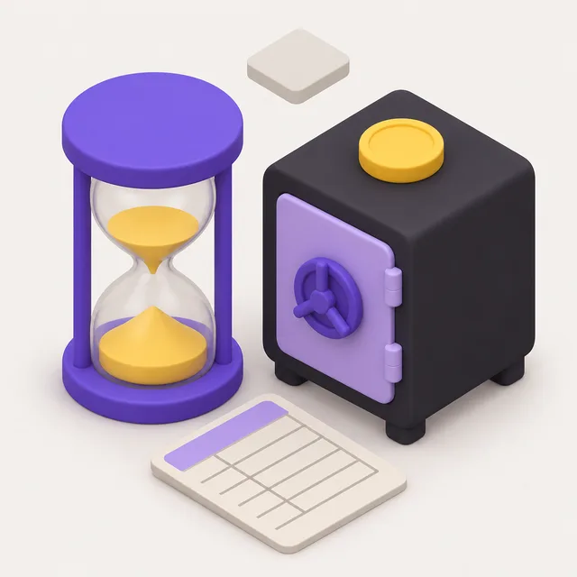
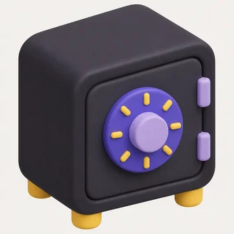

# 체무 그림 규격

체무 두 앱(알바생 앱, 사장님 앱)에 들어가는 아이소메트릭 3D 그림의 크기, 자리, 파일, 쓰는 화면, 새로 만드는 법을 한곳에 모은 규격이다. 근거는 `GRAPHIC_RULES.md`의 규칙 번호(R1~R38)와 절 번호(4.1~4.4)로 적는다. 그림 배정은 기준서 `BRIEF_v16_v50.md` B절 그림 배정표를 따른다. 두 문서와 라이팅 규칙집 `UX_WRITING_RULES.md`는 같은 폴더에 있다.

그림은 모두 화풍이 같다. 30도 아이소메트릭, 무광 클레이 질감, 웜그레이 바탕 #F4F3F0이다. 지금 있는 그림은 히어로 44장(`iso_00` ~ `iso_43`)과 3D 아이콘 24장(`ic_*`)이다. 한눈에 보는 미리보기는 `iso_sheet_v16.png`(규칙 폴더의 `review` 안)와 `docs/chemu/assets/_sheet.html`이다.

---

## 1. 크기 3단계

| 단계 | 화면 속 크기 | 쓰는 파일 | 자리 | 쓰는 화면 | 쓰지 않는 화면 | 근거 |
|---|---|---|---|---|---|---|
| 히어로 | 폭 200~224px | `iso_web/iso_*.webp` (640px) | 제목 위 가운데 한 자리. 그림, 제목, 설명, 버튼 순서 | 정보가 적은 한 메시지 화면: 온보딩 단계, 소개, 빈 화면, 경고, 기다림 | 금액이 결과인 화면(보관 완료, 확정 완료, 입금, 정산 받음), 금액과 목록이 함께 있는 정보 화면, 목록, 상세, 입력, 바텀시트, 확인 창, 민감 정보 입력(본인 확인, 계좌), 노동청 안내, 로딩 | R2, R3, R4, R12, R15, 4.1, 4.4 |
| 작은 사물 | 폭 72~112px, 기본 96px | `icon3d_lg/ic_*.webp` (336px, 2.3절) | 제목 위 가운데, 또는 결과 카드 안 위쪽 가운데. `data-iso="scene"` | 금액이 결과인 화면, 단순 완료, 히어로가 없는 빈 상태 | 히어로가 있는 화면, 카드가 여러 장 이어지는 화면(행 아이콘을 씀), 바텀시트, 확인 창 | R2, R5, R12, R16, R28, 4.2, 4.4 |
| 행 아이콘 | 40px 고정(상한) | `icon3d_web/ic_*.webp` (160px) | 목록 행 왼쪽 영역. 모서리 16px 정사각으로 자른다(그림 바탕이 #F4F3F0이라 그대로 바탕이 된다) | 목록 행, 메뉴, 알림 목록, 설정 행, 결과 화면의 내역 행, 온보딩 단계 행 | 바텀시트, 대화창, 버튼 안. 한 행에 둘 이상 | R18, R19, R20, R22, R23, 4.3, 4.4 |

세 단계를 함께 쓸 때 지킬 것
- 한 화면의 핵심 그림은 하나다. 히어로가 있으면 작은 사물을 두지 않고, 작은 사물도 한 화면에 하나다. 행 아이콘은 보조 그래픽이라 함께 쓸 수 있다(R2).
- 서로 다른 뜻의 화면에 같은 그림을 쓰지 않고, 바로 이어지는 두 화면에도 같은 그림을 쓰지 않는다(기준서 B절).
- 360×640 화면에서 제목, 핵심 금액, 주 버튼이 첫 화면 안에 보여야 한다. 넘치면 그림부터 줄이고, 그래도 넘치면 뺀다(R3, R13).
- 그림 바탕(#F4F3F0)과 그림이 놓이는 화면 바탕(`--bg-layer-basement` #F4F3F0)을 같게 두고, 가장 진한 색은 주 버튼에 남긴다(R30). 히어로 그림 모서리는 16px(`--radius-m`)이다.
- 행 아이콘의 상태는 오른쪽 글자나 배지로 나타낸다. ic_caution은 실제 실패나 늦음이 있는 행에만, ic_check는 끝난 항목에만 쓴다(R7, R23).
- 돈이 움직이는 길 화면(알바생 52, 사장님 21)의 4칸 장면은 iso_40 ~ iso_43을 같은 크기로 나란히 두고 칸마다 한 줄 문구를 붙인다. 칸 그림도 장식으로 처리한다.

### 1.1 접근성

| 단계 | 처리 | 근거 |
|---|---|---|
| 히어로 | `alt=""`, `aria-hidden="true"`. 뜻은 제목이 전한다 | R33 |
| 작은 사물 | `alt=""`, `aria-hidden="true"`. 금액과 상태는 제목과 본문 글자로 쓴다 | R33, R35 |
| 행 아이콘 | `alt=""`, `aria-hidden="true"`. 행 글자가 뜻을 말한다. 아이콘만 전하는 정보(예: 입금 실패)는 글자로 옮긴다 | R34, R35 |
| 공통 | 그림만 있는 버튼은 만들지 않는다. 만들면 버튼에 `aria-label`을 붙인다. `width`, `height`를 적어 그림이 늦게 떠도 글자가 밀리지 않게 한다 | R34 |

```html



```

등장 움직임(히어로가 아래에서 떠오름, 완료 화면의 작은 사물)은 기존 모션 규칙을 그대로 쓰고, 움직임 줄이기 설정이 켜져 있으면 멈춘다.

---

## 2. 파일

### 2.1 이름

| 종류 | 꼴 | 예 | 규칙 |
|---|---|---|---|
| 히어로 | `iso_번호_영어이름` | `iso_21_wait_confirm` | 번호는 두 자리, 이어서 매긴다(다음은 `iso_44`). 영어 이름은 소문자 낱말 1~3개를 밑줄로 잇고 장면이나 상태를 말한다. 보류한 그림도 번호를 다시 쓰지 않는다 |
| 아이콘 | `ic_영어이름` | `ic_safe`, `ic_phone_lock` | 사물 이름 한두 낱말. 번호 없음 |
| 확장자 | 원본 `.png`, 웹용 `.webp` | `iso_21_wait_confirm.png`, `iso_21_wait_confirm.webp` | 원본과 웹용은 이름이 같고 확장자만 다르다 |

### 2.2 폴더 (모두 `docs/chemu/assets/` 아래)

| 폴더 | 내용 | 크기 | 앱에서 |
|---|---|---|---|
| `iso/` | 히어로 원본 PNG 44장 | iso_00 ~ iso_15는 640×640, iso_16 ~ iso_43은 1024×1024 | 쓰지 않는다. 웹용을 다시 뽑을 때만 |
| `iso_web/` | 히어로 웹용 WebP 44장 | 640×640 | 히어로와 4칸 장면 |
| `icon3d/` | 아이콘 원본 PNG 24장 | 1024×1024 | 쓰지 않는다 |
| `icon3d_web/` | 아이콘 웹용 WebP 24장 | 160×160 | 행 아이콘 |
| `icon3d_lg/` | 아이콘 작은 사물용 WebP 24장 | 336×336 | 작은 사물. 아래 명령으로 원본에서 만든다 |

원본과 웹용 모두 투명 배경이 없다. 바탕은 #F4F3F0에 가까운 웜그레이로 칠해져 있다.

웹용을 뽑는 명령(지금 웹용 파일과 바이트 수까지 같은 결과가 나온다):

```
ffmpeg -i iso/iso_44_name.png -vf scale=640:640:flags=lanczos -c:v libwebp -quality 82 iso_web/iso_44_name.webp
ffmpeg -i icon3d/ic_name.png -vf scale=160:160:flags=lanczos -c:v libwebp -quality 85 icon3d_web/ic_name.webp
ffmpeg -i icon3d/ic_name.png -vf scale=336:336:flags=lanczos -c:v libwebp -quality 85 icon3d_lg/ic_name.webp
```

### 2.3 용량 (1KB = 1,024바이트)

| 폴더 | 장수 | 합계 | 한 장 평균 | 가장 작은 것 ~ 가장 큰 것 |
|---|---|---|---|---|
| `iso/` 전체 | 44 | 34,090,019바이트 (32.51MB) | 756.6KB | 319.7KB ~ 1,106.4KB |
| `iso/` 중 640px 16장 | 16 | 5,967,202바이트 (5.69MB) | 364.2KB | |
| `iso/` 중 1024px 28장 | 28 | 28,122,817바이트 (26.82MB) | 980.8KB | |
| `icon3d/` | 24 | 24,146,954바이트 (23.03MB) | 982.5KB | 870.1KB ~ 1,196.6KB |
| 원본 합계 | 68 | 58,236,973바이트 (55.54MB) | | |
| `iso_web/` | 44 | 649,406바이트 (634.2KB) | 14.4KB | 8.1KB (iso_31) ~ 37.2KB (iso_01) |
| `icon3d_web/` | 24 | 70,636바이트 (69.0KB) | 2.9KB | 2.0KB (ic_chart) ~ 4.9KB (ic_calendar) |
| 웹용 합계 | 68 | 720,042바이트 (703.2KB) | | 원본의 1.2% |
| `icon3d_lg/` (시험 변환) | 24 | 160,860바이트 (157.1KB) | 6.5KB | |

앱이 그림을 모두 한 번씩 받아도 웹용 세 폴더를 합쳐 880,902바이트(860.3KB)다.

### 2.4 2배, 3배 화면에서 충분한지

필요한 픽셀 = 화면 속 크기 × 화면 배율. 웹용 그림 폭이 필요한 픽셀보다 크거나 같으면 충분하다. 앱인토스 기준은 대부분 1배와 2배면 되고, 그래픽 품질이 특히 중요할 때만 3배를 더한다(R14).

| 자리 | 화면 속 크기 | 2배 필요 | 3배 필요 | 쓰는 파일 | 판정 |
|---|---|---|---|---|---|
| 히어로 | 200px | 400px | 600px | 640px | 3배까지 충분 |
| 히어로 | 224px | 448px | 672px | 640px | 2배 충분. 3배는 필요의 95%로 눈에 띄지 않는다 |
| 작은 사물 | 72px | 144px | 216px | 160px | 2배까지만 충분 |
| 작은 사물 | 96px | 192px | 288px | 160px | 2배에서 83%로 모자람 |
| 작은 사물 | 112px | 224px | 336px | 160px | 2배에서 71%로 모자람 |
| 작은 사물 | 112px | 224px | 336px | 336px (`icon3d_lg`) | 3배까지 충분 |
| 행 아이콘 | 40px | 80px | 120px | 160px | 3배까지 충분 |

정리하면 640px 히어로는 3배 화면에서 213px까지 선명하고, 160px 아이콘은 2배 화면에서 80px, 3배 화면에서 53px까지 선명하다. 작은 사물 자리는 160px로 모자라서 `icon3d_lg/`(336px)를 쓴다. iso_00 ~ iso_15는 원본이 640px라 웹용보다 크게 뽑을 수 없다.

---

## 3. 그림 목록

### 3.1 히어로 44장

"바닥"은 그림 아래 떠 있는 정사각 타일이 있는지다. "방 모서리"는 타일 위에 벽 두 면을 세운 장면이다. 화면 번호는 각 앱 화면 목록의 번호다.

| 그림 | 장면 | 바닥 | 쓰는 앱과 화면 |
|---|---|---|---|
| iso_00_store_night | 밤의 동네 가게. 줄무늬 차양, 불 켜진 진열장, 가로등과 초승달 | 타일 | 사장님 00 가게 등록 |
| iso_01_restaurant | 기와지붕 식당 앞 테이블에서 손님들이 식사하고 요리사가 일하는 거리 | 타일 | 보류. B님 식당 장면 전용인데, 쓰던 알바생 47과 사장님 45가 금액 결과 화면이라 작은 사물 ic_safe로 바뀐다. 사람이 그려져 있어 새 그림 틀(사람 없음)과도 다르다 |
| iso_02_contract | 체크 세 줄이 있는 계약서, 펜, 동전 하나 | 타일 | 알바생 05 계약서가 아직 안 옴, 55 계약서 요청함. 사장님 51 계약서 사진을 못 읽었을 때 |
| iso_03_clock_in | 휴대폰과 위치 핀이 꽂힌 작은 가게, 가게 둘레의 원 | 타일 | 알바생 11 출근하기, 20 가게 30m 밖, 82 퇴근할 때 위치를 못 찾음 |
| iso_04_vault_daily | 동전이 들어가는 먹색 금고와 탁상 달력 두 개 | 타일 | 보류. 쓰던 사장님 44 일부만 채운 뒤는 제목이 보관한 금액인 결과 화면이라 히어로를 빼고, 알바생 15는 작은 사물 ic_safe |
| iso_05_week_stack | 오른쪽 칸마다 동전이 쌓인 월간 달력 | 없음 | 알바생 32 급여일 아침 |
| iso_06_payday | 열린 금고에서 동전 길이 휴대폰 속 지갑으로 이어지고 옆에 벽시계 | 없음 | 보류. 쓰던 알바생 33과 사장님 28이 금액 결과 화면이라 ic_coins로 바뀐다. 휴대폰 속 지갑이 받을 곳을 지갑으로 읽히게 한다(UX-10) |
| iso_07_edit_time | 연필로 분침을 옮기는 벽시계 | 타일 | 알바생 23 퇴근을 못 누르고 나옴 |
| iso_08_dispute | 보라와 먹색 말풍선이 양쪽에 걸린 저울, 한쪽 접시에 동전 | 타일 | 사장님 16 내 기록을 그대로 둠 |
| iso_09_warning | 빨간 종이 울리는 빈 금고, 빨간 표시가 있는 달력 세 장 | 타일 | 알바생 38 안 들어온 돈 한 곳 |
| iso_10_export | 방패가 붙은 서류철에서 바깥으로 나가는 화살표 | 없음 | 알바생 43 기록 내보내기 |
| iso_11_settle | 문이 열린 가게, 문 앞 동전 주머니, 체크 배지로 가는 화살표 | 타일 | 알바생 69 정산 요청 뒤 |
| iso_12_verify | 반투명 블록 위에 체크가 비치는 돋보기 | 없음 | 사장님 39 기록 맞춰 보기, 기록 대조 웹 맨 위 |
| iso_13_owner_desk | 가게 안 계산대, 포스기, 태블릿, 뒤쪽 책상과 선반 | 방 모서리 | 보류. 사장님 앱 전용인데, 쓰던 사장님 10 확정 완료가 작은 사물 ic_check로 바뀐다 |
| iso_14_receive | 은행 건물에서 휴대폰으로 가는 화살표, 휴대폰 화면에 지갑 모양 | 타일 | 알바생 35 급여일 자동 입금 안 됨. 사장님 29 입금 다시 보내기 |
| iso_15_invite | 열린 봉투 안 자물쇠 방패 카드와 리본 봉인 | 없음 | 알바생 00 초대받고 가입. 사장님 02 초대 보냄 |
| iso_16_link_expired | 버터색 봉투, 모래가 다 내려간 모래시계, 풀린 리본 | 타일 | 알바생 01 초대 링크 기간 지남 |
| iso_17_bell_on | 울리는 보라 종, 동전, 켜진 스위치 | 타일 | 알바생 04 알림 허용, 54 알림 켜짐 |
| iso_18_location_off | 점선 원 안의 작은 가게, 위치 핀, 꺼진 스위치 | 타일 | 알바생 12 위치 꺼짐 |
| iso_19_offline | 구름, 공유기, 서류 트레이 | 없음 | 알바생 13 인터넷 끊김. 사장님 47 인터넷이 끊겼을 때 |
| iso_20_on_shift | 불 켜진 벽시계가 걸린 가게 계산대 한쪽과 커피 컵 | 방 모서리 | 알바생 14 근무 중(그림과 한 메시지만 있는 화면일 때) |
| iso_21_wait_confirm | 모래시계, 동전이 올라간 금고, 근무표 종이 | 없음 | 알바생 21 퇴근 뒤 확정 대기, 64 확정 요청 다시 보낸 뒤 |
| iso_22_missed_break | 김 나는 커피 컵, 빈 안락의자, 탁상시계 | 없음 | 알바생 24 쉬는 시간을 못 쉼, 66 쉬는 시간 확인 요청 보낸 뒤 |
| iso_23_all_checked | 모두 체크된 클립보드, 금고, 동전 기둥 | 타일 | 알바생 25 확인할 근무 없음 |
| iso_24_dispute_won | 체크 배지가 위에 뜬 수평 저울, 아래 금고로 들어가는 동전 | 타일 | 알바생 26 다르다고 알린 기록이 받아들여짐 |
| iso_25_next_step | 갈림길 표지판과 집게 꽂힌 서류철 | 타일 | 알바생 27 다르다고 알린 기록이 받아들여지지 않음 |
| iso_26_missing_day | 달력 한 장과 동전이 점선을 사이에 두고 닫힌 금고와 떨어져 있음 | 없음 | 알바생 42 보관 안 된 하루 |
| iso_27_message_preview | 열린 봉투에서 나온 말풍선과 돋보기 | 없음 | 알바생 40 사장님에게 알리기 전 문자 보기 |
| iso_28_pay_date | 깃발이 꽂힌 날짜가 있는 탁상 달력과 봉투 | 없음 | 알바생 39 사장님이 날짜를 알림. 사장님 43 날짜 알린 뒤 |
| iso_29_farewell | 앞치마가 든 상자, 사물함, 리본 묶은 봉투 | 타일 | 알바생 45 그만두고 정산. 사장님 46 그만둔 알바 정산 |
| iso_30_recovered | 달력 세 장 옆 금고로 동전이 들어가고 위에 체크 배지 | 없음 | 보류. 맞는 화면이 금액 결과 화면뿐이다. 금액 없이 한 메시지만 있는 화면이 생기면 쓴다 |
| iso_31_load_fail | 구름에서 빠진 플러그와 다시 불러오기 화살표 | 타일 | 알바생 49 불러오지 못함. 사장님 48 불러오지 못했을 때 |
| iso_32_contract_signed | 별 배지와 도장 자국이 있는 계약서, 도장 | 없음 | 알바생 57 계약 확정됨. 사장님 04 계약 확정 |
| iso_33_contract_edit | 노란 줄로 표시한 계약서, 연필, 날아가는 종이비행기 | 없음 | 알바생 56 고쳐 달라고 요청함. 사장님 03 A님이 계약을 고쳐 달라고 요청함 |
| iso_34_low_fund | 동전이 조금 든 유리병, 탁상 달력, 낮게 가리킨 눈금 | 없음 | 사장님 22 다음 주 인건비가 모자랄 때 |
| iso_35_confirm_stamp | 근무표에 체크 도장을 찍는 도장과 동전이 들어가는 금고 | 없음 | 보류. 맞는 화면(확정 완료)이 금액 결과 화면이라 작은 사물 ic_check를 쓴다 |
| iso_36_no_staff | 빈 걸이와 걸린 봉투, 의자 위에 개어 둔 앞치마 | 방 모서리 | 사장님 52 알바생이 아직 없을 때 |
| iso_37_quiet_bell | 방석 위에 엎어 둔 종 | 타일 | 보류. 알림을 꺼 둔 것처럼 읽힌다. 알림 빈 상태(알바생 50, 사장님 53)는 작은 사물 ic_bell |
| iso_38_fill_retry | 깔때기 위 동전, 빈 유리 금고, 다시 하기 화살표 | 없음 | 사장님 50 보관함 채우기가 안 됐을 때 |
| iso_39_record_sent | 시계가 놓인 계산대에서 근무표 종이비행기가 날아감 | 타일 | 알바생 65 퇴근 기록 보낸 뒤 |
| iso_40_path_fill | 가게 계산대 위 깔때기로 동전이 유리 금고에 채워짐 | 타일 | 4칸 장면 1칸(채우기). 알바생 52, 사장님 21 돈이 움직이는 길 |
| iso_41_path_hold | 보라 봉인이 붙은 닫힌 금고와 동전 표시가 있는 달력 | 없음 | 4칸 장면 2칸(보관). 같은 두 화면 |
| iso_42_path_confirm | 도장, 빈 도장 원이 있는 근무표, 동전 트레이 | 없음 | 4칸 장면 3칸(확정). 같은 두 화면 |
| iso_43_path_payday | 열린 금고에서 라벤더 길을 따라 봉투 세 개, 해 뜨는 달력 | 없음 | 4칸 장면 4칸(급여일 입금). 같은 두 화면 |

그림을 넣지 않는 화면
- 확인 창: 알바생 76 계약서 요청, 77 퇴근 시간 보내기, 79 1350 전화(노동청 안내이기도 하다)
- 금액과 목록이 함께 있는 정보 화면: 알바생 46 정산 받기 전 확인, 68 안 들어온 돈 알림 보낸 뒤
- 사장님 44 일부만 채운 뒤(보관한 금액이 제목인 결과 화면, 다음 화면 45가 ic_safe를 씀)
- 알바생 53 새 초대 요청함(배정표에 그림이 없다)

작은 사물(96px)을 쓰는 금액 결과 화면

| 화면 | 작은 사물 |
|---|---|
| 알바생 15 퇴근, 일당 보관 | ic_safe |
| 알바생 33 급여일 자동 입금 | ic_coins |
| 알바생 47 안 들어온 돈이 보관됨 | ic_safe |
| 사장님 10 확정 완료 | ic_check |
| 사장님 28 자동 입금 완료 | ic_coins |
| 사장님 45 아직 보관 못 한 돈 보관 완료 | ic_safe |
| 알바생 50, 사장님 53 알림이 없을 때 | ic_bell |

### 3.2 3D 아이콘 24개

짝이 헷갈리는 것: 달력은 날짜 안내 행에만, 동전은 금액과 월급 행에만, 입금과 받을 곳 행은 통장. 보관은 금고, 확정과 확인 끝은 체크. 단순 알림 행은 종, 실제 실패나 늦음이 있을 때만 경고이고 늦음은 오른쪽 글자로도 쓴다(R7).

| 아이콘 | 사물 | 쓰는 행 | 작은 사물로 쓰는 화면 |
|---|---|---|---|
| ic_apron | 고리에 걸린 라벤더 앞치마 | 알바생 목록, 초대 상태 | |
| ic_bankbook | 동전이 놓인 보라 통장 | 계좌, 받을 곳, 입금 | |
| ic_bell | 보라 종 | 알림, 알림 설정 | 알림이 없을 때(알바생 50, 사장님 53) |
| ic_box | 보라 리본을 묶은 종이 상자 | 정산, 그만두기 | |
| ic_calculator | 라벤더 키가 달린 계산기 | 일당 계산 풀이, 주휴수당 풀이 | |
| ic_calendar | 고리 제본 탁상 달력 | 근무 달력, 급여일 날짜 안내 | |
| ic_caution | 느낌표가 있는 노란 삼각형 | 실제 실패나 늦음이 있는 행만 | |
| ic_chart | 보라 막대그래프와 동전 | 인건비 리포트 | |
| ic_check | 체크가 있는 클립보드 | 확정, 확인이 끝난 항목 | 확정 완료(사장님 10) |
| ic_clock | 보라 탁상 알람시계 | 출근, 퇴근 | |
| ic_coins | 쌓인 동전 | 금액, 월급 | 자동 입금(알바생 33, 사장님 28) |
| ic_contract | 줄 막대와 인장 리본이 있는 계약서 | 계약 | |
| ic_cup | 김이 오르는 종이컵 | 쉬는 시간 | |
| ic_envelope | 보라 봉인이 붙은 노란 봉투 | 초대, 문자 | |
| ic_export | 서류가 든 보라 폴더와 오른쪽 화살표 | 기록 내보내기, 장부 | |
| ic_magnifier | 종이 위 돋보기 | 상세 보기, 기록 맞춰 보기 | |
| ic_phone_lock | 자물쇠가 붙은 휴대폰 | 본인 확인 | |
| ic_pin | 바닥 고리 위 위치 핀 | 위치, 출근할 수 있는 거리 | |
| ic_receipt | 아래가 말린 종이와 금색 인장 | 일당, 급여명세서 | |
| ic_repeat | 원형 화살표가 둘러싼 달력 | 반복 근무표 | |
| ic_safe | 보라 다이얼이 달린 먹색 금고 | 보관, 보관함 | 일당 보관(알바생 15, 47, 사장님 45) |
| ic_scale | 수평 저울 | 다르다고 알린 기록 | |
| ic_shield | 체크가 있는 방패 | 기록 원본, 안전 | |
| ic_store | 줄무늬 차양이 있는 작은 가게 | 가게 | |

---

## 4. 같은 화풍으로 더 만드는 법

### 4.1 프롬프트 틀

이미지 생성 모델 `gpt_image_2_6`, 비율 1:1. `{장면}`과 `{사물}` 자리에 영어로 묘사를 넣고 나머지는 바꾸지 않는다.

히어로

```
Isometric 3D illustration, 30-degree isometric angle, soft matte clay, {장면} on a floating square tile, palette warm gray #E9E6E0, charcoal #19181D, violet #5B4BDB, lavender, butter yellow #F5C84B, plain warm gray background #F4F3F0, no text, no letters, no numbers, no people
```

아이콘

```
Isometric 3D icon, 30-degree isometric angle, soft matte clay, a single {사물}, centered and filling most of the frame, no base tile, palette warm gray, charcoal #19181D, violet #5B4BDB, lavender, butter yellow #F5C84B, plain warm gray background #F4F3F0, no text, no letters, no numbers
```

만든 원본은 `iso/`, `icon3d/`에 두고 2.2절 명령으로 웹용을 뽑는다.

### 4.2 장면 묘사 쓰는 요령

- 사물은 2~4개. 뜻을 전하는 데 필요한 것만 둔다(R12, R32). 아이콘은 사물 하나.
- 사람, 얼굴, 손을 그리지 않는다. 사람이 필요한 뜻은 앞치마, 의자, 가게 같은 사물로 말한다.
- 글자와 숫자를 넣지 않는다. 서류의 글은 줄 막대로, 금액은 동전 더미로 나타낸다.
- 탓하거나 겁주는 장면을 쓰지 않는다. 깨진 금고, 쏟아지는 동전, 우는 얼굴, 경고음이 울리는 장면, 반짝이와 파티클은 피한다(R8, R9). 빨강은 안 들어온 돈 장면에만 쓴다(UX-16).
- 지갑, 코인 무늬, 체인 고리처럼 시스템 말을 떠올리게 하는 사물은 넣지 않는다. 받을 곳은 통장이나 은행 건물로 그린다(UX-10).
- 이미 있는 사물은 같은 모양으로 다시 쓴다. 금고는 먹색 몸체와 보라 다이얼, 동전은 버터 노랑 원반, 달력은 보라 고리 제본, 가게는 줄무늬 차양(R26).
- 묘사 예: `a charcoal safe with a violet dial, a small desk calendar with one lifted date tile, and a single butter yellow coin`

### 4.3 만든 뒤 확인할 것

| 항목 | 기준 | 근거 |
|---|---|---|
| 타일 | 히어로는 떠 있는 정사각 타일 위 장면, 아이콘은 타일 없이 사물 하나. 한 화면에 나란히 놓는 그림(4칸 장면)은 타일 유무를 맞춘다 | R2, R24 |
| 팔레트 | 웜그레이, 먹색, 보라, 라벤더, 버터 노랑 안에서 칠해졌는지. 바탕 모서리 색이 #F4F3F0과 RGB 채널마다 7 이하로 차이 나는지(지금 68장은 모두 7 이하) | R25, R30 |
| 각도 | 30도 아이소메트릭으로 기존 그림과 같은 방향에서 내려다보는지. 기울어진 사물은 한 방향으로 기울었는지 | R24 |
| 글자와 사람 | 글자, 숫자, 사람이 없는지 | R31 |
| 줄여 보기 | 히어로는 200px, 아이콘은 40px과 96px로 줄였을 때 사물 윤곽이 뭉개지지 않는지 | R28 |
| 뜻 | 쓸 화면의 제목과 같은 말을 하는지. 다른 뜻의 화면에 이미 쓰인 그림과 헷갈리지 않는지 | R1 |
| 어두운 몸체 | 먹색 금고처럼 검정에 가까운 몸체가 어두운 바탕에서 형태를 잃지 않는지 | R29 |

바탕 모서리 색 재는 명령:

```
ffmpeg -v error -i iso/iso_44_name.png -vf crop=4:4:4:4,scale=1:1 -f rawvideo -pix_fmt rgb24 - | od -An -tu1
```

---

## 5. 권리 메모

- 체무 그림 68장은 팀이 이미지 생성 모델로 직접 만든 그림이다. 토스 아이콘, 토스 3D 그래픽, 토스트(토스 AI 그래픽 생성기) 생성물, TDS Mobile UI Kit 부품은 쓰지 않는다. 토스 그래픽 자산과 UI Kit은 앱인토스 제휴 환경 안에서만 쓸 수 있어서 경진대회 산출물에 넣을 수 없다(R36).
- `assets/3d/`, `assets/3dicons/` 폴더의 그림은 이 규격에 들지 않고 앱에서 쓰지 않는다.
- 체무를 앱인토스 미니앱으로 출시할 때는 3D 리소스 규칙(`GRAPHIC_RULES.md` 2.6)을 다시 확인한다. 앱인토스 가이드에는 3D 그래픽과 애니메이션은 토스가 준 모듈의 리소스만 쓸 수 있다는 문장과 파트너사가 직접 만드는 그래픽의 유의사항이 함께 있어, 자체 3D 그림을 쓸 수 있는지는 원문만으로 정할 수 없다. 출시 단계에서 앱인토스 채널톡에 묻는다(R37). 토스트로 만든 그림을 쓰게 되면 토스 그래픽 디자인 팀 승인을 먼저 받는다(R38).
- 출시 전에 그림을 만든 이미지 생성 도구의 이용 조건에서 상업적 이용 범위를 함께 확인한다.
