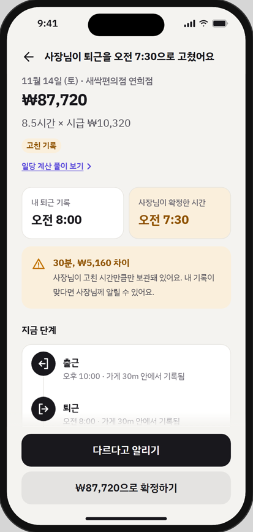
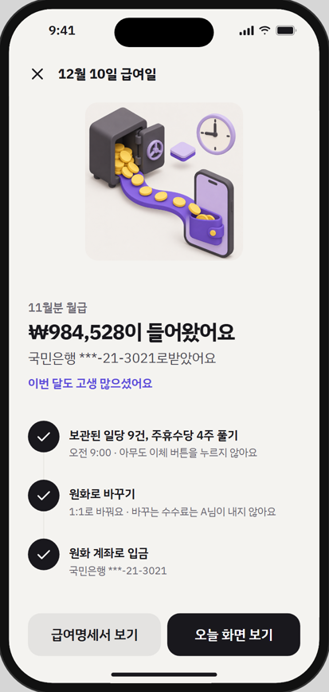
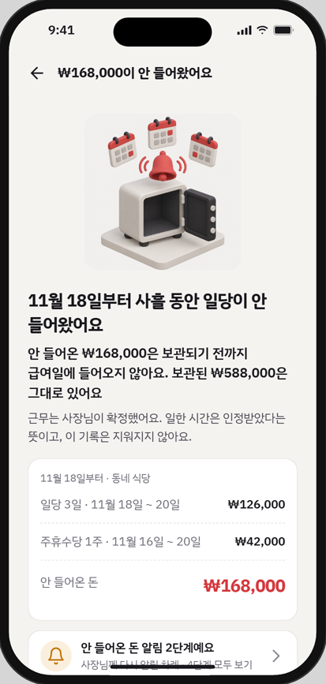
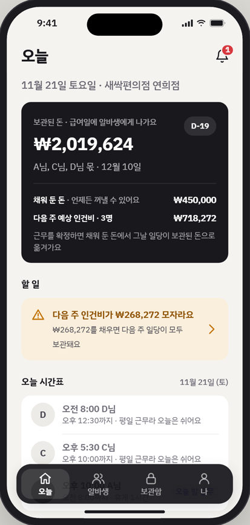
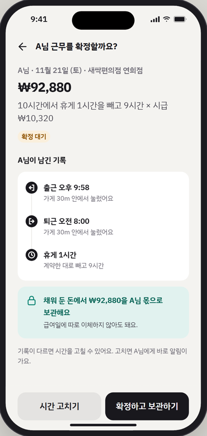

# 체무 화면기획서

알바생 앱, 사장님 앱, 그리고 링크를 받은 사람이 여는 기록 대조 페이지로 이뤄집니다. 알바생 앱은 근로자 파트 이성재 님의 와이어프레임 v3가 뼈대이고, 지금 판은 v15입니다(알바생 83화면, 사장님 54화면, 기록 대조 웹, 1분 시연 모드). v3의 정보 구조와 숫자는 그대로 두고 다음을 더했습니다.

- 화면마다 빠져 있던 상태(비어 있을 때, 실패했을 때, 끝났을 때, 확인 창)
- 한 화면 한 메시지 화면에 넣은 3D 아이소메트릭 그림
- 토스 라이팅 원칙에 맞춘 문구와, 모의 사용자 여섯 명(알바생 둘, 사장님 둘, UX 라이터, 은행 실무자) 검수 반영
- 두 앱을 잇는 주석: 화면 목록에서 고른 화면의 상대 앱 화면을 바로 엽니다
- 토스 TDS 공개 문서와 SEED Design 기준의 컴포넌트, 역할 이름 토큰, 명암비, 터치 영역 44px, 글자 크기 200%
- 에러와 빈 상태 한 틀(무슨 일, 돈은 어디, 바로 푸는 버튼), 완료 순간의 짧은 움직임

버전마다 바뀐 것은 [버전 기록](버전기록.md)에 있습니다.

직접 눌러 보는 와이어프레임은 [알바생 앱](wireframe/worker.html), [사장님 앱](wireframe/owner.html), [기록 대조 웹](wireframe/verify.html), [1분 시연 모드](wireframe/demo.html)입니다. 저장소를 내려받아 브라우저로 열면 오른쪽 `화면 목록`에서 모든 화면과 상태로 바로 갈 수 있고, 항목마다 기획 주석이 붙어 있습니다. 작동 흐름도는 [FigJam 보드](https://www.figma.com/board/LXlHx5ZjoJLioX72lDwHhV)에 있습니다.

## 1. 두 앱이 같이 쓰는 약속

| 항목 | 약속 |
|---|---|
| 핵심 용어 | 일당을 먼저 넣어 두는 것은 **보관**, 급여일에 풀리는 것은 **자동 입금**. 락업, 베스팅, 예치, 컨트랙트, 토큰은 화면에 쓰지 않습니다 |
| 확정 | 알바생이 출퇴근을 누르고 사장님이 확정해야 그날 일당이 보관됩니다. 확정 전에는 `확정 대기` |
| 고친 기록 | 원래 기록은 지우지 않고 고친 기록과 이유를 덧붙입니다. 고치면 상대에게 바로 알림이 갑니다 |
| 안 들어온 날 | 보관이 안 되면 사장님께 바로, 알바생에게는 다음 날 오전 9시에 알립니다. 알바생 쪽 알림은 끌 수 없습니다 |
| 받을 곳 | 원화 계좌가 기본(추천)이고, 원화 스테이블코인은 알바생이 고를 때만 씁니다 |
| 색 | 따뜻한 회색 바탕 `#f4f3f0`, 먹색 카드 `#19181d`, 보라 포인트 `#5b4bdb` 하나. 빨강 `#d6383e`은 돈이 안 들어왔을 때만, 주황 `#c27200`은 기다리거나 확인할 일, 초록 `#0f8574`은 안내 |
| 글꼴 | IBM Plex Sans KR. 크기는 30, 26, 22, 20, 17, 15, 13px 일곱 단계(rem)만 씁니다 |
| 토큰 | 색, 간격, 모서리를 역할 이름으로 정했습니다. 값과 명암비는 [디자인 토큰](design/디자인_토큰.md) |
| 시연 표기 | 테스트넷의 모의 원화 토큰(KRWt). 실제 예금이나 원화 스테이블코인이 아닙니다 |

## 2. 문구 원칙

토스 테크와 토스피드에 공개된 라이팅 원칙(8가지 라이팅 원칙, 좋은 에러 메시지 6원칙, TDS 버튼 규칙)을 체무 화면에 맞게 줄였습니다. 근거와 원문 주소는 [문구와 그림 원칙](문구와_그림_원칙.md)에 있습니다.

| # | 원칙 | 체무에서 |
|---|---|---|
| 1 | 해요체로 씁니다 | "보관되었습니다" 대신 "보관했어요" |
| 2 | 한 화면에 메시지는 하나 | 제목 한 줄이 그 화면의 전부이고 설명은 한두 줄. 제목을 설명에서 되풀이하지 않습니다 |
| 3 | 빼도 뜻이 같은 말은 뺍니다 | "해당", "진행", "관련", "~하실 수 있습니다", "확인 부탁드립니다" |
| 4 | 숫자가 주인공이면 숫자가 제목 | "₩92,880 보관했어요" |
| 5 | 버튼은 일어날 일을 말합니다 | 행동 버튼은 "출근하기", "확정하고 보관하기"처럼 "~하기". 다음 화면으로만 가는 버튼만 "확인", "다음" |
| 6 | 물러나는 버튼은 "닫기", "다음에" | "취소"를 쓰지 않습니다 |
| 7 | 법률, 금융 용어는 생활 말로 | "소정근로시간" 대신 "계약한 근무 시간", "지급" 대신 "입금" |
| 8 | 강요하지 않고 권합니다 | "~해야 합니다" 대신 "~할 수 있어요". "즉시", "반드시", "불이익" 같은 겁주는 말은 쓰지 않습니다 |
| 9 | 에러에는 고치는 버튼을 함께 | 가게에서 멀면 "위치 다시 찾기", 입금이 안 되면 "다시 입금 요청하기" |
| 10 | 불안한 순간에는 다음 일을 먼저 | "3일째 일당이 들어오지 않았어요" 다음 줄에 "사장님께 다시 알렸어요" |
| 11 | 큰 순간에는 한 줄 공감 | 급여일 입금, 정산 완료, 이의가 받아들여졌을 때 |

### 바꾸기 전과 후

| 화면 | 이전 | 지금 (v7) | 원칙 |
|---|---|---|---|
| 퇴근, 일당 보관 | 오늘 9시간 일했어요 | ₩92,880 보관했어요 | 4 |
| 계약 확인: 주휴수당 빠짐 | 주휴수당이 빠져 있어요, 주 버튼 "그대로 동의하기" | 주휴수당 ₩37,152이 빠져 있어요, 주 버튼 "수정 요청하기", 보조 "한 달 ₩148,608 없이 동의하기" | 4, 5 |
| 오늘: 안 들어온 돈 (B님) | 3일째 일당이 들어오지 않았어요 | 11월 18일부터 사흘 동안 일당이 안 들어왔어요. 일당 ₩126,000과 주휴수당 ₩42,000, 모두 ₩168,000이에요 | 10, 이름 하나로 |
| 급여일: 자동 입금 실패 | (없던 화면) | 월급 ₩984,528은 그대로 보관돼 있어요 | 9, 10 |
| 사장님: 근무 확정 | 퇴근 확정 | A님 근무를 확정할까요? | 2 |
| 사장님: 아직 보관 못 한 돈 | 보관 못 한 일당, 한 번에 채우는 버튼 하나 | 오늘 채울 수 있는 만큼부터 정해요. 다 채우기, 일부만 채우기, 날짜 알리기 | 8, 10 |

### 같은 것은 같은 이름으로

| 개념 | 알바생 앱 | 사장님 앱 |
|---|---|---|
| 근무를 확정해 묶인 돈 | 보관된 돈 | 보관된 돈 · 급여일에 알바생에게 나가요 |
| 사장님이 넣어 두기만 한 돈 | (보이지 않음) | 채워 둔 돈 · 언제든 꺼낼 수 있어요 |
| 보관되지 못한 돈 | 안 들어온 돈 | 아직 보관 못 한 돈 |
| 사장님이 하는 일 | 사장님 확정 | 근무 확정 |
| 고친 것 | 고친 기록 | 고친 기록 (버튼은 "시간 고치기") |
| 돈 이름 | 월급 | 인건비 |
| 받는 곳 | 받을 곳: 원화 계좌(기본), 원화 스테이블코인(법이 정비되면 열림, 지금은 시연용) | |

## 3. 3D 아이소메트릭 그림

| 규칙 | 내용 |
|---|---|
| 어디에 | 온보딩, 빈 상태, 완료, 경고처럼 한 화면 한 메시지인 화면의 제목 위에만, 가로 200~260px |
| 어디에 안 | 리스트, 표, 상세, 시트, 다이얼로그. 넣더라도 40~48px 행 아이콘까지 |
| 몇 개 | 한 화면에 하나 |
| 놓는 곳 | 바탕 `#f4f3f0` 위. 먹색 카드 안에 넣지 않고 카드 그림자와 겹치지 않게 |
| 색과 각도 | 16장 모두 같은 시점, 왼쪽 위 광원, 접촉 그림자 하나. 색은 디자인 토큰 안에서만. 그림 안에 글자와 숫자를 넣지 않습니다 |
| 화면 읽기 | 히어로는 장식이라 alt를 비우고 화면 읽기 프로그램에서 숨깁니다. 뜻은 제목이 전합니다 |
| 어디에 썼나 | [알바생 앱 그림 사용표](design/그림_사용표_알바생.md), [사장님 앱](design/그림_사용표_사장님.md). 두 앱을 합쳐 16장 모두 씁니다 |

`docs/assets/iso/`의 16장은 같은 시점, 같은 광원, 같은 바탕색(따뜻한 회색)으로 만들었습니다.

| 파일 | 장면 |
|---|---|
| iso_00_store_night | 편의점 야간 |
| iso_01_restaurant | 식당 |
| iso_02_contract | 계약서 |
| iso_03_clock_in | 가게 30m 안 출근 |
| iso_04_vault_daily | 날마다 보관 |
| iso_05_week_stack | 주말마다 쌓이는 일당 |
| iso_06_payday | 급여일 자동 입금 |
| iso_07_edit_time | 시간 고침 |
| iso_08_dispute | 이의 |
| iso_09_warning | 안 들어온 돈 |
| iso_10_export | 기록 내보내기 |
| iso_11_settle | 그만두고 정산 |
| iso_12_verify | 기록 대조 |
| iso_13_owner_desk | 사장님 카운터 |
| iso_14_receive | 받을 곳 |
| iso_15_invite | 초대 |

## 4. 페르소나와 숫자

| | A님 | B님 |
|---|---|---|
| 누구 | 21세 대학생, 기숙사 생활. 코인 지갑은 써 본 적 없고 토스, 카카오뱅크는 매일 씀 | 25세, 휴학하고 공무원 시험 준비. 자취하며 월세와 식비를 알바비로 냄 |
| 일하는 곳 | 새싹편의점 연희점 (박정민 사장님) | 동네 식당 (최영숙 사장님) |
| 근무 | 토, 일 오후 10:00 ~ 오전 8:00, 휴게 1시간, 하루 9시간, 주 18시간 | 평일 오전 11:00 ~ 오후 3:30, 휴게 30분, 하루 4시간, 주 20시간 |
| 시급 | 10,320원 (2026년 최저임금) | 10,500원 |
| 일당 | 92,880원 | 42,000원 |
| 주휴수당 | 주 37,152원 | 주 42,000원 |
| 급여일 | 매달 10일 | 매달 5일 |
| 받을 곳 | 국민은행 계좌 | 신한은행 계좌 |
| 보여 주는 장면 | 정상 흐름, 사장님이 시간을 고침, 이의 제기, 급여일 자동 입금 | 11월 18일부터 일당이 보관되지 않은 체불 위험, 그만두고 정산 |

A님 11월 예상 월급은 근무 9일 835,920원과 주휴수당 4주 148,608원을 더한 984,528원입니다. 11월 21일 기준 보관된 돈은 533,544원입니다(근무 5일 459,240원, 주휴수당 2주 74,304원). 근무 5일 가운데 11월 14일은 사장님이 퇴근을 오전 7:30으로 고쳐 87,720원만 보관됐고, A님 기록대로라면 5,160원이 더 보관됩니다.

B님은 11월 18, 19, 20일 근무가 확정됐지만 보관되지 않았습니다. 일당 126,000원과 11월 16~20일 주휴수당 42,000원, 모두 168,000원입니다.

인물과 가게는 가상입니다.

## 5. 알바생 앱 (83화면)

화면 번호를 누르면 이미지가 열립니다. "누른 뒤 상태", "확인 창", "에러와 빈 상태" 묶음은 누르고 나서야 열리는 상태와 실패 상태를 화면 목록에 올린 것입니다.

| 번호 | 화면 | 이 화면이 답하는 질문 | 들어오는 길 | 나가는 길 | 사장님 앱 |
|---|---|---|---|---|---|
| | **시작하기 (A)** | | | | |
| 01 | [초대받고 가입](screens/worker/01_초대받고가입.png) | 누가 나를 어느 가게에 초대했고 하루 일당은 얼마인가 | 사장님이 보낸 초대 문자 링크 | 시작하기 뒤 휴대폰 본인 확인, 받을 곳, 알림, 계약 확인 | 알바생 초대 상태, 근로계약 올리기 |
| 02 | [초대 링크 기간 지남](screens/worker/02_초대링크기간지남.png) | 초대 링크가 열리지 않으면 어떻게 다시 받나 | 기간이 지난 초대 문자 링크 | 사장님께 새 초대를 요청하기 뒤 새 초대 문자 | 알바생 초대 상태(다시 보내기) |
| 03 | [휴대폰 본인 확인](screens/worker/03_휴대폰본인확인.png) | 이 초대가 정말 내 번호로 온 것인가 | 초대 화면의 시작하기 | 본인 확인하기 뒤 받을 곳 등록, 번호 고치기, 인증번호 다시 받기 | 알바생 초대 상태(열어 봄) |
| 04 | [받을 곳 등록: 계좌 확인](screens/worker/04_받을곳등록계좌확인.png) | 월급 받을 원화 계좌가 내 이름의 계좌가 맞나 | 본인 확인 다음 단계 | 확인 완료 뒤 다음(알림) | 알바생 초대 상태(동의 완료), 급여일 |
| 05 | [알림 허용: 휴대폰 알림 꺼짐](screens/worker/05_알림허용휴대폰알림꺼짐.png) | 알림이 꺼져 있으면 안 들어온 돈을 어떻게 알게 되나 | 받을 곳 등록 다음 단계(휴대폰 알림 권한이 꺼져 있을 때) | 알림 켜기, 다음에 뒤 계약 확인 | B님에게 간 알림 확인 |
| 06 | [계약서가 아직 안 옴](screens/worker/06_계약서가아직안옴.png) | 가입했는데 왜 아직 일당 보관이 시작되지 않나 | 가입 마지막 단계, 나 탭 근로계약서 | 사장님께 계약서 요청하기, 계약서가 오면 계약 확인 | 알바생 초대 상태, 근로계약 올리기 |
| 07 | [계약 확인: 주휴수당 빠짐](screens/worker/07_계약확인주휴수당빠짐.png) | 이 계약대로 일해도 손해가 없나 | 가입 마지막 단계, 나 탭 근로계약서 | 수정 요청하기, 한 달 ₩148,608 없이 동의하기 | 근로계약 올리기 |
| 08 | [계약 확인: 고쳐진 계약](screens/worker/08_계약확인고쳐진계약.png) | 고쳐진 계약에 동의하면 무엇이 시작되나 | 수정 요청 뒤 "사장님이 계약을 고쳤어요" 알림 | 동의하고 시작하기 뒤 오늘 | 근로계약 올리기 |
| | **A의 근무하는 날** | | | | |
| 09 | [오늘: 보관된 돈](screens/worker/09_오늘보관된돈.png) | 지금까지 내 돈이 얼마나 보관됐나 | 앱 열기, 하단 오늘 탭 | 출근하기, 일당 계산 보기, 근무 달력 보기, 보관된 돈 설명, 최근 일당 행 | 오늘, 보관함 |
| 10 | [이번 달 근무 달력](screens/worker/10_이번달근무달력.png) | 이번 달 어느 날이 보관됐고 어느 날이 남았나 | 오늘의 근무 달력 보기, 기록 탭 달력 보기 | 날짜를 눌러 하루 상세, 주휴수당 풀이 | 반복 근무표, 오늘 |
| 11 | [일당 계산 풀이](screens/worker/11_일당계산풀이.png) | 일당 ₩92,880은 어떻게 나온 숫자인가 | 오늘의 일당 줄, 하루 상세, 계약 확인의 일당 줄, 급여 탭 근무 줄 | 주휴수당 풀이 | 주휴수당 풀이(사장님용), 이번 달 인건비 리포트 |
| 12 | [출근하기](screens/worker/12_출근하기.png) | 지금 출근을 눌러도 되나 | 오늘 화면 출근하기, 머리 출퇴근 버튼 | 출근하기 뒤 근무 중 | 오늘(출근한 알바 표시) |
| 13 | [출근하기: 위치 꺼짐](screens/worker/13_출근하기위치꺼짐.png) | 왜 출근이 안 눌리고 어떻게 하면 되나 | 출근하기 화면(휴대폰 위치가 꺼져 있을 때) | 위치 켜기 뒤 출근하기 | 오늘(출근한 알바 표시) |
| 14 | [출근하기: 인터넷 끊김](screens/worker/14_출근하기인터넷끊김.png) | 인터넷이 끊겼는데 출근이 기록됐나 | 출근하기를 누른 순간 연결이 없을 때 | 연결 다시 확인하기, 퇴근하기 | 오늘(연결되면 출근 표시) |
| 15 | [근무 중](screens/worker/15_근무중.png) | 언제 출근했고 얼마나 일했나 | 출근하기 | 퇴근하기 확인 창 뒤 확정 대기 | 오늘 |
| 16 | [퇴근, 일당 보관](screens/worker/16_퇴근_일당보관.png) | 오늘 일당이 정말 보관됐나 | 퇴근 뒤 사장님 근무 확정 | 자세히 보기(하루 상세), 확인(오늘) | 근무 확정, 보관함 |
| 17 | [근무 기록](screens/worker/17_근무기록.png) | 내 근무 가운데 챙길 것이 있나 | 하단 기록 탭, 오늘의 전체 보기 | 하루 상세, 확인 필요 칩, 달력 보기 | 오늘, 근무 확정 |
| 18 | [하루 상세](screens/worker/18_하루상세.png) | 이날 일당이 어디까지 왔나 | 기록 목록, 보관 알림, 근무 달력 | 일당 계산 풀이 보기, 기록 원본 보기 | 근무 확정, 보관함 |
| 19 | [사장님이 시간을 고침](screens/worker/19_사장님이시간을고침.png) | 사장님이 고친 시간이 맞나 | 시간 고침 알림, 기록의 확인 필요 | 다르다고 알리기, ₩87,720으로 확정하기 | 시간 고치기 |
| 20 | [이의 제기](screens/worker/20_이의제기.png) | 무엇이 다른지 사장님께 어떻게 말하나 | 시간 고침의 다르다고 알리기 | 사장님께 보내기 뒤 하루 상세(이의 제기 중) | 이의 받음 |
| 21 | [출근하기: 가게 30m 밖](screens/worker/21_출근하기가게30m밖.png) | 왜 출근이 안 눌리고 어떻게 하면 되나 | 출근하기 화면에서 위치가 30m 밖일 때 | 위치 다시 찾기 뒤 출근하기 | 오늘(가게 위치) |
| 22 | [퇴근 뒤 확정 대기](screens/worker/22_퇴근뒤확정대기.png) | 퇴근했는데 일당은 언제 보관되나 | 퇴근하기 직후 | 확정 알림 뒤 퇴근, 일당 보관 | 근무 확정 |
| 23 | [확정이 하루 넘게 늦음](screens/worker/23_확정이하루넘게늦음.png) | 퇴근한 지 하루가 넘었는데 왜 아직 보관이 안 됐나 | 확정 지연 알림, 기록의 확정 대기 줄 | 사장님께 확정 요청 다시 보내기, 기록 내보내기 | 어제 확정을 안 한 퇴근 |
| 24 | [퇴근을 못 누르고 나옴](screens/worker/24_퇴근을못누르고나옴.png) | 퇴근을 못 누르고 나왔으면 그날 일당은 어떻게 되나 | 다음 날 오전 9시 알림, 오늘의 주황 안내 | 사장님께 확인 요청하기 뒤 확정 대기 | 어제 확정을 안 한 퇴근, 시간 고치기 |
| 25 | [휴게 1시간을 못 쉼](screens/worker/25_휴게1시간을못쉼.png) | 쉬지 못한 휴게 1시간은 돈으로 받을 수 있나 | 오늘 근무 하루 상세의 휴게를 못 쉬었나요 | 사장님께 확인 요청하기 뒤 하루 상세 | 시간 고치기, 근무 확정 |
| 26 | [근무 기록: 확인할 근무 없음](screens/worker/26_근무기록확인할근무없음.png) | 내가 챙길 근무가 남았나 | 기록 탭 확인 필요 칩(시간 고침을 확정한 뒤) | 전체 칩, 오늘 탭 | 근무 확정 |
| 27 | [이의 결과: 받아들여짐](screens/worker/27_이의결과받아들여짐.png) | 내 이의가 받아들여져 얼마가 더 들어오나 | 이의 결과 알림 | 확인 뒤 알림, 하루 상세 | 이의 받음 |
| 28 | [이의 결과: 받아들여지지 않음](screens/worker/28_이의결과받아들여지지않음.png) | 이의가 받아들여지지 않으면 무엇을 할 수 있나 | 이의 결과 알림 | 기록 내보내기, 1350 상담 | 이의 받음, 장부 내보내기 |
| | **A의 급여일** | | | | |
| 29 | [급여: 보관 현황](screens/worker/29_급여보관현황.png) | 이번 급여일에 얼마를 어디로 받나 | 하단 급여 탭 | 일당 계산 풀이, 주휴수당 풀이, 보관된 돈 설명, 받을 곳 고르기, 지난 급여명세서 | 보관함, 급여일 |
| 30 | [주휴수당 풀이](screens/worker/30_주휴수당풀이.png) | 주휴수당 ₩37,152은 어떻게 나온 숫자이고 언제 쌓이나 | 급여 탭 주휴수당 줄, 주휴수당 하루 상세, 나 탭 도움 | 주휴수당 하루 상세 | 주휴수당 풀이(사장님용) |
| 31 | [보관된 돈은 누가 꺼낼 수 있나요](screens/worker/31_보관된돈은누가꺼낼수있나요.png) | 보관된 내 돈을 사장님이 도로 가져갈 수 있나 | 급여 탭 궁금한 점, 오늘의 "사장님도 꺼낼 수 없어요" | 기록 원본 보기 | 채워 둔 돈과 보관된 돈 설명, 보관된 돈을 꺼내려 할 때 |
| 32 | [받을 곳 고르기](screens/worker/32_받을곳고르기.png) | 월급을 어디로 받나 | 급여의 받을 곳, 나 탭, 입금 실패 화면 | 확인 뒤 원래 화면 | 급여일 |
| 33 | [급여일 아침 (오전 9시 전)](screens/worker/33_급여일아침_오전9시전.png) | 오늘 월급이 몇 시에 얼마 들어오나 | 급여일 아침 알림, 급여일에 앱 열기 | 확인, 받을 곳 바꾸기, 오전 9시 자동 입금 | 12월 10일 가게 전체 급여 미리보기 |
| 34 | [급여일 자동 입금](screens/worker/34_급여일자동입금.png) | 아무도 누르지 않아도 월급이 들어왔나 | 급여일 오전 9시 알림 | 급여명세서 보기, 확인 | 급여일 |
| 35 | [급여명세서](screens/worker/35_급여명세서.png) | 이번 월급이 어떻게 계산됐나 | 급여일 완료, 급여 탭 지난 명세서, 입금 알림 | PDF로 저장하기, 기록 원본 보기 | 급여명세서 |
| 36 | [급여일: 자동 입금 실패](screens/worker/36_급여일자동입금실패.png) | 월급이 안 들어왔는데 돈은 어디 있고 무엇을 하면 되나 | 입금 실패 알림 | 받을 곳 고치기 뒤 다시 입금 요청하기 | 급여일, 입금 실패 후 다시 보내기 |
| | **B의 안 들어온 돈** | | | | |
| 37 | [오늘: 안 들어온 돈](screens/worker/37_오늘안들어온돈.png) | 확정된 근무의 돈이 왜 안 들어왔나 | 앱 열기, 아침 9시 알림 | 빨간 안내를 눌러 안 들어온 돈 | 아직 보관 못 한 돈 |
| 38 | [알림](screens/worker/38_알림.png) | 어떤 돈이 언제 안 들어왔나 | 머리 종 버튼 | 안 들어온 돈, 하루 상세 | 아직 보관 못 한 돈 |
| 39 | [안 들어온 돈](screens/worker/39_안들어온돈.png) | 안 들어온 돈이 얼마이고 무엇을 할 수 있나 | 오늘의 빨간 안내, 알림 | 안 들어온 돈 알림 단계, 사장님께 알림 보내기(문자 보기 시트), 기록 내보내기, 노동청 진정 안내, 그만두고 정산 | 아직 보관 못 한 돈 |
| 40 | [안 들어온 돈: 사장님이 날짜를 알림](screens/worker/40_안들어온돈사장님이날짜를알림.png) | 사장님이 언제 채운다고 했고, 그날이 지나면 어떻게 되나 | "사장님이 12월 1일까지 채우겠다고 했어요" 알림, 오늘의 빨간 안내 | 날짜가 지나면 다음 날(12월 2일) 오전 9시 안내, 사장님께 알림 보내기, 기록 내보내기 | 지급 날짜 알리기, 아직 보관 못 한 돈 |
| 41 | [사장님께 알리기 전 문자 보기](screens/worker/41_사장님께알리기전문자보기.png) | 사장님께 어떤 문자가 가는지 보고 보낼 수 있나 | 안 들어온 돈의 사장님께 알림 보내기, 알림 단계의 사장님께 다시 알리기 | 보내기 뒤 안 들어온 돈(보냄 표시), 다음에 | 아직 보관 못 한 돈, B님에게 간 알림 확인 |
| 42 | [안 들어온 돈 알림 단계](screens/worker/42_안들어온돈알림단계.png) | 안 들어온 돈 문제가 지금 몇 단계이고 다음은 무엇인가 | 안 들어온 돈의 단계 줄 | 사장님께 다시 알리기(문자 보기 시트), 기록 내보내기, 노동청 진정 안내 | B님에게 간 알림 확인, 아직 보관 못 한 돈 |
| 43 | [보관 안 된 하루](screens/worker/43_보관안된하루.png) | 이날 돈이 어디서 멈췄나 | 안 들어온 돈 목록 | 안 들어온 돈 보기 | 아직 보관 못 한 돈 |
| 44 | [기록 내보내기](screens/worker/44_기록내보내기.png) | 노동청에 낼 기록을 어떻게 한 장으로 만드나 | 안 들어온 돈, 안 들어온 돈 알림 단계, 나 탭, 이의 결과 | PDF로 저장하기, 링크 복사하기, 이 PDF로 노동청에 진정하기 | 장부 내보내기 |
| 45 | [노동청 진정 안내](screens/worker/45_노동청진정안내.png) | 기록을 내보낸 다음 노동청에 어떻게 진정하나 | 기록 내보내기의 다음 단계, 안 들어온 돈 알림 단계, 안 들어온 돈 | 노동포털에서 진정하기, 1350 상담하기 | B님에게 간 알림 확인, 장부 내보내기 |
| 46 | [그만두고 정산](screens/worker/46_그만두고정산.png) | 지금 그만두면 얼마를 언제 받나 | 안 들어온 돈, 나 탭 | 정산 받기 뒤 확인 시트, 다음 날 오전 9시 입금 | 그만둔 알바 정산 |
| 47 | [정산 받기 전 확인](screens/worker/47_정산받기전확인.png) | 정산을 누르면 사장님께 무엇이 알려지나 | 그만두고 정산의 정산 받기 | 알리고 정산 받기 뒤 다음 날 오전 9시 입금, 다음에 | 그만둔 알바 정산 |
| 48 | [안 들어온 돈이 보관됨](screens/worker/48_안들어온돈이보관됨.png) | 안 들어온 돈이 다 들어왔나 | 보관 알림, 오늘 | 다시 보관된 날의 하루 상세 | 아직 보관 못 한 돈, 보관함 |
| | **공통** | | | | |
| 49 | [오늘: 불러오는 중](screens/worker/49_오늘불러오는중.png) | 화면이 비어 보이는데 앱이 멈춘 것인가 | 앱 열기, 느린 연결 | 다 불러오면 오늘 화면, 못 불러오면 불러오지 못함 | 오늘 |
| 50 | [오늘: 불러오지 못함](screens/worker/50_오늘불러오지못함.png) | 불러오지 못하면 내 돈은 괜찮은가, 무엇을 누르나 | 불러오는 중에 연결이 끊겼을 때 | 다시 불러오기 뒤 오늘 | 오늘 |
| 51 | [알림 (A)](screens/worker/51_알림_A.png) | 내 돈에 무슨 일이 있었나 | 머리 종 버튼 | 알림마다 그 화면(하루 상세, 급여명세서) | 근무 확정, 시간 고치기, 급여일 |
| 52 | [내 정보](screens/worker/52_내정보.png) | 내 계약, 받을 곳, 알림은 어떻게 되어 있나 | 하단 나 탭 | 근로계약서, 받을 곳, 기록 내보내기, 그만두고 정산 | 근로계약 올리기 |
| | **설명 화면** | | | | |
| 53 | [돈이 움직이는 길](screens/worker/53_돈이움직이는길.png) | 원화 스테이블코인 1:1 상환은 누가 하고, 돈은 어디서 어디로 가나 | 보관된 돈은 누가 꺼낼 수 있나요의 돈이 움직이는 길 줄, 급여 탭 궁금한 점 | 뒤로(보관된 돈 설명, 급여) | 보관함 맨 위 두 돈 설명 |
| | **누른 뒤 상태 (A)** | | | | |
| 54 | [초대: 새 초대 요청함](screens/worker/54_초대새초대요청함.png) | 새 초대를 요청했는데 이제 무엇을 기다리나 | 초대 링크 기간 지남의 사장님께 새 초대를 요청하기 | 새 초대 문자 링크 | 알바생 초대 상태(다시 보내기) |
| 55 | [알림 허용: 알림 켜짐](screens/worker/55_알림허용알림켜짐.png) | 어떤 때 알림이 오고 무엇은 끌 수 없나 | 받을 곳 등록 다음 단계(휴대폰 알림이 켜져 있을 때) | 계약 확인하러 가기 | B님에게 간 알림 확인 |
| 56 | [계약서 요청함](screens/worker/56_계약서요청함.png) | 계약서를 요청했는데 언제 오나 | 계약서가 아직 안 옴의 사장님께 계약서 요청하기 | 계약서가 오면 계약 확인 | 근로계약 올리기 |
| 57 | [계약: 수정 요청함](screens/worker/57_계약수정요청함.png) | 수정 요청을 보낸 뒤 무엇을 기다리나 | 계약 확인의 수정 요청하기 | 사장님이 고치면 고쳐진 계약 | 근로계약 올리기(수정 요청 받음) |
| 58 | [계약: 확정됨](screens/worker/58_계약확정됨.png) | 계약이 확정됐고 이제 무엇이 시작되나 | 고쳐진 계약의 동의하고 시작하기, 나 탭 근로계약서 | 확인 뒤 오늘 | 알바생 초대 상태(동의 완료) |
| 59 | [오늘: 근무 중](screens/worker/59_오늘근무중.png) | 출근한 뒤 오늘 화면에는 무엇이 보이나 | 출근하기 | 퇴근하기 | 오늘(출근한 알바 표시) |
| 60 | [오늘: 퇴근 뒤 확정 대기](screens/worker/60_오늘퇴근뒤확정대기.png) | 퇴근한 뒤 오늘 일당은 어디까지 왔나 | 퇴근 뒤 확정 대기의 확인 | 오늘 근무 카드를 눌러 하루 상세 | 근무 확정 |
| 61 | [오늘: 퇴근 뒤 보관됨](screens/worker/61_오늘퇴근뒤보관됨.png) | 오늘 일당이 보관된 뒤 오늘 화면은 어떻게 바뀌나 | 퇴근, 일당 보관의 확인 | 오늘 근무 카드를 눌러 하루 상세 | 근무 확정, 보관함 |
| 62 | [오늘: 어제 퇴근 기록 없음](screens/worker/62_오늘어제퇴근기록없음.png) | 어제 퇴근을 못 눌렀다는 것을 어디서 알게 되나 | 다음 날 오전 9시 알림, 앱 열기 | 주황 안내를 눌러 퇴근 기록 남기기 | 어제 확정을 안 한 퇴근 |
| 63 | [이의 제기 중](screens/worker/63_이의제기중.png) | 이의를 보낸 뒤 차액은 어디 있나 | 이의 제기의 사장님께 보내기 | 이의 결과 알림 | 이의 받음 |
| 64 | [주휴수당 하루 상세](screens/worker/64_주휴수당하루상세.png) | 이번 주 주휴수당이 보관됐나 | 기록 목록의 주휴수당 줄, 주휴수당 보관 알림 | 주휴수당이란?(주휴수당 풀이) | 주휴수당 풀이(사장님용) |
| 65 | [확정 요청 다시 보낸 뒤](screens/worker/65_확정요청다시보낸뒤.png) | 확정 요청을 다시 보낸 뒤 무엇이 남았나 | 확정이 하루 넘게 늦음의 사장님께 확정 요청 다시 보내기 | 내일 오전 9시 다시 알림, 기록 내보내기 | 어제 확정을 안 한 퇴근 |
| 66 | [퇴근 기록 보낸 뒤](screens/worker/66_퇴근기록보낸뒤.png) | 퇴근 시간을 보낸 뒤 일당은 언제 보관되나 | 퇴근을 못 누르고 나옴의 사장님께 확인 요청하기 | 확인 뒤 오늘 | 어제 확정을 안 한 퇴근, 시간 고치기 |
| 67 | [휴게 확인 요청 보낸 뒤](screens/worker/67_휴게확인요청보낸뒤.png) | 못 쉰 1시간을 보낸 뒤 얼마가 더 보관되나 | 휴게 1시간을 못 쉼의 사장님께 확인 요청하기 | 확인 뒤 하루 상세 | 시간 고치기 |
| | **누른 뒤 상태 (B)** | | | | |
| 68 | [주휴수당 보관 전](screens/worker/68_주휴수당보관전.png) | 이번 주 주휴수당은 왜 안 들어왔나 | 안 들어온 돈 목록의 주휴수당 줄 | 할 수 있는 일 보기, 안 들어온 돈 보기 | 아직 보관 못 한 돈 |
| 69 | [안 들어온 돈: 알림 보낸 뒤](screens/worker/69_안들어온돈알림보낸뒤.png) | 사장님께 알림을 보낸 뒤 다음은 무엇인가 | 사장님께 알리기 전 문자 보기의 보내기 | 안 들어온 돈 알림 단계(3단계), 기록 내보내기 | B님에게 간 알림 확인, 아직 보관 못 한 돈 |
| 70 | [정산 요청 뒤](screens/worker/70_정산요청뒤.png) | 정산을 요청한 뒤 언제 얼마가 들어오나 | 정산 받기 전 확인의 알리고 정산 받기 | 확인 뒤 오늘 | 그만둔 알바 정산 |
| | **확인 창** | | | | |
| 71 | [퇴근 확인 창](screens/worker/71_퇴근확인창.png) | 지금 퇴근을 눌러도 되나 | 근무 중의 퇴근하기 | 퇴근하기 뒤 퇴근 뒤 확정 대기, 다음에 | 근무 확정 |
| 72 | [₩87,720으로 확정 확인 창](screens/worker/72_₩87_720으로확정확인창.png) | 사장님 기록대로 확정하면 무엇이 바뀌나 | 사장님이 시간을 고침의 ₩87,720으로 확정하기 | 확정하기 뒤 하루 상세, 닫기 | 시간 고치기 |
| 73 | [기록 원본 보기 창](screens/worker/73_기록원본보기창.png) | 이 보관 기록은 정말 고칠 수 없나 | 하루 상세, 급여명세서, 보관된 돈 설명의 기록 원본 보기 | 원본 열기, 닫기 | 기록 대조 |
| 74 | [계약 수정 요청 확인 창](screens/worker/74_계약수정요청확인창.png) | 수정 요청을 누르면 사장님께 무엇이 가나 | 계약 확인의 수정 요청하기 | 요청하기 뒤 계약: 수정 요청함, 다음에 | 근로계약 올리기 |
| 75 | [주휴수당 없이 동의 확인 창](screens/worker/75_주휴수당없이동의확인창.png) | 주휴수당 없이 동의하면 얼마를 덜 받나 | 계약 확인의 한 달 ₩148,608 없이 동의하기 | 동의하기 뒤 계약: 확정됨, 닫기 | 근로계약 올리기 |
| 76 | [계약 동의 확인 창](screens/worker/76_계약동의확인창.png) | 동의하면 언제부터 일당이 보관되나 | 고쳐진 계약의 동의하고 시작하기 | 동의하기 뒤 계약: 확정됨, 닫기 | 알바생 초대 상태(동의 완료) |
| 77 | [계약서 요청 확인 창](screens/worker/77_계약서요청확인창.png) | 계약서를 요청하면 사장님께 무엇이 가나 | 계약서가 아직 안 옴의 사장님께 계약서 요청하기 | 요청하기 뒤 계약서 요청함, 다음에 | 근로계약 올리기 |
| 78 | [퇴근 시간 보내기 확인 창](screens/worker/78_퇴근시간보내기확인창.png) | 이 퇴근 시간으로 보내면 얼마가 보관되나 | 퇴근을 못 누르고 나옴의 사장님께 확인 요청하기 | 보내기 뒤 퇴근 기록 보낸 뒤, 다음에 | 어제 확정을 안 한 퇴근 |
| 79 | [못 쉰 휴게 보내기 확인 창](screens/worker/79_못쉰휴게보내기확인창.png) | 못 쉰 1시간을 보내면 얼마로 보관되나 | 휴게 1시간을 못 쉼의 사장님께 확인 요청하기 | 보내기 뒤 휴게 확인 요청 보낸 뒤, 다음에 | 시간 고치기 |
| 80 | [1350 전화 확인 창](screens/worker/80_1350전화확인창.png) | 고용노동부 상담에 언제 전화할 수 있나 | 안 들어온 돈, 이의 결과, 노동청 진정 안내, 나 탭의 1350 | 전화하기, 닫기 | 없음 |
| | **에러와 빈 상태** | | | | |
| 81 | [인증번호가 맞지 않음](screens/worker/81_인증번호가맞지않음.png) | 인증번호가 틀리거나 시간이 지나면 무엇을 하면 되나 | 휴대폰 본인 확인의 본인 확인하기 | 인증번호 다시 받기와 닫기 → 휴대폰 본인 확인 | 알바생 3명 초대 상태 |
| 82 | [계좌 주인 이름이 다름](screens/worker/82_계좌주인이름이다름.png) | 받을 계좌의 주인 이름이 가입한 이름과 다르면 월급은 어떻게 되나 | 받을 곳 등록의 계좌 확인 | 받을 곳 다시 등록하기 → 받을 곳 등록: 계좌 확인 | 알바생 3명 초대 상태 |
| 83 | [퇴근할 때 위치를 못 찾음](screens/worker/83_퇴근할때위치를못찾음.png) | 퇴근하려는데 위치가 안 잡히면 출근 기록과 일당은 어떻게 되나 | 근무 중의 퇴근하기 | 위치 다시 찾기 → 근무 중, 퇴근 확인 창 | 근무 확정 |

## 6. 사장님 앱 (54화면)

동네 식당(최영숙 사장님) 화면은 "다른 가게" 묶음에 따로 모았습니다. 박정민 사장님 앱의 화면이 아니라, 돈이 모자란 가게의 사장님 앱이 어떻게 보이는지 보여 주는 예시입니다.

| 번호 | 화면 | 이 화면이 답하는 질문 | 들어오는 길 | 나가는 길 | 알바생 앱 |
|---|---|---|---|---|---|
| | **시작하기** | | | | |
| 01 | [가게 등록](screens/owner/01_가게등록.png) | 이 가게에서 체무를 쓰면 무엇이 달라지나 | 앱 첫 실행 | 근로계약 올리기 | 없음 (사장님 쪽 시작점) |
| 02 | [근로계약 올리기](screens/owner/02_근로계약올리기.png) | A님과 무엇을 약속하나, 주휴수당은 들어갔나 (주 15시간 이상이면 자동 포함) | 가게 등록, 알바생 탭의 초대하기 | 초대 보냄 | 계약 확인 |
| 03 | [초대 보냄](screens/owner/03_초대보냄.png) | A님이 초대를 받았나 | 근로계약 올리기 | A님 수정 요청 또는 동의 알림 | 초대받고 가입 |
| 04 | [A님이 계약 수정을 요청함](screens/owner/04_A님이계약수정을요청함.png) | A님이 계약에서 무엇을 고쳐 달라고 했나 (계약서 사진으로 올려 주휴수당이 빠진 경우) | 알림, 알바생 목록 | 주휴수당 넣고 다시 보내기 → 계약 확정 | 계약 확인: 주휴수당 빠짐 |
| 05 | [계약 확정](screens/owner/05_계약확정.png) | 이제부터 무엇이 자동으로 돌아가나 | A님 동의 알림, 알바생 목록 | 오늘 | 계약 확인: 고쳐진 계약 |
| 06 | [알바생 3명 초대 상태](screens/owner/06_알바생3명초대상태.png) | 초대한 알바생이 어디까지 했나 (동의 완료, 열어 봄, 아직 안 열어 봄). 처음 가게를 열 때의 상태. 미정: 초대 링크 유효 기간 | 초대 보냄, 알바생 목록의 알바생 초대하기 | 초대 다시 보내기, 알바생 초대하기 (근로계약 올리기) | 휴대폰 본인 확인, 초대 링크 기간 지남, 계약 확인: 고쳐진 계약 |
| | **오늘** | | | | |
| 07 | [오늘](screens/owner/07_오늘.png) | 급여일에 나갈 돈이 보관돼 있나, 오늘 할 일은 무엇인가 | 오늘 탭 | 근무 확정, 보관함, 이의 받음, 알림 | 오늘: 보관된 돈 |
| 08 | [오늘: 알바 3명](screens/owner/08_오늘알바3명.png) | 3명 몫으로 보관된 돈과 꺼낼 수 있는 채워 둔 돈은 얼마인가, 오늘 누가 일하나. 11월 21일(토) 기준이라 오늘 근무는 A님뿐이고 C님, D님은 쉬는 날로 보임. 시간표는 하루 근무 순서(D님 오전 8:00, C님 오후 5:30, A님 오후 10:00) | 오늘 탭 | 다음 주 인건비, 근무 확정, 알바생 탭, 알림 | 오늘 (각자 자기 몫만 보여요) |
| 09 | [출근 알림](screens/owner/09_출근알림.png) | A님이 가게에서 제시간에 출근했나 | 휴대폰 알림 (A님이 가게 30m 안에서 출근) | 오늘 (근무 중 카드) | 출근하기 |
| 10 | [근무 확정](screens/owner/10_근무확정.png) | 이 근무 기록을 그대로 인정할까 | 오늘의 할 일, 퇴근 알림 | 확정 완료 또는 시간 고치기 | 퇴근, 일당 보관 (확정 대기) |
| 11 | [확정 완료](screens/owner/11_확정완료.png) | 오늘 일당이 어디로 갔나 | 근무 확정 | 오늘 | 퇴근, 일당 보관 (보관됨으로 바뀜) |
| 12 | [확정 안 한 근무가 쌓였을 때](screens/owner/12_확정안한근무가쌓였을때.png) | 확정하지 않은 근무가 몇 개, 얼마인가 | 오늘 (월요일 아침) | 한 번에 확정하기, 줄마다 그날 근무 확정 (11월 21일, 11월 22일) | 근무 기록 (확정 대기) |
| 13 | [어제 확정 안 한 근무](screens/owner/13_어제확정안한근무.png) | 하루 넘게 확정하지 않은 근무를 지금 확정할까 (A님 앱에는 아직 확정 대기로 보임) | 확정 안 한 근무가 쌓였을 때의 11월 21일 줄 | 확정하고 보관하기 → 확정 완료, 시간 고치기 (그날 기록으로 열림) | 확정이 하루 넘게 늦음 |
| | **기록 다루기** | | | | |
| 14 | [시간 고치기](screens/owner/14_시간고치기.png) | 기록과 다른 시간을 어떻게 바로잡나 (이유 필수, A님에게 바로 알림) | 근무 확정, 알바생 탭 근무 목록 | 고치기 → A님 확인 기다림 | 사장님이 시간을 고침 |
| 15 | [이의 받음](screens/owner/15_이의받음.png) | A님은 왜 다르다고 하나, 걸린 돈은 얼마인가 | 알림, 오늘의 할 일 | A님 기록으로 바꾸기 또는 내 기록 유지하기 | 이의 제기 |
| 16 | [이의 정리: A님 기록으로](screens/owner/16_이의정리A님기록으로.png) | A님 기록을 받아들이면 무엇이 바뀌나 | 이의 받음 | 오늘 | 하루 상세 (보관됨), 알림 |
| 17 | [이의 정리: 내 기록 유지](screens/owner/17_이의정리내기록유지.png) | 내 기록을 유지하면 무엇이 남나 | 이의 받음 → 이유 남기기 시트 | 기록 대조, 오늘 | 하루 상세 (사장님 기록 유지와 이유), 기록 내보내기 |
| | **보관함** | | | | |
| 18 | [보관함](screens/owner/18_보관함.png) | 보관함에 다음 주 인건비만큼 돈이 있나 | 보관함 탭, 알림 | 보관함 채우기, 급여일 미리보기, 돈이 움직이는 길 | 급여: 보관 현황 |
| 19 | [보관함: 알바 3명](screens/owner/19_보관함알바3명.png) | 채워 둔 돈과 보관된 돈이 각각 얼마이고, 다음 주 3명 인건비가 채워져 있나 | 보관함 탭 | 돈이 움직이는 길, 두 돈 비교표, 다음 주 인건비, 자동 채우기, 12월 10일 인건비 미리 보기, 꺼내기, 보관함 채우기 | 급여: 보관 현황 |
| 20 | [보관함 채우기](screens/owner/20_보관함채우기.png) | 얼마를 넣어 둘까 | 보관함, 내 정보의 사업자 계좌 | 보관함 (채워 둔 돈 늘어남) | 없음 |
| 21 | [채워 둔 돈과 보관된 돈](screens/owner/21_채워둔돈과보관된돈.png) | 사장님이 꺼낼 수 있는 돈과 급여일까지 묶인 돈은 무엇이 다른가 (그림 없이 표로) | 보관함의 "두 돈 비교표" | 보관함 | 보관된 돈은 누가 꺼낼 수 있나요 |
| 22 | [돈이 움직이는 길](screens/owner/22_돈이움직이는길.png) | 사장님 사업자 계좌의 돈이 어떤 길로 알바생 원화 계좌까지 가나, 원화로 바꾸는 수수료와 1:1 상환은 누가 맡나 (심사 질문용, 그림 없이 행 다섯 개) | 보관함 맨 위 두 돈 설명의 "돈이 움직이는 길 보기" | 보관함 | 보관된 돈은 누가 꺼낼 수 있나요 |
| 23 | [다음 주 인건비가 모자랄 때](screens/owner/23_다음주인건비가모자랄때.png) | 다음 주 3명 인건비에 얼마가 모자라나 (₩718,272에서 채워 둔 돈 ₩450,000을 빼면 ₩268,272) | 오늘의 할 일, 보관함, 알림 (오전 9:00) | ₩268,272 채우기 (채우기 시트), 자동으로 채우기 | 없음 (모자라 보관 못 하면 오늘: 안 들어온 돈) |
| 24 | [자동 채우기 설정](screens/owner/24_자동채우기설정.png) | 매주 따로 채우지 않아도 되나. 미정: 채워 둔 돈이 이미 있을 때 모자란 만큼만 채울지 예상 인건비 전부를 채울지 (화면은 모자란 만큼), 월요일 오전의 정확한 시각, 사업자 계좌 잔액이 모자랄 때 | 보관함, 다음 주 인건비 | 자동 채우기 켜기 → 보관함 | 없음 |
| 25 | [보관된 돈을 꺼내려 할 때](screens/owner/25_보관된돈을꺼내려할때.png) | 보관된 돈을 급여일 전에 꺼낼 수 있나 (사장님은 못 꺼내고 채워 둔 돈만 꺼냄). 미정: 채워 둔 돈을 꺼낼 때 금액 고르기와 계좌에 들어오는 시각 | 보관함의 꺼내기 → 알바생 몫 줄 | 닫기, 채워 둔 돈 꺼내기 | 보관된 돈은 누가 꺼낼 수 있나요 |
| | **급여일** | | | | |
| 26 | [급여일 하루 전 미리보기](screens/owner/26_급여일하루전미리보기.png) | 내일 누구에게 얼마가 나가나, 따로 할 일이 있나 | 알림 (12월 9일), 보관함 | 명세서 미리 보기 | 급여: 보관 현황 |
| 27 | [12월 10일 가게 전체 급여](screens/owner/27_12월10일가게전체급여.png) | 12월 10일에 3명에게 모두 얼마가 나가나 (A님 ₩984,528 + C님 ₩1,032,000 + D님 ₩1,032,000) | 보관함의 12월 10일에 나갈 인건비 | A님 명세서 미리 보기, 주휴수당 계산 | 급여일 아침 (오전 9시 전), 급여: 보관 현황 |
| 28 | [주휴수당 계산](screens/owner/28_주휴수당계산.png) | 주휴수당은 어떻게 계산되나 (주 시간 ÷ 40 × 8 × 시급, 개근한 주마다) | 12월 10일 가게 전체 급여, 알바생 목록, C님과 D님 근로계약 | 결근 처리 (결근한 주의 예) | 주휴수당 풀이 |
| 29 | [자동 입금 완료](screens/owner/29_자동입금완료.png) | 인건비가 다 나갔나 (아무도 이체하지 않음) | 알림 (12월 10일 오전 9:00) | 급여명세서 | 급여일 자동 입금 |
| 30 | [입금 실패, 다시 보내기](screens/owner/30_입금실패_다시보내기.png) | 왜 못 보냈고 돈은 어디 있나 | 알림 (오전 9:00 입금 실패) | 다시 보내기 → 자동 입금 완료 | 급여일: 자동 입금 실패 |
| 31 | [급여명세서](screens/owner/31_급여명세서.png) | 임금명세서를 따로 만들어야 하나 | 자동 입금 완료, 알림 | 장부 내보내기 | 급여명세서 |
| 32 | [이번 달 인건비 리포트](screens/owner/32_이번달인건비리포트.png) | 이번 달 인건비가 장부에 저절로 쌓이고 있나 (11월 1일 ~ 21일 ₩2,019,624, 근무 35일, 보관 43건) | 나 탭의 이번 달 인건비 | 장부 내보내기 | 근무 기록, 기록 내보내기 (같은 원본) |
| 33 | [장부 내보내기](screens/owner/33_장부내보내기.png) | 세무 신고와 노무 점검에 쓸 자료가 있나 | 내 정보, 급여명세서 | PDF, 엑셀 저장 | 기록 내보내기 |
| | **알바생 관리** | | | | |
| 34 | [알바생 목록](screens/owner/34_알바생목록.png) | 누가 일하고 있고 근무가 어떻게 보관됐나 | 알바생 탭 | 근로계약, 이의 받음, 알바생 초대하기 | 근무 기록, 내 정보 |
| 35 | [알바생 목록: 3명](screens/owner/35_알바생목록3명.png) | 3명이 각각 이번 달 얼마나 보관됐고 다음 근무는 언제인가 | 알바생 탭 | 근로계약 (A님, C님, D님), 알바생 초대, 반복 근무표, 주휴수당 계산 | 근무 기록, 내 정보 |
| 36 | [반복 근무표](screens/owner/36_반복근무표.png) | 매주 같은 근무를 한 번에 넣을 수 있나 (C님 월 ~ 금 오후 5:30). 미정: 반복이 끝나는 날(계약 기간), 공휴일, 근무표를 바꿀 때 알바생 동의를 다시 받는지 | 알바생 목록, C님과 D님 근로계약 | 매주 반복으로 넣기 → 알바생 목록 | 이번 달 근무 달력 (남은 근무) |
| 37 | [결근 처리](screens/owner/37_결근처리.png) | 출근하지 않은 날을 어떻게 처리하나 (C님 11월 24일: 일당 ₩41,280 보관 안 함, 그 주 주휴수당 ₩41,280 안 붙음). 미정: 결근을 묻는 때(출근 시각 뒤 몇 분), 미리 알린 휴무, 대타, 연차 | 알림 (C님 오후 5:30 근무에 출근 기록 없음), 주휴수당 계산 | 결근으로 처리하기 또는 다음에 | 이번 달 근무 달력, 주휴수당 풀이 (개근한 주마다) |
| | **공통** | | | | |
| 38 | [알림](screens/owner/38_알림.png) | 사장님이 놓친 일이 있나 | 오른쪽 위 종 | 보관함, 급여명세서, 이의 받음 | 알림 |
| 39 | [내 정보](screens/owner/39_내정보.png) | 가게, 계좌, 알림 설정은 어떻게 돼 있나 | 나 탭 | 보관함 채우기, 장부 내보내기, 기록 대조 | 내 정보 |
| 40 | [기록 대조](screens/owner/40_기록대조.png) | 이 기록이 남긴 뒤로 바뀌지 않았나 (링크를 받은 사람만, 이름과 계좌는 가림) | 내 정보, 이의 정리 결과, 공유 링크 | 파일로 직접 대조, 링크 끄기 | 하루 상세, 기록 내보내기 |
| | **다른 가게: 동네 식당** | | | | |
| 41 | [아직 보관 못 한 돈](screens/owner/41_아직보관못한돈.png) | 아직 보관 못 한 돈이 얼마이고, 오늘 무엇부터 할 수 있나 (최영숙 사장님, 11월 18일 ~ 20일 일당 ₩126,000과 주휴수당 ₩42,000) | 알림 (오전 9:00), 오늘, 보관함 | 다 채우기 → 보관 완료, 일부만 채우기(₩126,000 예) → 남은 돈 날짜 알리기, 채울 날짜 정해 B님께 알리기 → 지급 날짜 알리기, B님 앱에 보이는 안내 | 오늘: 안 들어온 돈, 안 들어온 돈 |
| 42 | [B님 앱에 보이는 안내](screens/owner/42_B님앱에보이는안내.png) | B님 앱에는 무엇이 보이고, 사장님이 먼저 할 수 있는 일은 무엇인가 | 아직 보관 못 한 돈의 "B님 앱에 보이는 안내 보기" | 채울 날짜 정해 B님께 알리기, 일부만 채우기, ₩168,000 다 채우기 | 안 들어온 돈, 안 들어온 돈 알림 단계 |
| 43 | [지급 날짜 알리기](screens/owner/43_지급날짜알리기.png) | 다 채우지 못할 때 언제까지 채울지 B님께 어떻게 알리나 (12월 1일은 예시) | 아직 보관 못 한 돈의 "날짜 정하기", B님 앱에 보이는 안내, B님 정산, 일부만 채운 뒤(남은 ₩42,000) | B님께 날짜 알리기 → 알렸어요 상태(나눠 채우기 줄), 다음에 | 안 들어온 돈: 사장님이 날짜를 알림 |
| 44 | [날짜 알린 뒤](screens/owner/44_날짜알린뒤.png) | B님께 날짜를 보낸 뒤 B님 앱에 무엇이 보이고, 사장님은 그 전에 무엇을 할 수 있나 (12월 1일은 예시) | 지급 날짜 알리기의 "B님께 날짜 알리기" | 확인 → 아직 보관 못 한 돈, 그 전에 나눠 채우기(일부만 채우기) | 안 들어온 돈: 사장님이 날짜를 알림 |
| 45 | [일부만 채운 뒤](screens/owner/45_일부만채운뒤.png) | 일부만 채우면 무엇이 보관되고 얼마가 남나. 예시 금액은 있는 숫자에서 골랐음: 11월 18일 ~ 20일 일당 3일 × ₩42,000 = ₩126,000을 먼저 채움. 남은 돈 ₩168,000 − ₩126,000 = ₩42,000 (11월 16일 ~ 20일 주휴수당 1주와 같은 금액) | 아직 보관 못 한 돈의 "₩126,000 채우기", B님 앱에 보이는 안내와 B님 정산의 "일부만 채우기" | 날짜 정하기 → 지급 날짜 알리기(남은 ₩42,000), 확인 → 아직 보관 못 한 돈(남은 ₩42,000만) | 안 들어온 돈 (일당 3일은 보관됨, 주휴수당만 남음) |
| 46 | [아직 보관 못 한 돈 보관 완료](screens/owner/46_아직보관못한돈보관완료.png) | 아직 보관 못 한 돈이 모두 보관됐나 | 아직 보관 못 한 돈의 다 채우기 | 보관함 | 안 들어온 돈이 보관됨, 알림 |
| 47 | [그만둔 알바 정산](screens/owner/47_그만둔알바정산.png) | 그만둔 B님에게 언제 얼마가 나가나 (보관된 돈은 남은 돈과 따로 다음 날 정산) | 알림 (B님이 그만둔다고 알림), 알바생 목록 | 일부만 채우기, 날짜 정하기 (지급 날짜 알리기) | 그만두고 정산 |
| | **에러와 빈 상태** | | | | |
| 48 | [인터넷이 끊겼을 때](screens/owner/48_인터넷이끊겼을때.png) | 확정을 눌렀는데 인터넷이 끊겨 있으면 기록과 돈은 어디 있나 | 근무 확정의 확정하고 보관하기 (연결 없음) | 다시 연결하기 → 확정 완료, 닫기 → 근무 확정 | 퇴근, 일당 보관 (확정 대기 그대로) |
| 49 | [불러오지 못했을 때](screens/owner/49_불러오지못했을때.png) | 보관함 숫자를 못 불러오면 돈은 괜찮은가 | 보관함 탭을 열었는데 응답이 없을 때 | 다시 불러오기 → 보관함 | 오늘: 불러오지 못함 |
| 50 | [근무 확정이 실패했을 때](screens/owner/50_근무확정이실패했을때.png) | 확정하고 보관하기를 눌렀는데 확정이 가지 않으면 ₩92,880은 어디 있나 | 근무 확정의 확정하고 보관하기 | 다시 확정하기 → 확정 완료, 닫기 → 근무 확정 | 퇴근, 일당 보관 (확정 대기 그대로) |
| 51 | [보관함 채우기가 안 됐을 때](screens/owner/51_보관함채우기가안됐을때.png) | 보관함 채우기 이체가 안 되면 사업자 계좌의 돈은 빠져나갔나 | 보관함 채우기 시트의 채우기 | 다시 채우기 → 보관함(채워 둔 돈 늘어남), 닫기 | 없음 |
| 52 | [계약서 사진을 못 읽었을 때](screens/owner/52_계약서사진을못읽었을때.png) | 계약서 사진 글자를 못 읽으면 무엇을 하면 되나 | 근로계약 올리기의 계약서 사진 올리기 | 다시 찍기 → 근로계약 올리기, 닫기 → 근로계약 올리기(직접 쓰기) | 없음 |
| 53 | [알바생이 아직 없을 때](screens/owner/53_알바생이아직없을때.png) | 가게를 막 등록했을 때 알바생 탭에서 무엇을 하면 되나 | 가게 등록 뒤 알바생 탭 | 알바생 초대하기 → 근로계약 올리기 | 초대받고 가입 |
| 54 | [알림이 없을 때](screens/owner/54_알림이없을때.png) | 알림이 하나도 없을 때 무엇이 보이나 | 오른쪽 위 종 | 알림 설정 보기 → 나 | 알림 |

## 7. 기록 대조 웹과 1분 시연 모드

| 파일 | 무엇 | 화면 |
|---|---|---|
| [verify.html](wireframe/verify.html) | 링크를 받은 사람이 여는 기록 대조. 브라우저가 원본과 고친 기록의 SHA-256을 계산해 남겨 둔 지문과 대조하고, 파일로 대조하기도 됩니다. 상태: 일치, 불일치, 링크 기간 지남, 파일 형식 오류 | [휴대폰](screens/verify/mobile.png), [데스크톱](screens/verify/desktop.png), [불일치](screens/verify/state_mismatch.png) |
| [demo.html](wireframe/demo.html) | 두 앱을 나란히 두고 아래 8장의 12단계를 5초씩, 모두 60초에 넘깁니다. 스페이스, 왼쪽, 오른쪽 키로 조작하고, 움직임 줄이기 설정이면 자동 재생 대신 다음 버튼으로 넘깁니다 | [5단계](screens/demo/05.png), [10단계](screens/demo/10.png) |

## 8. 시연 순서

| 순서 | 앱 | 화면 | 말할 것 |
|---|---|---|---|
| 1 | 사장님 | [근로계약 올리기](screens/owner/02_근로계약올리기.png) | 사장님은 계약을 올릴 때 주휴수당이 자동으로 들어가요 |
| 2 | 알바생 | [계약 확인: 주휴수당 빠짐](screens/worker/07_계약확인주휴수당빠짐.png) | 사진으로 올린 계약에 주휴수당이 빠지면 A님 화면에 바로 보여요 |
| 3 | 알바생 | [출근하기](screens/worker/12_출근하기.png) | 가게 30m 안에서만 출근이 눌려요 |
| 4 | 사장님 | [근무 확정](screens/owner/10_근무확정.png) | 사장님이 확정하면 채워 둔 돈에서 그날 일당 ₩92,880이 보관돼요 |
| 5 | 알바생 | [퇴근, 일당 보관](screens/worker/16_퇴근_일당보관.png) | A님 화면에는 ₩92,880 보관했어요 |
| 6 | 사장님 | [시간 고치기](screens/owner/14_시간고치기.png) | 퇴근을 7:30으로 고치면 A님께 바로 알림이 가요 |
| 7 | 알바생 | [사장님이 시간을 고침](screens/worker/19_사장님이시간을고침.png) | A님은 다르다고 알릴 수 있어요. 차액 ₩5,160만 따로 남겨 둬요 |
| 8 | 알바생 | [급여일 자동 입금](screens/worker/34_급여일자동입금.png) | 12월 10일 오전 9시, 아무도 이체하지 않았는데 ₩984,528이 들어와요 |
| 9 | 알바생 | [오늘: 안 들어온 돈](screens/worker/37_오늘안들어온돈.png) | 식당 B님은 다음 날 아침에 안 들어온 돈을 알아요 |
| 10 | 사장님 | [아직 보관 못 한 돈](screens/owner/41_아직보관못한돈.png) | 돈이 모자란 사장님은 일부만 채우거나 날짜를 알릴 수 있어요 |
| 11 | 알바생 | [돈이 움직이는 길](screens/worker/53_돈이움직이는길.png) | 보관된 돈은 급여일 전에 사장님이 꺼낼 수 없어요. 임금 책임은 사장님에게 있어요 |
| 12 | 사장님 | [기록 대조](screens/owner/40_기록대조.png) | 링크를 받은 사람은 원본과 고친 기록을 대조할 수 있어요 |

두 앱이 이어지는 곳: 사장님 「근로계약 올리기」 ↔ 알바생 「계약 확인: 주휴수당 빠짐」, 사장님 「근무 확정」 ↔ 알바생 「퇴근, 일당 보관」, 사장님 「시간 고치기」 ↔ 알바생 「사장님이 시간을 고침」, 사장님 「이의 받음」 ↔ 알바생 「이의 제기」, 사장님 「자동 입금 완료」 ↔ 알바생 「급여일 자동 입금」, 사장님 「아직 보관 못 한 돈」 ↔ 알바생 「오늘: 안 들어온 돈」, 사장님 「날짜 알린 뒤」 ↔ 알바생 「안 들어온 돈: 사장님이 날짜를 알림」, 사장님 「그만둔 알바 정산」 ↔ 알바생 「그만두고 정산」.

## 9. 심사에서 나올 질문과 답할 화면

| 질문 | 화면 |
|---|---|
| 보관된 돈은 누가 꺼낼 수 있나요? 그만두면요? | 알바생 「보관된 돈은 누가 꺼낼 수 있나요」, 「그만두고 정산」, 사장님 「보관된 돈을 꺼내려 할 때」 |
| 채워 둔 돈이 보관된 돈으로 어떻게 옮겨지나요? | 사장님 「근무 확정」, 「채워 둔 돈과 보관된 돈」 |
| 돈이 모자라면 누가 어떻게 채우나요? | 사장님 「다음 주 인건비가 모자랄 때」, 「아직 보관 못 한 돈」, 알바생 「오늘: 안 들어온 돈」 |
| 입금이 실패하면 돈은 어디에 있나요? | 알바생 「급여일: 자동 입금 실패」, 사장님 「입금 실패, 다시 보내기」 |
| 원화 스테이블코인을 원화로 바꾸는 건 누가 하나요? | 두 앱의 「돈이 움직이는 길」. 시연은 테스트넷 모의 토큰이고 실제 서비스의 전환 주체는 아직 정하지 않았습니다 |

## 아직 정하지 않은 것

- 사장님 앱에서 직원이 여러 명일 때 홈 화면 구성(지금은 A님 한 명 기준)
- 사장님이 확정을 미룰 때 언제까지 기다리고 그 뒤에 어떻게 처리할지
- 이의가 정리되지 않을 때 급여일 처리(지금은 다툼 금액만 남기고 나머지는 입금)
- 이 기록이 노동청에서 어느 정도의 증거로 인정되는지
