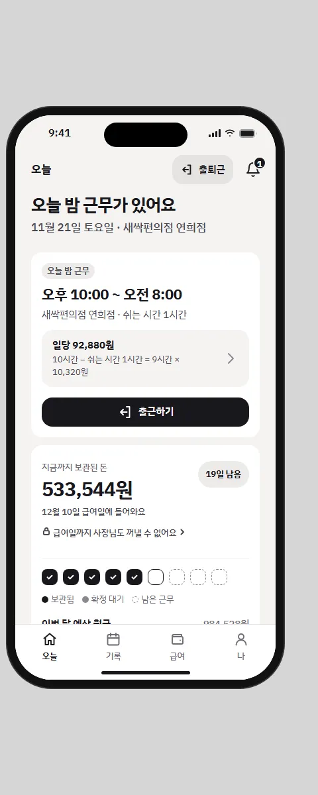
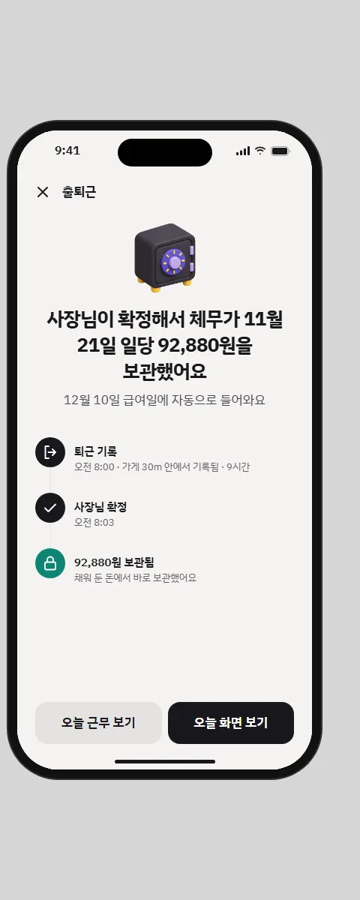
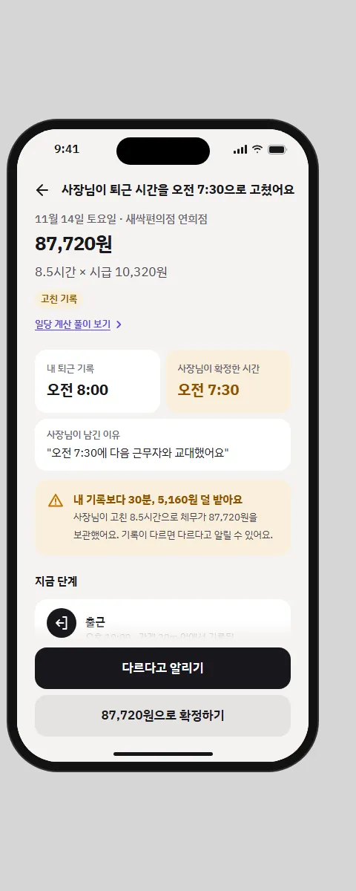
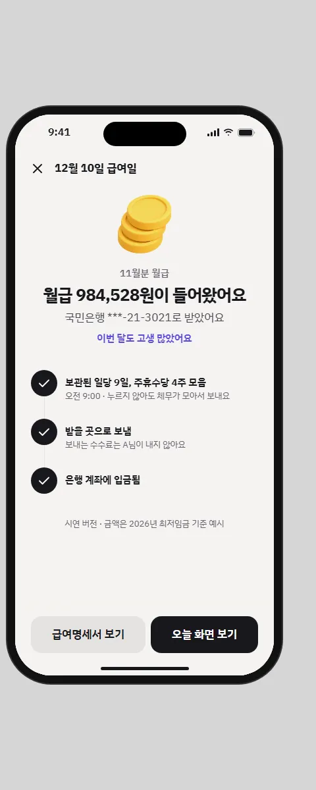
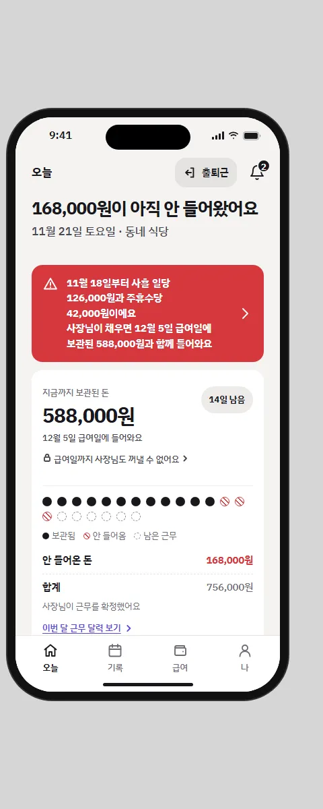
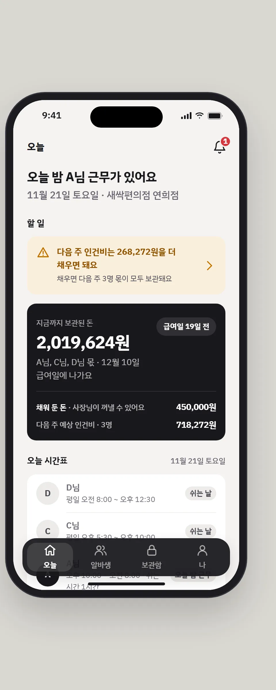
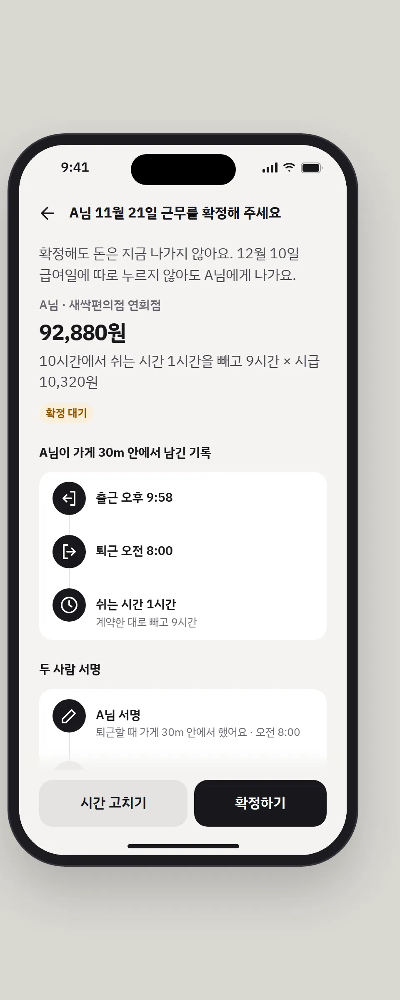
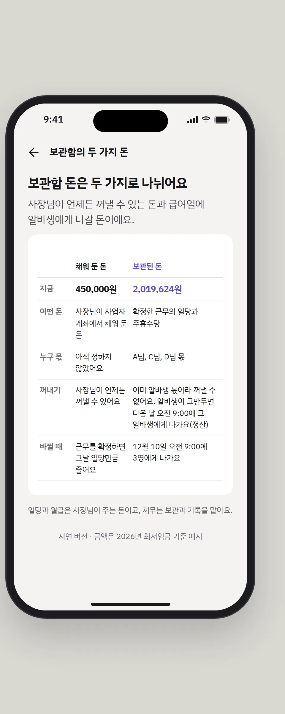
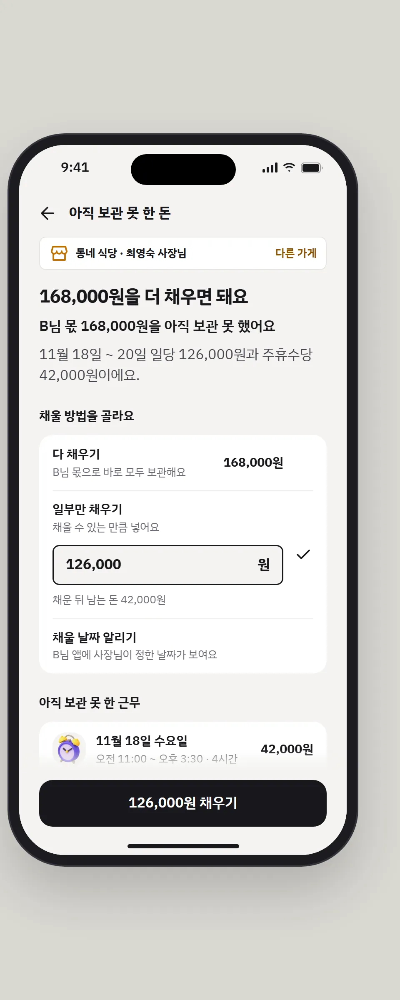
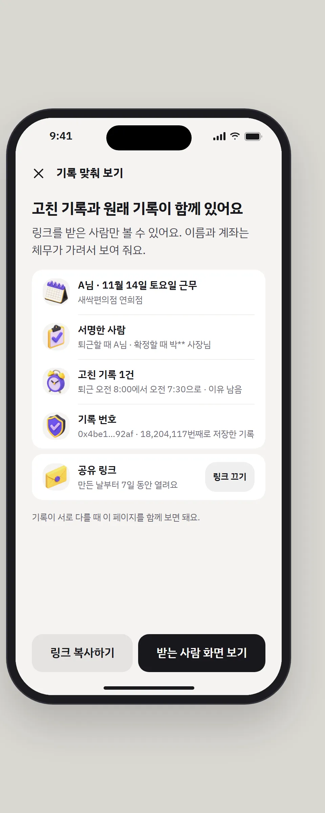

# 체무는 사장님이 확정한 날마다 일당을 먼저 보관합니다

체무는 알바생 앱(115화면), 사장님 앱(83화면), 링크를 받은 사람이 여는 기록 맞춰 보기 웹, 두 앱을 나란히 돌리는 1분 시연 모드로 이뤄집니다. 알바생 앱의 뼈대는 근로자 파트 이성재 님의 와이어프레임 3판이고, 정보 구조와 숫자는 그 판을 따릅니다.

- 화면 번호는 각 앱 PANEL 목록의 순서이고 0부터 셉니다. 앱 주소 뒤에 `?i=번호`를 붙이면 그 화면이 바로 열립니다.
- 화면 그림은 `screens_v80/worker/번호.webp`, `screens_v80/owner/번호.webp`입니다. 번호는 두 자리이고 100번부터는 세 자리입니다.
- PANEL 이름 뒤 괄호는 그 화면의 시점이나 갈래입니다(4절). 상대 앱 화면 칸의 앞 숫자는 상대 앱의 PANEL 번호입니다.
- 문구 규칙 전문은 [라이팅 가이드](라이팅_가이드.md), 그림 규칙 전문은 [그림 규격](그림_규격.md)에 있습니다.

## 1. 두 앱이 같이 쓰는 약속

| 항목 | 약속 |
|---|---|
| 돈의 두 상태 | 사장님이 보관함에 넣어 둔 돈은 **채워 둔 돈**이고 사장님이 언제든 꺼낼 수 있습니다. 사장님이 근무를 확정하면 체무가 채워 둔 돈에서 그날 일당을 알바생 몫으로 옮기고, 이 돈이 **보관된 돈**입니다. 보관된 돈은 급여일 전에 아무도 꺼낼 수 없습니다. 두 앱은 이 두 문장을 같은 말로 씁니다 |
| 출퇴근과 확정 | 알바생은 가게 30m 안에서만 출근과 퇴근을 누를 수 있고, 사장님이 그날 근무를 확정합니다. 같은 하루 기록에 알바생은 퇴근할 때, 사장님은 확정할 때 서명합니다. 확정 전 상태 이름은 `확정 대기`입니다 |
| 고친 기록 | 원래 기록은 지우지 않고 고친 기록과 이유를 덧붙입니다. 사장님이 시간을 고치면 알바생에게 바로 알림이 갑니다. 알바생은 기록이 다르면 다르다고 알릴 수 있고, 답이 나올 때까지 차이 나는 돈은 따로 남겨 둡니다 |
| 급여일 | 급여일 오전 9:00에 보관된 돈이 아무도 누르지 않아도 알바생이 고른 받을 곳으로 들어갑니다. 알바생 앱은 "들어와요", 사장님 앱은 "나가요"라고 씁니다 |
| 안 들어온 날 | 채워 둔 돈이 모자라 보관하지 못하면 사장님에게 바로, 알바생에게는 다음 날 오전 9:00에 알립니다. 보관, 입금, 입금 안 됨, 안 들어온 돈, 정산 알림은 알바생 앱에서 끌 수 없습니다 |
| 그만둘 때 | 그때까지 보관된 돈은 그만둔 다음 날 오전 9:00에 들어갑니다. 확정됐지만 보관되지 못한 돈은 금액과 날짜가 기록으로 남고, 그 돈을 줄 책임은 사장님에게 있습니다 |
| 사장님이 얻는 것 | 근무를 확정할 때마다 근무표, 임금대장, 급여명세서, 인건비 리포트가 저절로 쌓이고, 장부는 PDF와 엑셀로 내보냅니다 |
| 받을 곳 | 알바생 이름의 은행 계좌 하나입니다. "디지털 원화로 받기"는 처음 나올 때 한 줄로 풀어 보여 주고, 법이 마련되기 전에는 고를 수 없습니다 |
| 화면에 쓰지 않는 말 | 컨트랙트, 토큰, 블록체인, 지갑, 해시, 예치, 락업. 쉬운 말은 보관 규칙, 누구도 고칠 수 없는 기록, 기록 번호, 받을 곳입니다 |
| 색 | 바탕 웜그레이 `#f4f3f0`, 먹색 `#19181d`, 포인트 보라 `#5b4bdb` 하나. 빨강 `#d6383e`은 돈이 안 들어왔을 때만, 주황 글자 `#8f5200`은 기다리거나 확인할 일, 초록 글자 `#0a6658`은 안내입니다. 배지는 끝남, 지금, 확인 필요, 문제 있음, 다음 다섯 뜻이 두 앱에서 같습니다 |
| 글꼴과 크기 | IBM Plex Sans KR. 글자는 30, 26, 22, 20, 17, 15, 13px 일곱 단계와 단계마다 정한 줄 간격만 씁니다. 금액과 시각을 따로 보여 주는 칸은 고정폭 숫자입니다 |
| 간격과 모서리 | 간격은 4, 8, 12, 16, 24px와 이름 있는 간격(화면 좌우 24px, 부품 사이 12px, 묶음 사이 24px)만, 모서리는 8, 16, 24px와 알약 모양만 씁니다 |
| 오늘 카드 | 알바생 앱은 흰 카드(읽는 화면), 사장님 앱은 먹색 카드(보관함 총액 한 장)입니다 |
| 접근성 | 누르는 대상 44px 이상, 대상 사이 8px 이상(근무 달력 칸 사이 4px만 예외), 글자 200%에서 제목과 주 버튼이 첫 화면 안, 키보드 포커스에 보라 2px 테두리, 움직임 줄이기 설정이면 움직임을 모두 끕니다 |
| 시연 표시 | 화면 바닥에 "시연 버전 · 실제 돈 대신 연습용 돈으로 움직여요"를 둡니다. 시연 거래는 테스트넷의 모의 원화 토큰(KRWt)으로 움직이며 실제 예금이나 원화 스테이블코인이 아닙니다 |
| 12월 1일 거래 | 컨트랙트 함수는 채우기, 근무 확정과 보관, 급여일 입금 세 개입니다. 고친 기록, 차이 나는 돈 남겨 두기, 중도 정산, 다시 보관하는 거래는 2차에 만듭니다 |

## 2. 문구 원칙

화면 문구는 해요체이고, 돈이 어디 있는지 먼저 말합니다. 전문과 예외는 [라이팅 가이드](라이팅_가이드.md)에 있습니다.

| # | 원칙 | 체무에서 |
|---|---|---|
| 1 | 해요체로 씁니다 | 회사 잘못으로 생긴 에러에도 해요체입니다. "보관되었습니다" 대신 "보관했어요" |
| 2 | 소리 내어 읽기 쉬운 말 | 업무 한자어와 시스템 말 대신 일상어. "휴게" 대신 "쉬는 시간", "차액" 대신 "차이 나는 돈" |
| 3 | 돈을 움직인 주어가 보이게 | 사장님이 확정하고, 체무가 보관하고, 내가 받습니다. 보관되는 때는 "사장님이 확정한 날마다" |
| 4 | 탓하거나 재촉하거나 겁주지 않습니다 | "반드시", "즉시", "불이익", "~할 차례예요"를 쓰지 않습니다. 돈이 모자란 사장님에게 "168,000원을 더 채우면 돼요" |
| 5 | 문제가 생긴 화면일수록 돈이 있는 곳이 첫 줄 | "월급 984,528원은 그대로 보관돼 있어요" |
| 6 | 제목은 지금 상태나 결과 한 문장 | 20자 안팎, 최대 30자. 메뉴 이름만 쓰지 않고, 돈이 핵심이면 금액을 넣습니다 |
| 7 | 주 버튼은 15자 이하 "~하기" 하나 | 금액, 이름, 날짜, 계산식은 버튼 위 한 줄로 올립니다. 버튼 위 "어제 근무 2건, 185,760원" / [2건 확정하기] |
| 8 | 물러나는 버튼은 "닫기", "다음에" | "취소", "예", "아니요", "확인" 단독은 쓰지 않습니다 |
| 9 | 확인 창 제목은 "~할까요?" | 되돌릴 수 없으면 그 사실을 한 줄 남기고, 그림을 넣지 않습니다 |
| 10 | 에러는 일어난 일, 돈이 있는 곳, 해결 버튼 하나 | "확정을 보내지 못했어요 / 92,880원은 아직 채워 둔 돈에 있어요" / [다시 확정하기] |
| 11 | 막힌 행동은 풀리는 때를 먼저 | "12월 10일 급여일에 받을 돈이 들어오면 탈퇴할 수 있어요" |
| 12 | 같은 날을 시점마다 다르게 보이면 PANEL 이름에 시점 | 데이터에 없는 새 숫자를 만들지 않습니다 |

### 같은 것은 같은 이름으로

| 뜻 | 알바생 앱 | 사장님 앱 |
|---|---|---|
| 근무를 확정해 묶인 돈 | 보관된 돈 | 보관된 돈 · 급여일 전에 아무도 꺼낼 수 없어요 |
| 사장님이 넣어 두기만 한 돈 | 보이지 않음 | 채워 둔 돈 · 사장님이 꺼낼 수 있어요 |
| 보관되지 못한 돈 | 안 들어온 돈 | 아직 보관 못 한 돈 |
| 돈이 움직이는 말 | 들어와요 | 나가요 |
| 돈 이름 | 일당, 월급 | 일당, 월급(한 사람), 인건비(가게 전체) |
| 사장님이 하는 일 | 사장님 확정 | 근무 확정 |
| 고친 것 | 고친 기록 | 고친 기록 (버튼 [시간 고치기]) |
| 기록이 다를 때 | 다르다고 알리기 | 다르다고 알림 받음 ([A님 기록으로 바꾸기], [내 기록 그대로 두기]) |
| 채울 날짜 | 사장님이 12월 1일까지 돈을 채운다고 했어요 | 채울 날짜 알리기 |
| 출근하지 않은 날 | 결근으로 남은 날 | 결근으로 남기기 |
| 기록 확인 | 기록 원본 보기 | 기록 맞춰 보기 |
| 계약에서 고칠 것 | 고쳐 달라고 요청하기 | A님이 계약을 고쳐 달라고 요청함 |
| 시연 표시 | 실제 돈 대신 연습용 돈으로 움직여요 | 실제 돈 대신 연습용 돈으로 움직여요 |

### 숫자 표기

| 대상 | 쓰는 꼴 | 쓰지 않는 꼴 |
|---|---|---|
| 금액 | 92,880원 | ₩92,880, 92880원 |
| 날짜와 시각 | 11월 14일 토요일, 오후 10:00, 자정은 오전 0:00 | 11/14, 밤 10시, 22:00 |
| 범위 | 오후 10:00 ~ 오전 8:00 (앞뒤를 띄운 "~") | 대시, 붙여 쓴 ~ |
| 덜 받는 돈 | 알바생 앱 "5,160원 덜 받아요", 사장님 앱 "A님 일당이 5,160원 줄어요", 기록 맞춰 보기 웹 "A님 기록과 5,160원 차이 나요" | −5,160원 |
| 계산식 | 10시간 − 쉬는 시간 1시간 = 9시간 × 10,320원 = 92,880원 | 하이픈 빼기 |
| 버림 | 1원보다 작은 돈은 버립니다 | 반올림 |

## 3. 3D 그림

그림은 모두 30도 아이소메트릭, 무광 클레이 질감, 웜그레이 바탕 `#F4F3F0`이고 사람과 글자가 없습니다. 1판(히어로 44장 `iso_*`, 3D 아이콘 24개 `ic_*`)과 2판(히어로 19장과 돈이 움직이는 길 네 칸 4장 `iso2_*`, 큰 장면 2장 `scene_*`, 3D 아이콘 8개 `ic2_*`)이 함께 쓰입니다. 파일, 쓰는 화면, 새로 만드는 법은 [그림 규격](그림_규격.md)에 있습니다.

| 단계 | 화면 속 크기 | 파일 | 쓰는 화면 |
|---|---|---|---|
| 히어로 | 알바생 앱 200px, 사장님 앱과 기록 맞춰 보기 웹 208px. 화면 높이 700px 이하 168px | `iso_web/`, `iso_v2_web/` (640px WebP) | 정보가 적은 한 메시지 화면: 온보딩, 빈 화면, 경고, 기다림, 실패, 보낸 뒤 |
| 작은 사물 | 96px, 화면 높이 700px 이하 80px | `icon3d_lg/`, `icon3d_v2_lg/` (336px WebP) | 금액이 결과인 화면, 단순 완료, 히어로가 없는 빈 상태 |
| 행 아이콘 | 40px 칸, 모서리 16px | `icon3d_web/`, `icon3d_v2_web/` (160px WebP) | 목록 행, 메뉴, 알림 목록, 설정 행 |
| 네 칸 | 칸 폭에 맞춤, 한 화면의 네 장은 같은 크기 | `iso_v2_web/iso2_63` ~ `iso2_66` | 돈이 움직이는 길(알바생 52, 사장님 21) |
| 큰 장면 | 16:9 무대 전체 | `scene_v2/scene_demo_cover`, `scene_deck_cover` | 1분 시연 모드 표지, 발표 덱 표지 |

| 규칙 | 내용 |
|---|---|
| 몇 개 | 한 화면의 핵심 그림은 하나입니다. 히어로가 있으면 작은 사물을 두지 않고, 행 아이콘만 함께 쓸 수 있습니다. 네 칸은 하나뿐인 예외입니다 |
| 어디에 안 | 목록, 상세, 입력, 바텀시트, 확인 창, 민감 정보 입력, 로딩에는 히어로를 넣지 않습니다. 시트나 확인 창이 뜨면 덮인 화면의 그림을 숨깁니다 |
| 반복 | 서로 다른 뜻의 화면에 같은 그림을 쓰지 않고, 바로 이어지는 두 화면에 같은 히어로를 쓰지 않습니다 |
| 작은 화면 | 360×640에서 제목, 핵심 금액, 주 버튼이 첫 화면 안에 보여야 합니다. 넘치면 그림부터 줄이고 그래도 넘치면 뺍니다. 글자 130% 이상이면 히어로와 작은 사물을 숨깁니다 |
| 바탕 | 그림 바탕과 화면 바탕을 같은 `#F4F3F0`으로 두고, 가장 진한 색은 주 버튼에 남깁니다 |
| 화면 읽기 | 그림은 모두 장식이라 `alt=""`, `aria-hidden="true"`이고 뜻은 제목이 전합니다 |
| 움직임 | 화면을 열 때 히어로가 아래 8px에서 떠오르고(320ms), 완료 순간의 작은 사물은 0.92배에서 커지며 떠오릅니다. 반복이 없고 움직임 줄이기면 끕니다 |

## 4. 페르소나와 숫자

| | A님 | B님 |
|---|---|---|
| 누구 | 21세 대학생, 기숙사 생활. 코인 지갑은 써 본 적 없고 토스, 카카오뱅크는 매일 씀 | 25세, 휴학하고 공무원 시험 준비. 자취하며 월세와 식비를 알바비로 냄 |
| 일하는 곳 | 새싹편의점 연희점 (박정민 사장님) | 동네 식당 (최영숙 사장님) |
| 근무 | 토, 일 오후 10:00 ~ 오전 8:00, 쉬는 시간 1시간, 하루 9시간, 한 주 18시간 | 평일 오전 11:00 ~ 오후 3:30, 쉬는 시간 30분, 하루 4시간, 한 주 20시간 |
| 시급 | 10,320원 (2026년 최저임금) | 10,500원 |
| 일당 | 92,880원 | 42,000원 |
| 주휴수당 | 한 주 37,152원 | 한 주 42,000원 |
| 급여일 | 매달 10일 | 매달 5일 |
| 받을 곳 | 국민은행 계좌 | 신한은행 계좌 |
| 보여 주는 장면 | 정상 흐름, 사장님이 시간을 고침, 다르다고 알리기, 급여일 자동 입금 | 11월 18일부터 일당이 보관되지 않은 안 들어온 돈, 그만두고 정산 |

사장님 앱의 "알바 3명" 화면에는 새싹편의점의 C님(평일 오후 5:30 근무)과 D님(오전 8:00 근무)이 함께 나옵니다. 인물과 가게는 가상입니다.

### A님의 숫자

| 숫자 | 금액 | 나오는 곳 |
|---|---|---|
| 일당 | 92,880원 = (10시간 − 쉬는 시간 1시간) 9시간 × 10,320원 | 알바생 10 일당 계산 풀이, 15 퇴근, 일당 보관 |
| 주휴수당 | 한 주 37,152원 = 한 주 18시간 ÷ 40 × 8 × 10,320원 | 알바생 29 주휴수당 풀이, 06 계약 확인: 주휴수당 빠짐 |
| 11월 21일 보관된 돈 | 533,544원 = 근무 5일 459,240원 + 주휴수당 2주 74,304원 | 알바생 08 오늘: 보관된 돈, 사장님 06 오늘 |
| 11월 21일 근무가 보관된 뒤 | 626,424원 = 533,544원 + 92,880원 | 알바생 60 오늘: 퇴근 뒤 보관됨 |
| 급여일 12월 10일 월급 | 984,528원 = 근무 9일 835,920원 + 주휴수당 4주 148,608원 | 알바생 33 급여일 자동 입금, 사장님 28 자동 입금 완료 |

11월 21일 보관된 돈 533,544원의 근무 5일 가운데 11월 14일은 고친 기록 87,720원으로 들어 있습니다. 급여일 984,528원은 11월 14일이 A님 기록 9시간 92,880원으로 바뀐 뒤의 금액이라, 이번 달 예상 월급이 보이는 11월 21일 화면은 PANEL 이름에 "예상 월급은 결정 뒤"를 붙입니다.

### 11월 14일 토요일 근무의 시점

A님은 11월 14일 오후 10:00에 출근해 다음 날 오전 8:00에 퇴근을 눌렀습니다. 사장님은 11월 15일에 퇴근을 오전 7:30으로 고쳐 확정했습니다. 같은 근무가 시점마다 다르게 보여서, 화면마다 시점을 PANEL 이름 괄호에 적습니다.

| 시점 | 11월 14일 기록 | 11월 14일 보관된 돈 | 화면 |
|---|---|---|---|
| 11월 15일, 고치기 전 | A님 기록 오후 10:00 ~ 오전 8:00, 9시간 | 확정 대기 | 사장님 13 시간 고치기 (11월 15일) |
| 11월 21일, 다르다고 알리기 전 | 사장님이 고친 기록 퇴근 오전 7:30, 8.5시간 | 87,720원. 알바생 앱에서 "내 기록보다 30분, 5,160원 덜 받아요" | 알바생 08, 09, 16, 18, 19, 71, 103, 사장님 06, 08, 33 |
| 다르다고 알린 뒤 답 기다림 (결정 전) | 고친 기록, A님이 다르다고 알림 | 87,720원 보관, 차이 나는 5,160원은 따로 남김 | 알바생 62, 94, 사장님 14, 64, 기록 맞춰 보기 웹 |
| A님 기록으로 바꿈 (결정 뒤) | A님 기록 9시간 | 92,880원, 5,160원이 더 보관됨. 급여일 984,528원이 이 금액을 씀 | 알바생 26, 33, 사장님 15, 25, 28 |
| 내 기록 그대로 둠 (다른 갈래) | 사장님 기록 8.5시간 | 87,720원, 차이 나는 5,160원은 채워 둔 돈으로 돌아감 | 알바생 27, 사장님 16 |

### B님의 숫자

B님은 11월 18일, 19일, 20일 근무가 확정됐지만 동네 식당의 채워 둔 돈이 모자라 보관되지 않았습니다. 사흘 일당 126,000원과 11월 16일 ~ 20일 주휴수당 42,000원, 모두 168,000원입니다. 그 전까지 보관된 588,000원은 B님 몫이라 그대로 있고, 사장님이 채우면 12월 5일 급여일에 함께 들어갑니다. 사장님이 일부만 채우는 예는 사흘 일당 126,000원이고, 남는 돈은 주휴수당 한 주와 같은 42,000원입니다. 채울 날짜 12월 1일은 예시입니다.

## 5. 알바생 앱 (115화면)

화면 이름을 누르면 화면 그림이 열립니다. "누른 뒤 상태", "확인 창", "에러와 빈 상태", "누르면 열리는 시트", "입력 화면" 묶음은 누르고 나서야 열리는 상태와 실패 상태를 화면 목록에 올린 것입니다. 들어오는 길과 나가는 길 칸의 괄호 숫자는 같은 앱의 PANEL 번호입니다. 사람이 바뀌거나 시간이 지나야 열리는 화면(알림으로 여는 화면)은 앞 화면에서 눌러 가는 길이 없습니다.

| 번호 | 화면 | 이 화면이 답하는 질문 | 들어오는 길 | 나가는 길 | 이어지는 사장님 앱 화면 |
|---|---|---|---|---|---|
| | **시작하기 (A)** | | | | |
| 00 | [초대받고 가입](screens_v80/worker/00.webp) | 누가 나를 어느 가게에 초대했고 하루 일당은 얼마인가 | 사장님이 보낸 초대 문자 링크 | 시작하기 뒤 휴대폰 본인 확인, 받을 곳, 알림, 계약 확인 | 알바생 초대 상태, 01 근로계약 올리기 |
| 01 | [초대 링크 기간 지남](screens_v80/worker/01.webp) | 초대 링크가 열리지 않으면 어떻게 다시 받나 | 기간이 지난 초대 문자 링크 | 사장님께 새 초대를 요청하기 뒤 새 초대 문자 | 알바생 초대 상태(다시 보내기) |
| 02 | [휴대폰 본인 확인](screens_v80/worker/02.webp) | 이 초대가 정말 내 번호로 온 것인가 | 초대 화면의 시작하기 | 본인 확인하기 뒤 받을 곳 등록, 번호 고치기, 인증번호 다시 받기 | 알바생 초대 상태(열어 봄) |
| 03 | [받을 곳 등록: 계좌 확인](screens_v80/worker/03.webp) | 월급 받을 원화 계좌가 내 이름의 계좌가 맞나 | 본인 확인 다음 단계 | 확인 완료 뒤 다음(알림) | 알바생 초대 상태(확정 완료), 급여일 |
| 04 | [알림 허용: 휴대폰 알림 꺼짐](screens_v80/worker/04.webp) | 알림이 꺼져 있으면 안 들어온 돈을 어떻게 알게 되나 | 받을 곳 등록 다음 단계(휴대폰 알림 권한이 꺼져 있을 때) | 알림 켜기, 다음에 뒤 계약 확인 | B님에게 간 알림 확인 |
| 05 | [계약서가 아직 안 옴](screens_v80/worker/05.webp) | 가입했는데 왜 아직 일당 보관이 시작되지 않나 | 가입 마지막 단계, 나 탭 근로계약서 | 사장님께 계약서 요청하기, 계약서가 오면 계약 확인 | 알바생 초대 상태, 01 근로계약 올리기 |
| 06 | [계약 확인: 주휴수당 빠짐](screens_v80/worker/06.webp) | 이 계약대로 일해도 손해가 없나 | 가입 마지막 단계, 나 탭 근로계약서 | 수정 요청하기, 주휴수당 없이 확정하기 | 01 근로계약 올리기 |
| 07 | [계약 확인: 고쳐진 계약](screens_v80/worker/07.webp) | 고쳐진 계약을 확정하면 무엇이 시작되나 | 수정 요청 뒤 "사장님이 계약을 고쳤어요" 알림 | 계약 확정하기 뒤 계약: 확정됨 | 01 근로계약 올리기 |
| | **A의 근무하는 날** | | | | |
| 08 | [오늘: 보관된 돈 (11월 21일, 예상 월급은 결정 뒤)](screens_v80/worker/08.webp) | 지금까지 내 돈이 얼마나 보관됐나 | 앱 열기, 하단 오늘 탭 | 출근하기, 일당 계산 보기, 근무 달력 보기, 보관된 돈 설명, 최근 일당 행 | 06 오늘, 17 보관함 |
| 09 | [이번 달 근무 달력 (11월 21일)](screens_v80/worker/09.webp) | 이번 달 어느 날이 보관됐고 어느 날이 남았나 | 오늘의 근무 달력 보기, 기록 탭 달력 보기 | 날짜를 눌러 하루 상세, 주휴수당 풀이 | 35 반복 근무표, 06 오늘 |
| 10 | [일당 계산 풀이](screens_v80/worker/10.webp) | 일당 92,880원은 어떻게 나온 숫자인가 | 오늘의 일당 줄, 하루 상세, 계약 확인의 일당 줄, 급여 탭 근무 줄 | 주휴수당 풀이 | 주휴수당 풀이(사장님용), 31 이번 달 인건비 리포트 |
| 11 | [출근하기](screens_v80/worker/11.webp) | 지금 출근을 눌러도 되나 | 오늘 화면 출근하기, 머리 출퇴근 버튼 | 출근하기 뒤 근무 중 | 06 오늘(출근한 알바 표시) |
| 12 | [출근하기: 위치 꺼짐](screens_v80/worker/12.webp) | 왜 출근이 안 눌리고 어떻게 하면 되나 | 출근하기 화면(휴대폰 위치가 꺼져 있을 때) | 위치 켜기 뒤 출근하기 | 06 오늘(출근한 알바 표시) |
| 13 | [출근하기: 인터넷 끊김](screens_v80/worker/13.webp) | 인터넷이 끊겼는데 출근이 기록됐나 | 출근하기를 누른 순간 연결이 없을 때 | 연결 다시 확인하기, 퇴근하기 | 06 오늘(연결되면 출근 표시) |
| 14 | [근무 중](screens_v80/worker/14.webp) | 언제 출근했고 얼마나 일했나 | 출근하기 | 퇴근하기 확인 창 뒤 확정 대기 | 06 오늘 |
| 15 | [퇴근, 일당 보관](screens_v80/worker/15.webp) | 오늘 일당이 정말 보관됐나 | 퇴근 뒤 사장님 근무 확정 | 자세히 보기(하루 상세), 확인(오늘) | 09 근무 확정, 17 보관함 |
| 16 | [근무 기록 (11월 21일)](screens_v80/worker/16.webp) | 내 근무 가운데 챙길 것이 있나 | 하단 기록 탭, 오늘의 전체 보기 | 하루 상세, 확인 필요 칩, 달력 보기 | 06 오늘, 09 근무 확정 |
| 17 | [하루 상세](screens_v80/worker/17.webp) | 이날 일당이 어디까지 왔나 | 기록 목록, 보관 알림, 근무 달력 | 일당 계산 풀이 보기, 기록 원본 보기 | 09 근무 확정, 17 보관함 |
| 18 | [사장님이 시간을 고침 (11월 21일)](screens_v80/worker/18.webp) | 사장님이 고친 시간이 맞나 | 시간 고침 알림, 기록의 확인 필요 | 다르다고 알리기, 87,720원으로 확정하기 | 13 시간 고치기 |
| 19 | [다르다고 알리기 (11월 21일)](screens_v80/worker/19.webp) | 무엇이 다른지 사장님께 어떻게 말하나 | 시간 고침의 다르다고 알리기 | 사장님께 보내기 뒤 하루 상세(다르다고 알린 뒤 답 기다림) | 14 다르다고 알림 받음 |
| 20 | [출근하기: 가게 30m 밖](screens_v80/worker/20.webp) | 왜 출근이 안 눌리고 어떻게 하면 되나 | 출근하기 화면에서 위치가 30m 밖일 때 | 위치 다시 찾기 뒤 출근하기 | 06 오늘(가게 위치) |
| 21 | [퇴근 뒤 확정 대기](screens_v80/worker/21.webp) | 퇴근했는데 일당은 언제 보관되나 | 퇴근하기 직후 | 확정 알림 뒤 퇴근, 일당 보관 | 09 근무 확정 |
| 22 | [확정이 하루 넘게 늦음](screens_v80/worker/22.webp) | 퇴근한 지 하루가 넘었는데 왜 아직 보관이 안 됐나 | 확정 지연 알림, 기록의 확정 대기 줄 | 사장님께 확정 요청 다시 보내기, 기록 내보내기 | 어제 확정을 안 한 퇴근 |
| 23 | [퇴근을 못 누르고 나옴](screens_v80/worker/23.webp) | 퇴근을 못 누르고 나왔으면 그날 일당은 어떻게 되나 | 다음 날 오전 9시 알림, 오늘의 주황 안내 | 사장님께 확인 요청하기 뒤 확정 대기 | 어제 확정을 안 한 퇴근, 13 시간 고치기 |
| 24 | [쉬는 시간 1시간을 못 쉼](screens_v80/worker/24.webp) | 쉬지 못한 휴게 1시간은 돈으로 받을 수 있나 | 오늘 근무 하루 상세의 휴게를 못 쉬었나요 | 사장님께 확인 요청하기 뒤 하루 상세 | 13 시간 고치기, 09 근무 확정 |
| 25 | [근무 기록: 확인할 근무 없음](screens_v80/worker/25.webp) | 내가 챙길 근무가 남았나 | 기록 탭 확인 필요 칩(시간 고침을 확정한 뒤) | 전체 칩, 오늘 탭 | 09 근무 확정 |
| 26 | [다르다고 알린 결과: 내 기록으로 바뀜 (결정 뒤)](screens_v80/worker/26.webp) | 다르다고 알린 기록이 받아들여져 얼마가 더 들어오나 | 다르다고 알린 결과 알림 | 확인 뒤 알림, 하루 상세 | 14 다르다고 알림 받음 |
| 27 | [다르다고 알린 결과: 기록 그대로 둠 (다른 갈래)](screens_v80/worker/27.webp) | 다르다고 알린 기록이 받아들여지지 않으면 무엇을 할 수 있나 | 다르다고 알린 결과 알림 | 기록 내보내기, 1350 상담 | 14 다르다고 알림 받음, 32 장부 내보내기 |
| | **A의 급여일** | | | | |
| 28 | [급여: 보관 현황](screens_v80/worker/28.webp) | 이번 급여일에 얼마를 어디로 받나 | 하단 급여 탭 | 일당 계산 풀이, 주휴수당 풀이, 보관된 돈 설명, 받을 곳 고르기, 지난 급여명세서 | 17 보관함, 급여일 |
| 29 | [주휴수당 풀이](screens_v80/worker/29.webp) | 주휴수당 37,152원은 어떻게 나온 숫자이고 언제 쌓이나 | 급여 탭 주휴수당 줄, 주휴수당 하루 상세, 나 탭 도움 | 주휴수당 하루 상세 | 주휴수당 풀이(사장님용) |
| 30 | [보관된 돈은 누가 꺼낼 수 있나요](screens_v80/worker/30.webp) | 보관된 내 돈을 사장님이 도로 가져갈 수 있나 | 급여 탭 궁금한 점, 오늘의 "사장님도 꺼낼 수 없어요" | 기록 원본 보기 | 채워 둔 돈과 보관된 돈 설명, 24 보관된 돈을 꺼내려 할 때 |
| 31 | [받을 곳 고르기](screens_v80/worker/31.webp) | 월급을 어디로 받나 | 급여의 받을 곳, 나 탭, 입금 실패 화면 | 확인 뒤 원래 화면 | 급여일 |
| 32 | [급여일 아침 (오전 9시 전)](screens_v80/worker/32.webp) | 오늘 월급이 몇 시에 얼마 들어오나 | 급여일 아침 알림, 급여일에 앱 열기 | 확인, 받을 곳 바꾸기, 오전 9시 자동 입금 | 12월 10일 가게 전체 급여 미리보기 |
| 33 | [급여일 자동 입금 (12월 10일, 결정 뒤)](screens_v80/worker/33.webp) | 아무도 누르지 않아도 월급이 들어왔나 | 급여일 오전 9시 알림 | 급여명세서 보기, 확인 | 급여일 |
| 34 | [급여명세서](screens_v80/worker/34.webp) | 이번 월급이 어떻게 계산됐나 | 급여일 완료, 급여 탭 지난 명세서, 입금 알림 | PDF로 저장하기, 기록 원본 보기 | 30 급여명세서 |
| 35 | [급여일: 자동 입금 실패](screens_v80/worker/35.webp) | 월급이 안 들어왔는데 돈은 어디 있고 무엇을 하면 되나 | 입금 실패 알림 | 받을 곳 고치기 뒤 다시 입금 요청하기 | 급여일, 입금 실패 후 다시 보내기 |
| | **B의 안 들어온 돈** | | | | |
| 36 | [오늘: 안 들어온 돈](screens_v80/worker/36.webp) | 확정된 근무의 돈이 왜 안 들어왔나 | 앱 열기, 아침 9시 알림 | 빨간 안내를 눌러 안 들어온 돈 | 40 아직 보관 못 한 돈 |
| 37 | [알림](screens_v80/worker/37.webp) | 어떤 돈이 언제 안 들어왔나 | 머리 종 버튼 | 안 들어온 돈, 하루 상세 | 40 아직 보관 못 한 돈 |
| 38 | [안 들어온 돈](screens_v80/worker/38.webp) | 안 들어온 돈이 얼마이고 무엇을 할 수 있나 | 오늘의 빨간 안내, 알림 | 안 들어온 돈 알림 단계, 사장님께 알림 보내기(문자 보기 시트), 기록 내보내기, 노동청 진정 안내, 그만두고 정산 | 40 아직 보관 못 한 돈 |
| 39 | [안 들어온 돈: 사장님이 날짜를 알림](screens_v80/worker/39.webp) | 사장님이 언제 채운다고 했고, 그날이 지나면 어떻게 되나 | "사장님이 12월 1일까지 채우겠다고 했어요" 알림, 오늘의 빨간 안내 | 날짜가 지나면 다음 날(12월 2일) 오전 9시 안내, 사장님께 알림 보내기, 기록 내보내기 | 42 채울 날짜 알리기, 40 아직 보관 못 한 돈 |
| 40 | [사장님에게 알리기 전 문자 보기](screens_v80/worker/40.webp) | 사장님께 어떤 문자가 가는지 보고 보낼 수 있나 | 안 들어온 돈의 사장님께 알림 보내기, 알림 단계의 사장님께 다시 알리기 | 보내기 뒤 안 들어온 돈(보냄 표시), 다음에 | 40 아직 보관 못 한 돈, B님에게 간 알림 확인 |
| 41 | [안 들어온 돈 알림 단계](screens_v80/worker/41.webp) | 안 들어온 돈 문제가 지금 몇 단계이고 다음은 무엇인가 | 안 들어온 돈의 단계 줄 | 사장님께 다시 알리기(문자 보기 시트), 기록 내보내기, 노동청 진정 안내 | B님에게 간 알림 확인, 40 아직 보관 못 한 돈 |
| 42 | [보관 안 된 하루](screens_v80/worker/42.webp) | 이날 돈이 어디서 멈췄나 | 안 들어온 돈 목록 | 안 들어온 돈 보기 | 40 아직 보관 못 한 돈 |
| 43 | [기록 내보내기](screens_v80/worker/43.webp) | 노동청에 낼 기록을 어떻게 한 장으로 만드나 | 안 들어온 돈, 안 들어온 돈 알림 단계, 나 탭, 다르다고 알린 결과 | PDF로 저장하기, 링크 복사하기, 이 PDF로 노동청에 진정하기 | 32 장부 내보내기 |
| 44 | [노동청 진정 안내](screens_v80/worker/44.webp) | 기록을 내보낸 다음 노동청에 어떻게 진정하나 | 기록 내보내기의 다음 단계, 안 들어온 돈 알림 단계, 안 들어온 돈 | 노동포털에서 진정하기, 1350 상담하기 | B님에게 간 알림 확인, 32 장부 내보내기 |
| 45 | [그만두고 정산](screens_v80/worker/45.webp) | 지금 그만두면 얼마를 언제 받나 | 안 들어온 돈, 나 탭 | 정산 받기 뒤 확인 시트, 다음 날 오전 9시 입금 | 46 그만둔 알바 정산 |
| 46 | [정산 받기 전 확인](screens_v80/worker/46.webp) | 정산을 누르면 사장님께 무엇이 알려지나 | 그만두고 정산의 정산 받기 | 알리고 정산 받기 뒤 다음 날 오전 9시 입금, 다음에 | 46 그만둔 알바 정산 |
| 47 | [안 들어온 돈이 보관됨](screens_v80/worker/47.webp) | 안 들어온 돈이 다 들어왔나 | 보관 알림, 오늘 | 다시 보관된 날의 하루 상세 | 40 아직 보관 못 한 돈, 17 보관함 |
| | **공통** | | | | |
| 48 | [오늘: 불러오는 중](screens_v80/worker/48.webp) | 화면이 비어 보이는데 앱이 멈춘 것인가 | 앱 열기, 느린 연결 | 다 불러오면 오늘 화면, 못 불러오면 불러오지 못함 | 06 오늘 |
| 49 | [오늘: 불러오지 못함](screens_v80/worker/49.webp) | 불러오지 못하면 내 돈은 괜찮은가, 무엇을 누르나 | 불러오는 중에 연결이 끊겼을 때 | 다시 불러오기 뒤 오늘 | 06 오늘 |
| 50 | [알림 (A, 11월 21일)](screens_v80/worker/50.webp) | 내 돈에 무슨 일이 있었나 | 머리 종 버튼 | 알림마다 그 화면(하루 상세, 급여명세서) | 09 근무 확정, 13 시간 고치기, 급여일 |
| 51 | [내 정보](screens_v80/worker/51.webp) | 내 계약, 받을 곳, 알림은 어떻게 되어 있나 | 하단 나 탭 | 근로계약서, 받을 곳, 기록 내보내기, 그만두고 정산 | 01 근로계약 올리기 |
| | **설명 화면** | | | | |
| 52 | [돈이 움직이는 길](screens_v80/worker/52.webp) | 원화 스테이블코인 1:1 상환은 누가 하고, 돈은 어디서 어디로 가나 | 보관된 돈은 누가 꺼낼 수 있나요의 돈이 움직이는 길 줄, 급여 탭 궁금한 점 | 뒤로(보관된 돈 설명, 급여) | 21 돈이 움직이는 길, 보관함 맨 위 두 돈 설명 |
| | **누른 뒤 상태 (A)** | | | | |
| 53 | [초대: 새 초대 요청함](screens_v80/worker/53.webp) | 새 초대를 요청했는데 이제 무엇을 기다리나 | 초대 링크 기간 지남의 사장님께 새 초대를 요청하기 | 새 초대 문자 링크 | 알바생 초대 상태(다시 보내기) |
| 54 | [알림 허용: 알림 켜짐](screens_v80/worker/54.webp) | 어떤 때 알림이 오고 무엇은 끌 수 없나 | 받을 곳 등록 다음 단계(휴대폰 알림이 켜져 있을 때) | 계약 확인하러 가기 | B님에게 간 알림 확인 |
| 55 | [계약서 요청함](screens_v80/worker/55.webp) | 계약서를 요청했는데 언제 오나 | 계약서가 아직 안 옴의 사장님께 계약서 요청하기 | 계약서가 오면 계약 확인 | 01 근로계약 올리기 |
| 56 | [계약: 고쳐 달라고 함](screens_v80/worker/56.webp) | 수정 요청을 보낸 뒤 무엇을 기다리나 | 계약 확인의 수정 요청하기 | 사장님이 고치면 고쳐진 계약 | 01 근로계약 올리기(수정 요청 받음) |
| 57 | [계약: 확정됨](screens_v80/worker/57.webp) | 계약이 확정됐고 이제 무엇이 시작되나 | 고쳐진 계약의 계약 확정하기, 나 탭 근로계약서 | 확인 뒤 오늘 | 알바생 초대 상태(확정 완료) |
| 58 | [오늘: 근무 중 (11월 21일, 예상 월급은 결정 뒤)](screens_v80/worker/58.webp) | 출근한 뒤 오늘 화면에는 무엇이 보이나 | 출근하기 | 퇴근하기 | 06 오늘(출근한 알바 표시) |
| 59 | [오늘: 퇴근 뒤 확정 대기 (11월 21일, 예상 월급은 결정 뒤)](screens_v80/worker/59.webp) | 퇴근한 뒤 오늘 일당은 어디까지 왔나 | 퇴근 뒤 확정 대기의 확인 | 오늘 근무 카드를 눌러 하루 상세 | 09 근무 확정 |
| 60 | [오늘: 퇴근 뒤 보관됨 (11월 21일, 예상 월급은 결정 뒤)](screens_v80/worker/60.webp) | 오늘 일당이 보관된 뒤 오늘 화면은 어떻게 바뀌나 | 퇴근, 일당 보관의 확인 | 오늘 근무 카드를 눌러 하루 상세 | 09 근무 확정, 17 보관함 |
| 61 | [오늘: 어제 퇴근 기록 없음 (11월 22일, 예상 월급은 결정 뒤)](screens_v80/worker/61.webp) | 어제 퇴근을 못 눌렀다는 것을 어디서 알게 되나 | 다음 날 오전 9시 알림, 앱 열기 | 주황 안내를 눌러 퇴근 기록 남기기 | 어제 확정을 안 한 퇴근 |
| 62 | [다르다고 알린 뒤 답 기다림 (결정 전)](screens_v80/worker/62.webp) | 다르다고 알린 뒤 차이 나는 돈은 어디 있나 | 다르다고 알리기 시트의 보내기 | 다르다고 알린 결과 알림 | 14 다르다고 알림 받음 |
| 63 | [주휴수당 하루 상세](screens_v80/worker/63.webp) | 이번 주 주휴수당이 보관됐나 | 기록 목록의 주휴수당 줄, 주휴수당 보관 알림 | 주휴수당이란?(주휴수당 풀이) | 주휴수당 풀이(사장님용) |
| 64 | [확정 요청 다시 보낸 뒤](screens_v80/worker/64.webp) | 확정 요청을 다시 보낸 뒤 무엇이 남았나 | 확정이 하루 넘게 늦음의 사장님께 확정 요청 다시 보내기 | 내일 오전 9시 다시 알림, 기록 내보내기 | 어제 확정을 안 한 퇴근 |
| 65 | [퇴근 기록 보낸 뒤](screens_v80/worker/65.webp) | 퇴근 시간을 보낸 뒤 일당은 언제 보관되나 | 퇴근을 못 누르고 나옴의 사장님께 확인 요청하기 | 확인 뒤 오늘 | 어제 확정을 안 한 퇴근, 13 시간 고치기 |
| 66 | [못 쉰 쉬는 시간 알린 뒤](screens_v80/worker/66.webp) | 못 쉰 1시간을 보낸 뒤 얼마가 더 보관되나 | 쉬는 시간 1시간을 못 쉼의 사장님께 확인 요청하기 | 확인 뒤 하루 상세 | 13 시간 고치기 |
| | **누른 뒤 상태 (B)** | | | | |
| 67 | [주휴수당 보관 전](screens_v80/worker/67.webp) | 이번 주 주휴수당은 왜 안 들어왔나 | 안 들어온 돈 목록의 주휴수당 줄 | 할 수 있는 일 보기, 안 들어온 돈 보기 | 40 아직 보관 못 한 돈 |
| 68 | [안 들어온 돈: 알림 보낸 뒤](screens_v80/worker/68.webp) | 사장님께 알림을 보낸 뒤 다음은 무엇인가 | 사장님께 알리기 전 문자 보기의 보내기 | 안 들어온 돈 알림 단계(3단계), 기록 내보내기 | B님에게 간 알림 확인, 40 아직 보관 못 한 돈 |
| 69 | [정산 요청 뒤](screens_v80/worker/69.webp) | 정산을 요청한 뒤 언제 얼마가 들어오나 | 정산 받기 전 확인의 알리고 정산 받기 | 확인 뒤 오늘 | 46 그만둔 알바 정산 |
| | **확인 창** | | | | |
| 70 | [퇴근 확인 창](screens_v80/worker/70.webp) | 지금 퇴근을 눌러도 되나 | 근무 중의 퇴근하기 | 퇴근하기 뒤 퇴근 뒤 확정 대기, 다음에 | 09 근무 확정 |
| 71 | [87,720원으로 확정 확인 창 (11월 21일)](screens_v80/worker/71.webp) | 사장님 기록대로 확정하면 무엇이 바뀌나 | 사장님이 시간을 고침의 87,720원으로 확정하기 | 확정하기 뒤 하루 상세, 닫기 | 13 시간 고치기 |
| 72 | [기록 원본 보기 창](screens_v80/worker/72.webp) | 이 보관 기록은 정말 고칠 수 없나 | 하루 상세, 급여명세서, 보관된 돈 설명의 기록 원본 보기 | 원본 열기, 닫기 | 39 기록 맞춰 보기 |
| 73 | [계약 고쳐 달라고 요청하기 확인 창](screens_v80/worker/73.webp) | 수정 요청을 누르면 사장님께 무엇이 가나 | 계약 확인의 수정 요청하기 | 요청하기 뒤 계약: 고쳐 달라고 함, 다음에 | 01 근로계약 올리기 |
| 74 | [주휴수당 없이 확정하기 확인 창](screens_v80/worker/74.webp) | 주휴수당 없이 확정하면 얼마를 덜 받나 | 계약 확인의 주휴수당 없이 확정하기 | 확정하기 뒤 계약: 확정됨, 닫기 | 01 근로계약 올리기 |
| 75 | [계약 확정하기 확인 창](screens_v80/worker/75.webp) | 확정하면 언제부터 일당이 보관되나 | 고쳐진 계약의 계약 확정하기 | 확정하기 뒤 계약: 확정됨, 닫기 | 알바생 초대 상태(확정 완료) |
| 76 | [계약서 요청 확인 창](screens_v80/worker/76.webp) | 계약서를 요청하면 사장님께 무엇이 가나 | 계약서가 아직 안 옴의 사장님께 계약서 요청하기 | 요청하기 뒤 계약서 요청함, 다음에 | 01 근로계약 올리기 |
| 77 | [퇴근 시간 보내기 확인 창](screens_v80/worker/77.webp) | 이 퇴근 시간으로 보내면 얼마가 보관되나 | 퇴근을 못 누르고 나옴의 사장님께 확인 요청하기 | 보내기 뒤 퇴근 기록 보낸 뒤, 다음에 | 어제 확정을 안 한 퇴근 |
| 78 | [못 쉰 시간 알리기 확인 창](screens_v80/worker/78.webp) | 못 쉰 1시간을 보내면 얼마로 보관되나 | 쉬는 시간 1시간을 못 쉼의 사장님께 확인 요청하기 | 보내기 뒤 못 쉰 쉬는 시간 알린 뒤, 다음에 | 13 시간 고치기 |
| 79 | [1350 전화 확인 창](screens_v80/worker/79.webp) | 고용노동부 상담에 언제 전화할 수 있나 | 안 들어온 돈, 다르다고 알린 결과, 노동청 진정 안내, 나 탭의 1350 | 전화하기, 닫기 | 없음 |
| | **에러와 빈 상태** | | | | |
| 80 | [인증번호가 맞지 않음](screens_v80/worker/80.webp) | 인증번호가 틀리거나 시간이 지나면 무엇을 하면 되나 | 휴대폰 본인 확인의 본인 확인하기 | 인증번호 다시 받기와 닫기 → 휴대폰 본인 확인 | 05 알바생 3명 초대 상태 |
| 81 | [계좌 주인 이름이 다름](screens_v80/worker/81.webp) | 받을 계좌의 주인 이름이 가입한 이름과 다르면 월급은 어떻게 되나 | 받을 곳 등록의 계좌 확인 | 받을 곳 다시 등록하기 → 받을 곳 등록: 계좌 확인 | 05 알바생 3명 초대 상태 |
| 82 | [퇴근할 때 위치를 못 찾음](screens_v80/worker/82.webp) | 퇴근하려는데 위치가 안 잡히면 출근 기록과 일당은 어떻게 되나 | 근무 중의 퇴근하기 | 위치 다시 찾기 → 근무 중, 퇴근 확인 창 | 09 근무 확정 |
| | **받을 곳, 알림 설정, 결근 (A)** | | | | |
| 83 | [받을 곳 바꾸기](screens_v80/worker/83.webp) | 월급 받을 계좌를 바꾸면 언제부터 새 계좌로 들어오나 | 나 탭 받을 곳, 받을 곳 고르기 시트의 다른 계좌로 바꾸기 | 본인 확인하기 뒤 받을 곳 바꾸기: 본인 확인 | 알바생 받을 곳 등록 알림(E16) |
| 84 | [받을 곳 바꾸기: 본인 확인](screens_v80/worker/84.webp) | 받을 곳을 바꾸는 사람이 정말 나인가 | 받을 곳 바꾸기의 본인 확인하기 | 받을 곳 바꾸기 뒤 받을 곳을 바꾼 뒤, 인증번호 다시 받기 | 없음 |
| 85 | [받을 곳을 바꾼 뒤](screens_v80/worker/85.webp) | 바꾼 계좌로 언제부터 들어오고 보관된 돈은 그대로인가 | 받을 곳 바꾸기: 본인 확인의 받을 곳 바꾸기 | 오늘 화면 보기 | 알바생 받을 곳 등록 알림(E16) |
| 86 | [받을 곳 바꾸기: 급여일 아침](screens_v80/worker/86.webp) | 급여일 당일에 바꾸면 오늘 월급은 어디로 들어오나 | 급여일 아침(32)의 받을 곳 바꾸기 | 본인 확인하기 뒤 본인 확인 | 25 급여일 하루 전 미리보기 |
| 87 | [받을 곳 고치기: 월급이 안 들어온 뒤](screens_v80/worker/87.webp) | 입금이 안 된 뒤 받을 곳을 고치면 월급은 언제 들어오나 | 급여일: 자동 입금 실패(35)의 받을 곳 고치기 | 본인 확인 뒤 받을 곳 고치기를 누르면 체무가 바로 다시 보내고 급여일 자동 입금(33) | 29 입금이 안 됐을 때, 66 입금이 안 된 뒤 다시 보냄 |
| 88 | [알림 설정](screens_v80/worker/88.webp) | 어떤 알림을 끌 수 있고 어떤 알림은 왜 늘 켜져 있나 | 나 탭 알림 설정 | 스위치로 근무 전날 알림, 계약 소식, 소식과 안내 켜고 끄기 | 54 알림 설정 |
| 89 | [알림 설정: 휴대폰 알림 꺼짐](screens_v80/worker/89.webp) | 휴대폰 알림이 꺼져 있으면 무엇을 하면 되나 | 나 탭 알림 설정(휴대폰 알림 권한이 꺼져 있을 때) | 알림 켜기 뒤 알림 설정 | 54 알림 설정 |
| 90 | [결근으로 남은 날 (가상: A의 11월 1일)](screens_v80/worker/90.webp) | 사장님이 결근으로 남긴 날을 일했다면 어떻게 하나 | 알림(사장님이 11월 1일 근무를 결근으로 남겼어요), 근무 기록 | 다르다고 알리기 시트(일했는데 기록이 없어요를 먼저 고름) | 36 결근으로 남기기(결근으로 남긴 뒤에는 다르다고 알릴 때만 다시 정할 수 있어요) |
| | **로그아웃과 탈퇴** | | | | |
| 91 | [로그아웃 확인 창](screens_v80/worker/91.webp) | 로그아웃하면 돈과 기록은 어떻게 되나 | 나 탭 계정의 로그아웃하기 | 닫기, 로그아웃하기 | 없음(사장님 쪽 화면은 그대로) |
| 92 | [탈퇴: 보관된 돈이 있음](screens_v80/worker/92.webp) | 지금 탈퇴할 수 있나, 아니면 언제 할 수 있나 | 나 탭 계정의 체무 탈퇴 | 기록 내보내기, 보관된 돈 행에서 보관된 돈은 누가 꺼낼 수 있나요, 그만두고 정산 받기 | 없음 |
| 93 | [탈퇴: 확정 대기 근무가 있음](screens_v80/worker/93.webp) | 확정을 기다리는 근무가 있으면 탈퇴는 언제 할 수 있나 | 나 탭 계정의 체무 탈퇴(퇴근 뒤 확정 대기) | 기록 내보내기, 확정 대기 행에서 하루 상세 | 09 근무 확정 |
| 94 | [탈퇴: 다르다고 알린 뒤 (결정 전)](screens_v80/worker/94.webp) | 사장님 답을 기다리는 기록이 있으면 탈퇴는 언제 할 수 있나 | 나 탭 계정의 체무 탈퇴(다르다고 알린 뒤 답 기다림) | 기록 내보내기, 다르다고 알린 기록 행에서 다르다고 알린 뒤 답 기다림 | 14 다르다고 알림 받음 |
| 95 | [탈퇴: 안 들어온 돈이 있음 (B)](screens_v80/worker/95.webp) | 안 들어온 돈이 있으면 탈퇴는 언제 할 수 있나 | 나 탭 계정의 체무 탈퇴(B) | 기록 내보내기, 안 들어온 돈 행에서 안 들어온 돈 | 40 아직 보관 못 한 돈 |
| 96 | [탈퇴: 월급이 안 들어옴](screens_v80/worker/96.webp) | 급여일 입금이 안 됐으면 탈퇴는 언제 할 수 있나 | 나 탭 계정의 체무 탈퇴(급여일 입금 실패) | 기록 내보내기, 급여일 입금 행에서 받을 곳 고치기(87) | 29 입금이 안 됐을 때 |
| 97 | [탈퇴: 남은 돈이 없음](screens_v80/worker/97.webp) | 남은 돈이 없으면 바로 탈퇴할 수 있나 | 나 탭 계정의 체무 탈퇴(보관된 돈까지 모두 받은 뒤) | 기록 내보내기, 탈퇴하기 뒤 탈퇴 확인 창 | 없음 |
| 98 | [탈퇴 확인 창](screens_v80/worker/98.webp) | 탈퇴하면 되돌릴 수 있나 | 탈퇴: 남은 돈이 없음의 탈퇴하기 | 닫기, 탈퇴하기 | 없음 |
| | **도움말** | | | | |
| 99 | [자주 묻는 질문](screens_v80/worker/99.webp) | 돈, 기록, 위치에 대해 많이 묻는 것을 한곳에서 볼 수 있나 | 나 탭 도움의 자주 묻는 질문 | 고용노동부 상담 1350 행 뒤 1350 전화 확인 창 | 62 자주 묻는 질문 |
| | **처음 연 날** | | | | |
| 100 | [오늘: 처음 연 날 (계약 전)](screens_v80/worker/100.webp) | 가입하고 처음 열었는데 왜 비어 있고 무엇을 하면 되나 | 가입 마지막 단계(계약 확인하러 가기, 다음에) 뒤 오늘 탭 | 계약서 확인하기 뒤 계약 확인: 주휴수당 빠짐 | 01 근로계약 올리기 |
| | **빠진 실패와 빈 상태** | | | | |
| 101 | [알림: 알림이 없을 때](screens_v80/worker/101.webp) | 받은 알림이 하나도 없으면 무엇을 보나 | 오늘 탭 종 | 알림 설정 보기 뒤 알림 설정 | 53 알림이 없을 때 |
| 102 | [받을 곳 바꾸기: 계좌 주인 이름이 다름](screens_v80/worker/102.webp) | 새 계좌 주인 이름이 내 이름과 다르면 월급은 어디로 가나 | 받을 곳 바꾸기에서 계좌를 적은 뒤 | 계좌 다시 적기 뒤 받을 곳 바꾸기 | 없음 |
| 103 | [다르다고 알리기: 보내지 못함 (11월 21일)](screens_v80/worker/103.webp) | 다르다고 알리기가 인터넷 때문에 안 갔으면 내 돈과 적은 글은 어떻게 되나 | 다르다고 알리기 시트의 보내기(인터넷 끊김) | 다시 보내기 뒤 다르다고 알린 뒤 답 기다림, 닫기 | 없음(사장님에게 가지 않음) |
| | **누르면 열리는 시트** | | | | |
| 104 | [다르다고 알리기: 결근으로 남은 날 (가상: A의 11월 1일)](screens_v80/worker/104.webp) | 결근으로 남은 날에 일했다고 알리려면 무엇을 고르나 | 결근으로 남은 날 (가상: A의 11월 1일)의 다르다고 알리기 | 다르다고 알리기 뒤 결근으로 남은 날(알린 뒤), 닫기 | 14 다르다고 알림 받음 (결정 전) |
| | **입력 화면** | | | | |
| 105 | [휴대폰 본인 확인: 인증번호를 다 넣지 않았을 때](screens_v80/worker/105.webp) | 인증번호를 덜 넣고 넘어가려 하면 어디서 알 수 있나 | 휴대폰 본인 확인(02)에서 인증번호를 넷만 넣고 칸을 떠남 | 여섯 자리를 다 넣으면 본인 확인하기 뒤 받을 곳 등록, 인증번호 다시 받기 | 알바생 초대 상태(열어 봄) |
| 106 | [휴대폰 본인 확인: 번호가 초대한 번호와 다를 때](screens_v80/worker/106.webp) | 내 번호를 잘못 고치면 어디서 알 수 있나 | 휴대폰 본인 확인(02)의 번호 고치기 또는 휴대폰 번호 칸 | 초대한 번호(끝자리 5678)로 고치면 초대한 번호와 같아요 배지가 다시 보이고 본인 확인하기 | 알바생 초대 상태 |
| 107 | [받을 곳 바꾸기: 계좌번호를 다 넣지 않았을 때](screens_v80/worker/107.webp) | 계좌번호를 덜 넣으면 어디서 알 수 있나 | 받을 곳 바꾸기(83)의 계좌번호 칸에서 자리를 덜 넣고 칸을 떠남 | 번호를 다 넣고 칸을 떠나면 은행에서 계좌 주인 이름을 확인(1.6초) 뒤 이름 같음과 본인 확인하기, 이름이 다르면 102 | 없음 |
| 108 | [퇴근을 못 누르고 나옴: 출근보다 앞 시간을 골랐을 때](screens_v80/worker/108.webp) | 퇴근 시간을 잘못 고르면 어디서 알 수 있나 | 퇴근을 못 누르고 나옴(23)의 퇴근 행에서 오후 8:00을 고름(오전과 오후를 바꿔 고름) | 오후 9:58 뒤 시간을 고르면 그 시간으로 사장님에게 확정 요청하기 뒤 퇴근 시간 보내기 확인 창(77) | 12 어제 확정 안 한 근무 |
| 109 | [다르다고 알리기: 기타를 고르고 비워 뒀을 때 (11월 21일)](screens_v80/worker/109.webp) | 기타를 고르고 아무것도 안 적으면 어떻게 되나 | 다르다고 알리기(19)에서 기타를 고르면 적는 칸으로 포커스, 비운 채 칸을 떠남 | 무엇이 달랐는지 적으면 다르다고 알리기 뒤 다르다고 알린 뒤 답 기다림, 다른 줄을 고르면 오류 줄이 없어짐 | 14 다르다고 알림 받음 (결정 전) |
| | **이어지는 화면** | | | | |
| 110 | [오늘 근무: 사장님 확정 기다림 (11월 21일)](screens_v80/worker/110.webp) | 퇴근한 뒤 오늘 근무는 어디까지 왔나 | 09 달력의 11월 21일, 21 퇴근 뒤 확정 대기의 오늘 근무 보기, 59 오늘의 근무 카드와 행 | 확정이 하루 넘게 늦으면 22, 사장님이 확정하면 111 | 09 근무 확정 |
| 111 | [오늘 근무: 보관됨 (11월 21일)](screens_v80/worker/111.webp) | 오늘 일당이 보관됐는지, 쉬는 시간을 못 쉬었으면 어디서 알리나 | 15 퇴근, 일당 보관의 오늘 근무 보기, 60 오늘의 근무 카드 | 쉬는 시간에 못 쉬었나요 뒤 24 쉬는 시간 1시간을 못 쉼 | 09 근무 확정 |
| 112 | [결근으로 남은 날: 다르다고 알린 뒤 (가상: A의 11월 1일)](screens_v80/worker/112.webp) | 결근으로 남은 날에 일했다고 알린 뒤 무엇을 기다리나 | 104 다르다고 알리기: 결근으로 남은 날의 다르다고 알리기 | 사장님이 답하면 알림, 기록 내보내기 | 14 다르다고 알림 받음 (결정 전) |
| | **결정안 사건 틀** | | | | |
| 113 | [받을 곳 등록: 등록함](screens_v80/worker/113.webp) | 내 계좌가 월급 받을 곳으로 등록됐나 | 받을 곳 등록: 계좌 확인(03)에서 은행이 계좌 주인 이름을 확인한 뒤 | 다음 뒤 알림 허용 | 알바생 받을 곳 등록 알림(E16) |
| 114 | [정산 받음 (B, 다음 날 오전 9:00)](screens_v80/worker/114.webp) | 그만둔 다음 날 정산이 정말 들어왔나 | 정산 요청 뒤(69) 다음 날 오전 9:00 정산 알림(E12) | 기록 내보내기, 오늘 화면 보기 | 46 그만둔 알바 정산 |

## 6. 사장님 앱 (83화면)

동네 식당(최영숙 사장님) 화면은 "다른 가게: 동네 식당" 묶음에 따로 모았습니다. 박정민 사장님 앱의 화면이 아니라, 채워 둔 돈이 모자란 가게의 사장님 앱이 어떻게 보이는지 보여 주는 예시입니다. "알바 3명"이 붙은 화면은 새싹편의점에 A님, C님, D님 세 명이 일할 때의 모습입니다.

| 번호 | 화면 | 이 화면이 답하는 질문 | 들어오는 길 | 나가는 길 | 이어지는 알바생 앱 화면 |
|---|---|---|---|---|---|
| | **시작하기** | | | | |
| 00 | [가게 등록](screens_v80/owner/00.webp) | 이 가게에서 체무를 쓰면 무엇이 달라지나 | 앱 첫 실행 | 근로계약 올리기 | 없음 (사장님 쪽 시작점) |
| 01 | [근로계약 올리기](screens_v80/owner/01.webp) | A님과 무엇을 약속하나, 주휴수당은 들어갔나 (주 15시간 이상이면 자동 포함) | 가게 등록, 알바생 탭의 초대하기 | 초대 보냄 | 06 계약 확인: 주휴수당 빠짐 |
| 02 | [초대 보냄](screens_v80/owner/02.webp) | A님이 초대를 받았나 | 근로계약 올리기 | A님 수정 요청 또는 계약 확정 알림 | 00 초대받고 가입 |
| 03 | [A님이 계약을 고쳐 달라고 요청함](screens_v80/owner/03.webp) | A님이 계약에서 무엇을 고쳐 달라고 했나 (계약서 사진으로 올려 주휴수당이 빠진 경우) | 알림, 알바생 목록 | 주휴수당 넣고 다시 보내기 → 계약 확정 | 06 계약 확인: 주휴수당 빠짐 |
| 04 | [계약 확정](screens_v80/owner/04.webp) | 이제부터 무엇이 자동으로 돌아가나 | A님 계약 확정 알림, 알바생 목록 | 오늘 | 07 계약 확인: 고쳐진 계약, 57 계약: 확정됨 |
| 05 | [알바생 3명 초대 상태](screens_v80/owner/05.webp) | 초대한 알바생이 어디까지 했나 (확정 완료, 열어 봄, 아직 안 열어 봄). 처음 가게를 열 때의 상태 | 초대 보냄, 알바생 목록의 알바생 초대하기 | 초대 다시 보내기, 알바생 초대하기 (근로계약 올리기) | 02 휴대폰 본인 확인, 01 초대 링크 기간 지남, 07 계약 확인: 고쳐진 계약 |
| | **오늘** | | | | |
| 06 | [오늘 (11월 21일)](screens_v80/owner/06.webp) | 급여일에 나갈 돈이 보관돼 있나, 오늘 할 일은 무엇인가 | 오늘 탭 | 근무 확정, 보관함, 다르다고 알림 받음, 알림 | 08 오늘: 보관된 돈 (11월 21일, 예상 월급은 결정 뒤) |
| 07 | [오늘: 알바 3명](screens_v80/owner/07.webp) | 3명 몫으로 보관된 돈과 꺼낼 수 있는 채워 둔 돈은 얼마인가, 오늘 누가 일하나. 11월 21일(토) 기준이라 오늘 근무는 A님뿐이고 C님, D님은 쉬는 날로 보임. 시간표는 하루 근무 순서(D님 오전 8:00, C님 오후 5:30, A님 오후 10:00) | 오늘 탭 | 다음 주 인건비, 근무 확정, 알바생 탭, 알림 | 오늘 (각자 자기 몫만 보여요) |
| 08 | [출근 알림 (11월 21일)](screens_v80/owner/08.webp) | A님이 가게에서 제시간에 출근했나 | 휴대폰 알림 (A님이 가게 30m 안에서 출근) | 오늘 (근무 중 카드) | 11 출근하기 |
| 09 | [근무 확정](screens_v80/owner/09.webp) | 이 근무 기록을 그대로 인정할까 | 오늘의 할 일, 퇴근 알림 | 확정 완료 또는 시간 고치기 | 21 퇴근 뒤 확정 대기, 59 오늘: 퇴근 뒤 확정 대기 (11월 21일, 예상 월급은 결정 뒤) |
| 10 | [확정 완료](screens_v80/owner/10.webp) | 오늘 일당이 어디로 갔나 | 근무 확정 | 오늘 | 15 퇴근, 일당 보관, 60 오늘: 퇴근 뒤 보관됨 (11월 21일, 예상 월급은 결정 뒤) |
| 11 | [확정 안 한 근무가 쌓였을 때](screens_v80/owner/11.webp) | 확정하지 않은 근무가 몇 개, 얼마인가 | 오늘 (월요일 아침) | 한 번에 확정하기, 줄마다 그날 근무 확정 (11월 21일, 11월 22일) | 16 근무 기록 (11월 21일)의 확정 대기 줄 |
| 12 | [어제 확정 안 한 근무](screens_v80/owner/12.webp) | 하루 넘게 확정하지 않은 근무를 지금 확정할까 (A님 앱에는 아직 확정 대기로 보임) | 확정 안 한 근무가 쌓였을 때의 11월 21일 줄 | 확정하고 보관하기 → 확정 완료, 시간 고치기 (그날 기록으로 열림) | 22 확정이 하루 넘게 늦음 |
| | **기록 다루기** | | | | |
| 13 | [시간 고치기 (11월 15일)](screens_v80/owner/13.webp) | 기록과 다른 시간을 어떻게 바로잡나 (이유 필수, A님에게 바로 알림) | 근무 확정, 알바생 탭 근무 목록 | 고치기 → A님 확인 기다림 | 18 사장님이 시간을 고침 (11월 21일) |
| 14 | [다르다고 알림 받음 (결정 전)](screens_v80/owner/14.webp) | A님은 왜 다르다고 하나, 걸린 돈은 얼마인가 | 알림, 오늘의 할 일 | A님 기록으로 바꾸기 또는 내 기록 그대로 두기 | 19 다르다고 알리기 (11월 21일), 62 다르다고 알린 뒤 답 기다림 (결정 전) |
| 15 | [A님 기록으로 바꿈 (결정 뒤)](screens_v80/owner/15.webp) | A님 기록을 받아들이면 무엇이 바뀌나 | 다르다고 알림 받음 | 오늘 | 26 다르다고 알린 결과: 내 기록으로 바뀜 (결정 뒤), 17 하루 상세 |
| 16 | [내 기록 그대로 둠 (다른 갈래)](screens_v80/owner/16.webp) | 내 기록을 그대로 두면 무엇이 남나 | 다르다고 알림 받음 → 이유 남기기 시트 | 기록 맞춰 보기, 오늘 | 27 다르다고 알린 결과: 기록 그대로 둠 (다른 갈래) |
| | **보관함** | | | | |
| 17 | [보관함](screens_v80/owner/17.webp) | 보관함에 다음 주 인건비만큼 돈이 있나 | 보관함 탭, 알림 | 보관함 채우기, 급여일 미리보기, 돈이 움직이는 길 | 28 급여: 보관 현황 |
| 18 | [보관함: 알바 3명](screens_v80/owner/18.webp) | 채워 둔 돈과 보관된 돈이 각각 얼마이고, 다음 주 3명 인건비가 채워져 있나 | 보관함 탭 | 돈이 움직이는 길, 두 돈 비교표, 다음 주 인건비, 자동 채우기, 12월 10일 인건비 미리 보기, 꺼내기, 보관함 채우기 | 28 급여: 보관 현황 |
| 19 | [보관함 채우기](screens_v80/owner/19.webp) | 얼마를 넣어 둘까 | 보관함, 내 정보의 사업자 계좌 | 보관함 (채워 둔 돈 늘어남) | 없음 |
| 20 | [채워 둔 돈과 보관된 돈](screens_v80/owner/20.webp) | 사장님이 꺼낼 수 있는 돈과 급여일까지 묶인 돈은 무엇이 다른가 (그림 없이 표로) | 보관함의 "두 돈 비교표" | 보관함 | 30 보관된 돈은 누가 꺼낼 수 있나요 |
| 21 | [돈이 움직이는 길](screens_v80/owner/21.webp) | 사장님 사업자 계좌의 돈이 어떤 길로 알바생 원화 계좌까지 가나, 원화로 바꾸는 수수료와 1:1 상환은 누가 맡나 (심사 질문용, 그림 없이 행 다섯 개) | 보관함 맨 위 두 돈 설명의 "돈이 움직이는 길 보기" | 보관함 | 52 돈이 움직이는 길, 30 보관된 돈은 누가 꺼낼 수 있나요 |
| 22 | [다음 주 인건비가 모자랄 때](screens_v80/owner/22.webp) | 다음 주 3명 인건비에 얼마가 모자라나 (718,272원에서 채워 둔 돈 450,000원을 빼면 268,272원) | 오늘의 할 일, 보관함, 알림 (오전 9:00) | 268,272원 채우기 (채우기 시트), 자동으로 채우기 | 없음 (모자라 보관 못 하면 오늘: 안 들어온 돈) |
| 23 | [자동 채우기 설정](screens_v80/owner/23.webp) | 매주 따로 채우지 않아도 되나 | 보관함, 다음 주 인건비 | 자동 채우기 켜기 → 보관함 | 없음 |
| 24 | [보관된 돈을 꺼내려 할 때](screens_v80/owner/24.webp) | 보관된 돈을 급여일 전에 꺼낼 수 있나 (사장님은 못 꺼내고 채워 둔 돈만 꺼냄) | 보관함의 꺼내기 → 알바생 몫 줄 | 닫기, 채워 둔 돈 꺼내기 | 30 보관된 돈은 누가 꺼낼 수 있나요 |
| | **급여일** | | | | |
| 25 | [급여일 하루 전 미리보기 (12월 9일, 결정 뒤)](screens_v80/owner/25.webp) | 내일 누구에게 얼마가 나가나, 따로 할 일이 있나 | 알림 (12월 9일), 보관함 | 명세서 미리 보기 | 28 급여: 보관 현황 |
| 26 | [12월 10일 가게 전체 급여 (11월 21일에 본 예상)](screens_v80/owner/26.webp) | 12월 10일에 3명에게 모두 얼마가 나가나 (A님 984,528원 + C님 1,032,000원 + D님 1,032,000원) | 보관함의 12월 10일에 나갈 인건비 | A님 명세서 미리 보기, 주휴수당 계산 | 32 급여일 아침 (오전 9시 전), 28 급여: 보관 현황 |
| 27 | [주휴수당 계산](screens_v80/owner/27.webp) | 주휴수당은 어떻게 계산되나 (주 시간 ÷ 40 × 8 × 시급, 개근한 주마다) | 12월 10일 가게 전체 급여, 알바생 목록, C님과 D님 근로계약 | 결근 처리 (결근한 주의 예) | 29 주휴수당 풀이 |
| 28 | [자동 입금 완료](screens_v80/owner/28.webp) | 인건비가 다 나갔나 (아무도 이체하지 않음) | 알림 (12월 10일 오전 9:00) | 급여명세서 | 33 급여일 자동 입금 (12월 10일, 결정 뒤) |
| 29 | [입금이 안 됐을 때](screens_v80/owner/29.webp) | 왜 못 보냈고 돈은 어디 있나 | 알림 (오전 9:00 입금 실패) | 다시 보내기 → 자동 입금 완료 | 35 급여일: 자동 입금 실패 |
| 30 | [급여명세서](screens_v80/owner/30.webp) | 임금명세서를 따로 만들어야 하나 | 자동 입금 완료, 알림 | 장부 내보내기 | 34 급여명세서 |
| 31 | [이번 달 인건비 리포트](screens_v80/owner/31.webp) | 이번 달 인건비가 장부에 저절로 쌓이고 있나 (11월 1일 ~ 21일 2,019,624,원 근무 35일, 보관 43건) | 나 탭의 이번 달 인건비 | 장부 내보내기 | 16 근무 기록 (11월 21일), 43 기록 내보내기 (같은 원본) |
| 32 | [장부 내보내기](screens_v80/owner/32.webp) | 세무 신고와 노무 점검에 쓸 자료가 있나 | 내 정보, 급여명세서 | PDF, 엑셀 저장 | 43 기록 내보내기 |
| | **알바생 관리** | | | | |
| 33 | [알바생 목록 (11월 21일)](screens_v80/owner/33.webp) | 누가 일하고 있고 근무가 어떻게 보관됐나 | 알바생 탭 | 근로계약, 다르다고 알림 받음, 알바생 초대하기 | 16 근무 기록 (11월 21일), 51 내 정보 |
| 34 | [알바생 목록: 3명](screens_v80/owner/34.webp) | 3명이 각각 이번 달 얼마나 보관됐고 다음 근무는 언제인가 | 알바생 탭 | 근로계약 (A님, C님, D님), 알바생 초대, 반복 근무표, 주휴수당 계산 | 16 근무 기록 (11월 21일), 51 내 정보 |
| 35 | [반복 근무표](screens_v80/owner/35.webp) | 매주 같은 근무를 한 번에 넣을 수 있나 (C님 월 ~ 금 오후 5:30) | 알바생 목록, C님과 D님 근로계약 | 매주 반복으로 넣기 → 알바생 목록 | 09 이번 달 근무 달력 (11월 21일)의 남은 근무 |
| 36 | [결근으로 남기기](screens_v80/owner/36.webp) | 출근하지 않은 날을 어떻게 남기나 (C님 11월 24일: 일당 41,280원 보관 안 함, 그 주 주휴수당 41,280원 안 붙음) | 알림 (C님 오후 5:30 근무에 출근 기록 없음), 주휴수당 계산 | 결근으로 남기기 또는 다음에 | 90 결근으로 남은 날 (가상: A의 11월 1일), 09 이번 달 근무 달력 (11월 21일), 29 주휴수당 풀이 |
| | **공통** | | | | |
| 37 | [알림](screens_v80/owner/37.webp) | 사장님이 놓친 일이 있나 | 오른쪽 위 종 | 보관함, 급여명세서, 다르다고 알림 받음 | 50 알림 (A, 11월 21일) |
| 38 | [내 정보](screens_v80/owner/38.webp) | 가게, 계좌, 알림 설정은 어떻게 돼 있나 | 나 탭 | 보관함 채우기, 장부 내보내기, 기록 맞춰 보기 | 51 내 정보 |
| 39 | [기록 맞춰 보기](screens_v80/owner/39.webp) | 이 기록이 남긴 뒤로 바뀌지 않았나 (링크를 받은 사람만, 이름과 계좌는 가림) | 내 정보, 내 기록 그대로 둠, 공유 링크 | 받는 사람 화면 보기(같은 폴더의 기록 맞춰 보기 웹), 링크 복사하기, 링크 끄기 | 17 하루 상세, 72 기록 원본 보기 창 |
| | **다른 가게: 동네 식당** | | | | |
| 40 | [아직 보관 못 한 돈](screens_v80/owner/40.webp) | 아직 보관 못 한 돈이 얼마이고, 오늘 무엇부터 할 수 있나 (최영숙 사장님, 11월 18일 ~ 20일 일당 126,000원과 주휴수당 42,000원) | 알림 (오전 9:00), 오늘, 보관함 | 다 채우기 → 보관 완료, 일부만 채우기(126,000원 예) → 남은 돈 채울 날짜 알리기, 채울 날짜 알리기, B님 앱에 보이는 안내 | 36 오늘: 안 들어온 돈, 38 안 들어온 돈 |
| 41 | [B님 앱에 보이는 안내](screens_v80/owner/41.webp) | B님 앱에는 무엇이 보이고, 사장님이 먼저 할 수 있는 일은 무엇인가 | 아직 보관 못 한 돈의 "B님 앱에 보이는 안내 보기" | 채울 날짜 알리기, 일부만 채우기, 168,000원 다 채우기 | 38 안 들어온 돈, 41 안 들어온 돈 알림 단계 |
| 42 | [채울 날짜 알리기](screens_v80/owner/42.webp) | 다 채우지 못할 때 언제까지 채울지 B님에게 어떻게 알리나 (12월 1일은 예시) | 아직 보관 못 한 돈의 "채울 날짜 알리기", B님 앱에 보이는 안내, B님 정산, 일부만 채운 뒤(남은 42,000원) | 채울 날짜 알리기 → 날짜 알린 뒤(나눠 채우기 줄), 다음에 | 39 안 들어온 돈: 사장님이 날짜를 알림 |
| 43 | [날짜 알린 뒤](screens_v80/owner/43.webp) | B님에게 날짜를 보낸 뒤 B님 앱에 무엇이 보이고, 사장님은 그 전에 무엇을 할 수 있나 (12월 1일은 예시) | 채울 날짜 알리기의 [채울 날짜 알리기] | 확인 → 아직 보관 못 한 돈, 그 전에 나눠 채우기(일부만 채우기) | 39 안 들어온 돈: 사장님이 날짜를 알림 |
| 44 | [일부만 채운 뒤](screens_v80/owner/44.webp) | 일부만 채우면 무엇이 보관되고 얼마가 남나. 예시 금액은 있는 숫자에서 골랐음: 11월 18일 ~ 20일 일당 3일 × 42,000원 = 126,000원을 먼저 채움. 남은 돈 168,000원 − 126,000원 = 42,000원 (11월 16일 ~ 20일 주휴수당 1주와 같은 금액) | 아직 보관 못 한 돈의 "126,000원 채우기", B님 앱에 보이는 안내와 B님 정산의 "일부만 채우기" | 채울 날짜 알리기(남은 42,000원), 닫기 → 아직 보관 못 한 돈(남은 42,000원만) | 38 안 들어온 돈 (일당 3일은 보관됨, 주휴수당만 남음) |
| 45 | [아직 보관 못 한 돈 보관 완료 (다 채운 뒤)](screens_v80/owner/45.webp) | 아직 보관 못 한 돈이 모두 보관됐나 | 아직 보관 못 한 돈의 다 채우기 | 보관함 | 47 안 들어온 돈이 보관됨, 37 알림 |
| 46 | [그만둔 알바 정산 (채우기 전)](screens_v80/owner/46.webp) | 그만둔 B님에게 언제 얼마가 나가나 (보관된 돈은 남은 돈과 따로 다음 날 정산) | 알림 (B님이 그만둔다고 알림), 알바생 목록 | 일부만 채우기, 채울 날짜 알리기 | 45 그만두고 정산 |
| | **에러와 빈 상태** | | | | |
| 47 | [인터넷이 끊겼을 때](screens_v80/owner/47.webp) | 확정을 눌렀는데 인터넷이 끊겨 있으면 기록과 돈은 어디 있나 | 근무 확정의 확정하고 보관하기 (연결 없음) | 다시 연결하기 → 확정 완료, 닫기 → 근무 확정 | 21 퇴근 뒤 확정 대기 (확정 대기 그대로) |
| 48 | [불러오지 못했을 때](screens_v80/owner/48.webp) | 보관함 숫자를 못 불러오면 돈은 괜찮은가 | 보관함 탭을 열었는데 응답이 없을 때 | 다시 불러오기 → 보관함 | 49 오늘: 불러오지 못함 |
| 49 | [근무 확정이 실패했을 때](screens_v80/owner/49.webp) | 확정하고 보관하기를 눌렀는데 확정이 가지 않으면 92,880원은 어디 있나 | 근무 확정의 확정하고 보관하기 | 다시 확정하기 → 확정 완료, 닫기 → 근무 확정 | 21 퇴근 뒤 확정 대기 (확정 대기 그대로) |
| 50 | [보관함 채우기가 안 됐을 때](screens_v80/owner/50.webp) | 보관함 채우기 이체가 안 되면 사업자 계좌의 돈은 빠져나갔나 | 보관함 채우기 시트의 채우기 | 다시 채우기 → 보관함(채워 둔 돈 늘어남), 닫기 | 없음 |
| 51 | [계약서 사진을 못 읽었을 때](screens_v80/owner/51.webp) | 계약서 사진 글자를 못 읽으면 무엇을 하면 되나 | 근로계약 올리기의 계약서 사진 올리기 | 다시 찍기 → 근로계약 올리기, 닫기 → 근로계약 올리기(직접 쓰기) | 없음 |
| 52 | [알바생이 아직 없을 때](screens_v80/owner/52.webp) | 가게를 막 등록한 날 오늘 탭에서 무엇을 하면 되나 | 가게 등록 뒤 첫 오늘 탭(알바생 탭도 같은 빈 상태) | 알바생 초대하기 → 근로계약 올리기 | 00 초대받고 가입 |
| 53 | [알림이 없을 때](screens_v80/owner/53.webp) | 알림이 하나도 없을 때 무엇이 보이나 | 오른쪽 위 종 | 알림 설정 보기 → 알림 설정(54) | 101 알림: 알림이 없을 때 |
| | **설정과 도움** | | | | |
| 54 | [알림 설정](screens_v80/owner/54.webp) | 사장님은 어떤 알림을 끄고 켤 수 있나 | 나 → 알림 설정, 알림 → 알림 설정 보기 | 행을 눌러 켜고 끄기(토스트 한 줄) | 88 알림 설정 (알바생 쪽 늘 받는 알림: 보관, 입금, 입금 안 됨, 38 안 들어온 돈, 정산) |
| 55 | [알림 설정: 휴대폰 알림이 꺼져 있을 때](screens_v80/owner/55.webp) | 휴대폰에서 체무 알림을 꺼 두었을 때 무엇이 보이나 | 나 → 알림 설정 | 알림 켜기 → 알림 설정(알림을 모두 받고 있어요) | 89 알림 설정: 휴대폰 알림 꺼짐, 04 알림 허용: 휴대폰 알림 꺼짐 |
| 56 | [로그아웃 확인 창](screens_v80/owner/56.webp) | 로그아웃하면 돈과 기록은 어떻게 되나 | 나 → 계정 → 로그아웃 | 로그아웃하기(시연에서는 토스트만) | 91 로그아웃 확인 창 (짝. 알바생 화면은 그대로) |
| 57 | [가게 정보 바꾸기](screens_v80/owner/57.webp) | 가게 이름이나 주소가 바뀌면 어디서 고치나 | 나 → 가게 정보 | 가게 정보 바꾸기 → 나(토스트 한 줄) | 알바생 앱 가게 이름과 출근할 수 있는 거리가 같이 바뀜 |
| 58 | [가게 닫기: 보관된 돈이 있을 때](screens_v80/owner/58.webp) | 보관된 돈이 남아 있을 때 가게를 닫을 수 있나 | 나 → 계정 → 가게 닫기 | 장부 내보내기 | 92 탈퇴: 보관된 돈이 있음 (짝. A님 몫은 12월 10일 급여일에 그대로 들어감) |
| 59 | [가게 닫기: 채워 둔 돈만 있을 때](screens_v80/owner/59.webp) | 채워 둔 돈만 남았을 때 가게를 닫으려면 | 나 → 계정 → 가게 닫기 | 채워 둔 돈 꺼내기 → 가게 닫기: 남은 돈이 없을 때 | 알바생 앱과 관계없음 |
| 60 | [가게 닫기: 남은 돈이 없을 때](screens_v80/owner/60.webp) | 남은 돈이 없을 때 가게를 닫는 길 | 채워 둔 돈 꺼내기 뒤, 나 → 계정 → 가게 닫기 | 가게 닫기 → 확인 창, 장부 내보내기 | 97 탈퇴: 남은 돈이 없음 (짝) |
| 61 | [가게 닫기 확인 창](screens_v80/owner/61.webp) | 가게를 닫기 직전에 무엇을 보나 | 가게 닫기: 남은 돈이 없을 때 → 가게 닫기 | 가게 닫기(시연에서는 토스트만) | 98 탈퇴 확인 창 (짝) |
| 62 | [자주 묻는 질문](screens_v80/owner/62.webp) | 사장님이 처음 쓰면서 묻는 것은 어디서 보나 | 나 → 도움 → 자주 묻는 질문 | 고용노동부 상담 1350 → 전화 확인 창 | 알바생 앱 자주 묻는 질문(알바생 쪽 6개) |
| | **새로 더한 화면** | | | | |
| 63 | [처음 연 날: 알바생이 아직 없을 때](screens_v80/owner/63.webp) | 가게를 막 등록한 날 오늘 탭에서 무엇을 하면 되나 | 가게 등록 뒤 첫 오늘 탭 | 알바생 초대하기 → 근로계약 올리기 | 00 초대받고 가입, 100 오늘: 처음 연 날 (계약 전) |
| 64 | [가게 닫기: 끝낼 일이 여럿일 때 (결정 전)](screens_v80/owner/64.webp) | 끝내지 않은 일이 여럿일 때 가게를 닫으려면 | 나 → 계정 → 가게 닫기 | 행마다 그 일을 끝내는 화면, 장부 내보내기 | 92 탈퇴: 보관된 돈이 있음, 93 탈퇴: 확정 대기 근무가 있음, 94 탈퇴: 다르다고 알린 뒤 (결정 전). 알바생 탈퇴를 막는 조건과 짝 |
| 65 | [가게 닫기: 동네 식당 아직 보관 못 한 돈](screens_v80/owner/65.webp) | 아직 보관 못 한 돈이 있을 때 가게를 닫을 수 있나 | 나 → 계정 → 가게 닫기 | B님 정산, 아직 보관 못 한 돈, 장부 내보내기 | 95 탈퇴: 안 들어온 돈이 있음 (B, 알바생 탈퇴를 막는 조건과 짝) |
| 66 | [입금이 안 된 뒤 다시 보냄](screens_v80/owner/66.webp) | A님이 받을 곳을 고친 뒤 월급이 나갔나 | 알림 (A님 월급이 나갔어요) | 급여명세서 보기, 오늘로 돌아가기 | 87 받을 곳 고치기: 월급이 안 들어온 뒤 |
| 67 | [채워 둔 돈을 꺼내지 못했을 때](screens_v80/owner/67.webp) | 채워 둔 돈 꺼내기가 안 되면 돈은 어디 있나 | 보관된 돈을 꺼내려 할 때 → 채워 둔 돈 꺼내기, 가게 닫기: 채워 둔 돈만 있을 때 | 다시 꺼내기, 닫기 | 없음 |
| 68 | [자동 채우기가 안 됐을 때](screens_v80/owner/68.webp) | 자동 채우기가 안 되면 무엇을 하면 되나 | 알림 (월요일 오전 자동 채우기) | 268,272원 채우기 → 보관함 채우기 시트 | 없음 |
| | **누르면 열리는 화면** | | | | |
| 69 | [채워 둔 돈 꺼내기](screens_v80/owner/69.webp) | 채워 둔 돈 가운데 얼마를 꺼낼 수 있나 | 보관함: 알바 3명의 꺼내기, 보관된 돈을 꺼내려 할 때의 채워 둔 돈 꺼내기, 채워 둔 돈을 꺼내지 못했을 때 | 꺼내기 → 사업자 계좌, 꺼내지 못하면 67 | 없음 (채워 둔 돈은 사장님 돈이라 알바생 앱에 보이지 않음) |
| 70 | [일부만 먼저 채우기 확인 창](screens_v80/owner/70.webp) | 일부만 채우면 무엇이 보관되나 | 아직 보관 못 한 돈의 126,000원 채우기 | 126,000원 채우기 → 일부만 채운 뒤(44), 닫기 → 40 | 38 안 들어온 돈 (일당 3일은 보관됨, 주휴수당만 남음) |
| 71 | [내 기록 그대로 두기 시트](screens_v80/owner/71.webp) | 그대로 두는 이유를 A님도 보나 | 다르다고 알림 받음 (결정 전)의 내 기록 그대로 두기 | 이유 남기고 그대로 두기 → 내 기록 그대로 둠 (16), 닫기 → 14 | 27 다르다고 알린 결과: 기록 그대로 둠 (다른 갈래) |
| | **입력 화면** | | | | |
| 72 | [채울 날짜 알리기: 남은 돈 (일부만 채운 뒤)](screens_v80/owner/72.webp) | 일부만 채운 뒤 남은 돈은 언제까지 채운다고 알리나 | 일부만 채운 뒤의 채울 날짜 알리기 | 채울 날짜 알리기 → 날짜 알린 뒤(43), 다음에 → 44 | 39 안 들어온 돈: 사장님이 날짜를 알림 |
| 73 | [가게 등록: 사업자등록번호가 맞지 않을 때](screens_v80/owner/73.webp) | 사업자등록번호를 잘못 넣으면 어디서 알 수 있나 | 가게 등록의 사업자등록번호 줄 | 10자리를 넣으면 가게 등록하기 → 근로계약 올리기 | 없음 (사장님 쪽 시작점) |
| 74 | [근로계약 올리기: 시급이 최저임금보다 낮을 때](screens_v80/owner/74.webp) | 최저임금보다 낮은 시급은 어떻게 막나 | 근로계약 올리기의 시급 줄 | 10,320원 이상을 넣으면 계약서 등록하고 초대하기 → 초대 보냄 | 06 계약 확인: 주휴수당 빠짐 (알바생 앱 계약 화면의 최저임금 이상 배지와 같은 기준) |
| 75 | [아직 보관 못 한 돈: 남은 돈보다 많이 넣었을 때](screens_v80/owner/75.webp) | 남은 돈보다 많이 채우려 하면 어떻게 되나 | 아직 보관 못 한 돈의 일부만 채우기 칸 | 168,000원 이하로 고치면 그 금액 채우기 → 일부만 먼저 채우기 확인 창(70) | 38 안 들어온 돈 |
| 76 | [보관함 채우기: 직접 쓰기](screens_v80/owner/76.webp) | 원하는 금액만큼 채우려면 어디에 넣나 | 보관함 채우기의 직접 쓰기 | 268,272원 채우기 → 보관함(토스트) | 없음 (채워 둔 돈은 사장님 돈이라 알바생 앱에 보이지 않음) |
| | **길 잇기** | | | | |
| 77 | [계약 다시 보냄 (A님 확정 기다림)](screens_v80/owner/77.webp) | 다시 보낸 계약은 어디까지 왔나 | 초대 보냄의 계약 상태 보기, A님이 계약을 고쳐 달라고 요청함의 주휴수당 넣고 다시 보내기 | A님이 확정하면 계약 확정(04, 알림), 알바생 목록으로 돌아가기 | 07 계약 확인: 고쳐진 계약 |
| 78 | [나: 알바 3명](screens_v80/owner/78.webp) | 가게 전체 인건비와 장부는 어디서 보나 | 보관함: 알바 3명, 알바생 목록: 3명의 탭 막대 나 | 이번 달 인건비 → 31, 장부 내보내기, 가게 정보, 가게 닫기 | 51 내 정보 |
| | **결정안과 맞춘 상태** | | | | |
| 79 | [근무 확정 거래를 기다릴 때](screens_v80/owner/79.webp) | 확정하기를 누른 뒤 보관이 끝나기 전에는 무엇이 보이나 | 근무 확정의 확정하기, 어제 확정 안 한 근무의 확정하기 | 끝나면 확정 완료(10), 오늘로 돌아가기 | 사장님 확정을 기다림 (끝나면 보관됨) |
| 80 | [아직 보관 못 한 돈: 다시 보관하는 거래를 기다릴 때 (2차)](screens_v80/owner/80.webp) | 다 채운 뒤 B님 몫으로 보관되기 전에는 무엇이 보이나 | 아직 보관 못 한 돈의 168,000원 채우기 확인 창 | 끝나면 보관 완료(45), 보관함으로 돌아가기 | 38 안 들어온 돈 (끝나면 보관됨) |
| 81 | [근로계약 올리기: 계약서 사진 찍기를 골랐을 때](screens_v80/owner/81.webp) | 계약서를 사진으로 올리면 무엇을 읽나 | 근로계약 올리기의 계약서 사진 찍기 | 계약서 찍기 → 직접 쓰기 칸(읽은 값), 못 읽으면 51 | 없음 (계약서를 올리는 쪽은 사장님) |
| 82 | [알림: A님이 확정 요청을 다시 보냈을 때](screens_v80/owner/82.webp) | A님이 확정을 다시 요청하면 어디서 보나 | A님이 확정 요청을 다시 보냄(알바생 앱), 오늘 탭의 알림 종 | 알림 줄 → 어제 확정 안 한 근무(12) | 확정 요청을 다시 보낸 뒤 |

## 7. 기록 맞춰 보기 웹과 1분 시연 모드

| 화면 | 무엇 | 상태와 조작 |
|---|---|---|
| 기록 맞춰 보기 웹 | 사장님 39 기록 맞춰 보기의 [받는 사람 화면 보기]가 여는 웹 페이지입니다. 알바생, 사장님, 링크를 받은 사람 누구나 봅니다. 브라우저가 기록 파일의 SHA-256 값을 계산해 저장한 값과 맞춰 봅니다. 기록 파일은 고르기, 끌어 놓기, 복사한 파일 붙이기로 넣습니다. 이름과 계좌는 가린 값(A님, 박** 사장님, 국민은행 ***-21-3021)입니다. "두 사람이 서명했어요" 묶음에 A님은 퇴근할 때, 사장님은 확정할 때 서명했다는 것과, 두 서명은 이 하루 기록에만 묶여 다른 날 기록이나 다른 가게 계약에 다시 쓸 수 없다는 한 줄이 있습니다. 한쪽 시점 말 대신 "A님 기록과 5,160원 차이 나요"처럼 두 기록의 차이로 씁니다 | 같음, 다름, 링크 기간 지남(히어로 iso2_53), 파일 형식이 맞지 않음. 주소 `?state=match`, `mismatch`, `expired`, `badfile`로 각 상태가 열리고, 쿼리가 없으면 페이지 기록을 맞춰 본 결과입니다. 휴대폰과 데스크톱 두 폭에 맞춥니다 |
| 1분 시연 모드 | 알바생 앱과 사장님 앱 두 휴대폰을 나란히 두고 8절의 12단계를 5초씩, 모두 60초에 넘깁니다. 0단계는 표지 큰 장면(`scene_demo_cover`)이고 제목 "체무 1분 시연"은 그림의 비운 가운데 3분의 1에 둡니다. 끝 화면 문장은 "일한 날마다 일당을 먼저 보관해요"입니다. 자막은 두 줄이고, 화면 읽기는 단계 번호, 앱, 자막을 한 문장으로 읽습니다(시각과 거리는 "오전 9시", "30미터"처럼 말로) | 표지에서는 저절로 넘어가지 않고 재생을 누르면 1단계부터 돕니다. 스페이스로 재생과 멈춤, 왼쪽과 오른쪽 키로 단계를 옮깁니다. 움직임 줄이기 설정이면 재생 버튼 대신 다음 버튼으로 넘깁니다. 주소 `?step=번호`는 그 단계에 멈춘 화면입니다 |

## 8. 시연 순서

말하는 앱의 화면이 앞에 크게 보이고, 다른 휴대폰에는 상대 앱의 이어지는 화면이 보입니다.

| 단계 | 앱 | 말하는 화면 | 다른 휴대폰 | 자막 |
|---|---|---|---|---|
| 1 | 사장님 | [01 근로계약 올리기](screens_v80/owner/01.webp) | 알바생 06 계약 확인: 주휴수당 빠짐 | 사장님이 근로계약서를 등록해요 / 주휴수당은 체무가 법에 따라 계산해요 |
| 2 | 알바생 | [06 계약 확인: 주휴수당 빠짐](screens_v80/worker/06.webp) | 사장님 01 근로계약 올리기 | 주휴수당 한 주 37,152원이 빠지면 / 확정하기 전에 바로 보여요 |
| 3 | 알바생 | [11 출근하기](screens_v80/worker/11.webp) | 사장님 01 근로계약 올리기 | 가게 30m 안에서 출근하면 / 기록이 A님과 사장님에게 똑같이 남아요 |
| 4 | 사장님 | [09 근무 확정](screens_v80/owner/09.webp) | 알바생 15 퇴근, 일당 보관 | 사장님이 확정해 두 사람 서명이 모이면 / 체무가 일당 92,880원을 보관해요 |
| 5 | 알바생 | [15 퇴근, 일당 보관](screens_v80/worker/15.webp) | 사장님 09 근무 확정 | 보관된 92,880원은 급여일 전에 / 아무도 꺼낼 수 없어요 |
| 6 | 사장님 | [13 시간 고치기 (11월 15일)](screens_v80/owner/13.webp) | 알바생 18 사장님이 시간을 고침 (11월 21일) | 퇴근을 오전 7:30으로 고치면 / A님 앱에 고친 이유까지 바로 보여요 |
| 7 | 알바생 | [18 사장님이 시간을 고침 (11월 21일)](screens_v80/worker/18.webp) | 사장님 13 시간 고치기 (11월 15일) | A님이 다르다고 알리면 / 차이 나는 5,160원은 따로 남겨 둬요 |
| 8 | 알바생 | [33 급여일 자동 입금 (12월 10일, 결정 뒤)](screens_v80/worker/33.webp) | 사장님 28 자동 입금 완료 | 급여일 오전 9:00에 누르지 않아도 / 월급 984,528원이 들어와요 |
| 9 | 알바생 | [36 오늘: 안 들어온 돈](screens_v80/worker/36.webp) | 사장님 40 아직 보관 못 한 돈 | 일당이 안 들어오면 / 다음 날 오전 9:00에 알려 드려요 |
| 10 | 사장님 | [40 아직 보관 못 한 돈](screens_v80/owner/40.webp) | 알바생 36 오늘: 안 들어온 돈 | 채울 돈이 모자라면 일부만 채우거나 / 채울 날짜를 B님에게 알려요 |
| 11 | 알바생 | [52 돈이 움직이는 길](screens_v80/worker/52.webp) | 사장님 40 아직 보관 못 한 돈 | 월급을 주는 사람은 사장님이에요 / 체무는 돈을 보관하고 기록을 남겨요 |
| 12 | 사장님 | [39 기록 맞춰 보기](screens_v80/owner/39.webp) | 알바생 52 돈이 움직이는 길 | 링크를 받은 사람은 / 원래 기록과 고친 기록을 맞춰 봐요 |

- 12월 1일 발표에서 실제 앱으로 옮기는 화면은 1 ~ 5단계, 8단계, 12단계입니다(1, 2단계를 옮길 사람은 아직 정하지 않았습니다). 4, 5단계(근무 확정과 일당 보관 92,880원)와 8단계(급여일 입금)는 테스트넷 거래로 돌리고, 발표장에서는 GPS를 쓸 수 없어 3단계 위치는 모의 값으로 넣습니다. 급여일 시각은 발표용 배포 때 발표 몇 분 뒤로 잡고, 화면에 테스트넷 전용이라고 표시합니다.
- 4단계와 8 ~ 12단계는 앞 단계 화면에서 눌러 가는 길이 없습니다. 사람이 바뀌거나 시간이 지나야 열리는 화면입니다.

두 앱이 이어지는 곳: 사장님 「01 근로계약 올리기」 ↔ 알바생 「06 계약 확인: 주휴수당 빠짐」, 사장님 「03 A님이 계약을 고쳐 달라고 요청함」 ↔ 알바생 「56 계약: 고쳐 달라고 함」, 사장님 「09 근무 확정」 ↔ 알바생 「15 퇴근, 일당 보관」, 사장님 「13 시간 고치기 (11월 15일)」 ↔ 알바생 「18 사장님이 시간을 고침 (11월 21일)」, 사장님 「14 다르다고 알림 받음 (결정 전)」 ↔ 알바생 「19 다르다고 알리기 (11월 21일)」, 「62 다르다고 알린 뒤 답 기다림 (결정 전)」, 사장님 「28 자동 입금 완료」 ↔ 알바생 「33 급여일 자동 입금 (12월 10일, 결정 뒤)」, 사장님 「40 아직 보관 못 한 돈」 ↔ 알바생 「36 오늘: 안 들어온 돈」, 사장님 「43 날짜 알린 뒤」 ↔ 알바생 「39 안 들어온 돈: 사장님이 날짜를 알림」, 사장님 「46 그만둔 알바 정산 (채우기 전)」 ↔ 알바생 「45 그만두고 정산」.

## 9. 심사에서 나올 질문과 답할 화면

| 질문 | 묻는 사람 | 화면 |
|---|---|---|
| 보관된 돈은 누가 꺼낼 수 있나요? 그만두면요? | | 알바생 「30 보관된 돈은 누가 꺼낼 수 있나요」, 「45 그만두고 정산」, 사장님 「24 보관된 돈을 꺼내려 할 때」, 「46 그만둔 알바 정산 (채우기 전)」 |
| 채워 둔 돈이 보관된 돈으로 어떻게 옮겨지나요? | | 사장님 「09 근무 확정」, 「20 채워 둔 돈과 보관된 돈」, 「21 돈이 움직이는 길」 |
| 돈이 모자라면 누가 어떻게 채우나요? | | 사장님 「22 다음 주 인건비가 모자랄 때」, 「40 아직 보관 못 한 돈」, 알바생 「36 오늘: 안 들어온 돈」 |
| 입금이 실패하면 돈은 어디에 있나요? | | 알바생 「35 급여일: 자동 입금 실패」, 사장님 「29 입금이 안 됐을 때」, 「66 입금이 안 된 뒤 다시 보냄」 |
| 원화 스테이블코인을 원화로 바꾸는 건 누가 하나요? | | 두 앱의 「돈이 움직이는 길」(알바생 52, 사장님 21). 시연은 테스트넷 모의 원화 토큰이고, 실제 서비스에서 원화로 바꾸는 곳과 수수료를 맡는 쪽은 정하지 않았습니다 |
| 기간이 0인 보관에서 급여일 전 꺼내기는 왜 막히나요? | 블록체인 전공 교수 | 알바생 「30 보관된 돈은 누가 꺼낼 수 있나요」("12월 10일 오전 9:00 전에 꺼낼 수 있는 돈 / 사장님, 체무, A님 모두 / 0원"), 「52 돈이 움직이는 길」, 사장님 「17 보관함」, 「18 보관함: 알바 3명」("지금 꺼낼 수 있는 돈 · 보관된 돈에서 0원"), 시연 5단계 자막 |
| 서명이 다른 날짜나 다른 앱에서 다시 쓰이지 않게 무엇을 묶나요? | 블록체인 전공 교수 | 알바생 「72 기록 원본 보기 창」("11월 15일 일요일 근무 기록과 새싹편의점 연희점 계약에 묶인 서명이에요"), 기록 맞춰 보기 웹의 "두 사람이 서명했어요" 묶음, 시연 4단계 자막 |
| 사장님이 파산하면 보관된 돈은 은행 예금처럼 보호되나요? | 은행 실무자 | 알바생 「45 그만두고 정산」, 「46 정산 받기 전 확인」, 「69 정산 요청 뒤」, 「99 자주 묻는 질문」("가게가 문을 닫아도 그대로 받아요"), 사장님 「58 가게 닫기: 보관된 돈이 있을 때」, 「64 가게 닫기: 끝낼 일이 여럿일 때 (결정 전)」, 「65 가게 닫기: 동네 식당 아직 보관 못 한 돈」("가게 문을 닫아도 보관된 돈은 A님 몫이에요"). 화면은 보관된 돈이 알바생 몫이라는 것까지만 말하고 예금자 보호나 지급 보장 같은 말은 쓰지 않습니다 |

## 아직 정하지 않은 것

| 정할 것 | 지금 화면 | 정하는 사람 |
|---|---|---|
| 급여일 시연 금액: 984,528원(11월 14일 차이 나는 5,160원이 다시 보관된 뒤) 또는 979,368원(고친 기록 그대로). 12월 1일 거래 셋에 고친 기록 함수가 없습니다 | 두 앱 모두 984,528원 | |
| 주휴수당을 보관하는 거래: 개근한 주의 마지막 근무 확정 거래에 그 주 37,152원을 함께 보관할지 | 주마다 「주휴수당 보관」 줄이 있습니다(알바생 63 주휴수당 하루 상세) | 다헌, 윤민섭 |
| 아직 보관 못 한 돈을 채운 뒤 다시 보관하는 거래: 12월 1일 거래 셋에 없습니다. 시연 9 ~ 11단계를 거래로 돌릴지 모의로 둘지 | 사장님 「80 아직 보관 못 한 돈: 다시 보관하는 거래를 기다릴 때 (2차)」 | |
| 시연 1, 2단계(계약 올리기와 계약 확인) 화면을 실제 앱으로 옮길 사람 | 와이어프레임 사장님 01, 알바생 06 | |
| 계약, 출퇴근 기록, 기록 맞춰 보기용 저장한 값을 둘 곳: 시연용 모의 데이터 또는 서버 | 기록 맞춰 보기 웹은 페이지 안 기록을 씁니다 | |
| 사장님이 파산했을 때 보관된 돈을 채권자가 가져갈 수 있는지. 법으로 확인하지 않아 화면에 쓰지 않습니다 | 9절 마지막 질문의 화면들 | 발표 질의응답에서 답할 사람 |
| 실제 서비스에서 원화로 바꾸는 곳(1:1 상환을 맡는 쪽)과 수수료를 내는 쪽 | 알바생 28, 31, 33, 52, 사장님 21은 "알바생이 내지 않아요"까지만 | |
| 운영 쪽 긴급 중지 권한 | 알바생 30 | |
| 출근할 수 있는 거리 조절(기본 가게 30m 안에서 사장님이 넓히거나 좁히기) | 사장님 00 | |
| 초대 링크와 기록 맞춰 보기 링크를 열 수 있는 기간(7일은 예시) | 사장님 05, 39, 알바생 01 | |
| 자동 채우기: 채워 둔 돈이 있을 때 모자란 만큼만 채울지 예상 인건비 전부를 채울지, 월요일 오전의 정확한 시각, 사업자 계좌 잔액이 모자랄 때 | 사장님 23은 모자란 만큼 | |
| 채워 둔 돈을 꺼낼 때 금액 고르기와 계좌에 들어오는 시각 | 사장님 24, 69 | |
| 반복 근무표가 끝나는 날(계약 기간), 공휴일, 근무표를 바꿀 때 알바생에게 다시 확정을 받을지 | 사장님 35 | |
| 결근을 묻는 때(출근 시각 뒤 몇 분), 미리 알린 휴무, 대타, 연차 | 사장님 36 | |
| 채울 날짜를 고르는 범위(그만둔 뒤 14일 정산 기한 안으로 묶을지) | 사장님 42 | |
