# 체무 화면기획서

알바생 앱과 사장님 앱, 누구나 여는 기록 대조 페이지로 이뤄집니다. 알바생 앱은 근로자 파트 이성재 님의 와이어프레임 v3(23화면)이 기준이고, 사장님 앱 8화면은 같은 페르소나와 숫자, 같은 디자인 토큰으로 맞췄습니다.

화면 전체와 흐름도는 [FigJam 보드](https://www.figma.com/board/LXlHx5ZjoJLioX72lDwHhV)의 「화면 설계」 섹션에서 함께 고칠 수 있습니다.

## 1. 두 앱이 같이 쓰는 약속

| 항목 | 약속 |
|---|---|
| 핵심 용어 | 일당을 컨트랙트에 먼저 넣어 두는 것은 **보관**, 급여일에 풀리는 것은 **자동 입금**. 락업, 베스팅, 예치 같은 말은 화면에 쓰지 않습니다 |
| 확정 | 알바생이 출퇴근을 누르고 사장님이 확정해야 그날 일당이 보관됩니다 |
| 고친 기록 | 원래 기록은 지우지 않고 고친 기록과 이유를 덧붙입니다. 고치면 상대에게 바로 알림이 갑니다 |
| 디자인 | 따뜻한 회색 바탕 `#f4f3f0`, 먹색 카드 `#19181d`, 보라 포인트 `#5b4bdb` 하나. 위험은 빨강, 주의는 주황, 안내는 초록 알림 상자 |
| 3D 에셋 | 팀 커버와 같은 파스텔 클레이 스타일(`docs/assets/3d/`). 사장님 앱의 상단 그림과 발표 자료에 씁니다 |
| 시연 표기 | 테스트넷의 모의 원화 토큰(KRWt). 실제 예금이나 원화 스테이블코인이 아닙니다 |

## 2. 페르소나와 숫자

| | A님 | B님 |
|---|---|---|
| 일하는 곳 | 새싹편의점 연희점 (박정민 사장님) | 동네 식당 (최영숙 사장님) |
| 근무 | 토, 일 오후 10:00 ~ 오전 8:00, 휴게 1시간, 하루 9시간, 주 18시간 | 평일 오전 11:00 ~ 오후 3:30, 휴게 30분, 하루 4시간, 주 20시간 |
| 시급 | 10,320원 (2026년 최저임금) | 10,500원 |
| 일당 | 92,880원 | 42,000원 |
| 주휴수당 | 주 37,152원 | 주 42,000원 |
| 급여일 | 매달 10일 | 매달 5일 |
| 보여 주는 장면 | 정상 흐름, 사장님이 시간을 고침, 이의 제기, 급여일 자동 입금 | 11월 18일부터 일당이 보관되지 않은 체불 위험 |

A님 11월 예상 월급은 근무 9일 835,920원과 주휴수당 4주 148,608원을 더한 984,528원입니다. 11월 21일 기준 보관된 돈은 근무 5일 459,240원과 주휴수당 2주 74,304원, 모두 533,544원입니다. 인물과 가게는 가상입니다.

## 3. 알바생 앱 (이성재 님 v3, 23화면)

| 묶음 | 화면 |
|---|---|
| 시작하기 | 01 초대받고 가입, 02 계약 확인: 주휴수당 빠짐, 03 계약 확인: 고쳐진 계약 |
| A의 근무하는 날 | 04 오늘: 보관된 돈, 05 출근하기, 06 근무 중, 07 퇴근, 일당 보관, 08 근무 기록, 09 하루 상세, 10 사장님이 시간을 고침, 11 이의 제기 |
| A의 급여일 | 12 급여: 보관 현황, 13 받을 곳 고르기, 14 급여일 자동 입금, 15 급여명세서 |
| B의 체불 위험 | 16 오늘: 안 들어온 일당, 17 알림, 18 안 들어온 돈, 19 보관 안 된 하루, 20 기록 내보내기, 21 그만두고 정산 |
| 공통 | 22 알림, 23 내 정보 |

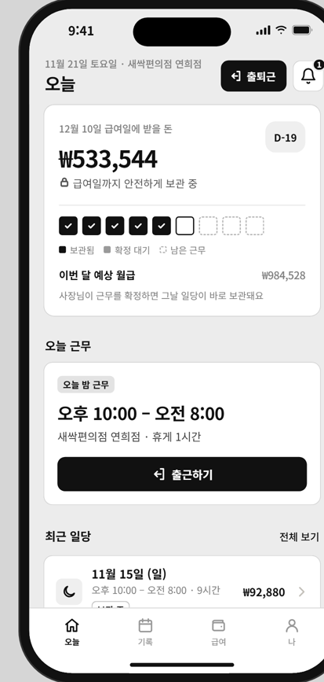
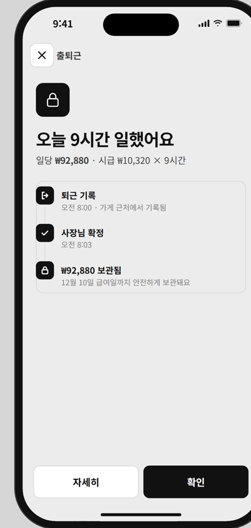

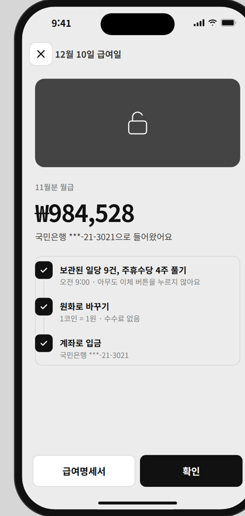
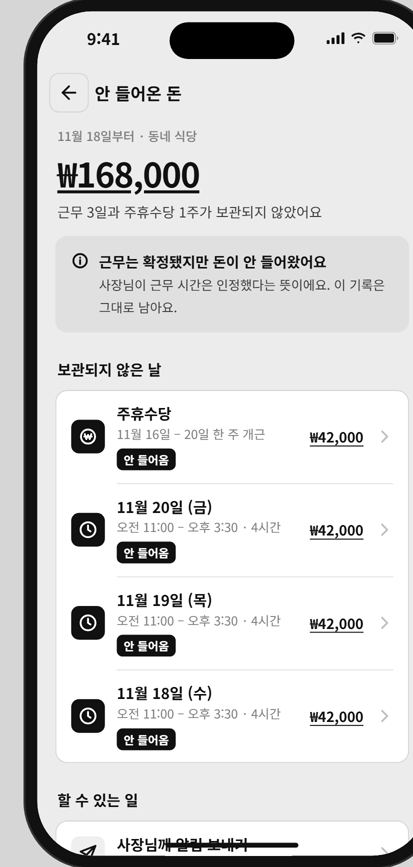

23화면 이미지는 `docs/screens/worker_v3/`에 있습니다.

## 4. 사장님 앱 (8화면)

| 화면 | 사장님의 질문 | 큰 숫자와 핵심 요소 | 이어지는 알바생 화면 |
|---|---|---|---|
| O1 근로계약 올리기 | 계약을 어떻게 맞게 올리지? | 시급 10,320원, 주 18시간, 주휴수당 주 37,152원이 자동으로 들어감, 급여일 매달 10일. A님이 동의해야 확정 | 01, 02, 03 |
| O2 오늘 | 오늘 처리할 게 뭐지? | 12월 10일에 나갈 인건비 533,544원이 이미 보관돼 있음, 확정 기다리는 퇴근 1건 | 04 |
| O3 퇴근 확정 | 이 퇴근 기록이 맞나? | 출근 오후 9:58, 퇴근 오전 8:00, 9시간, 일당 92,880원. 확정하면 바로 보관 | 07 |
| O4 시간 고치기 | 기록이 다르면 어떻게 하지? | A님 8:00 대 사장님 7:30, 30분 5,160원 차이, 이유 필수, A님께 바로 알림 | 10 |
| O5 이의 받음 | A님이 반대하면? | 정리될 때까지 87,720원만 보관, A님 기록으로 되돌리면 5,160원 추가 보관 | 11 |
| O6 보관함 | 보관할 돈이 모자라면? | 자동 보관, 잔액 450,000원, 다음 주 예상 인건비 222,912원. 하루 지나면 사장님께, 사흘째에는 알바생에게도 알림 | 16 ~ 21 |
| O7 급여일 | 급여가 제대로 나갔나? | A님 11월분 984,528원, 아무도 이체하지 않음, 급여명세서와 11월 장부 | 14, 15 |
| V1 기록 대조 | 이 기록이 진짜인가? | 원문과 해시 일치, 서명 2개, 고친 기록 1건. 로그인 없이 누구나 | 20 |

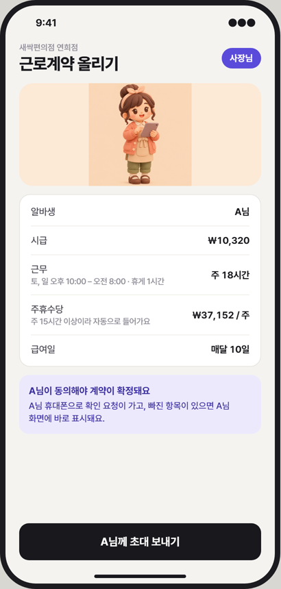
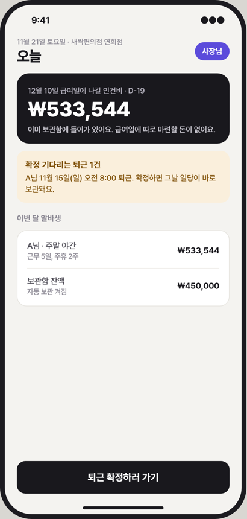

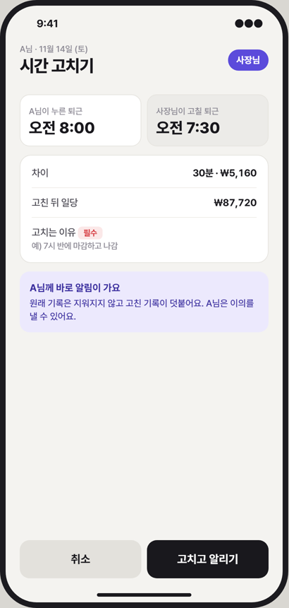

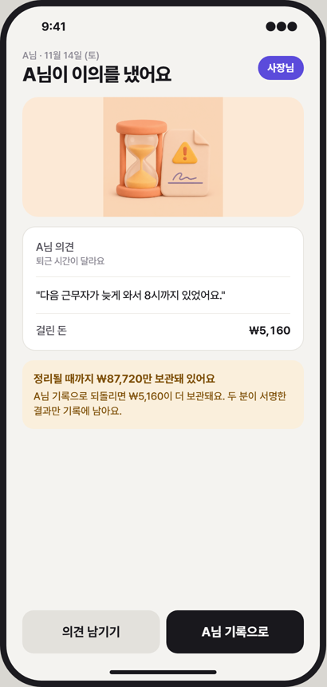
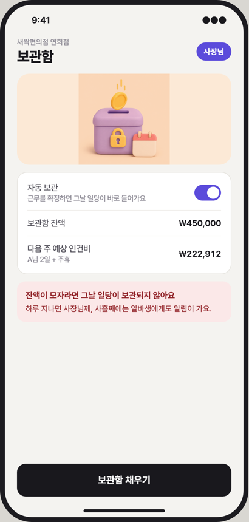
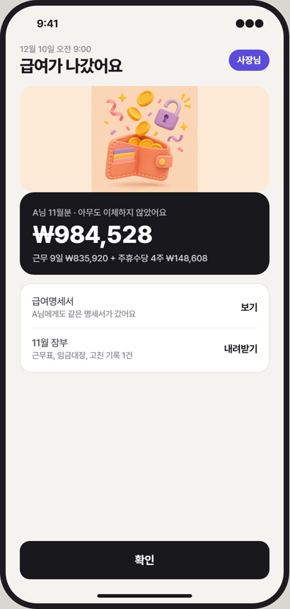
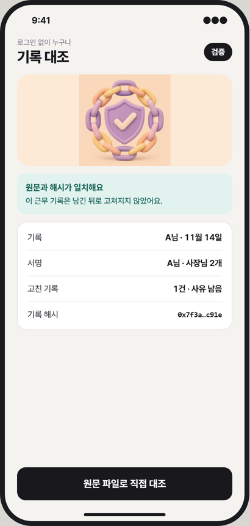

## 5. 시연 순서 (약 2분)

| 순서 | 화면 | 보여 줄 것 |
|---|---|---|
| 1 | 사장 O1 → 알바생 02 | 주휴수당이 빠진 계약은 알바생 화면에 바로 표시되고, 사장님 앱은 처음부터 주휴수당을 넣어 올림 |
| 2 | 알바생 05 → 07 | 가게 30m 안에서 출퇴근 |
| 3 | 사장 O3 | 퇴근을 확정하면 그날 일당 92,880원이 바로 보관 |
| 4 | 알바생 04 | 급여일에 받을 533,544원이 이미 보관돼 있음 |
| 5 | 사장 O4 → 알바생 10, 11 → 사장 O5 | 사장님이 퇴근을 30분 당기면 A님에게 알림이 가고, A님이 이의를 내면 다툼 금액만 따로 남음 |
| 6 | 알바생 14 | 12월 10일 오전 9:00, 아무도 이체하지 않았는데 984,528원 입금 |
| 7 | 알바생 16, 18 | 식당 B님은 사흘째 일당이 보관되지 않았다는 경고를 받음 |
| 8 | V1 | 검증 링크로 원문과 해시를 대조 |

## 6. 3D 에셋 목록

`docs/assets/3d/`에 있는 12장은 팀 커버와 같은 클레이 스타일로 생성했습니다. 화면과 발표 자료의 상단 그림으로 씁니다.

| 파일 | 장면 |
|---|---|
| 01_qr_checkin | 가게 QR로 출근 |
| 02_cosign | 두 사람이 서명한 기록 |
| 03_deposit | 그날 일당을 보관함에 넣음 |
| 04_lockup_jar | 급여일까지 보관된 돈 |
| 05_payday_wallet | 급여일 자동 입금 |
| 06_payslip | 급여명세서 |
| 07_store | 가게 |
| 08_worker | 알바생 |
| 09_owner | 사장님 |
| 10_chain_shield | 고쳐지지 않은 기록 |
| 11_pending | 확정 대기, 이의 |
| 12_daily_growth | 날마다 쌓이는 일당 |

공개 3D 아이콘이 더 필요하면 [3dicons](https://github.com/realvjy/3dicons)(CC0)를 씁니다.

## 7. 아직 정하지 않은 것

- 사장님 앱의 직원이 여러 명일 때 홈 화면 구성(지금은 A님 한 명 기준)
- 보관함 잔액이 모자랄 때 알바생에게 알리는 시점(지금은 사흘째)
- 이의가 정리되지 않을 때 급여일 처리(지금은 다툼 금액만 남기고 나머지는 지급)
- 기록이 노동청에서 어느 정도의 증거로 인정되는지
